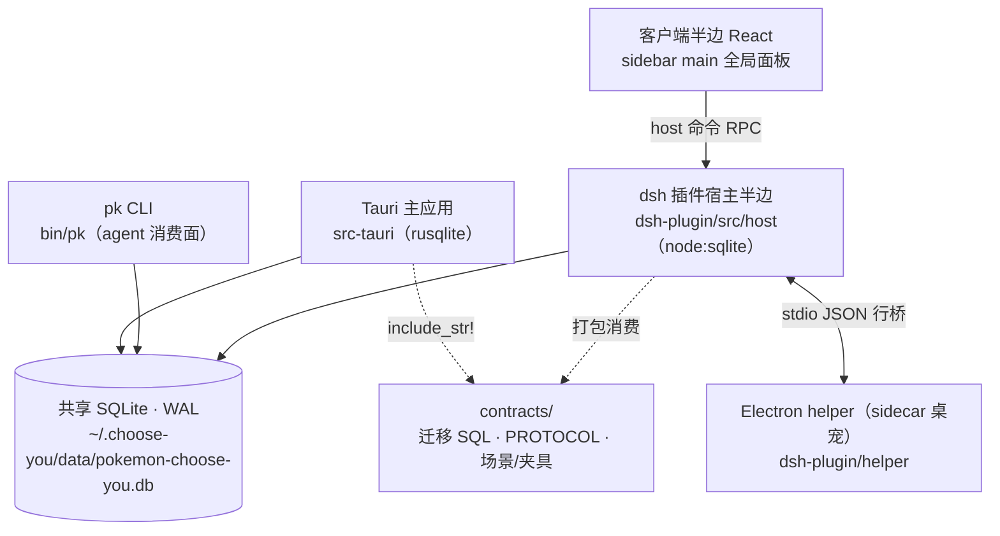

# 架构总览

> 跨模块架构速览：两形态布局、共享数据面、契约机制。模块内部约定见各目录 AGENTS.md；
> 历史重大决策见 `docs/decisions/`（ADR）；债务与待办见 `docs/debt.md`。

## 形态一：Tauri 桌面应用（主形态）

Vue 3 前端（`src/`，约定见 `src/AGENTS.md`）+ Rust 后端（`src-tauri/src/`，约定见根 `AGENTS.md`）：

- `commands/` Tauri 命令面（tasks/tags/radio·收音机判定与分诊/dispatch·派发/settings/diagnostics…）
- `db.rs` SQLite 迁移与连接（迁移 SQL 单源外置 `contracts/schema/`，只追加不修改）
- `scheduler.rs`/`events.rs` 提醒调度与前端事件广播；`feishu.rs`/`lark_cli.rs` 飞书轮询链路
- `ai/` agent CLI 无头调用与提示词；`anonymize.rs` 假名化；`bin/pk/` pk CLI（agent 消费面）
- 数据集中在本机归一化根 `~/.choose-you/`（库文件 `data/pokemon-choose-you.db`，`CHOOSE_YOU_HOME` 可重定位）

## 形态二：dsh 插件形态（第二形态）

同一套待办业务以 dsh（DeepSeek Harness 0.2.1-rc.2）Cordis 插件形态落地（`dsh-plugin/`，约定见
`dsh-plugin/AGENTS.md`），与主应用**长期双轨并存**：主应用正常演进，两形态面向同一份待办数据。
用户面说明见 `docs/USER_GUIDE.md` dsh 形态章节；并发与配置决策见
`docs/decisions/0001|0002`（ADR）。

### 双轨架构：同一 SQLite，三个直连方

- **零同步层**：三方（主应用 / pk / dsh 插件）直接连同一个库文件，WAL + busy_timeout + `BEGIN IMMEDIATE`
  短事务；并发正确性靠**消息级幂等**（claim/UNIQUE/CAS/槽表四原语）而非进程互斥（ADR-0001）。
- **双实现、单契约**：业务核心（任务状态机/判定协议/假名化/注入定界等）TS 重写进插件，与 Rust 实现
  钉在同一契约上——`contracts/scenarios/` 场景由 Rust（oracle）生成 `contracts/fixtures/` 锁定，
  TS vitest 回放逐字段比对，任一侧漂移即 CI 红（机制见 `contracts/PROTOCOL.md` §5、约定见
  `contracts/AGENTS.md`）。
- **schema 演化**：迁移 SQL 单源 `contracts/schema/`（只追加），双执行方 guarded 协议——插件迁移封顶
  minSchema、超窗只读拒写（`DB_SCHEMA_TOO_NEW`），「推库版本到更高」只由主应用执行（ADR-0001）。

### 插件包结构（host 各模块一句职责）

`dsh-plugin/src/host/`（package-by-feature，详见各模块 README）：

| 模块 | 职责 |
|---|---|
| `index.ts` | 插件 apply 装配：能力探测（node:sqlite 等）+ 兼容拒绝 + 惰性注册 |
| `storage/` | 全插件唯一握连接模块：WAL 连接、guarded 迁移（封顶 minSchema）、事务助手 |
| `domain/` | 纯逻辑核心：任务/派发状态机、建议分诊 CAS、审计、专注入账、背包词表、36 设置键面与提示词覆盖/修订检测 |
| `radio/` | timer 轮询（D14 分支 A，拉取步零 LLM）、水位 CAS、退避、lark-cli 子进程封装 |
| `anonymize/` | 假名化/还原（与 Rust 逐 fixtures 对齐，D17 群名不脱敏） |
| `judge/` | 判定编排：批次组装、claim 协议、执行方适配（无头 subagent / 外部 CLI）、强校验 |
| `dispatch/` | 派发链路：项目路由、无头/交互编排、worktree、SSH deployment 引用、`dispatch_slots` 并发槽、回传落库 |
| `pet/` | 桌宠 helper 生命周期监督、桥协议、任务状态事件流（≤2 秒变更侦听） |
| `health/` | 诊断快照、支持报告与日志查看器（共用三层脱敏管线）、运行日志环形缓冲（2000 条） |
| `i18n/` | 字典装载与三语键集校验（主应用字典 `@app-i18n` alias 直引） |

客户端半边 `src/client/`（React）：侧边栏「图鉴机」全局面板（sidebar main 槽）= SegmentNav 七段（冒险/草丛/路线/图鉴/收音机/日志/背包；原 plugins.detail.section 槽已摘除，详情页回归纯信息页），
背包八分区与主应用设置页同名同构（ADR-0002）。

### helper sidecar 模型

桌宠 OS 面不赌 dsh Desktop API：`dsh-plugin/helper/`（独立 Electron 子包）以 sidecar 进程承载——
透明置顶**局部小窗**（禁止全屏透明画布）、穿透翻转、置顶看门狗、宿主存亡绑定（宿主退 helper 10 秒内
自杀；helper 崩溃插件 10 秒内自拉起）。与宿主半边走 **stdio JSON 行桥**（协议单源 = `helper/README.md`），
Electron 运行时由插件侧探测下载 `~/.dsh/electron/`（首装离线 = 桌宠停用不弹窗，A20 降级路径）。
测试三形态：Electron 真窗体（开发机）/ `HELPER_HEADLESS=1`（CI）/ 生产 `dist/main.js`。
