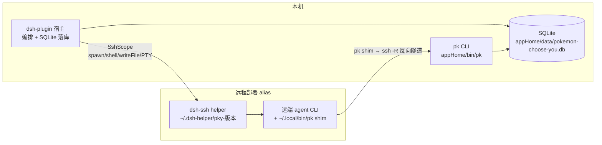
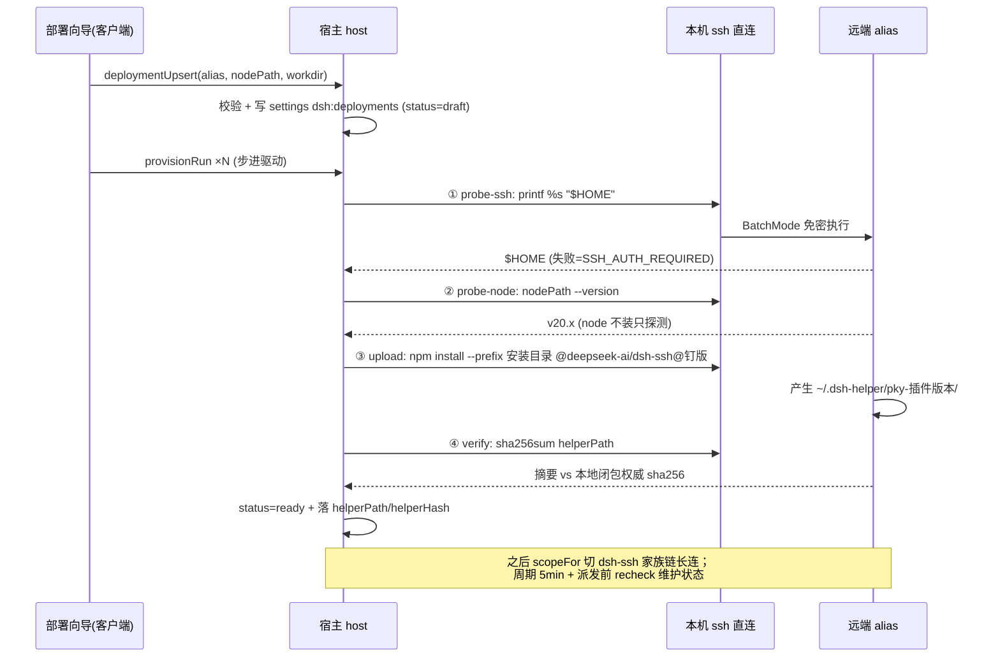
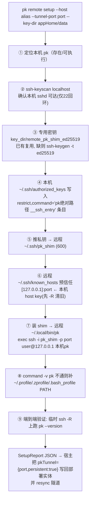
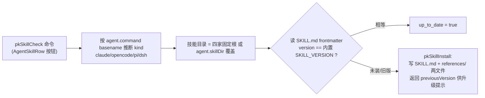
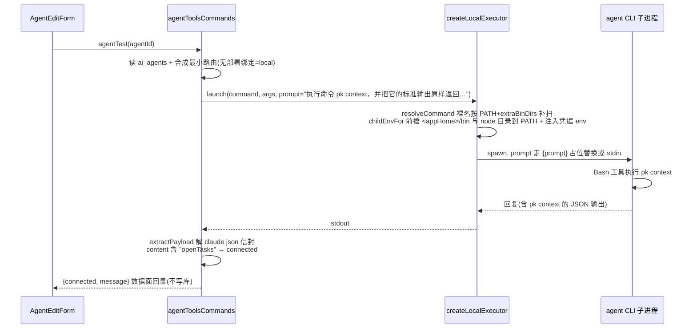
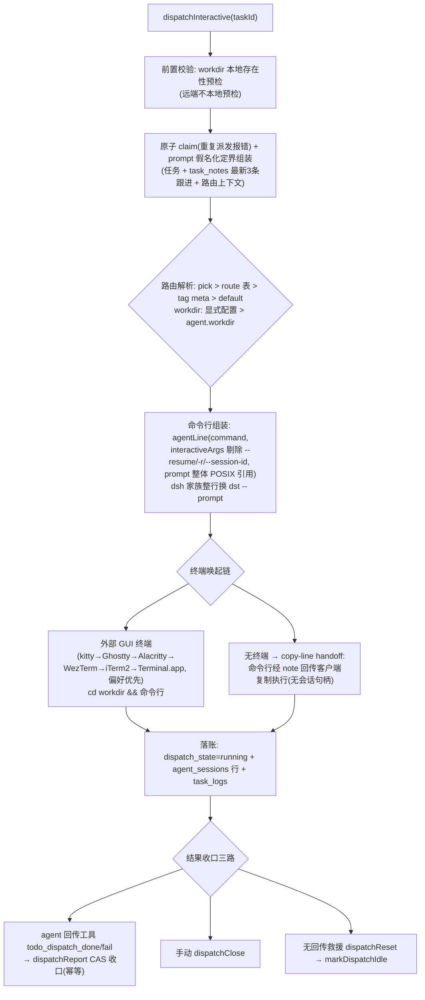
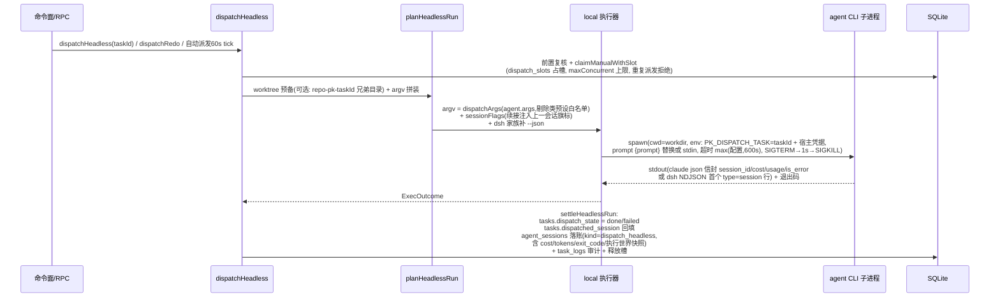
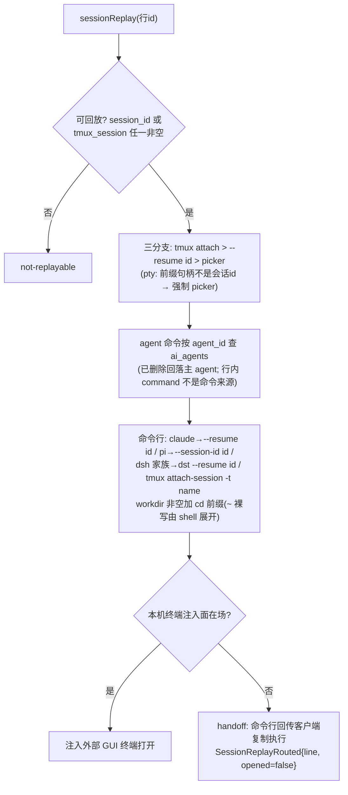
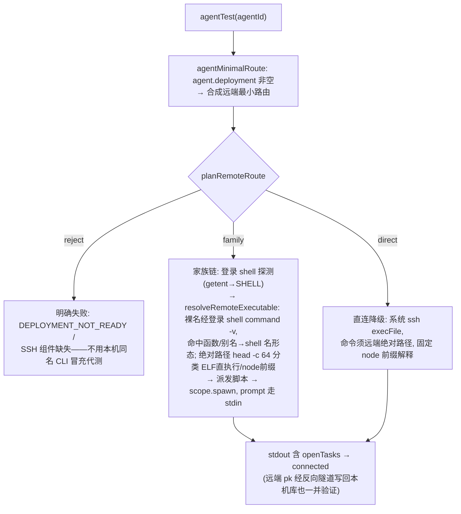
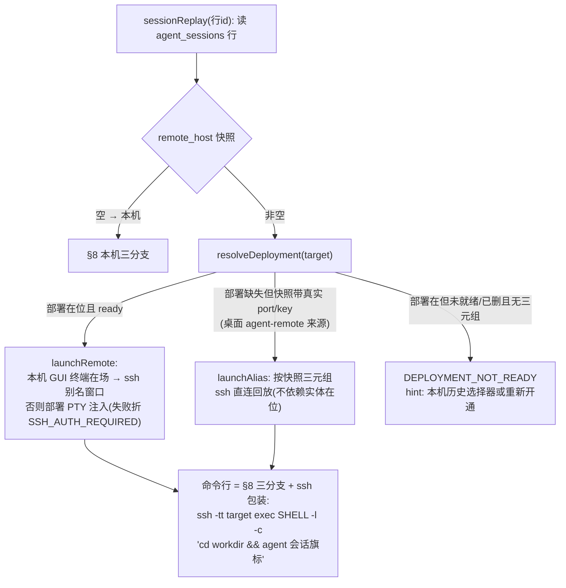

# agent CLI 交互机制全景（部署 · pk 通道 · 技能 · 测试 · 判定 · 派发 · 回放）

> 活文档：描述 dsh-plugin 宿主与 agent CLI（claude / dsh / dst / pi 等）交互的十二条链路
> （本地/远程 × 部署、pk 通道、技能、测试、判定、交互式/无头派发、回放），跟随结构变更同步。
> 桌面 Tauri 侧为双宿主同构实现，文末统一对照。
>
> 锚点纪律：优先按符号名/命令/路径 grep 定位；file:line 为梳理时快照（基准 2026-10-24，
> HEAD 8459ecc），随编辑允许悬空。

## 0. 公共基座（先读这节，后面各节都引用）

**角色分工**：dsh-plugin 宿主（Node）负责编排与落库；agent CLI（外部进程）负责推理与执行；
pk（Rust CLI，随插件 vendor 分发）是 agent 的"工具手"——agent 通过 Bash 工具调用
`pk context` / `pk suggest batch` 读写本机待办库。



**关键常量与单源**：

| 项 | 值 | 出处 |
|---|---|---|
| appHome | `$CHOOSE_YOU_HOME` 或 `~/.choose-you` | `dsh-plugin/src/host/storage/paths.ts:9-25` |
| 数据库 | `<appHome>/data/pokemon-choose-you.db`，settings 表键值 + tasks / chat_messages / agent_sessions / task_logs / dispatch_slots | `contracts/schema/001_v1.sql:36` |
| 部署实体 | settings 键 `dsh:deployments`（JSON map） | `dsh-plugin/src/host/remote/deployments.ts:21` |
| agent 配置 | settings 键 `ai_agents`（含 command / args / deployment 绑定 / workdir / skillDir / timeoutSecs） | `dsh-plugin/src/host/domain/settings.ts:136-183` |
| 派发路由表 | settings 键 `dsh:dispatch_routes` | `dsh-plugin/src/host/dispatch/routes.ts:19` |
| 写路径铁律 | 单条 `BEGIN IMMEDIATE` 短事务 | `dsh-plugin/src/host/storage/db.ts:31-51` |
| 会话账本 | `agent_sessions` 表（session_id / tmux_session / remote_host / workdir 执行世界快照）——**插件不产生任何会话 jsonl，转录由 agent CLI 自存** | `dsh-plugin/src/host/dispatch/sessions.ts:71-105` |

**执行器三链**（`planRemoteRoute`，`dsh-plugin/src/host/remote/sshExecutor.ts:95-125`）：
`local`（本机子进程）/ `family`（dsh-ssh 家族链长连，就绪后用）/ `direct`（系统 `ssh` 二进制降级直连）
/ `reject`（部署不可用）。

---

## 1. 远程部署（deployment + provision）

**流程**：设置页部署向导 → `deploymentUpsert` 落实体 → 客户端步进循环调 `provisionRun`
（四步幂等状态机，单次只执行下一步）→ 全过置 `ready` → 此后远端操作从直连 ssh 切到
dsh-ssh 家族链。



**读的配置**：`~/.ssh/config`（`sshAliasList` 枚举确定性别名，Include 递归展开，
`dsh-plugin/src/host/remote/sshConfig.ts:89-113`）；settings `dsh:deployments`；本地闭包
`lib/helper.js` 权威 sha256（`dsh-plugin/src/host/dsh/remoteAssembly.ts:30-38`）。
凭据零存储，全由 OpenSSH 别名承载。

**写的配置**：settings 键 `dsh:deployments`（实体字段：id / alias / nodePath / helperPath /
helperHash / workdir / status / provision{四步} / degraded / pkTunnel，`deployments.ts:24-78`）；
alias 改名级联 `ai_agents.deployment`。

**产生的文件**：远程 `<远端$HOME>/.dsh-helper/pky-<插件版本>/`（npm 安装
`@deepseek-ai/dsh-ssh`，helper 入口 `node_modules/@deepseek-ai/dsh-ssh/lib/helper.js`，
`provisionCommands.ts:54-62`）。本机无新文件（只有 SQLite 行）。

**执行的命令**（全部经 `ssh -o BatchMode=yes -o ConnectTimeout=10 -- <alias> '<cmd>'`，
`dsh-plugin/src/host/dsh/directScope.ts:80-113`）：

| 步骤 | 命令 |
|---|---|
| ① probe-ssh | `printf %s "$HOME"` |
| ② probe-node | `<nodePath> --version` |
| ③ upload | npm 探测（`[ -x <node目录>/npm ]` 否则 `command -v npm`）→ `PATH=<node目录>:$PATH npm install --prefix <安装目录> @deepseek-ai/dsh-ssh@<闭包版本>` |
| ④ verify | `sha256sum <helperPath>`（不符 → `HELPER_HASH_MISMATCH`，upload 重置 pending） |
| recheck（周期/手动/派发前） | `printf pky-ok` + `sha256sum <helperPath>`（`recheck.ts:41-119`） |
| delete | 远端 `rm -rf -- <安装目录>`（失败只留诊断不阻塞），再事务删记录 |

**状态机**：`draft → not_ready/installing → ready`；断连 → `disconnected`；恢复带
`recovered=true` 触发 lateReport（§10）。降级直连确认（D31）：仅"从未装过/摘要不符"两态
可显式确认 `ready + degraded=true`。

---

## 2. 开通 pk 通道

**目的**：agent 跑在远程、待办库在本机——让远端 `pk` 命令经 ssh 反向隧道安全地写回本机
SQLite。入口：部署向导「开通 pk 通道」→ host 命令 `deploymentSetupPk`
（`dsh-plugin/src/host/commands/remoteCommands.ts:185-202`）→ 宿主先把 vendor pk 落位本机
（`ensureLocalPk`：`vendor/pk-<triple>` → `<appHome>/bin/pk`，sha256 漂移重拷，
`pkLocal.ts:80-97`），再 spawn `pk remote setup`（超时 3 分钟，`PK_LOG_FILE` 指向共享日志，
`dsh-plugin/src/host/dsh/pkSetup.ts:59-78`）。

pk 内部九步幂等序列（`src-tauri/src/commands/remote_pk.rs:242-527`）：



**读的配置**：部署实体（alias / pkTunnel.port，缺省回落 10022）；`~/.ssh/authorized_keys`
（找旧条目原位升级）。

**写的配置**：本机 `~/.ssh/authorized_keys`（forced command 受限条目——私钥失陷也只能进
pk 的 `__ssh_entry` 入口，只认 `PK_*` 白名单 env + 本 pk 路径 + 参数，
`src-tauri/src/bin/pk/remote.rs:14-76`）；远程 `~/.ssh/pk_shim`、`~/.ssh/known_hosts`、
`~/.local/bin/pk`、登录 profile；settings `dsh:deployments.pkTunnel`。

**产生的文件**：`<appHome>/data/remote_pk_shim_ed25519(.pub)`；隧道锁
`<appHome>/tunnels/<部署id>/pid`。

**执行的命令**（宿主侧）：

- 开通：`pk remote setup --host <alias> --tunnel-port <port> --key-dir <appHome>/data`
- 隧道维持（TunnelSupervisor，按 `pkTunnel.persistent=true` 注册）：
  `ssh -N -R 127.0.0.1:<port>:127.0.0.1:22 -o BatchMode=yes -o ServerAliveInterval=10 -o ServerAliveCountMax=3 -o ExitOnForwardFailure=yes -o ConnectTimeout=10 -- <alias>`
  （`tunnelSupervisor.ts:37-55`）；退避 1s→30s，目录锁让位机制防多宿主互踩（`tunnelLock.ts:51-80`）。

**注意**：开通通道**不碰** AGENTS.md / 技能目录 / agent 配置——它只动 SSH 材料与部署实体的
`pkTunnel` 字段。

---

## 3. pk 技能的检查与安装

**目的**：把「如何用 pk」（`pk context` → `pk suggest batch` 工作流）的技能文档装进 agent
的技能目录，agent 才会主动用 pk。技能源单源内嵌编译（`?raw` 引同一批文件，
`dsh-plugin/src/host/skills-raw.ts:7-19`；Rust 侧 `include_str!`），当前
`SKILL_VERSION = "9"`（`src-tauri/src/skills.rs:9-22`）。



**读的配置**：`ai_agents`（command / skillDir，编辑表单草稿值优先，
`agentToolsCommands.ts:120-133`）；目标目录 `SKILL.md`。

**写的配置**：无（不落库，安装状态每次现读 frontmatter）。

**产生的文件**（安装时，`domain/skills.ts:112-128`）：目标技能目录
`~/.claude/skills/pokemon-choose-you/`（或 `~/.config/opencode/skill/…`、
`~/.pi/agent/skills/…`、`~/.dsh/skills/…`，其他 agent 走 `--dir` 技能根目录）下写
`SKILL.md` + `references/commands.md` + `references/suggest-workflow.md`。

**执行的命令**：无 shell 命令——纯文件读写。dsh-plugin 的检查/安装**只有本机分支**
（远程安装仅桌面 RPC：heredoc 脚本经 `ssh 'sh -s'` 落远端，末行哨兵
`PK_SKILL_INSTALLED <version>` 确认，`commands/skills.rs:223-245`）。`pk doctor` 会顺带
体检四家技能版本并给 `pk skill install <agent>` 修复建议。

---

## 4. 本地 agent CLI 测试（agentTest）

**目的**：一次性验证「命令可用 + PATH 里有 pk + pk 能读写数据库」。入口：agent 编辑表单
测试按钮 → `client.agentTest({agentId})`。



**读的配置**：`ai_agents`（command / args / timeoutSecs / deployment）；无部署绑定时本机
回落 `createLocalExecutor`。

**写的配置 / 产生的文件**：**均无**——结果只走数据面回显，不写库、不记健康
（`dsh-plugin/src/client/rpcTypes.ts:154`）。

**执行的命令**：探针不是 ping/echo，而是让 agent 真跑 `pk context`
（`agentToolsCommands.ts:24`）；判定 stdout 含 `openTasks` 即通。超时生效值
`max(配置, 600s)`（`executor.ts:59-61`）。有回复但无 pk 输出 → 白名单指引（如 claude 附加
`--allowedTools Bash(pk:*)`）。

---

## 5. 使用本地 agent CLI 进行判定（judge）

**核心机制——selfLanding（自主落库）**：宿主**不**把候选项交给 agent 选再解析输出，而是
系统提示词指示 agent 自己跑 `pk context` 拿上下文、推理后用 `pk suggest batch` 整批写库，
宿主从库回读。触发点：收音机每轮轮询有 pending 消息（`radio/pollLoop.ts:85-97`）、诊断面板
「立即重试」（retryJudge）、快速捕捉 captureTodo（桌宠/手动输入）。

```mermaid
sequenceDiagram
    participant PL as 收音机轮询 pollLoop
    participant OR as 判定编排 orchestrator
    participant CR as cliRun 本机 spawn
    participant AG as agent CLI 子进程
    participant PK as pk CLI
    participant DB as SQLite

    PL->>OR: judgePending(pending 消息, claim 抢占 10min 窗口)
    OR->>OR: im_classify 系统 prompt + 消息列表(AnonRules 假名化,<br/>同会话30min上下文≤10条,200字符截断)
    OR->>CR: buildAgentInvocation<br/>argv = agent.args 分词 + {prompt}替换(无占位走 stdin)<br/>claude/pi 追加 --session-id uuid, dsh 追加 --json
    CR->>AG: spawn(cwd=agent.workdir, PATH 前插 pk 目录, 超时 max(配置,10s))
    AG->>PK: ① pk context
    PK->>DB: 读 now/openTasks/categories/tags…
    PK-->>AG: 上下文 JSON
    AG->>PK: ② pk suggest batch --agent AGENT_ID <<'JSON' {"results":[…]} JSON
    PK->>DB: 整批校验后事务写 chat_messages 建议列
    AG-->>CR: 退出(stdout 只解 claude 信封/dsh session 行拿会话 id)
    CR-->>OR: 完成信号
    OR->>DB: 回读判定(零落库→报错; 校验失败→feedback 拼接回执行方修正重试≤2)
    OR->>DB: agent_sessions 落账(kind=classify, session_id, remote_host, workdir)<br/>+ ai_health 内存态记录
```

**读的配置**：`ai_agents`（判定执行方路由 `judgeExecutor=session|cli`，
`hostEntry.ts:53-68`）；chat_messages pending 行；task_notes（派发上下文用）；
`agent.workdir`（`~` 展开 + 存在性预检）。

**写的配置（库表）**：`chat_messages`——`ai_status`
（pending→judging→todo/update/followup/none/error）、`judge_claimed_at`、`suggested_*`
建议列（由 pk 写，宿主回读）；`agent_sessions`（kind=classify/capture）；`task_logs` 审计。

**产生的文件**：无专有文件（pk 的写入就是库行本身）。

**执行的命令**：宿主只 spawn agent CLI 一次（`judge/cliRun.ts:84-92`）；真正执行的两条命令
由 agent 自己发起：`pk context` 与 `pk suggest batch --agent <AGENT_ID> <<'JSON'`（系统提示词
`domain/prompts.ts:31-39`；pk 侧 `src-tauri/src/bin/pk/suggest.rs:129-171` 从 stdin 读
`{"results":[…]}`）。

---

## 6. 使用本地 agent CLI 进行交互式派发

**铁律**：不解析终端输出（A15）——命令注入终端后宿主只保持 `running`，结果靠 agent 主动回传。



**读的配置**：`ai_agents`；路由级联（pick / `dsh:dispatch_routes` / tag meta / default，
`routes.ts:138-157`）；`tasks.dispatched_session`（续接）；`terminal_preference`（终端偏好）。

**写的配置（库表）**：`tasks.dispatch_state`（→running）；`agent_sessions`（交互式本地无
会话句柄，回放走 picker）；`task_logs`。

**产生的文件**：无（会话转录由 agent CLI 自存在自己的目录）。

**执行的命令**：在所选终端里执行 `cd <workdir> && <agent> <args> '<prompt>'`（prompt 是
首条输入整体引用，不可信输入不裸拼，`dsh-plugin/src/host/dispatch/cmdline.ts:54-56`）；
dsh 家族为 `dst -- <prompt>`（`dstLaunch.ts:21-28`）。

---

## 7. 使用本地 agent CLI 进行无头派发



**读的配置**：`ai_agents`；`dsh:dispatch_routes` 与 tag meta（路由/workdir/maxConcurrent/
worktree）；`dispatch_max_concurrent` 全局；`tasks.dispatched_session`（续接）；凭据
（`DEEPSEEK_API_KEY` 等经 agentEnv 注入，`localEnv.ts:139-153`）。

**写的配置（库表）**：`tasks.dispatch_state`、`tasks.dispatched_session`、`agent_sessions`、
`task_logs`、`dispatch_slots`（租约行，超时+5min 过期自动回收）。

**产生的文件**：worktree 模式下本机兄弟目录 `<repo>-pk-<taskId>`（含分支）；无头本身无
其他专有文件。

**执行的命令**：本机子进程直接 spawn agent CLI（**没有 `-p/--print` 硬编码**——无头语义由
agent 配置 args 自带，如 claude 的 `--output-format json`；`headlessRun.ts:64`、
`executor.ts:98-105`）。失败判据 `超时 || error || 退出码≠0 || is_error`；claim 后任何抛错走
`containedFailure`（error 账本行 + failed + 删槽，不泄漏 running）。

---

## 8. 回放本地 agent CLI 会话

**数据源是账本行不是转录文件**：读 `agent_sessions` 行的句柄（session_id / tmux_session），
用 `--resume` 重新唤起 agent CLI。



**读的配置**：`agent_sessions` 行（sessionId / tmuxSession / workdir 快照）；`ai_agents`
（command / historyArgs——会话 id 注入位）。

**写的配置 / 产生的文件**：无——回放纯读，不动库不产文件。

**执行的命令**：`tmux attach-session -t <name>`，或
`cd <workdir> && <agent> <historyArgs 注入会话 id>`，或裸 `<agent>`（picker 分支，agent 自带
历史选择器）；dsh 家族 `dst --resume <id>`（`dsh-plugin/src/host/commands/replayRig.ts:53-64`）。

---

## 9. 远程 agent CLI 测试

与 §4 同一条 `agentTest` 探针（同款 `pk context` 提示词与判据），差异全在执行世界路由：



**读/写/文件**：同 §4（不写库、无文件）；额外读部署实体与 helper 状态。**前置**：家族链先
`recheckDeployment`（`printf pky-ok` + `sha256sum`），直连链 `sshCheck` 免密预检
（`ssh -o BatchMode=yes … true`，`sshCheck.ts:63-90`）。

**执行的命令**：远端登录 shell `<shell> -l -c '<派发脚本>'`（脚本形态见 §11）；探针语义与
§4 完全一致。

---

## 10. 使用远程 agent CLI 进行交互式派发

在 §6 编排（claim / prompt 假名化 / 命令行组装 / todo_dispatch_done 回传）之上，终端承载
换为三条远端链（装配判定 `sshExecutorDeps.ts:239-268`）：

| 链 | 条件 | 机制 |
|---|---|---|
| ssh 别名窗口 | 本机 GUI 终端在场（localSshWindow 注入） | 外部终端执行 `ssh -tt <alias> exec "$SHELL" -l -c '<载荷>'`，载荷 = `cd <远端workdir> && <agent 命令行 + prompt>`（`cmdline.ts:75-86`） |
| 远端真 PTY | 家族链在场、无本机终端 | `scope.spawnTerminal` 在远端起登录 shell，`writeTerminal` 注入命令行；**同任务重派查上一行 `pty:` 句柄写回同一 PTY**，原会话已关则新开（`sshExecutorTerminal.ts:72-91`） |
| copy-line | 都缺席 | 命令行回传客户端复制 |

**读的配置**：同 §6 + 部署实体（workdir：部署登记工作区**压过** agent.workdir，
`routes.ts:182-200`）。**写的配置**：同 §6，但 PTY 链会话句柄落
`agent_sessions.session_id = "pty:<handle>"`（回放据此走 picker）。**产生的文件**：无
（远程转录由 agent CLI 自存）。**执行的命令**：上面的 ssh 别名载荷或 PTY 注入行。

**远端特有——断连与迟到回传**：周期 recheck 发现断连 → guard 单事务把部署置 `disconnected`
并将该 hostKey 在途无头派发逐个收口失败（"未确认操作已拒绝、不自动重放"）；恢复时
lateReport 用 GNU `find -printf` 探测 workdir 与兄弟 worktree 的 mtime，窗口内有活动痕迹才
**纯 INSERT** 补录 1 行 task_logs + 1 行 agent_sessions
（`dsh-plugin/src/host/remote/lateReport.ts:119-160`，不改写失败结论）。

---

## 11. 使用远程 agent CLI 进行无头派发

与 §7 共用 `planHeadlessRun → executeAndSettle` 编排（占机器槽、信封解析、状态机全同），
执行核心换成 SSH 两链：

```mermaid
sequenceDiagram
    participant HD as dispatchHeadless
    participant GR as 部署前置 guard
    participant SC as 家族链 scope
    participant R as 远端登录 shell
    participant AG as 远端 agent CLI
    participant PK as 本机 pk (经隧道)

    HD->>GR: preflightDeployment<br/>(recheckDeployment: printf pky-ok + sha256sum;<br/>直连链 = sshCheck 免密预检)
    GR-->>HD: 通过(拒绝发生在 claim 前,不污染任务状态)
    HD->>SC: launchOverScope<br/>登录 shell 探测 + resolveRemoteExecutable(带缓存)
    SC->>R: spawn([shell, -l, -c, 派发脚本]), prompt 走 stdin 管道
    R->>AG: 脚本内容见下
    AG->>PK: pk context / pk suggest batch<br/>经 ~/.local/bin/pk shim + ssh -R 反向隧道写回本机库
    AG-->>SC: stdout 信封/事件流 + 退出码(超时=本机竞态计时+scope.timeoutMs 双保险)
    SC-->>HD: ExecOutcome → settle 同 §7<br/>(agent_sessions 如实记 remote_host)
```

**派发脚本**（`sshExecutorScope.ts:41-64`，逐 token POSIX 引用；prompt 不拼进脚本走 stdin）：

```sh
export PATH="$HOME/.local/bin:${PATH:-/usr/local/bin:/usr/bin:/bin}"  # REMOTE_PATH_BOOTSTRAP 单源
export PK_DISPATCH_TASK=<taskId>                                       # env 段(凭据同本地注入链)
cd <远端workdir> || exit 1                                              # worktree 模式则 cd 兄弟目录
exec <node前缀或空> <CLI绝对路径> <argv>                                 # ELF 原生二进制直执行;
                                                                       # node shebang 走 node 前缀
```

**读的配置**：同 §7 + 部署实体（家族链五元组
`{host=alias, node=nodePath, helper=helperPath, helperHash, workspace=workdir}`，
`sshScopeHost.ts:101-136`）。**写的配置 / 状态机**：同 §7（`agent_sessions.remote_host`
如实记录）。**产生的文件**：worktree 模式下远端兄弟目录 `<repo>-pk-<taskId>`（定位仓库根的
worktree 脚本经 ShellRunner 在远端跑）。**执行的命令**：家族链 `scope.spawn`（dsh-ssh helper
长连）；直连降级链为系统 `ssh -o BatchMode=yes -o ConnectTimeout=10 -- <host> '<脚本>'`，
且 agent 命令必须远端绝对路径、解释形态固定 node 前缀（`sshExecutorDirect.ts:44-54`）。

---

## 12. 回放远程 agent CLI 会话

复用 §8 的路由骨架，核心差异：**执行世界快照压过当前配置**（会话在哪台机器录的就回哪台，
`sessionsReplay.ts:221-226`）。



**读的配置**：`agent_sessions` 行（sessionId / tmuxSession / remote_host / remote_port /
remote_key / workdir 快照）；`ai_agents`（agent 命令，删除回落主 agent）；部署实体（就绪
判定）。**写的配置 / 产生的文件**：无（纯读唤起）。**执行的命令**：§8 三分支命令行再包
一层 ssh 别名窗口（`replayRig.ts:129-170`）；`pty:` 前缀句柄行强制走 picker 分支（远端 PTY
无法跨机 attach，就在目标机上打开 agent 自带历史选择器）。

---

## 附：桌面（Tauri）双宿主对照

桌面主应用与 dsh-plugin 共享同一套契约与 pk：判定管线 `src-tauri/src/ai/` +
`commands/radio/judge.rs`（同样 selfLanding，`TOOLS_SYSTEM_PROMPT` 禁止 agent 输出 JSON
文本）、部署/provision `commands/deployments.rs` 与 `remote_pk.rs`、技能
`commands/skills.rs`（多一个远程安装分支）、无头派发 `commands/dispatch/headless.rs`
（`DISPATCH_MIN_TIMEOUT_SECS=600` 同源）、回放 `commands/integrations.rs` resume_route
（dsh 侧行为基准）。差异点主要是交互承载（桌面自带终端/外部终端 vs 插件 copy-line/PTY）与
「用户手动无头不占槽」的有意分歧（dsh 形态一律占机器槽）。

一句话收束：**所有链路的"写"都收敛到 SQLite 单库 + 部署实体；"命令执行"收敛到三链执行器
（local 子进程 / dsh-ssh 家族链 / ssh 直连）；agent 的"手"收敛到 pk（本机直调或经反向隧道
shim）；会话的"回放"收敛到 agent_sessions 账本句柄重新唤起 CLI，而非读转录文件。**
