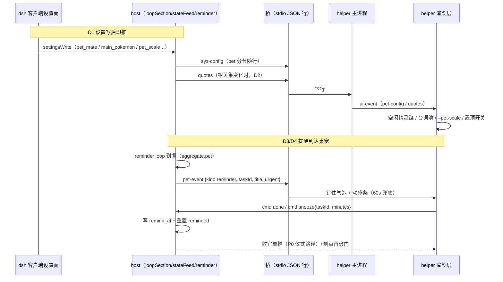

# Design

## Context

桥协议（`dsh-plugin/helper/src/bridge/protocol.ts` 单源）已有可选字段向后兼容增量先例（`task-state.caught`、`sys-config.pet`），旧端校验器丢弃未知字段不崩（NFR-14）；P0 已把完成仪式改为 host 收官单推驱动。当前卡点：host 写路径 `onWrites` 只推 task-state（sys-config 失活）；reminder loop 组装了 `PetReminderEvent` 但从未下发；窗口尺寸常量在 `windowConsts.ts` 硬编码三档。桌面 app（Vue/Tauri）是行为单源基准，方向单向 helper → 桌面。

## Goals / Non-Goals

**Goals:**

- 设置变更免重启生效（写后即推 sys-config + quotes）
- helper 空闲精灵/台词与桌面同链路（main_pokemon + pokemon_quotes 惰性下发）
- 提醒第一现场到桌宠（pet-event + urgent + 就近动作条 + snooze）
- 窗口行为可配（置顶/缩放/透明度），缩放与命中区几何一致
- 位置找回（建窗校验 + 设置面重置）、首启进度可见

**Non-Goals:**

- 桌面 app 侧行为改动（对齐方向单向）
- TTS 触发面扩展（生日/allDone 语音）、双宿主互斥、性能基线测量（归 P2/spike）
- 提醒聚合策略与勿扰逻辑变更（宿主侧既有 `aggregate.ts` 原样复用）

## Decisions

**D1 设置写后即推**：`loopSection.ts` / `assembly.ts` 的 `onWrites` 回调追加 `stateFeed.pushSysConfig()`——复用既有写后直推钩子，避免为设置另开通知面；任务写路径多推一条小 sys-config 属可接受开销。

**D2 mainPokemon 走 sys-config.pet、quotes 走独立下行消息**：`mainPokemon` 是单键低频变更，直接进 `sys-config.pet`（A2 已开先例）；`pokemon_quotes` 是按精灵 map，体量不可控，用独立下行消息 `quotes { map: Record<key, string[]> }` 惰性下发——host 在 `pushTaskState` / `republishAll` / sys-config 推送点计算「相关集」（main_pokemon + activeTask.categoryPokemon），与上次已发集比对，变化才发。深夜档（22–6）回退池是全局文案，进 helper 渲染层台词表（桌面 `pet.quotesNight` 同构），不走协议。

**D3 提醒事件复用 `PetReminderEvent` 组装、经新下行消息 `pet-event` 下发**：`reminder/deliver.ts` 的 pet 通道从「缺席丢弃」改为桥在位即发 `pet-event {kind:"reminder", taskId, title, urgent, pokemon}`；helper runtime 转发渲染层（新 UiEvent），渲染层 DialogBox 进「钉住 + 动作条」模式（60s 兜底计时、点击收起、新提醒替换旧提醒）。urgent 底态进 `petState.ts` 状态机（P0 已解除 U10 的文档位，此处实装：base urgent + 抖动类）。

**D4 snooze 上行走既有 cmd 面**：新增 cmd op `snooze {taskId, minutes}`（`CMD_OPS` + 校验器 + host `cmdHandler` 写 `remind_at = now + minutes`、`reminded = 0`）——不另开消息类型；「完成」按钮直接复用 `cmd done`（完成仪式路径 P0 已统一）。

**D5 窗口配置三键进 sys-config.pet、渲染层经 CSS 变量缩放**：`pet.alwaysOnTop / pet.scale / pet.opacity` 下行；helper 主进程按 scale 重算三档窗口尺寸（常量 × scale，resize 保持左上角锚定——与既有 quickSize/chatSize 同式）；渲染层根节点设 `--pet-scale`，stage/精灵/气泡/菜单以 `calc(… × var(--pet-scale))` 或 transform 等比缩放，`.hit` 命中区随元素几何自然联动（决策 5 要求）；opacity 作用于 `.pet-sprite` 与 `.dialog`。置顶看门狗读取开关（关 = `setAlwaysOnTop(false)` 且跳过重申）。

**D6 位置校验在 helper `placeWindow`、重置走 host→helper 复位事件**：建窗恢复 `--pos` 前用 `screen.getAllDisplays()` bounds 校验，越界回落默认位；「重置位置」rpc（host 清 `dsh:pet_pos` + 经桥发 `pet-event {kind:"reset-pos"}`），helper 主进程收到后 setPosition 回默认位——避免为一次性动作新开 IPC 面。

**D7 首启进度经轮询查询而非推送**：`electronGet` 维护阶段/进度状态（下载字节数可从 https 响应头累计），rpc `petSetupProgress` 返回 `{phase, percent} | null`；客户端设置面在 petStatus 行内轮询展示（1s），避免跨进程进度订阅的复杂度。

## Risks / Trade-offs

- **onWrites 追加 sys-config 推送**：任务高频写路径消息量增加（每写 +1 条小 JSON）；桥有丢弃容错与节流面，风险低，若实测过大再收敛为设置键白名单触发。
- **quotes 惰性集计算的时序**：main_pokemon 与 activeTask 都在相关集内，两条消息（sys-config 与 quotes）可能交错到达——渲染层以「精灵解析时查当前镜像」消费，无原子性要求。
- **pet-event 与 sys-notify 双通道并发**：同一条提醒既弹系统通知又敲门，桌面 parity 即如此；若用户嫌吵，后续可加通道偏好键（不在本 change）。
- **CSS 缩放与既有绝对定位**：`pet.css` 多处绝对像素（气泡 top 248px 等）需换算为 scale 感知，是一次性清扫成本；`.hit` 几何随元素自然缩放，但 4px 拖拽阈值等指针判定仍是逻辑像素，极端缩放下拖拽手感可能偏松/紧（可接受，后续实测调）。
