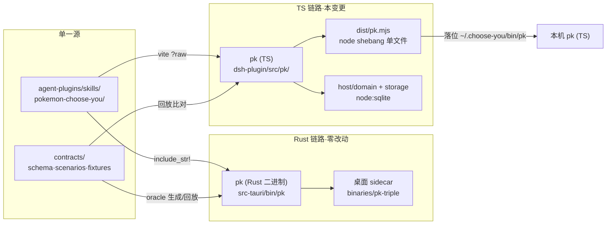
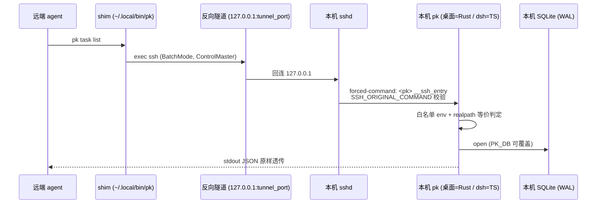

# Design

## Context

现状四个关键事实塑造本设计（动机见 proposal.md - Why）：

1. 技能文档已是「单一源、双消费」，只是源放错位置：Rust `include_str!`（`src-tauri/src/skills.rs:9-20`）与 dsh-plugin vite `?raw`（`src/host/skills-raw.ts`）内嵌同一批文件；版本单源为 md frontmatter，但 Rust 侧留有人工常量镜像（`SKILL_VERSION = "9"`）。
2. dsh-plugin 对 Rust pk 的依赖极薄：vendor 二进制唯一 spawn 点是 `pk remote setup`（`src/host/dsh/pkSetup.ts`）；宿主数据操作全走 TS 自有 storage + domain，且该两层已通过全部 contracts 场景回放（`__tests__/contracts/`）。
3. remote 家族为 Rust 单源（ADR-0003 §3）：九步幂等开通（`src-tauri/src/commands/remote_pk.rs:242-527`）、forced-command 入口 `__ssh_entry`（`src-tauri/src/bin/pk/remote.rs:14-149`）、shim 模板生成。关键约束：authorized_keys 的 forced-command 指向「本机落位的 pk」——dsh 场景落位的正是 TS pk，故 `__ssh_entry` 必须随宿主形态 TS 化，这不是可选项。
4. pk CLI 的 stdout JSON 形状无任何契约层锁定（Rust 各命令手拼 `serde_json::json!`），双实现一致性需要新契约面。

约束：桌面 Tauri 链路（sidecar `binaries/pk`、`setup_deployment_pk`、`prepare-pk-cli.mjs`）零行为改动；contracts 迁移 SQL 只追加；Rust oracle 生成 fixtures 不得手改。

## Goals / Non-Goals

**Goals:**

- dsh-plugin 单次构建即产出全部能力（含 pk），构建链解绑 cargo。
- pk 命令面双实现（Rust/TS）对外行为一致，漂移可被机器检出。
- agent 消费面资产归属中立化（`agent-plugins/`），版本彻底单源。

**Non-Goals:**

- 桌面 Tauri 切换 TS pk 或 Rust pk 退役（双实现为终态，见 ADR-0006 要点）。
- 技能文档内容的重写或扩充（搬家不改内容）。
- pk 接入 dsh SshScope 家族链（setup 阶段远端 family 未 provision，且 pk 须零平台面依赖）。
- `agent-plugins/` 承载技能以外的新资产类型（只留目录空间，不预造结构）。
- TS 实现 SSH 远端技能安装分支（Rust 桌面分支独有，dsh 场景不需要）。

## Decisions

### D1 资产搬家与版本单源化

`git mv src-tauri/skills/pokemon-choose-you.md agent-plugins/skills/pokemon-choose-you/SKILL.md`（references 随迁），消费方只改引用路径：Rust `include_str!("../../agent-plugins/skills/...")`、vite raw 路径。Rust `SKILL_VERSION` 常量替换为 `LazyLock` 运行时解析内嵌 MD frontmatter（复用既有 `frontmatter_version()` 解析逻辑），消除人工镜像；`pk doctor`/`skill install` 的版本对比逻辑不变。新增 `agent-plugins/AGENTS.md` 记不变量（单源、双内嵌、frontmatter 版本唯一源）。
*备选*：保留常量并加 CI 断言常量==frontmatter——仍有两处真相，弃。

### D2 TS pk 模块架构：`dsh-plugin/src/pk/` 顶层 + 零平台面依赖

结构对齐 `bin/pk/`：`main.ts`（argv 分发器 + help/COMMAND_INDEX）+ 按域拆件（`task.ts`、`suggest.ts`、`remote.ts`、`skill.ts`、`doctor.ts`、`context.ts` 等）+ `cli.ts`（输出信封：pretty JSON、`{"error":...}` 到 stderr、退出码）。

- 数据面命令 import `src/host/domain/` + `src/host/storage/`（契约回放已证可脱离 dsh 运行时工作）。
- 硬约束 **pk 依赖图零 `dsh/`、`radio/`、`dispatch/` 平台面模块**：构建期以 esbuild metafile 生成依赖图清单，测试断言清单不含平台面路径前缀（机器检，不靠约定）。
- remote 的 ssh 编排在 `src/pk/` 内自持最小实现（`child_process` execFile `ssh`/`ssh-keygen`/`ssh-keyscan`，对齐 `ssh_run` 的 BatchMode/超时/kill 语义），不 import host 侧任何 SshScope 设施。

*备选*：逻辑放 `src/host/pk/` 并由 host 复用——pk 不是宿主进程的一部分，且会诱导平台面依赖渗入，弃。

### D3 CLI 信封契约组：oracle spawn 真二进制，比对字段树

- 场景：`contracts/scenarios/cli_envelope/<command>.json`（输入：argv + 场景库种子数据 + env 覆盖），每命令至少一条，shim 生成等纯文本命令同样入组。
- Rust oracle：集成测试经标准机制 `CARGO_BIN_EXE_pk` 取已编译 pk 二进制，设 `PK_DB` 指向 harness 按场景准备的库，spawn 捕获 stdout/退出码，归一化（时间戳类 `<ts:N>`、版本号 `<pk-version>`、绝对路径 `<home>`）后写 `fixtures/cli_envelope/`（`UPDATE_FIXTURES=1` 再生）。对 `bin/pk/` 零重构。
- TS 回放：vitest spawn `node dist/pk.mjs`（同 env 注入），解析 stdout 为 JSON 后与 fixtures **逐字段比对字段树**（不比字节串——serde_json 与 `JSON.stringify` 的键序与缩进天然不同）；纯文本命令（skill show/remote shim）做归一化后字符串比对。
- 双侧完备性断言沿用既有口径：执行场景数 == 场景目录文件数。

*备选*：CI 内双实现对拍——时间戳/路径归一在拍点上重复做且无落盘基线，漂移不可追溯，弃。

### D4 remote 家族 TS 化要点

- 九步 setup 逐步移植（定位 pk/ssh-keyscan 探测/ed25519 密钥幂等/authorized_keys 四形态收口/私钥 stdin 推送/known_hosts 改写/shim 落 `~/.local/bin/pk`/登录 shell PATH 验证/端到端验证 + ControlPersist master 收尾），SetupReport 结构（camelCase `ok/steps[]/version`）不变；`ssh_run` 语义（BatchMode、step timeout、到期 kill）以 execFile + AbortController 等价实现。
- `__ssh_entry`：shlex 子集解析器按 Rust 版语义移植（单/双引号、反斜杠、零展开、畸形即拒）；env 白名单同表；程序 token 等价判定 = `fs.realpathSync` 消解后比较；「以 argv 直启自身」= spawn `process.execPath`（node）+ 自身脚本路径 + argv，不经 shell；拒绝退出码 78。
- Windows 分支对齐：authorized_keys 写入走 `icacls` 子进程（node 无原生 ACL API）、路径转义（反斜杠加倍）、shim 的无 env 段形态、落位 `pk.cmd`（`@node "%~dp0pk.mjs" %*` 包装）。

### D5 构建分发与落位切换

- esbuild 新入口 `src/pk/main.ts` → `dist/pk.mjs`（ESM 单文件、target 与 host bundle 同代、banner 注入 `#!/usr/bin/env node`、`define` 注入 `process.env.PK_CLI_VERSION = package.json version`）；`package.json` files 增 `dist/pk.mjs`。
- `pkLocal.ts` 的 `ensureLocalPk()`：拷贝源从 `vendor/pk-<triple>` 改为 `dist/pk.mjs`，落位 `~/.choose-you/bin/pk`（Windows 落位无扩展名脚本 + 生成 `pk.cmd`），sha256 漂移重拷逻辑不变；PATH 注入与 `pkSetup.ts` 的 spawn 调用形态零改动。
- `build.mjs` 删除 vendor 拷贝段（198-221）与 `vendor/` 目录；`scripts/prepare-pk-cli.mjs` 保留（仅服务桌面 sidecar）。

### D6 ADR-0006 要点（取代 ADR-0003 §3 单源结论）

- 决策：远程开通（setup/shim/`__ssh_entry`）从「Rust 单源、dsh 经 pk 子命令复用」改为「按宿主双实现」——桌面 Rust、dsh-plugin TS。
- 理由：①forced-command 指向本机落位 pk，`__ssh_entry` 必须随宿主形态走（技术必然）；②隧道/让位锁已是双实现同构协议（`tunnelSupervisor.ts` ↔ `tunnel.rs`），非开先例；③dsh-plugin 单次构建全能力分发的形态目标。
- 漂移缓解：CLI 信封契约组（D3）+ SetupReport 入信封场景。
- ADR-0003 头部加 superseded 注记指向 0006，原文不改。

### 架构图

构建分发链与运行时消费链（变更后）：

远端 agent 调用链（`__ssh_entry` 落在落位 pk 上，双宿主等价）：

## Risks / Trade-offs

- [双实现行为漂移（信封/域语义）] → CLI 信封契约组锁 stdout；域语义既有 contracts 组继续双侧回放；oracle 再生即 TS 红。
- [目标机无 node 或版本过低] → 与 dsh 宿主自身运行前提一致（host 已用 `node:sqlite`，node ≥ 22）；`pk doctor` 增补 node 环境检测项（见 Open Questions）。
- [shim/`__ssh_entry` 字节级与语义级偏差（引号转义、退出码）] → shim 文本入信封场景逐字锁定；`__ssh_entry` 拒绝路径逐 Scenario E2E 覆盖。
- [Windows ACL/icacls 分支无自动化验证环境] → 四形态收口与 icacls 参数移植做单测（命令行构造断言），真机手工验收记入验收清单。
- [阶段④（remote 家族）工作量集中] → 五阶段独立可交付，④完成前 vendor 链路仍可用（⑤才切换），无中间态断档。
- [双宿主先后开通互相搬移 authorized_keys 条目] → 既有四形态收口语义原样保持，不新增行为；design 注明，ADR-0006 提及双宿主共存模型。
- [pk bundle 体积膨胀（误引平台面/全量 domain）] → esbuild metafile 依赖图 guard（D2）+ 产物尺寸基线入质量棘轮观察。

## Migration Plan

五阶段顺序合入（tasks.md 展开），每阶段 lint-gate 全绿：

1. 资产搬家与双消费方适配（独立可交付，先行合入）。
2. CLI 信封契约组 + Rust oracle fixtures（先锁基线，TS 实现有靶）。
3. TS pk 数据面命令 + 信封回放绿。
4. TS pk remote 家族（setup/shim/`__ssh_entry`）+ 对应信封场景。
5. 分发切换：build 产 `dist/pk.mjs`、落位改造、vendor 删除、pkSetup 验证。

回滚：阶段⑤合入前任意回退无用户可见影响；⑤后回滚 = git revert 恢复 vendor 拷贝段与落位逻辑（TS pk 与 vendor 在④前并存，切换点单一）。

## Open Questions

- `pk doctor` 是否为 TS pk 场景增加 node 可用性检测项（不改变既有检查语义，仅增补）——实施阶段④时定。
- esbuild metafile 依赖图 guard 落为独立测试还是 build 内断言——实施阶段⑤时按构建时长影响定。
