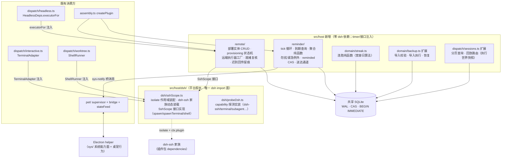
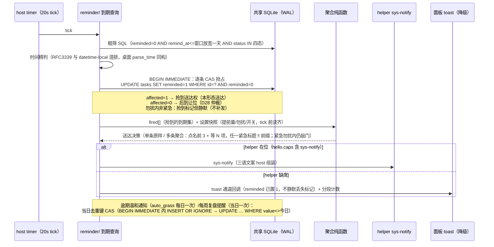
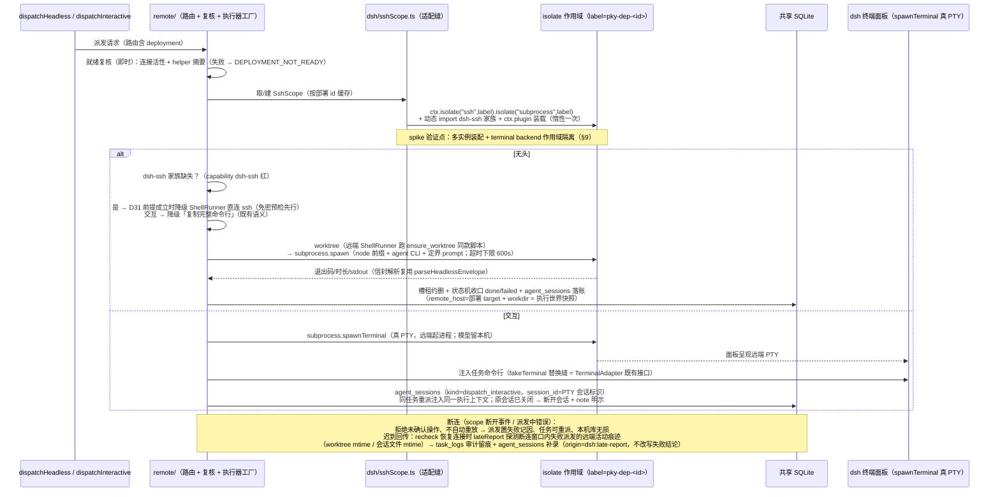
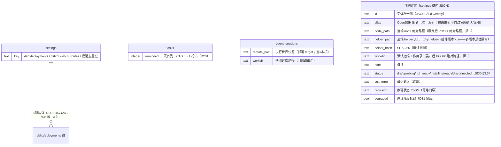

# dsh-plugin 独立形态全量补齐 + dsh 原生 SSH 远程派发 · 架构设计文档 (AD)

> 输入：本目录 `requirements.md`（SDD，D21–D32 已就地决策）、本目录 `design.md`（三轴选型 1a/2a/3a）、
> 前序 `specs/dsh-plugin/architecture.md`（架构连续性基准，决策 A1–A24）、`dsh-plugin/` 现行代码实读
> （hostEntry 装配 / remoteService / commands.ts 69 命令面（7986072 增 petStatus）/ storage migrate / dispatch 全家 /
> pet bridge / helper 子包与桥协议 / build.mjs / package.json / vite.config.ts）、
> `contracts/PROTOCOL.md`（§1 迁移、§2 错误码 15 枚举）+ `contracts/schema/`（001/002）。
> dsh 平台事实（dsh-ssh 家族 0.1.6-alpha.1 / dsh-subprocess seam / cordis 4.0.4 isolate）已由任务输入
> 实测核实，本文不作重新考证。**架构连续性铁律：本 AD 是前序 AD 的增量演进，不推翻前序任何已落地
> 决策；与前序冲突处仅限 SDD 明示翻案项（D22 键盘红线、D28 并发仲裁、D29 迁移封顶语义）。**

## 1. 架构决策概要

核心决策三句话：

1. **系统能力全部收编进既有 helper sidecar**（方案 1a）：托盘/快捷键/通知/TTS/对话框/输入计数作为
   helper 内部 `sys/` 模块族，经既有 stdio JSON 行桥协议扩展承载（hello 能力位协商 + 未知消息显式
   拒绝），不新增进程、不新增原生依赖面（唯一新原生依赖 uiohook-napi 隔离在单文件、prebuilds 分发）。
2. **远程派发 = 每部署一个 isolate 作用域内动态装载 dsh-ssh 家族**（方案 2a 主路径）：插件包
   dependencies 钉版携带 dsh-ssh/dsh-subprocess-ssh，`DispatchExecutor`/`ShellRunner`/`TerminalAdapter`
   三个既有抽象缝新增远端实现（全部经 `SshScope` 接口注入，业务核心保持零 dsh 依赖）；首实施任务为
   spike（§9），失败切 2b 回流。
3. **零新表、零 003 迁移**：deployment 实体存 settings 键 `dsh:deployments`（与 `dsh:dispatch_routes`
   同形态），执行世界快照复用 `agent_sessions` 现有列组合，跨形态提醒仲裁复用 `tasks.reminded` 既有列
   （CAS 化写入）；D29 迁移封顶语义改造 = migrate.ts 常量语义 + 发版同版断言，行为零变化。

**架构特性排序（冲突时按序取舍）**：

**平台演进韧性（alpha 隔离在薄适配层）> 数据一致性（跨形态仲裁 / 断连不损库）> 独立分发完整性（干净
profile 全功能）**

- 平台演进韧性压倒功能丰富度：dsh-ssh 家族是 **0.1.6-alpha.1**（RC 期最高风险面），一切 SSH 家族
  触碰收口在 `src/host/dsh/sshScope.ts` 单文件适配缝（§3.4）；isolate API、spawnTerminal 契约变更时
  只改该文件 + spike 结论重验；
- 数据一致性压倒性能与便捷：跨形态提醒/复盘去重一律库内 CAS 抢占（宁可让位不重复送达），断连路径
  不自动重放（宁可转失败可重派），迟到回传只留痕不改写（§4.7）；
- 独立分发完整性压倒实现捷径：schema/字典/helper 产物/技能文档 100% 随包内嵌（NFR-12），外部依赖
  缺失 0 静默（全部降级提示 + 指引）。

## 2. 技术栈选择

前序栈全部沿用（node:sqlite / 无 ORM / Cordis 插件 / Vitest / 共享字典直引）。本特性新增选型：

| 层级 | 技术 | 版本基线 | 备选与否决理由 |
|------|------|----------|----------------|
| SSH 传输与远端进程托管 | **`@deepseek-ai/dsh-ssh` + `@deepseek-ai/dsh-subprocess-ssh`**（+ dsh-fs-ssh 按需），插件包 `dependencies` 钉版 `0.1.6-alpha.1`；构建保持 external（`@deepseek-ai/*` 既有口径），运行时从插件包 node_modules（file: 安装产物）解析 | 0.1.6-alpha.1 | ① 插件自管 OpenSSH（方案 2c 全量）：无 PTY 终端集成、进程托管/断连/清理全自研，只保留为降级链；② 每部署一个 dsh profile（方案 2b）：每台远端常驻一个 dsh 进程、多实例共享库需 primary/worker 互斥，仅作 spike 失败后备（D23 授权）；③ 要求用户在 dsh 侧手工装载 SSH 家族（不随插件分发）：违背 NFR-12 独立安装 0 静默半工作，仅作为包解析失败时的指引文案面 |
| SSH 家族装载方式 | **运行时动态 `import()` + `ctx.plugin()` 应用到 per-deployment isolate 作用域**（惰性：首个远程部署开通时才装载） | cordis 4.0.4 `ctx.isolate(name, label?)` | ① cordis.patch.yml 静态追加 dsh-ssh 组件：宿主启动期即装载 SSH 家族（违背 NFR-8 冷启动惰性），alpha 升级需重发 patch，否决；② 直接在插件 apply 顶层作用域装载单实例：dsh-ssh 是部署级单连接设计，多部署需 isolate 分 fork（spike 验证点①），否决 |
| 全局输入钩子 | **uiohook-napi**（helper 主进程 dynamic import，只累计事件计数；prebuilds 覆盖 Node/Electron 多 ABI） | 最新稳定（prebuilds 分发；**钉当前最新稳定版并于实施首任务锁定具体版本号**） | ① Electron 内置 globalShortcut：只有注册组合键回调、无全局输入事件流，无法实现 cps 计数，否决；② iohook / node-global-key-listener 等旧库：不维护或平台覆盖不全，否决；③ 不做（维持 D4 降级）：与 SDD「全部补齐」冲突且 D22 已换新红线，否决。**ABI 失配兜底**：dynamic import try/catch，失败 = 输入响应降级不可用 + 设置卡提示，不崩 helper（§4.4） |
| Electron 运行时按需获取（D30） | **`@electron/get` 严格校验模式**（`pet/electronGet.ts` 薄封装：官方获取库——无 postinstall、内建 npmmirror 镜像回落/本地缓存/checksum；Electron 稳定版钉版常量 + **校验值 = 构建期内嵌 sha512 常量**（源出官方 releases——**镜像回落只换 URL 不换校验源**）+ 原子落位 `~/.dsh/electron/`；离线给手动放置指引） | Electron 稳定版钉版常量 + @electron/get 当前稳定版 | ① 依赖 npm `electron` 包的 postinstall 下载：postinstall 不可控（dsh 安装安全性）+ 拉整棵依赖树，否决；② 强制要求用户预装：违背「独立安装全功能」，仅作离线指引文案；③ 自研轻量下载器（原案）：下载/校验/镜像/缓存/解压全自研面重复官方库能力、供应链自证弱，**否决——改用 @electron/get**（官方单源 + 严格校验模式覆盖校验诉求） |
| 提醒调度载体 | **host 内 timer tick（20s）+ helper 通知送达**，判定/聚合/勿扰全在 host 纯函数（与桌面 scheduler.rs 逐场景对齐，契约夹具锁定） | — | ① 调度判定放 helper：helper 缺席时提醒静默丢失（违背 FR-A3 降级不丢提醒），否决；② 复用桌面 scheduler：桌面 app 零改动铁律（SDD §8），dsh 侧必须自持同构实现 |
| 部署实体存储 | **settings 键 `dsh:deployments`（JSON，id→实体 + alias 唯一索引——同一性裁决见 §5.2/A25）**，整读-改-整写（A24 模式复用） | — | contracts 003 新表 `deployments`：桌面零改动铁律下引入「桌面必须迁移却零消费」的表结构 + Rust oracle fixtures 会强迫桌面实现同款 domain 行为（违反契约面单一语义），且 deployment 无 SQL join 需求（路由联接在 routes.ts 解析层），否决——详见 §5.2 |
| 遥测 | 无（延续 NFR-2） | — | — |

## 3. 系统模块与组件树

### 3.1 宿主半边模块图（增量；前序 §3.1 模块全部沿用）



### 3.2 模块挂点表（新模块 → 职责 → 依赖约束）

| 新模块/挂点 | 职责 | 平台面约束 |
|---|---|---|
| `src/host/reminder/`（query.ts / aggregate.ts / loop.ts / deliver.ts） | 到期查询（桌面 scheduler.rs 同构 SQL：窗口放宽一天粗筛 + 时间精判）/ 聚合与勿扰纯函数（点名前 3 + 等 N 项 + ‼ 前缀、跨零点、start==end 视为关、解析失败 fail-open）/ 20s tick 编排（timer 注入）/ 送达通道抽象（helper `sys-notify` 优先、缺席降级面板 toast + 分段计数回调） | 零 dsh；timer 注入；**CAS 原语见 §4.6** |
| `src/host/reminder/daily-keys.ts` | 逾期温和通知（auto_grass 每日一次）与每周复盘提醒（当日一次）的当日去重键 CAS 抢占 | 零 dsh |
| `src/host/domain/backup.ts` 扩展（每日备份循环 backupLoop） | **D33（主会话契约收敛新增）**：独立分发后桌面每日备份循环无执行者（NFR-12 静默缺席 = 0 精神）——host timer 承接每日自动备份：30min 惶 + 跨天判定（读 `last_backup_date` ≠ 今日才执行）+ **备份成功后**才条件写键 `UPDATE settings SET value=<今日> WHERE key='last_backup_date' AND value<><今日>`（affected=1 即当日已备份；写键失败不回滚已成功备份——下轮读旧值自愈重跑；「失败下轮重试」按此时序成立：键未写 = 下轮必重试，杜绝「先烧键、备份失败后当日恒不重试」）+ 空库不备份（tasks+chat_messages = 0 跳过）+ prune 滚动保留 `backup_keep`（默认 7 下限 1）；跨形态同窗竞态双备份 = **良性事件**（A36——重复文件仅多占滚动保留一档）；复用既有 backupRun 实现与 `backupList` 呈现面，**无新命令**；UIUX U35「备份执行——作用于主应用」badge 撤销（§12 A36） | 零 dsh；timer 注入 |
| `src/host/remote/deployments.ts` | 部署实体 CRUD（settings 键 `dsh:deployments` 整读-改-整写；字段见 §5.2）；移除时关连接（回调注入）+ 远端自清理尽力执行（结果只留诊断） | 零 dsh（SshScope 接口注入） |
| `src/host/remote/provision.ts` | 开通向导幂等状态机（探测→安装→校验，§4.5）；步骤结果持久化在部署实体内；**全部远端命令组装走引号全量引用**（NFR-11 静态断言） | 零 dsh |
| `src/host/remote/sshExecutor.ts` | `DispatchExecutor` 远端实现工厂（消费 `SshScope.spawn`）；`resolveExecutable` 前缀远端 node 路径 | 零 dsh（接口消费） |
| `src/host/remote/recheck.ts` | 就绪复核（周期 + 派发前即时）：连接探测 + helper sha256 复核；失败置「连接断开」并留最近错误；**连接恢复时触发迟到回传核对**（§4.7） | 零 dsh |
| `src/host/remote/lateReport.ts` | 断连窗口内失败派发的远端活动痕迹探测（worktree mtime / 会话文件 mtime）→ 审计留痕 + agent_sessions 补录（**不改写失败结论**） | 零 dsh |
| `src/host/dsh/sshScope.ts` | **唯一 dsh-ssh 触碰点**：per-deployment `ctx.isolate("ssh", label)` + isolate("subprocess", label) 作用域创建、dsh-ssh 家族动态 import + `ctx.plugin()` 装载、连接生命周期托管、断开事件回调；导出平台中立 `SshScope` 接口（spawn / spawnTerminal / shell / **writeFile** / disconnect / connected；writeFile = helper 制品上传原语——spawn `cat > <path>` + stdin 管道灌内容，字节安全、零命令行拼接，写毕远端 sha256 复核，§4.5 步③） | 适配缝（coverage exclude 同 `src/host/dsh/**` 口径） |
| `src/host/dsh/probeDsh.ts` | capability 键真实探测（§4.9）：`dsh-ssh` = 动态 import 可解析 + 导出面形状；`dsh-terminal`/`dsh-subagent`/`dsh-worktrees` = ctx 表面探测；结果进 diagnosticsSnapshot + 诊断段 | 适配缝 |
| `src/host/domain/streak.ts` | 连胜纯函数（本地自然日去重、宽容日 = 1、今日未完成不算断、回溯上限 400 天、输出 {days, todayCount}）——对齐桌面 `streak_conn`，**契约夹具新场景组锁定**（§6 NFR-16） | 零 |
| `src/host/domain/backup.ts` 扩展 + `commands/backupCommands.ts` 扩展 | 导入结构校验（导出文件 schema 为契约）→ 前置自动备份（D25）→ 整体替换（秘钥与提示词覆盖行不随导入覆盖）→ onWrites 刷新；恢复 = 前置备份 + 迁移补跑 + 默认分类补种 + 超窗口拒绝 | 零 |
| `src/host/dispatch/sessions.ts` 扩展 | `sessionsPage`（分组过滤 all/radio/dispatch/other、limit 钳 1–100 默认 20、offset、id 倒序、counts 不随翻页变）+ `sessionReplay` 回放路由（按执行世界快照：`remote_host` 空 = 本机终端唤起、非空 = 对应部署唤起；快照压过当前配置） | 零（唤起经 TerminalAdapter / SshScope 注入） |
| `src/host/pet/electronGet.ts` | Electron 运行时按需获取（`@electron/get` 严格校验模式薄封装——探测链失败 → 下载/校验/解压/原子落位，校验值 = 构建期内嵌 sha512 常量、镜像回落只换 URL 不换校验源；离线指引文本返回） | 零 dsh |
| `src/host/pet/` 扩展（sys 桥消费 + macAuth） | 桥协议新消息的 host 侧消费面（tray-action/shortcut-fired/dialog-result/input-activity/mac-auth-result）；`macAuthorizationStatus` 查询；郑重时刻判定（完成动作发生形态 → `tts-speak`） | 零 |
| `src/host/commands/` 扩展（remoteCommands.ts 新文件 + 既有分域扩展） | §4.1 新增 17 条命令实现 | 零 |
| `helper/src/sys/`（tray / shortcuts / notify / tts / dialogs / inputCount / openPath） | 系统能力模块族（Electron 稳定 API：Tray/globalShortcut/Notification/dialog/shell/speechSynthesis + uiohook-napi dynamic import）；headless 模式 = no-op 记录器（CI fake 扩面） | Electron API（非 dsh 面） |
| `helper/src/state/` + `renderer/` 扩展 | 桌宠行为补齐：坐栖（底边 ≤72 逻辑像素判定）、时刻台词（生日>深夜>周五晚>整点优先级）、连胜演出（双球三摇）/里程碑（互不叠加）、陪跑、生日彩蛋、打盹问候、AI 聊聊对话框（≤4 行原位框，问题经桥 `cmd.pet-chat` 回传 host → 主 agent 执行方，回答截前 2 句经 `chat-reply` 下发） | 纯 helper 内 |

> **AGENTS.md 同步义务**：`dsh-plugin/AGENTS.md` 铁律「平台面只在 `dsh/ pet/ dispatch/` 适配缝」更新为
> 「`dsh/ pet/ dispatch/ remote/(经接口注入)`」——`remote/` 目录整体零 dsh import，dsh 触碰收口在其
> 注入的 `dsh/sshScope.ts`；实施时同步 README 与 `src/host/README.md` 挂点清单。

### 3.3 客户端半边（增量组件，结构归 UIUX，此处只定数据契约挂点）

插件页面 SegmentNav 七分段维持；新增视图挂点：任务表单 `TaskCreateModal`（消费 `taskCreate`）、
SessionsView 扩展分页/回放入口（`sessionsPage`/`sessionReplay`）、设置·Agent 分区扩展「远程部署」管理卡
（`deploymentList/Upsert/Delete` + 开通向导步进 UI 消费 `provisionRun/Status`）、设置·通用分区导入恢复
确认流（`importValidate/importRun/restoreRun` + helper 对话框选择）、桌宠分区输入响应授权卡
（`macAuthorizationStatus` + 共享键）。托盘菜单/通知文案为 helper 面（host 组装三语经桥下发）。

### 3.4 Electron helper 子包（系统能力 sidecar 化）

- **进程模型不变**：单 helper 主进程（每宠一窗）+ stdio 桥 + 宿主存亡绑定（FR-P1 自愈口径复用）；
  系统能力全部挂 helper 主进程（Tray/globalShortcut/Notification/dialog/speechSynthesis 均为主进程 API）。
- **内部分模块防一锅粥**：`sys/` 每能力一文件、各自独立启停（host 经 `sys-config` 下发启停面）；
  输入计数 `inputCount.ts` 为唯一原生依赖挂点（uiohook-napi dynamic import + 授权检测 + 撤销即停）。
- **分发物变更（D30 / debt ⑥）**：`dsh-plugin/package.json` `files` 增 `"helper"`（构建产物 `helper/dist`
  随插件包分发；`build.mjs` 构建顺序先 helper 后 host——实施细节见 §7.3）；electron 运行时按需获取
  （§2 表）；**electronGet 落位事实（7986072 后探测链）**：hostEntry 的 electron 探测已改为
  `node_modules/electron/dist/<平台真实二进制>`（绕开 `.bin/electron` wrapper——kill 落在 wrapper 上
  不带走 Electron 会产生孤儿窗口；darwin = `Electron.app/Contents/MacOS/Electron`），`~/.dsh/electron/`
  回落链含 `dist/<distBin>` 候选——**electronGet 解压落 `~/.dsh/electron/dist/` 目录形态即被探测链
  直接命中**，无需额外适配；**helper 载体缺席时系统能力面降级提示不静默**（诊断段 + 设置卡报错行 +
  页内 toast 兜底）。
- **RC 期破坏性变更面**（§11 风险）：helper 的 Electron API 面为稳定 API，非 alpha 面。

## 4. 关键接口定义

### 4.1 host 命令契约表（新增 17 条；既有 69 条零改动）

命令面总量 **69 → 86**（基线 = 7986072 后实数 69，含新增 petStatus）。响应统一 `{ ok, data? }` / `{ ok: false, error: { code, message, hint? } }`
（PROTOCOL §2）；全部写命令库超窗时先撞 `DB_SCHEMA_TOO_NEW`（不逐行重复）。除注明外均同步返回。
错误码增量见 §4.2。

| 域 | 命令 | 参数 | 响应 data | 业务错误码 |
|---|------|------|-----------|-----------|
| 部署 | `deploymentList` | — | `{ deployments: DeploymentView[], counts: { ready, pending, broken } }`（View = 实体字段 + 就绪状态 + 最近错误 + provisioning 步骤状态） | — |
| | `deploymentUpsert` | `{ id?, alias, nodePath, workdir, note?, confirmAliasRefs?: boolean }`（**实体以 id 为唯一键、alias 唯一索引**（§5.2/A25）；alias = OpenSSH 别名；nodePath/workdir = 远端绝对路径，**显式拒收 `~` 前缀**——实体只存展开后 POSIX 绝对路径，§4.5 路径不变式；alias 改名且被 `dsh:dispatch_routes` 引用时须携带 `confirmAliasRefs:true` 级联更新路由 ref，否则拒绝并列出受影响路由） | `{ deployment }` | 参数校验错（空别名 / 别名重复 / 路径非绝对或含 `~` 前缀 / 改名被路由引用未确认） |
| | `deploymentDelete` | `{ id }` | `{ id, cleanup: { attempted, ok, detail? } }`（关连接 + 远端 helper 托管目录自清理尽力执行，失败不阻塞） | — |
| | `deploymentRecheck` | `{ id }` | `{ deployment }`（手动触发就绪复核：连接探测 + 摘要复核） | 复核失败不报错——结果落实体状态呈现 |
| | `provisionRun` | `{ id }` | `{ status: ProvisionStatus }`（**单次只执行下一未完成步骤并同步返回该步结果**——步骤间客户端驱动，匹配 provisionStatus 轮询呈现与幂等续跑；单步 SSH 操作秒级~十秒级，通道超时按单步声明；已完成步骤跳过） | `SSH_AUTH_REQUIRED`（免密探测步）/ `PROVISION_STEP_FAILED`（probe-node / upload / verify 执行失败步，含 `step` 字段）/ `HELPER_HASH_MISMATCH`（摘要校验步——拒绝就绪不降级直连） |
| | `provisionStatus` | `{ id }` | `{ status: ProvisionStatus }`（向导呈现：各步骤结果 + 失败步 + 可重试标记） | — |
| | `deploymentDegradeConfirm` | `{ id, acknowledgedRisk: true }` | `{ deployment }`（摘要不符部署转 ShellRunner 直连，**须显式确认并留痕诊断段**——D31；未经确认直连态不可达） | 状态前置错（部署从未出现摘要不符 / 未安装即跳过场景外） |
| 导入恢复 | `importValidate` | `{ path }` | `{ summary: { app, schemaVersion, counts, compatible } }`（结构校验只读预检） | `IMPORT_VALIDATION_FAILED`（app 字段不符 / 结构坏 / **文件 >100MB 大小上限** / **解析深度超限**——整体拒绝不动库；两道上限防恶意/损坏文件拖垮 host，复用同码） |
| | `importRun` | `{ path, confirmed: true }` | `{ result: { backupId, applied: 变更计数 } }`（**前置自动备份 → 整体替换 → onWrites 刷新**；秘钥与提示词覆盖行不随导入覆盖） | `IMPORT_VALIDATION_FAILED`（含大小/深度超限，同 importValidate 口径）/ `BACKUP_FAILED`（前置备份失败即中止，不执行替换——D25）/ 参数错（confirmed 缺失） |
| | `restoreRun` | `{ source: { backupId? , path? }, confirmed: true }`（path **显式继承桌面文件名白名单**：`pokemon-choose-you-` 前缀 + `.db` 后缀匹配、拒 `/` 与 `\`——桌面 `is_backup_name` 同款） | `{ result: { backupId, migratedTo, seeded } }`（恢复前自动备份 → 恢复 → 补跑迁移 + 默认分类补种 + **恢复后补写当日 `last_backup_date`**——防恢复回滚日期标记后 backupLoop 当日再跑，桌面 commands/backup.rs:59-63 先例） | `BACKUP_FAILED` / `IMPORT_VALIDATION_FAILED`（备份文件坏 / 文件名不符白名单）/ `DB_SCHEMA_TOO_NEW`（备份 user_version 超插件窗口——只读保护语义延伸到恢复通道，复用码） |
| | `exportDirOpen` | — | `{ ok, path }`（helper 文件管理器定位 `<数据目录>/exports/`，不存在先建） | `HELPER_CAPABILITY_MISSING`（helper 缺席 → hint 给路径供复制） |
| 图鉴 | `streakInfo` | — | `{ days, todayCount, nextMilestone? }`（连胜纯函数直读） | — |
| 任务 | `taskCreate` | `{ title, note?, categoryId?, priority?, due?, remindAt?, scheduledFor?, tagIds? }`（title 必填 trim 非空；分类缺省第一个启用分类；优先级默认 normal；状态 = 排期?scheduled:inbox；标签全量替换关联；写任务审计 + onWrites） | `{ task }` | 参数校验错（空标题 / 分类不存在 / 标签不存在） |
| 会话 | `sessionsPage` | `{ group?: all\|radio\|dispatch\|other, limit?, offset? }`（limit 钳 1–100 默认 20；未知分组按 all；id 倒序） | `{ rows: SessionRow[], counts, total }`（counts 汇总不随翻页变化） | — |
| | `sessionReplay` | `{ rowId }` | `{ routed: { world: "local" \| { deploymentAlias }, note? } }`（按落库执行世界快照路由：本机 = dsh 终端面板唤起 agent 回放（tmux attach 优先 → `--resume` 会话 id → agent 自带选择器兜底）；远端 = 对应部署唤起；**快照压过当前配置**） | `DEPLOYMENT_NOT_READY`（快照指向的部署已删/未就绪——hint 给替代（本机回放或重新开通））/ `DISPATCH_LAUNCH_FAILED`（复用：本机回放时 dsh-terminal 缺失——hint 给降级指引）/ `SSH_AUTH_REQUIRED`（复用：远端回放免密/连接失败——择一落定为此码） |
| 飞书 | `larkLoginStart` | — | `{ ok, note }`（dsh 终端会话注入 `lark-cli`（已初始化 → `auth login`；未初始化 → `config init` 接 `auth login`）；登录态查询沿用既有 `larkTest`/`larkAuth`） | `DISPATCH_LAUNCH_FAILED`（复用：终端注入失败，hint 确认 dsh 终端面板可用） |
| 桌宠 | `macAuthorizationStatus` | `{ kind: "accessibility" }` | `{ granted: boolean, helperPath: string }`（helper 查询系统辅助功能授权状态 + 定位 helper 二进制路径——授权引导卡数据面） | `HELPER_CAPABILITY_MISSING` |

**命令命名约定**：camelCase、与既有 69 条同风格；`HOST_COMMAND_NAMES` 单源扩容 + 装配完整性断言
（commands.ts 既有机制）。**events 推送面零新增**：导入恢复六类变更刷新沿用既有 onWrites →
stateFeed → 客户端重拉路径（拉式数据面维持 PkyRemoteService `call` 单通道）；provisioning 向导进度 =
客户端步进驱动（provisionRun 同步返回 + provisionStatus 呈现），不新开推送通道。

**既有命令响应面增量（主会话契约收敛 · 签名不变）**：`diagnosticsSnapshot` 响应追加三字段——
`helperCaps`（hello.caps 能力位矩阵——UIUX 诊断段能力矩阵行数据源）、`shortcutRegistered`（启动期
注册结果，失败才显行）、`sshFamily`（dsh-ssh 家族探测 + 缺失指引标志 = `capabilities.dsh-ssh` 的
呈现投影，§4.8 合并声明）。托盘「设置」动作**复用既有 `pageOpen(section:"settings")` 链**
（`petSection.ts` 现行已支持——零契约变更，A37 事实修正；tray-action 链消费）。向前兼容：旧客户端
忽略未知字段。

### 4.2 错误码增量表（PROTOCOL §2 追加，15 → 21；只追加不修改）

| code | 语义 | 典型触发 | SDD 溯源 |
|---|---|---|---|
| `DEPLOYMENT_NOT_READY` | 部署非就绪态（未开通 / 断开 / 摘要不符）的派发/回放/连接操作前置拒绝 | 远程派发前、sessionReplay 路由 | FR-RD1/RD2、FR-C2 |
| `PROVISION_STEP_FAILED` | 开通向导单步失败（error.data 附 `step: probe-ssh\|probe-node\|upload\|verify`） | provisionRun | FR-RD2 |
| `HELPER_HASH_MISMATCH` | 远端 helper SHA-256 摘要不符——拒绝就绪、不降级直连（转直连须 `deploymentDegradeConfirm` 显式确认留痕） | provisionRun 校验步 / 就绪复核 | FR-RD2、NFR-11、D31 |
| `HELPER_CAPABILITY_MISSING` | helper 未运行 / hello 能力位缺失——系统能力面该能力降级提示（不静默） | exportDirOpen、macAuthorizationStatus、通知/TTS 降级诊断 | FR-X9-4、NFR-12 |
| `IMPORT_VALIDATION_FAILED` | 导入/恢复文件结构校验失败——整体拒绝、0 行变更 | importValidate/importRun/restoreRun | FR-A5 |
| `BACKUP_FAILED` | 恢复/导入前自动备份失败——中止操作 | importRun/restoreRun | FR-A5、D25 |

> 复用声明：恢复超窗口版本拒绝复用 `DB_SCHEMA_TOO_NEW`（同一兼容窗口判定语义）；免密探测失败复用
> `SSH_AUTH_REQUIRED`；终端注入失败复用 `DISPATCH_LAUNCH_FAILED`。

### 4.3 helper 桥协议扩展（helper/README.md §桥协议单源同步扩展）

版本协商（NFR-14）：**`hello.caps` 能力位**扩展为系统能力位集（`"sys-tray"` / `"sys-shortcut"` /
`"sys-notify"` / `"sys-tts"` / `"sys-dialog"` / `"sys-open"` / `"input-count"` / `"mac-auth"`）；
host 缓存 hello、按能力位降级（缺位不发对应命令 → 页内降级通道）。**发送门控：host 未收到 hello 前
禁发任何 sys 消息**——hello 到达即有能力位快照，关闭「能力位缺失但消息已发」的竞态窗口（NFR-14
验收 = hello 门控 + ack 超时双机制，§6）。

| 方向 | 消息 | 数据结构 | 溯源 |
|------|------|----------|------|
| 插件 → helper | `sys-config` | `{ tray?: { tooltip }, shortcuts?: { capture: "CmdOrCtrl+Shift+K", togglePet: "CmdOrCtrl+Shift+D" }, inputResponse?: { enabled, focusHopCoupleMax? }, tts?: { enabled } }`（启停 + 三语不在此——文案 host 组装） | FR-A1/A2/A9 |
| 插件 → helper | `sys-notify` | `{ kind: reminder\|pomo-done\|pomo-chime\|overdue\|review, title, body }`（**三语文案 host 组装**——与桌面 notification_text/aggregated_notification_text 同源；通知点击无动作） | FR-A3/A4 |
| 插件 → helper | `tts-speak` | `{ text }`（文本已按桌面口径剥 emoji 截 120 字符；仅郑重时刻、默认静音由 `sys-config.tts.enabled` 控制；失败 helper 静默） | FR-A7、D26 |
| 插件 → helper | `dialog-request` | `{ mode: "open-file", filters?: { name, extensions[] }[], seq }`（导入/恢复选文件；helper 收到即秒级回 `dialog-ack {seq}` 回执——seq 两段语义第一段，见下双向兼容语义） | FR-A5 |
| 插件 → helper | `dialog-cancel` | `{ seq }`（host 侧取消通道：面板确认流放弃/会话关闭时下发；helper 关闭对应系统对话框并丢弃该 seq 的迟到结果） | FR-A5 |
| 插件 → helper | `open-path` | `{ path }`（打开导出目录；不存在 host 先建再下发） | FR-A6 |
| 插件 → helper | `mac-auth-query` | `{ kind: "accessibility", seq }`（helper 收到即秒级回 `mac-auth-ack {seq}` 回执——同型两段语义） | FR-A9 |
| 插件 → helper | `chat-reply` | `{ text, ok }`（AI 聊聊回答：截前 2 句；失败 `ok:false` 气泡回退） | FR-A8 |
| helper → 插件 | `tray-action` | `{ action: open\|pet-toggle\|settings\|quit }`（quit = helper 连同桌宠与托盘退出，宿主不受影响；`settings` 经既有 `pageOpen(section:"settings")` 链） | FR-A1 |
| helper → 插件 | `shortcut-fired` | `{ id: capture\|togglePet }`（capture → host 经 pageOpen 链聚焦收音机快捕框；注册失败时 helper 不发——降级提示经诊断面） | FR-A2 |
| helper → 插件 | `notify-clicked` | `{ kind }`（观测留痕；无动作语义） | FR-A3 |
| helper → 插件 | `dialog-ack` | `{ seq }`（**回执级**：收到 dialog-request 的秒级回执；host 以 ack 超时（10s）判能力在位——超时按 `HELPER_CAPABILITY_MISSING` 降级，**不与用户交互时长耦合**） | FR-A5、NFR-14 |
| helper → 插件 | `dialog-result` | `{ seq, canceled, paths?: string[] }`（**完成级**：不设短超时（≥5min 长超时兜底）——用户在系统对话框停留任意时长不触发降级；host 侧取消走 `dialog-cancel`） | FR-A5 |
| helper → 插件 | `mac-auth-ack` | `{ seq }`（mac-auth 同型回执级 ack；超时判能力在位） | FR-A9、NFR-14 |
| helper → 插件 | `mac-auth-result` | `{ seq, kind, granted }`（完成级；授权中途撤销 → helper 停止计数并主动上报 `granted:false`） | FR-A9 |
| helper → 插件 | `input-activity` | `{ cps }`（≥1s 节流回传；**仅计数**——键值/键名/窗口标题/应用名 0 出 helper 计数模块） | FR-A9、NFR-13 |
| helper → 插件 | `cmd`（op 扩展） | 增 `pet-chat`（text = 问题 ≤200 字符，host → 主 agent 执行方，任务快照假名化入上下文）；历史内存 3 条不持久化（helper 侧自持） | FR-A8 |
| helper → 插件 | `sys-unsupported` | `{ type }`（适用域 = helper 认识该消息类型但**能力位声明与实现失配**（未来版本错位）的兜底上报：每类型节流一次 + 计错进诊断。**旧 helper 不认识 sys-unsupported 本身**——对旧 helper 发未知消息只能被其「丢弃 + 计错」；「提示升级 helper」信号源以 host 侧能力位缺失 / ack 超时为准） | NFR-14 |

**双向兼容语义（NFR-14 落地机制 = hello 门控 + ack 超时双机制）**：
- **发送门控**：host 未收到 hello 前禁发任何 sys 消息（hello 到达即有能力位快照——关闭「能力位缺失
  但消息已发」的竞态窗口，残留面只剩未来版本的能力位与实现错位）。
- **seq 两段语义（回执 ≠ 交互完成）**：`dialog-request` / `mac-auth-query` → helper 秒级回
  `dialog-ack` / `mac-auth-ack`（**回执级**——10s ack 超时 = 能力缺席判定，按
  `HELPER_CAPABILITY_MISSING` 降级）；`dialog-result` / `mac-auth-result` 为**完成级**——不设短超时
  （≥5min 长超时兜底），host 侧取消走 `dialog-cancel {seq}`。杜绝「用户在系统对话框停留 >10s 被
  误降级 HELPER_CAPABILITY_MISSING + 迟到 result 与降级提示双流竞争」。
- 新 host + 旧 helper：能力位缺位不发（发送门控）；若仍收到未声明能力的消息（能力位与实现错位兜底）
  → helper 丢弃 + 计错 + `sys-unsupported` 上报（旧 helper 无此消息面——只能丢弃计错）→ host 记诊断
  + 面板提示升级 helper（`HELPER_CAPABILITY_MISSING`）。**崩溃数 = 0** 由既有「坏消息丢弃 + 计错
  不崩」立场保证（两侧协议校验器扩展同步）。
- 旧 host + 新 helper：host 侧 `validateUpstream` 丢弃未知上行 + `invalidMessages` 计数进诊断
  （既有立场已满足「安全忽略并留日志」）。
- **协议单源同步义务**：`helper/src/bridge/protocol.ts`（类型 + 校验器）是 host 侧 `pet/bridge.ts`
  直接 import 的单源（既有机制），扩展表两侧同步改；`helper/README.md` §桥协议表同步。
- **文本渲染红线**：桥文本字段（通知标题/正文、`chat-reply`、`tts-speak` 文本）在 helper 渲染层一律
  `textContent` 赋值，禁 `innerHTML` / `insertAdjacentHTML`（host 组装文案亦不视为可信——纵深防御）。

### 4.4 输入响应（D22/D32 红线落地）

- helper `sys/inputCount.ts`：开启条件 = 共享键 `pet_input_response` 开 **且** macOS 辅助功能授权
  `granted`；两者任一不满足 → 零监听（`isAuthorized()` 每次启动/授权变更时查询）。授权撤销
  （macOS 系统设置中途撤销）→ Electron `systemPreferences.subscribeNotification`（AX 通知）或 60s
  轮询兜底检测 → 停止计数 + 上报 `mac-auth-result { granted:false }` + 设置卡提示重新授权。
- **只计数红线（NFR-13）**：uiohook 回调只累计事件次数（keyboard/mousedown 计数器），rawcode/keycode
  不读取不出模块（代码审查断言：inputCount.ts 无键值 API 调用面）；cps = 滑动窗口计数差；三档
  （<2 静默 / 2–5 轻微 / ≥5 密集）驱动 helper 内桌宠微抖与回头；停顿 >3s 哈欠；专注态 hop 节奏耦合
  ≤+10%；演出中跳过；reducedMotion 不启动。
- 非 macOS 宿主：`sys-config.inputResponse` 永不下发开启态 + 客户端整面隐藏（D32 终局口径，
  host 侧命令面也按平台短路）。
- uiohook-napi 加载失败（ABI 失配/缺 prebuild）：输入响应该面降级不可用 + 设置卡提示，helper 不崩。

### 4.5 provisioning 协议（FR-RD2 · 幂等状态机）

```
步骤（幂等可重跑，已完成步骤跳过——状态持久化在部署实体 provision 字段内）：
① probe-ssh   免密探测：复用既有 sshCheck（BatchMode + ConnectTimeout=10 + 整体超时兜底）；
               失败 → SSH_AUTH_REQUIRED + ssh-copy-id 指引文案（hint），部署停「未就绪」；
               通过则顺带探测远端 $HOME（下述路径不变式的展开基准）
② probe-node  远端 node 探测：经 SshScope.shell 跑 `<nodePath> --version`（引号全量引用）；
               失败 → PROVISION_STEP_FAILED(step=probe-node)，hint 给远端 Node 安装指引
③ upload      helper 制品上传：来源 = 插件包 node_modules 内 @deepseek-ai/dsh-ssh 包的
               lib/helper.js（sha256 双保险——**权威源 = 运行时读文件计算**，防构建机与安装机依赖
               版本漂移；构建期内嵌常量仅作来源文件缺失时一级报警）；经 `SshScope.writeFile`
               （spawn `cat > <path>` + stdin 管道灌内容——字节安全、零命令行拼接，写毕远端
               sha256 复核）写远端 helperPath（缺省 = `<远端 $HOME 展开后>/.dsh-helper/
               pky-helper-<插件版本>.js`——**helperPath 含插件版本段**，同远端被多版本插件
               provision 时文件按版本隔离、顶替不互踩）+ chmod 700；
               失败 → PROVISION_STEP_FAILED(step=upload)
④ verify      摘要校验：远端 `sha256sum <helperPath>` 与预期比对 → 通过置「就绪」
               （helperHash 落部署实体）；执行失败（如远端缺 sha256sum）→
               PROVISION_STEP_FAILED(step=verify)；比对不符 → HELPER_HASH_MISMATCH
               （拒绝就绪，不降级直连——D31）
```

- **路径不变式（NFR-11④ 前置）——`~` 展开与 posixQuote 互斥**：`~` 不入库——provision 步① 探测
  远端 `$HOME` 后展开；部署实体内 helperPath/nodePath/workdir 一律存**展开后 POSIX 绝对路径**，
  deploymentUpsert 对三者显式拒收 `~` 前缀（§4.1）。posixQuote 全量引用面因此永不与 `~` 展开叠加
  （`'~/...'` 字面量陷阱归零）。
- **就绪语义**：免密可达 + helper 摘要校验通过（SDD §3.2 ER）；就绪复核（§4.7）周期复验 ②④ 两步的
  轻量版（连接活性 + sha256）。
- **降级链前提（D31）**：`deploymentDegradeConfirm` 仅在「helper 从未安装且训练家显式选择跳过」或
  「曾摘要不符 + 显式确认 + 诊断留痕」两态可达；向导重跑（provisionRun）不可绕行确认。

### 4.6 提醒调度与跨形态仲裁（FR-A3/A10 · D24/D28）



- **CAS 原语（D28）**：`UPDATE tasks SET reminded=1 WHERE id=? AND reminded=0`（BEGIN IMMEDIATE 内）；
  当日去重键 CAS：`INSERT OR IGNORE INTO settings(key,value) VALUES(k,'')` →
  `UPDATE settings SET value=<今日> WHERE key=k AND value<><今日>`，affected=1 才送达。桌面
  `scheduler.rs` 现行为**无守卫** UPDATE（双开窗口会双发）——主应用配套演进项 P2（§7.1）加同款守卫，
  是 NFR-10「双形态合计通知数 = 1」100% 指标的达成前提。
- **静默消费闭环（勿扰静默 / toast 降级的补看面）**：面板打开首屏呈现「离开期间到期」清单——数据面
  = settings 键 `dsh:last_seen_reminder_at`（**语义时间戳 = 最近一次面板打开时刻**，面板打开时更新）；
  面板打开查询该时间窗内新置 `reminded` 的任务（含勿扰静默与 toast 降级送达的），呈现于分段计数与
  首屏清单（送达权已被 CAS 消费——此面只补「看得见」，不补「再送达」）。
- **郑重时刻仲裁（D28 后半）**：判定点 = host 完成动作编排路径（taskComplete / 捕捉接受 / 判定落地
  发生在 dsh 时）——该路径内取连胜 + 图鉴前后统计 → 演出与 `tts-speak` 只对本形态 helper 下发；
  对面形态（桌面）的桌宠只收到既有跨形态侦听的**状态动画**信号（无 TTS 桥，物理隔离）。
- **聚合纯函数**：与桌面 `aggregated_notification_text` / 勿扰边界（跨零点、start==end 视为关、解析失败
  fail-open）/ 提前量（0/5/15/30）逐场景对齐，**新增契约场景组 `reminder` 锁定**（Rust oracle =
  桌面 scheduler.rs 抽取纯函数化——桌面重构约束：只抽取不改行为；§7.1 条目 P1）。

### 4.7 远程派发链路（FR-RD3/RD4/RD5 · D23/D27/D31）



- **isolate 装配细节（§2 选型落地）**：`SshScope` 按部署 id 缓存（Map）；label = `pky-dep-<deploymentId>`
  （同 label 合并作用域——重连复用）；部署移除/断开 → scope dispose（isolate fiber 卸载逆序注销，
  `ctx.effect` 既有模式）；dsh-ssh Config 从部署实体组装（host=alias、node=nodePath、helper=helperPath、
  helperHash、workspace=workdir、requestTimeoutMs/maxFrameBytes 按 dsh-ssh 缺省）。
- **本地/远端统一**：`HeadlessDeps.executorFor` 路由到 local（既有）/ sshExecutor（新）；交互
  `TerminalAdapter` 路由到本机终端（Phase B 既有 fake→真装缝）与远端 spawnTerminal 适配器——
  DispatchExecutor/TerminalAdapter/ShellRunner 三个缝正是前序为此预留（design.md 2a）。
- **就绪复核循环**：recheck.ts 周期（5 分钟，timer 注入）+ 派发前即时复核；「连接断开」态下派发命令
  前置 `DEPLOYMENT_NOT_READY`；训练家手动重连 = `deploymentRecheck`（SDD §3.3 状态图迁移）。

### 4.8 capability 探测实装（FR-RD7 · docs/compatibility.md 同步义务）

| 键 | 探测实现 | 失败呈现 |
|---|---|---|
| `dsh-ssh` | 动态 `import("@deepseek-ai/dsh-ssh")` 可解析 + 导出面（name/Config/apply）形状探测 | 远程派发入口降级指引（「需要 dsh-ssh 家族」+ 装载/重装指引文案）+ ShellRunner 直连链（D31 前提） |
| `dsh-terminal` | 宿主 ctx 终端表面探测（spawnTerminal 可用性——spike 一并验证） | 交互派发降级「复制命令行」明示 |
| `dsh-subagent` / `dsh-worktrees` / `dsh-timer` / `dsh-storage` / `dsh-slots` | ctx 表面探测（注入面存在性）；storage/slots 若宿主无对应服务 → 按前序设计自持（插件不自依赖该两面） | 诊断段呈现；不阻断核心待办闭环 |

探测结果落 `diagnosticsSnapshot` 扩展段 `capabilities`（键 → ok/detail）；其中 §4.1 三字段之一的
`sshFamily` = `capabilities.dsh-ssh` 条目的**呈现投影**（探测单源合并声明——不另立第二条探测路径）；
`docs/compatibility.md` 矩阵
「探测方式」列由「待实测」更新为实装口径 + 最低版本（dsh-ssh 家族 0.1.6-alpha.1），`compat.spec.ts`
双向相等断言继续锁一致性（矩阵与 CAPABILITY_KEYS 单源机制不变）。

### 4.9 数据与迁移（详见 §5）

## 5. 数据模型

### 5.1 ER 增量（零新表）



### 5.2 deployment 存 settings 键 vs contracts 003 新表（结论：settings 键）

| 候选 | 结论 | 理由 |
|---|---|---|
| settings 键 `dsh:deployments`（JSON） | **采纳** | ① 桌面零改动铁律：003 迁移会强迫桌面 db.rs 同步迁移面而桌面零消费（SDD §8 明示桌面侧唯一义务是共享库兼容语义）；② 契约纪律：contracts fixtures 是**双实现**契约——deployment CRUD 若进 fixtures 需 Rust oracle 实现（桌面被迫实现 dsh 形态私有 domain，违反契约面单一语义）；settings 键路径的 TS 侧行为由插件单测锁定（同 `dsh:dispatch_routes` 先例）；③ 随库备份/导出（FR-A5 恢复含部署记录——同库保证）；④ 无 SQL join 需求（派发路由联接在 routes.ts 解析层读两键合流）；⑤ A24 整读-改-整写模式现成（低频管理面，v1 不做修订检测——桌面无对端编辑面） |
| contracts/schema/003 新表 `deployments` | 否决 | 上表①②；且触发 D29 窗口推版连锁（插件推 3 → 旧桌面 FutureVersion 拒启面扩大）——本次无新表则零推版 |

**A13 双轨口径延续 + 实体同一性裁决**：`dsh:dispatch_routes` 的 `deployment` 字段（ref + target）
继续作为**路由引用**；`dsh:deployments` 是**实体本体**——**JSON 内 id 为唯一键（id→entity），alias
作唯一索引**（upsert 生成/复用 id；alias 是人对人标识）。引用完整性两裁决：
① **改名约束**——alias 被 `dsh:dispatch_routes` 引用时改名须训练家确认或级联更新路由 ref
（deploymentUpsert 携带 `confirmAliasRefs` 确认位，§4.1；delete 维持不做级联——删除后的悬空引用由
②承接）；② **路由解析失败（部署缺失/别名失配）不再静默降级本机**——派发确认处明示「该路由指向的
部署缺失，将改在本机执行」并需训练家确认（执行世界错置是现实危害面，不再只是诊断段提示；不阻断
其他路由）。target 冗余（实体也有 alias）维持——路由快照自包含（回放/诊断不依赖实体存在）。

### 5.3 迁移边界与 D29 改造（无 003；行为零变化）

- **本次零新表零新列零迁移**（§5.1/5.2 结论）——`contracts/schema/` 维持 001/002，
  `MIN_SCHEMA = MAX_SCHEMA = 2` 不动。
- **D29 语义改造（面向未来，现在落常量语义 + 断言）**：
  1. `storage/migrate.ts`：迁移目标从「封顶 minSchema（A19）」改为「**封顶 = 插件打包的最新契约版** =
     `SCHEMA_FILES.length`」——冷启动与旧库升级一律迁到打包上限；`MIN_SCHEMA` 保留为 dbStatus 呈现的
     窗口下限声明；`> maxSchema` 只读保护语义不变（FR-X2）。
  2. **同版发版断言（FR-X9-2 发布检查单的机器面）**：新增测试断言
     `MAX_SCHEMA === SCHEMA_FILES.length` 且 `schema-raw` 内嵌键集 === `contracts/schema/` 文件集
     （字节同源断言已有，本断言补「窗口常量与打包 SQL 数量同版」）——contracts 追加 003 而插件窗口
     未同步时 CI 红。
  3. 语义说明写入 PROTOCOL §1（「迁移封顶 = 打包的最新契约版」替换「绝不推过 2」表述——文档同步义务）。
- **写路径铁律不变**：新模块全部写操作（部署 CRUD / 提醒 CAS / 导入替换 / 迟到补录）走 storage
  事务助手单条 BEGIN IMMEDIATE + CAS；**禁止事务内子进程/SSH 调用**（provisioning 与远端执行全部
  在事务外编排，事务只收口状态）。

### 5.4 事务边界与一致性策略

- 全部本地短事务（单库）——无 Saga/最终一致需求；跨形态仲裁 = 库内 CAS（§4.6）。
- **远端执行与本地库的边界**：远端命令执行不持库事务（事务外）；回传落库单事务收口（状态机 CAS +
  账本行 + 槽删除三步一条 BEGIN IMMEDIATE——与既有 headlessRun 收口同构）；断连 = 本机侧状态转失败
  （可重派），远端进程托管清理由 dsh-subprocess-ssh 语义承载（连接断开远端进程组静默清理——平台事实），
  不做本机补偿。
- 迟到回传（lateReport）= 只增行（审计 + 账本补录）不改写既有行——无并发冲突面。

## 6. 非功能性设计（NFR-10..16 落实）

| NFR | 架构保障点 |
|---|---|
| **NFR-10 提醒正确性 100%** | ① 到期判定/勿扰/聚合/去重 = reminder/ 纯函数与桌面 scheduler.rs 逐场景对齐，**contracts 新增 `reminder` 场景组**（Rust oracle = 桌面纯函数抽取，§7.1 P1）fixtures 锁定；② 勿扰静默 = 0 补发（抢到即置 reminded——SDD Gherkin 口径）；③ 双形态单发 = D28 CAS（§4.6）+ 桌面守卫配套（P2，达成前提）；④ helper 缺席 toast 降级不丢标记（FR-A3 Gherkin） |
| **NFR-11 远程安全稳健** | ① 摘要不符 100% 拒绝（HELPER_HASH_MISMATCH + 就绪状态机不迁移 ready——NFR 断言场景）；② 断连不损库不重放（§4.7：事务外执行 + 单事务收口 + 置失败可重派）；③ 凭据 0 存储（部署实体字段表白名单 = §5.1 ER 全集逐一枚举：`id` / `alias` / `node_path` / `helper_path` / `helper_hash` / `workdir` / `note` / `status` / `last_error` / `provision` / `degraded`——实体 JSON 键集超出白名单即断言红；gitleaks + 字段审查断言）；④ **远端命令组装 0 转义缺口**：posixQuote 全量引用既有单点复用（worktreeScript 先例），provision/sshExecutor/lark 注入命令的组装路径集中 `remote/` 三文件 + `dispatch/cmdline.ts`；**上传原语 = `SshScope.writeFile`**（spawn `cat > <path>` + stdin 管道，零命令行拼接——纳入静态断言清单）；**前置不变式 = 实体路径零 `~`**（provision 期探测 `$HOME` 展开后落库，deploymentUpsert 拒收 `~` 前缀，§4.5——posixQuote 永不与 `~` 展开叠加）；静态断言 = 测试逐命令检查引号包裹（NFR-11 第四场景的 CI 面） |
| **NFR-12 独立分发完整性** | ① 内嵌面清点：schema（?raw 内嵌既有）+ 字典（@app-i18n alias）+ 图鉴名录（@app-pokemon）+ 技能文档（skills-raw 既有）+ **helper 产物（files 增 helper）**+ dsh-ssh 家族（dependencies 钉版）+ **uiohook-napi（dependencies 钉版；CI 断言安装产物内 prebuild 文件在场）**；② 外部依赖缺失 0 静默：lark-cli（feishuConfigured 既有）/ agent CLI / pk / dsh-ssh 家族（§4.8 探测面）全部降级提示 + 指引——`compat.spec` + 诊断段断言；③ 干净 profile 冷启动冒烟（真实 profile 安装，§7.3 CI 手动验收项） |
| **NFR-13 输入隐私** | §4.4：只计数模块无键值 API 面（**机械化断言 = eslint `no-restricted-*` 规则锁 keycode/rawcode 属性访问，进 CI**（§7.3）——代码审查断言清单进测试注释面为辅）；默认关（NFR-6 键级断言合并）；授权门槛 + 撤销即停 |
| **NFR-14 桥协议兼容** | §4.3 能力位协商 + **hello 门控（未收到 hello 禁发任何 sys 消息）** + sys-unsupported 显式拒绝（适用域 = 能力位与实现失配的兜底——旧 helper 无此面，只能丢弃计错）+ **seq 两段语义**（`dialog-ack`/`mac-auth-ack` 回执级秒超时判能力在位；`dialog-result`/`mac-auth-result` 完成级不设短超时 + `dialog-cancel` 取消通道）+ 未知上行安全忽略计错；**验收口径 = hello 门控 + ack 超时双机制**；helper 桥契约测试（bridge.contract.spec）扩双版本矩阵用例（旧协议样本回放） |
| **NFR-15 资源性能** | helper 常驻 ≤300MB（sys/ 模块懒启停——`sys-config` 缺席能力不初始化）；输入计数 ≤10% CPU（uiohook 回调仅计数器自增）；派发连接 P95 ≤10s（isolate scope 缓存 + **部署级连接复用**——dsh-ssh 为自协议单连接设计，非 OpenSSH ControlMaster；同 scope 并发两路 spawn 行为经 spike 验证点① 验证 = P95 断言依据）；提醒 tick→通知 ≤30s（20s tick 上界 + 桥直发）；electron 下载不阻塞冷启动（按需 + 后台）。**验证方法**：CPU/内存断言测量路径 = 本机验收脚本（打字驱动 60s + `process.cpuUsage`/`ps` 采样——归 §7.3 手动验收项）；「只计数」断言机械化 = eslint `no-restricted-*` 锁 keycode/rawcode 属性访问（进 CI，§7.3） |
| **NFR-16 质量门禁不回退** | 覆盖率：新模块全部落 `src/host/**`（include 既有口径自动覆盖）；`dsh/sshScope.ts` + `dsh/probeDsh.ts` 进 exclude（`src/host/dsh/**` 既有口径，GUI/平台胶水同待遇——纯逻辑抽 `SshScope` 接口层在 remote/ 入门禁）；契约回放 100%（新增 reminder 组 + streak 组——streak 进 `task_sm` 组或独立组由实施定，Rust oracle = 桌面 streak_conn 抽取）；i18n 三语键集相等（新增通知/托盘/向导文案键入 dsh.* 字典三语）；棘轮复杂度基线只紧不松 |

## 7. 变更影响评估

### 7.1 主应用配套演进项（「主应用自身演进」框架；桌面功能行为零改动声明见 SDD §8）

| # | 改动 | 位置 | 性质 |
|---|---|---|---|
| P1 | scheduler.rs 提醒决策纯函数抽取（聚合/勿扰/文案）供 Rust 契约 oracle 生成 `reminder` 组 fixtures（**只抽取不改行为**） | `src-tauri/src/scheduler.rs` | 纯重构；行为零变化（NFR-10 契约锁定的 oracle 供给侧） |
| P2 | 提醒落库加 CAS 守卫：`UPDATE tasks SET reminded=1 WHERE id=? AND reminded=0` + 当日去重键（fresh_start_last_run / review_last_notified）改 BEGIN IMMEDIATE 内条件更新，以 affected 判定送达权 | `src-tauri/src/scheduler.rs` | 小改；单形态下守卫恒真（无观测差异）——**NFR-10 双形态指标达成前提** |
| P3 | streak_conn 抽取为可测纯入口（或以现测试面直供 oracle）——fixtures streak 组 | `src-tauri/src/commands/pet.rs` | 纯增量（测试面） |
| P4 | run_daily_backup 落键改同款条件更新：`UPDATE settings SET value=<今日> WHERE key='last_backup_date' AND value<><今日>`（**备份成功后**写键——与 §3.2 backupLoop 同款时序），闭合双形态备份当日仲裁 | `src-tauri/src/backup.rs` | 小改；与 P2 同窗口发布；合入前跨形态同窗竞态双备份 = **良性事件**（A36——重复文件仅多占滚动保留一档） |

除上表外桌面零改动；P1–P4 均在「主应用正常演进」框架内（前序 §7.1 同口径）。

### 7.2 dsh-plugin 工程/构建变更

- `package.json`：`files` 增 `"helper"`（debt ⑥）；`dependencies` 增 dsh-ssh 家族钉版 +
  `uiohook-napi`（helper 运行时经包根 node_modules 解析——helper/dist 向上寻址可达，见 §3.4）；
  peerDeps 不动（SSH 家族不是 peer——它们随插件分发）。
- `build.mjs`：构建序先 `helper/build.mjs` 后 host（或维持手动两步 + 构建脚本链）；无其他变更
  （external 口径不变——dsh-ssh 家族运行时解析插件包 node_modules）。
- `AGENTS.md` / `src/host/README.md`：适配缝清单 + 挂点表同步（§3.2 注记）；`docs/compatibility.md`
  矩阵实装化（§4.8）；`helper/README.md` §桥协议扩展表同步（§4.3）；`docs/debt.md` 记
  uiohook-napi 原生依赖维护项（SDD §8 规格 obligations）。
- 前序 SDD 回流：`specs/dsh-plugin/requirements.md` §4.7 两行标 superseded 指向本 SDD（FR-X9-3）。

### 7.3 测试与 CI（headless fake 扩面）

- **fake dsh-ssh 作用域**：`SshScope` 接口的内存 fake（spawn 记录 + 可编程结果 + 断开事件模拟）——
  remote/ 全模块（provision/recheck/sshExecutor/lateReport）在 fake 上单测，真 isolate 装配面走
  spike + profile 冒烟（`src/host/dsh/**` 不进门禁的既有口径）。
- **helper headless 系统能力 fake**：`HELPER_HEADLESS=1` 模式 sys/ 模块 = no-op 记录器
  （notify 文本/shortcut 事件/dialog 可编程结果），桥契约测试（真 stdio fake host 既有形态）扩
  §4.3 全消息 + 双版本兼容矩阵（NFR-14）。
- **CI**：plugin job 既有顺序不变，新增断言 = MAX_SCHEMA 同版断言（§5.3）+ 远端命令引号静态断言
  （NFR-11——含 `SshScope.writeFile` 上传原语走 stdin 管道零拼接、实体路径零 `~` 前置不变式）+
  诊断 capabilities 段一致性 + eslint `no-restricted-*` 锁 inputCount 键值面（keycode/rawcode
  属性访问禁入——NFR-13/15「只计数」断言机械化）+ uiohook-napi 安装产物内 prebuild 文件在场断言
  （NFR-12①）；干净 profile 冷启动冒烟维持手动验收（A10 口径延续）；**资源验收脚本归手动验收项**
  （打字驱动 60s + `process.cpuUsage`/`ps` 采样——NFR-15 CPU/内存断言测量路径）。

## 8. 契约映射表（主会话收敛版 · 2026-10-17）

> UIUX 契约需求面（uiux-design.md「契约需求面」4 表 + contract.json）与 AD 契约供给逐条比对完毕。
> 差异全部裁决如下；**冲突裁决原则**：命令命名/通道形态以 AD 为准（对齐既有 nounVerb 风格与拉式
> 单通道），交互语义以 UIUX 为准（呈现状态不变，仅传输映射变化）。

| UIUX 需求面 | AD 契约供给（收敛终版） | 收敛裁决 |
|---|---|---|
| 部署管理卡 + 开通向导 | `deploymentList/Upsert/Delete/Recheck` + `provisionRun/Status` + `deploymentDegradeConfirm`（§4.1）+ ProvisionStatus（§4.5） | 命名对齐：UIUX `deploymentRemove→deploymentDelete`、`deploymentProvision(含 confirmDegrade)→provisionRun+deploymentDegradeConfirm` 三分（降级确认独立命令——显式留痕语义更清）；向导步进 = provisionRun **单步推进语义**（每次调用只执行下一未完成步骤并同步返回该步结果——§4.1 定案）+ provisionStatus 轮询驱动步骤条（UIUX 四态呈现不变，事件推送改拉式） |
| 导入/恢复确认流 | `importValidate` + `importRun` + `restoreRun` + 桥 `dialog-request→dialog-ack→dialog-result`（**两段 seq 语义**——ack 回执级判能力、result 完成级不设短超时）+ `dialog-cancel`（host 侧取消通道） | 命名对齐：UIUX `importJson→importValidate+importRun` 两分（校验/执行分离匹配确认弹层两步）；`restoreBackup→restoreRun`；`helper:pickOpenFile→桥 dialog-request`；UIUX 期望码 `IMPORT_PRE_BACKUP_FAILED→BACKUP_FAILED` 通用化 |
| 打开导出目录 | `exportDirOpen`（桥 `open-path`） | 命名对齐：UIUX `helper:openExportDir→host:exportDirOpen` |
| 新建任务表单 | `taskCreate`（§4.1） | 一致 |
| 会话分页与回放 | `sessionsPage` + `sessionReplay{rowId}` | 入参对齐：UIUX「会话 id」→ `rowId`（账本行 id——快照挂行上） |
| lark 一键登录 | `larkLoginStart`（新命令；`larkAuth` 契约不变仍返回指引文案） | UIUX「larkAuth 语义扩展」改新命令（既有契约零破坏） |
| AX 授权引导 | `macAuthorizationStatus{kind}` + 桥 `mac-auth-query→mac-auth-ack/mac-auth-result`（ack 同型两段语义） | 命名对齐：UIUX `axPermissionStatus→macAuthorizationStatus`（kind 泛化）；UIUX `helper:openAccessibilityPane→mac-auth-query`（query 含直达面板动作） |
| 托盘菜单 / 退出 | `sys-config`/`sys-notify` + 上行 `tray-action{action:quit}`（host 复用 supervisor 停 helper） | UIUX `helper:quit` 改经上行 tray-action 链（无需新下行命令）；「设置」落点 = **复用既有 `pageOpen(section:"settings")` 链**（`petSection.ts` 现行已支持——零契约变更，A37 事实修正） |
| 输入响应启停 | `sys-config.inputResponse`（配置驱动启停）+ 上行 `input-activity`/`mac-auth-result` | UIUX `helper:inputWatchStart/Stop` 并入 sys-config（单一启停面） |
| 反馈通道（UIUX 10 行 event:*） | 拉式收敛：向导 = provisionStatus 轮询；部署状态 = deploymentList/recheck；远端回传/迟到回传 = 既有派发面（FollowupStream/panelSnapshot）；AX = 聚焦复查轮询；helper 能力 = diagnosticsSnapshot.`helperCaps`；快捷键注册 = diagnosticsSnapshot.`shortcutRegistered`；提醒送达 = 桥 sys-notify / 页内 toast | **事件→拉式全量收敛**（A34 events 零新增维持）；UIUX 呈现状态设计全部不变（传输映射变化） |
| 错误码期望 15 项 | §4.2 终集 6 新码 + 复用声明 | 映射：`REMOTE_NODE_MISSING/PROVISION_INSTALL_FAILED→PROVISION_STEP_FAILED(step)`；`DEPLOYMENT_DISCONNECTED→状态面（三态徽章）+ 派发时 DEPLOYMENT_NOT_READY`；`SESSION_REPLAY_TARGET_GONE→DEPLOYMENT_NOT_READY（hint 替代）`；`AX_PERMISSION_DENIED/HELPER_UNAVAILABLE/DSH_CAPABILITY_MISSING→状态面 + HELPER_CAPABILITY_MISSING`；恢复超窗复用 `DB_SCHEMA_TOO_NEW`；lark 缺失走既有 LARK 面 |
| 每日自动备份 | §3.2 backupLoop（D33 新增） | **收敛发现的真缺口**：UIUX 轻漂移③保守项被推翻——独立分发后桌面备份循环无执行者；host timer 承接（`last_backup_date` **备份成功后条件写键** CAS 时序——A36；跨形态同窗竞态双备份 = 良性事件，桌面 §7.1 P4 收口），U35 badge 撤销 |
| 轻漂移 ①–⑤（UIUX 回流节） | — | ① 部署编辑 = upsert{id} 字面落地、编辑后回落未就绪并提示复核（采纳）；② 托盘设置落点复用既有 `pageOpen(section:"settings")`（采纳——现行已支持，零契约变更）；③ 被 D33 推翻（见上）；④ 能力矩阵粒度 = hello.caps 8 位、UIUX 六能力行归并呈现（采纳）；⑤ 向导中止与移除分离 = provisionRun 单步推进 + 幂等续跑天然支持（采纳） |

## 9. spike 任务定义（D23 · 首个实施任务）

| 项 | 内容 |
|---|---|
| 目标 | 验证方案 2a 两个不确定点 + 装载方式主验证 + 构建产物解析锚定（③），产出结论备忘（specs/ 本目录 `spike-dsh-ssh.md`，实施会话写） |
| 验证点① 多实例装配 | 干净 dsh profile 内：两个 label 作用域（`pky-dep-a`/`pky-dep-b`）各自 `ctx.isolate("ssh",label).isolate("subprocess",label)` + 动态 import dsh-ssh 家族 + `ctx.plugin()` 装载（不同 Config/alias，两台可达远端或一台 + 一个假目标）→ 断言：各自 ctx.ssh 独立连接互不串扰；单侧 dispose 不影响另一侧；dsh-ssh 在 isolate 内装载无宿主级副作用；顺带断言**同 scope 并发两路 spawn** 行为（dsh-ssh 自协议单连接的**部署级连接复用**语义——非 OpenSSH ControlMaster；§6 NFR-15 P95≤10s 断言依据） |
| 验证点② terminal backend 作用域 | 作用域内 dsh-subprocess-ssh 的 `spawnTerminal` 真 PTY：两作用域同时注册/打开面板 → 断言面板正确路由到对应远端、backend 注册无命名冲突/无相互覆盖 |
| 验证点③ 构建产物解析锚定 | 构建产物经 `file:` 安装进**干净 profile** 后，断言 `dist/host.js` 内 `import("@deepseek-ai/dsh-ssh")` 的**实际解析路径**——external 的「全局 dsh 安装锚定」与「插件包 node_modules 锚定」是**两个不同锚点**（本 AD 最重载假设，§2 选型行）；顺带验证 uiohook-napi 经同一安装形态对 helper（Electron ABI）可达（prebuild 文件在场 + dynamic import 不抛） |
| 附带验证 | dsh-ssh 包 `lib/helper.js` 上传远端后 helper 入口可用（远端 node 直跑探测）；`ctx.plugin` 动态装载在 isolate 作用域的 fiber 生命周期（卸载干净） |
| 判据（通过） | 上述断言全部成立 + 脚本化 spike（可重跑脚本 + 日志/截图证据）在真实 dsh profile 跑通 |
| 失败切换 | 验证点①/② 不成立 → **主路径切换方案 2b**（每部署一个 dsh profile 的 worker 形态：dispatch_slots 队列领取 + worker 装入，2b 细节回流 design.md 轴 2 重开——D23 已授权）→ 本 AD §3.1/§4.7 的 sshScope.ts 替换为 worker 队列适配（其余模块——deployments/provision/降级链/命令面——不受影响，isolate 相关结论标 stale）；验证点③ 不成立 → **构建面修复**（external 解析锚定收口插件包 node_modules——bundling/安装形态调整），不改架构路径、不切 2b |
| 产出消费 | 通过 → plan.md 以 2a 落实施；SshScope 接口签名按 spike 实测调整（接口在 remote/，实现在 dsh/，调整不回流本 AD 结构） |

## 10. SDD 追溯表（FR/NFR → AD 落点）

| SDD | AD 落点 |
|---|---|
| FR-A1 托盘 / FR-A2 快捷键 | §3.2 helper sys/ + §4.3 sys-config/tray-action/shortcut-fired + §2 选型 |
| FR-A3 提醒触达 / FR-A10 仲裁 | §3.2 reminder/ + §4.6 序列图 + §5.2 CAS 原语 + §7.1 P1/P2 |
| FR-A4 番茄通知 / FR-A6 打开目录 | §4.3 sys-notify(kind=pomo-*)/open-path |
| FR-A5 导入恢复 | §4.1 importValidate/Run/restoreRun/exportDirOpen + §3.2 importer 扩展 + §4.2 错误码 |
| FR-A7 TTS / FR-A8 聊聊 | §4.3 tts-speak/chat-reply/cmd.pet-chat + §4.6 郑重时刻判定 |
| FR-A9 输入响应 | §4.4 + §2 uiohook-napi 选型 + §6 NFR-13 |
| FR-B1–B5 桌宠行为 | §3.2 helper state/renderer 扩展 + FR-B3 连胜 = §3.2 domain/streak.ts + §7.1 P3 |
| FR-C1 新建 / FR-C2 会话回放 / FR-C3 lark | §4.1 taskCreate/sessionsPage/sessionReplay/larkLoginStart |
| FR-RD1 部署管理 | §4.1 deployment* + §5.2 实体 |
| FR-RD2 开通向导 | §4.5 协议 + §4.1 provisionRun/Status/deploymentDegradeConfirm |
| FR-RD3 无头派发 | §4.7 序列图 + §3.2 sshExecutor/recheck/lateReport |
| FR-RD4 交互派发 | §4.7 交互分支（spawnTerminal + TerminalAdapter 缝） |
| FR-RD5 远端 worktree | §4.7 + §3.2（ShellRunner 远端实现注入既有 gitWorktree） |
| FR-RD6 降级链 | §4.7 降级分支 + §4.8 探测 + D31 前提（§4.5） |
| FR-RD7 兼容探测 | §4.8 + docs/compatibility.md 同步（§7.2） |
| FR-X9-1 独立安装 | §6 NFR-12 + §7.3 冒烟 + §3.2 backupLoop（每日备份循环 D33） |
| FR-X9-2 迁移收编 | §5.3 D29 改造 + 同版断言 |
| FR-X9-3 规格回流 | §7.2 文档同步义务 |
| FR-X9-4 helper 分发 | §3.4 + §2 electronGet 选型 + §7.2 files 变更 |
| NFR-10..16 | §6 表逐条 |
| D21–D33 | D22→§4.4；D23→§9；D24→§4.6；D25→§4.1 importRun；D26→§4.3 tts；D27→§4.7 交互；D28→§4.6/§5.2；D29→§5.3；D30→§3.4/§2；D31→§4.5/§4.1 degradeConfirm；D32→§4.4；D33→§3.2/§12 A36（backupLoop 备份成功后条件写键时序） |

## 11. 风险与 RC 期破坏性变更面评估

| 风险面 | 集中位置 | 缓解 |
|---|---|---|
| dsh-ssh 家族 0.1.6-alpha.1（Config schema / Service 表面 / spawnTerminal 契约 / lib/helper.js 制品路径） | **单文件** `src/host/dsh/sshScope.ts` + spike 结论 | 接口隔离（SshScope 平台中立）；版本钉死 dependencies；破坏性变更 = 改一个文件 + 重跑 spike；降级链（ShellRunner 直连 + 复制命令行）独立于该面 |
| cordis 4.0.4 `isolate` API 语义（label 合并/fiber 生命周期） | 同上单文件 | spike 验证点①；失败切 2b（已授权回流） |
| uiohook-napi（原生模块 ABI / prebuild 覆盖） | 单文件 `helper/src/sys/inputCount.ts` | dynamic import try/catch 降级；**prebuild 覆盖矩阵验证落点 = 实施首任务**（darwin arm64/x64 × Electron ABI 组合实测 + CI 断言安装产物内 prebuild 在场——§7.3）；可选功能默认关（D22）——失败面 = 该功能不可用，不伤 helper |
| Electron 运行时按需下载（网络/校验/解压） | `src/host/pet/electronGet.ts` | @electron/get 严格校验模式——**校验值 = 构建期内嵌 sha512 常量，镜像回落只换 URL 不换校验源**；原子落位 + 失败清理；离线手动放置指引（D30）；下载失败 = 系统能力面降级提示（不静默） |
| Typert Remote SRC 模式（构建不 minify 硬依赖） | 既有约束延续 | 新命令面维持同一 call 通道（不新增方法签名面），零新增暴露 |
| 双形态提醒仲裁依赖桌面守卫（P2） | `src-tauri/src/scheduler.rs` | 配套演进项同窗口发布；P2 未合入前 NFR-10 第三场景标注「待桌面守卫合入」——插件侧 CAS 已单方面正确（先到让位成立，后到桌面无守卫时存在双发窗口，实施验收口径按合入后 |
| alpha 版本升级节奏 | dependencies 钉版 + capability 探测 | 升级 = 显式改钉版 + spike 回归（计划项） |

## 12. 就地决策汇总（A25 起；歧义均已就地决策）

| # | 决策 | 位置 |
|---|------|------|
| A25 | deployment 实体存 settings 键 `dsh:deployments`（零新表零迁移）；**同一性裁决：JSON 内 id 为唯一键（id→entity）+ alias 唯一索引**——被 `dsh:dispatch_routes` 引用的 alias 改名须确认或级联更新路由 ref；路由解析失败（部署缺失）= 派发确认处**明示改本机并需确认**（不静默降级）；理由与 003 否决论据见 §5.2 | §5.2 |
| A26 | dsh-ssh 家族装载 = 运行时动态 import + ctx.plugin 应用到 per-deployment isolate（惰性）；cordis.patch.yml 静态装配否决（冷启动 + 版本演进） | §2/§4.7 |
| A27 | 执行世界快照复用 agent_sessions 现有列（remote_host = 部署 target、workdir）；零新列；部署删除后回放按快照自包含 target 直连探测，解析失败 DEPLOYMENT_NOT_READY 降级提示 | §4.1/§5.1 |
| A28 | 桥协议兼容 = hello.caps 能力位协商 + **hello 门控（未收到 hello 禁发 sys 消息）** + sys-unsupported 显式拒绝上报（适用域 = 能力位与实现失配的兜底）+ **seq 两段语义 ack 超时降级**（`dialog-ack`/`mac-auth-ack` 回执级判能力在位；result 完成级不设短超时 + `dialog-cancel` 通道）（不引入协议版本号字段——能力位即版本面） | §4.3 |
| A29 | 提醒/复盘/逾期三组送达权统一 CAS 原语族（reminded 0→1 / 当日去重键条件更新），桌面配套守卫 = §7.1 P2（NFR-10 前提） | §4.6 |
| A30 | 郑重时刻判定在 host 完成动作编排路径内（完成动作发生形态触发），对面形态物理无 TTS 桥——仲裁不依赖跨形态信号 | §4.6 |
| A31 | uiohook-napi 经插件包 dependencies 分发（prebuilds），helper dynamic import + ABI 失配降级不崩；不引入 postinstall/rebuild 面 | §2/§4.4 |
| A32 | electron 按需获取 = **@electron/get 严格校验模式**（官方库内建镜像/缓存/checksum；**校验值 = 构建期内嵌 sha512 常量**——镜像回落只换 URL 不换校验源；原子落位 + 离线指引）；不依赖 npm electron 包 postinstall（自研下载器原案否决——供应链收敛官方单源） | §2/§3.4 |
| A33 | 迟到回传 = lateReport 连接恢复时活动痕迹探测（mtime 面）→ 只增审计/账本行不改写结论；不做远端会话内容解析 | §4.7/§5.4 |
| A34 | 新增命令 17 条（69→86——基线实数随 7986072 修正）、错误码 6 枚（15→21）、events 推送面零新增（拉式数据面维持） | §4.1/§4.2 |
| A35 | reminder/streak 契约场景组新增（Rust oracle = 桌面 scheduler.rs/streak_conn 纯函数抽取——只抽取不改行为，§7.1 P1/P3）；TS 侧新模块行为不进双实现契约的（deployment CRUD/provision）由插件单测锁定 | §5.2/§6 |
| A36 | **每日备份循环（D33，主会话契约收敛新增）**：host timer 承接桌面备份循环（30min 惶 + `last_backup_date` **备份成功后条件写键**（`UPDATE … SET value=今日 WHERE value<>今日`）——写键失败不回滚、下轮读旧值自愈，失败下轮重试按此时序 + prune 滚动保留 + 空库跳过）；桌面现行落键无守卫（`backup.rs:158-162` 无条件 ON CONFLICT DO UPDATE）→ 跨形态竞态双备份定义为**良性事件**（重复文件仅多占滚动保留一档；§7.1 P4 条件更新收口）；无新命令面；U35 badge 撤销；SDD 决策表 D33 同步 | §3.2/§7.1/§8 |
| A37 | 既有命令响应面增量：`diagnosticsSnapshot` + helperCaps/shortcutRegistered/sshFamily 三字段（签名不变、旧客户端向前兼容）；托盘 settings 动作**复用既有 `pageOpen(section:"settings")` 链，零契约变更**（`petSection.ts` 现行已支持——事实修正，原「target 枚举追加 settings」不成立） | §4.1/§8 |
