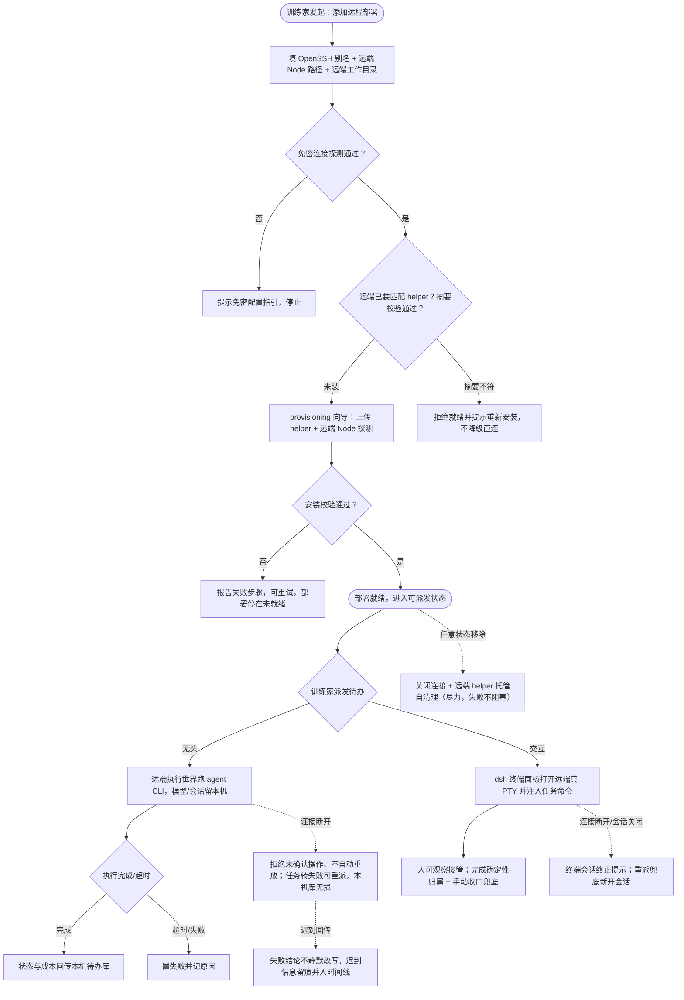
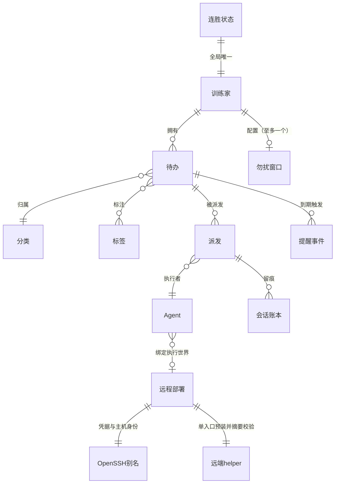
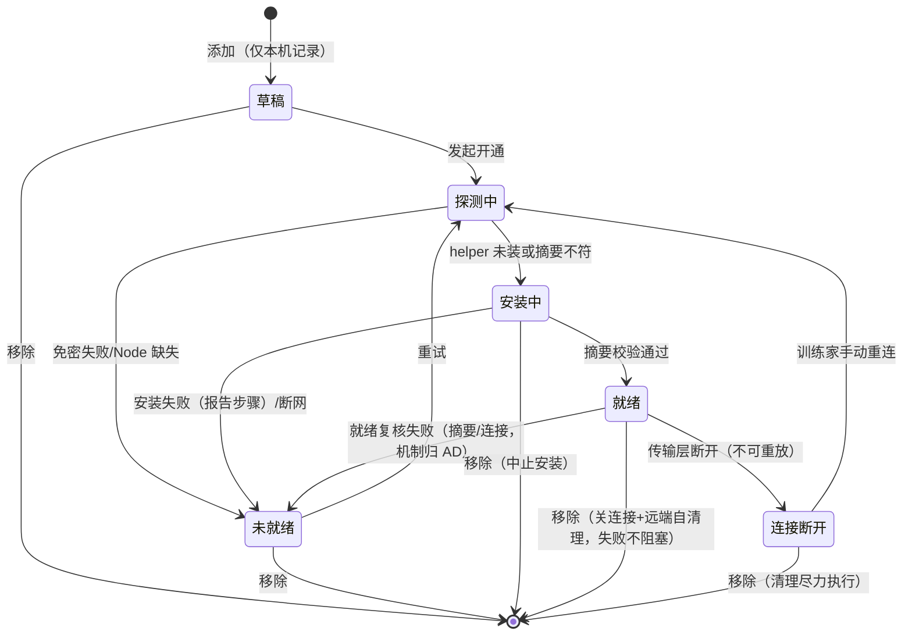

# dsh-plugin 独立形态全量补齐 + dsh 原生 SSH 远程派发 · 软件设计规范 (SDD)

> 特性名：`dsh-plugin-full-parity`。分级 L 级。方向依据：本目录 `design.md`（2026-10-17）。
> 前序规格：`specs/dsh-plugin/`（v1 插件主体，决策 D1–D20）。本 SDD 的就地决策续编 **D21** 起；翻案项在正文标注。

## 1. 需求理解

dsh 插件形态当前约九成对齐桌面 app，剩余缺口为：①系统能力 9 项（托盘/全局快捷键/提醒触达与系统通知/导入恢复与文件对话框/TTS/AI 聊聊/输入响应）②桌宠行为 6 项（坐栖/时刻台词/连胜演出/陪跑/生日彩蛋/打盹问候）③纯逻辑 4 项（手动新建任务/会话分页与回放/lark-cli 一键登录/打开导出目录）④远程 agent 派发（前序降级为「dsh 原生 SSH 语义替代」但未实现）。本特性目标：**不装桌面 app、只装 dsh 插件即获得完整功能**；远程派发落地为 **dsh 原生 SSH 子系统**（`ctx.ssh` + `ctx.subprocess` SSH provider）驱动的远端执行世界，取代桌面 pk shim + 反向隧道机制（该机制维持不复刻，前序 D5 口径不变）。

边界：分发形态维持 A9 本地安装（npm 公开发布不在本次）；Windows 远端端点不支持（dsh-ssh 平台事实），输入响应仅 macOS 本机（D32）——两者为不同维度；桌面 app 不做对应改动（单向补齐，双向共享库兼容语义照旧）；残留债务不属本次：番茄精确倒计时跨形态同步（debt ②）、标签体检 LLM 复核（桌面专属，debt ⑤）、acceptance 遗留四项（J/K 焦点流、迟到判定 30s 回看、pregen --session-id、pk claim 令牌）。

## 2. 待澄清问题（关卡待确认汇总）

无阻塞歧义。就地决策 D21–D27 汇总如下（正文对应条目带【待确认】标），供唯一批量关卡裁决：

| # | 就地决策 | 位置 |
|---|---------|------|
| D21 | **范围边界**：「全部补齐」= 本 SDD 全部故事；不含 acceptance 遗留四项、不含 npm 发布、不含桌面 app 侧改动 | §1 |
| D22 | **输入响应红线替换**（翻案前序 D4 的该子项）：helper 引入全局键盘鼠标钩子，以四条新红线替代「不引入键盘监听」——可选功能、**默认关**、只计数不取内容（键值/键名/窗口标题/应用名 0 采集）、开启需显式授权（macOS 辅助功能，一键直达系统设置面板 + 定位 helper 二进制） | FR-A9 |
| D23 | **远程派发主路径** = 插件内按部署隔离作用域装配 dsh-ssh（方案 2a）；首个实施任务为 spike（验证多实例隔离装配 + 终端 backend 作用域注册），**spike 失败即切换方案 2b（每部署一个 dsh profile 的 worker 形态）并回流设计**；ShellRunner 直连 ssh 保留为降级链 | FR-RD 组 / §3.1 |
| D24 | 提醒调度语义对齐桌面 scheduler 口径（20s tick/提前量/勿拦/紧急仍敲门/去重/聚合），载体 = host timer 扫描 + helper 通知送达；helper 缺席时降级为插件页内 toast + 分段计数，不静默丢失提醒标记（详见 FR-A3 边界） | FR-A3 |
| D25 | 导入/恢复为危险操作：二次确认 + **恢复/导入前自动做一次数据库备份**（补桌面「导入无前置快照」缺口，两通道统一口径） | FR-A5 |
| D26 | 语音 TTS 引擎随 helper 平台原生能力（Electron speechSynthesis），语义对齐桌面「仅郑重时刻出声、默认静音、文本剥符号截 120 字符、失败静默」 | FR-A7 |
| D27 | 交互远程派发的终端载体 = dsh 终端面板（经 `ctx.subprocess.spawnTerminal` 真 PTY 在远端起进程，本机面板呈现），前序 D6「tmux attach-or-create 由 dsh 会话语义承载」口径继续有效 | FR-RD4 |
| D28 | **跨形态提醒/出声仲裁**（补翻案 D1 后出现的并发缺口）：提醒送达权 = `reminded` 标记的跨进程 CAS 抢占（单条写事务内 0→1，抢到者送达、后到者让位；复盘提醒/逾期温和通知的当日去重键同构）；郑重时刻 TTS/演出仅由**完成动作发生形态**触发（对面形态的桌宠只做状态动画不出声） | FR-A10 / NFR-10 |
| D29 | **迁移执行权收编（语义变更，非成文澄清）**：独立分发后插件是唯一迁移执行方，A19「封顶 minSchema（绝不推过 2）」修订为「封顶 = 插件打包的最新契约版」；双形态并存语义 = 插件推到打包上限、主应用可推更高、任一方窗口外只读保护（前序 FR-X2 语义不变）；contracts 追加迁移时插件窗口常量与内嵌 SQL 必须同版发版（发布检查单） | FR-X9-2 |
| D30 | **helper 分发与 electron 运行时获取**：helper 构建产物纳入插件包分发物（修复 debt ⑥「files 不含 helper/」）；electron 运行时 = 优先复用本机已有，缺失时按需下载到 `~/.dsh/electron/`（下载与校验机制归 AD），离线环境给手动放置指引；helper 载体缺席时系统能力面降级提示（不静默） | FR-X9-4 |
| D31 | **降级链前提**：ShellRunner 直连降级仅适用于「helper 从未安装且训练家显式选择跳过安装」的部署；曾出现摘要不符的部署必须经训练家显式确认降级并留痕（诊断段记录）方可转直连，向导重跑不得绕行 | FR-RD2 / FR-RD6 |
| D32 | 输入响应 v1 仅 macOS 本机（CGEventTap/AX 授权体系独有）；Windows/Linux 宿主上该功能整面隐藏（非「降级可用」）为终局口径，与「Windows 远端端点不支持」属两个维度 | §1 边界 / FR-A9 |
| D33 | **每日备份循环 dsh 自执行（主会话契约收敛新增）**：独立分发后桌面备份循环无执行者（NFR-12 静默缺席 = 0 精神）——host timer 承接每日自动备份（跨天判定 + `last_backup_date` 当日 CAS 双形态仲裁 + 空库跳过 + prune 滚动保留 `backup_keep`），复用既有 backupRun/backupList 面，无新命令；U35「备份执行——作用于主应用」badge 撤销（前序 D20 标注清单的该行随之失效） | FR-X9-1 / §8 |

## 3. 示意图

### 3.1 业务流程图（远程部署开通 → 派发主流程，含异常分支）



### 3.2 概念 ER 图



| 业务实体 | 属性 | 属性的业务含义 |
|----------|------|----------------|
| 远程部署 | 别名、远端 Node、helper 入口与摘要、默认远端工作目录、就绪状态 | 一台可执行 agent 的远端 POSIX 机器的**业务化描述**；凭据与主机身份完全由既有 OpenSSH 别名承载（插件不存私钥/密码）；就绪 = 免密可达 + helper 摘要校验通过 |
| 远端 helper | 入口路径、SHA-256 摘要 | 远端预装的受信执行助手；摘要不符 = 拒绝就绪（不降级直连） |
| 提醒事件 | 任务、到期时刻、紧急档、是否已送达 | 到期触发的派生事件；已送达标记防重复；紧急档（urgent/high 优先级）勿扰内仍敲门 |
| 勿扰窗口 | 起止时刻、开关 | 时段内静默非紧急提醒、结束不补发；紧急例外 |
| 连胜状态 | 天数、今日捕捉数、宽容日 | 按本地自然日累计的任务完成连续性；空天消耗唯一 1 个宽容日，今日未完成不算断 |
| 会话账本 | 执行世界快照、会话标识、退出码/时长/成本 | 既有实体扩展：记录「在哪台机器执行」，回放时快照压过当前配置 |
| 派发 | 状态机、执行世界、超时 | 既有实体扩展：执行世界从「本机」扩展为「本机 \| 远程部署」 |

### 3.3 状态图（远程部署生命周期）



## 4. 用户故事

### 4.1 系统能力面（FR-A · helper 升级为系统能力 sidecar）

| 优先级 | 角色 | 行为 | 价值 |
|--------|------|------|------|
| P0 | 训练家 | 我希望系统托盘常驻：菜单含 打开图鉴机/显示隐藏桌宠/设置/退出（对齐桌面 5 项去「检查更新」——升级走 dsh 插件机制），左键打开图鉴机、右键弹菜单、三语文案；helper 崩溃自愈期间托盘随之恢复（复用前序 FR-P1 自愈口径）（FR-A1） | 关掉面板后应用仍可达 |
| P0 | 训练家 | 我希望 OS 级全局快捷键：⌘⇧K 打开插件面板并聚焦收音机快速捕捉输入框、⌘⇧D 显隐桌宠（翻案前序 D3/FR-R7 降级）；注册失败降级为面板内快捷键并提示，不阻断（FR-A2） | 任意应用里一键捕捉 |
| P0 | 训练家 | 我希望提醒触达在 dsh 形态自主执行（翻案前序 D1「行为不在 dsh」）：到期判定（提前量 0/5/15/30 分钟、状态集 inbox/scheduled/active/paused）、已送达去重、多条聚合为一条通知（点名前 3 + 等 N 项、任一紧急时聚合标题整体带 ‼ 前缀——对齐桌面口径）、勿扰时段（静默非紧急、结束不补发、urgent/high 仍敲门）、逾期温和通知（auto_grass 模式、每天一次、勿扰内不发）/每周复盘提醒（当日去重）同口径、通知点击无动作（动作入口在桌宠气泡：✔ 完成 / ⇨ 推迟 10 分钟）（FR-A3【待确认 D24】） | 不装桌面 app 提醒照样到 |
| P0 | 训练家 | 我希望跨形态提醒仲裁：双形态同库并存时，同一到期任务全系统只发一条通知（`reminded` 跨进程 CAS 抢占，后到形态让位）；复盘提醒/逾期通知的当日去重键同构抢占；郑重时刻 TTS 与捕捉演出仅由**完成动作发生形态**触发，对面形态桌宠只做状态动画不出声（FR-A10【待确认 D28】） | 双开不打扰 |
| P1 | 训练家 | 我希望番茄完成通知与长番茄提示音在 dsh 形态送达（通知经 helper、提示音在桌宠 helper 内合成；helper 缺席降级面板 toast；FR-A4） | 专注结束不用盯屏 |
| P0 | 训练家 | 我希望导入 JSON / 恢复备份可全程在 dsh 完成：helper 文件对话框选文件 → 结构校验（不符整体拒绝、不动库）→ 二次确认（明示「整体替换」且**自动先做一次备份**）→ 执行 → 六类变更事件广播刷新（FR-A5【待确认 D25】） | 数据自主可迁移 |
| P1 | 训练家 | 我希望打开导出目录（helper 文件管理器定位 `<数据目录>/exports/`，不存在则先建；FR-A6） | 导出物一步可达 |
| P1 | 训练家 | 我希望桌宠语音 TTS：语义对齐桌面——仅捕捉收工/里程碑/连胜/AI 回答/生日五类郑重时刻出声、默认静音、文本剥 emoji 截 120 字符、失败静默（FR-A7【待确认 D26】；跨形态出声仲裁见 FR-A10） | 陪伴感完整 |
| P1 | 训练家 | 我希望桌宠 AI 聊聊：右键菜单入口（配了 agent 才出现）、原位 ≤4 行对话框、问题 ≤200 字符、主 agent 执行、任务快照假名化入上下文、回答截前 2 句、失败气泡回退不崩、历史内存 3 条不持久化（对齐桌面全口径；FR-A8） | 和宝可梦说说话 |
| P2 | 训练家 | 我希望桌宠输入响应：全局键盘鼠标**仅计数**（键值 0 采集）、cps 三档（<2 静默 / 2–5 轻微 / ≥5 密集）驱动微抖与回头、停顿 >3s 哈欠、专注态子开关（hop 节奏耦合 ≤+10%）、演出中跳过、reducedMotion 不启动；默认关、开启需显式授权（macOS 一键直达辅助功能面板 + 呈现 helper 二进制路径指引；授权后被系统中途撤销则停止计数并提示重新授权）；非 macOS 该功能整面隐藏（D32）（FR-A9【待确认 D22】；翻案前序 D4 该子项） | 打字时宝可梦有回应 |

### 4.2 桌宠行为补齐（FR-B · 翻案前序 D4 降级清单）

| 优先级 | 角色 | 行为 | 价值 |
|--------|------|------|------|
| P1 | 训练家 | 我希望坐栖：拖拽落定后窗口底边距工作区底 ≤72 逻辑像素即栖息（姿态幅度减半 + 落座台词，首次判定即说；拎起即离开）（FR-B1） | 宝可梦落在桌面底沿 |
| P1 | 训练家 | 我希望时刻台词：优先级 生日 > 深夜(23:00–04:59) > 周五晚(≥18 点) > 整点(9:00–18:59)，普通类每天一次、整点类每天每小时一次，睡觉/urgent/对话/演出/拖拽期间不播；生日 = 首次见面日、带陪伴天数（FR-B2） | 时间感知的陪伴 |
| P0 | 训练家 | 我希望连胜与捕捉演出：完成当前任务先取前后图鉴统计与连胜再改状态；里程碑 = 累计捕捉跨 {10,50,100,200,500,1000} 阈值（优先、互不叠加）、连胜演出 = 今日首捕且连胜 ≥3 天（双球三摇）；演出可点击跳过、reducedMotion 即时结算；连胜算法 = 本地自然日去重、空天消耗唯一 1 个宽容日、今日未完成不算断、回溯上限 400 天、输出 {天数, 今日捕捉数}（对齐桌面 task_streak 口径，契约夹具锁定）（FR-B3） | 成长反馈仪式感 |
| P2 | 训练家 | 我希望陪跑精灵：专注满 25 分钟来一位图鉴宝可梦陪坐（排除当前与主宝可梦，图鉴空回退伊布），一次会话最多一位；默认关（对齐桌面 pet_mate 默认 false）（FR-B4） | 长专注不孤单 |
| P2 | 训练家 | 我希望每日时段问候（早/午/晚/深夜各一次）与打盹（无进行中任务且 5 分钟无交互，任何交互唤醒）（FR-B5） | 活物感 |

### 4.3 纯逻辑补齐（FR-C）

| 优先级 | 角色 | 行为 | 价值 |
|--------|------|------|------|
| P0 | 训练家 | 我希望面板手动新建任务：字段集对齐桌面（标题必填 trim 非空、备注/分类/优先级/截止/提醒/排期/标签），分类缺省落第一个启用分类、优先级默认 normal、状态 = 排期?scheduled:inbox、标签全量替换关联、写任务审计、广播刷新（FR-C1） | 不依赖发报也能建卡 |
| P1 | 训练家 | 我希望会话账本分页与回放：分组过滤（全部/收音机/派发/其他，未知分组按全部）、limit 钳 1–100 默认 20、offset 分页、id 倒序、counts 汇总不随翻页变化（对齐桌面）；回放按落库**执行世界快照**路由——本机会话在 dsh 终端面板唤起 agent 回放（tmux 会话优先 attach、其次 `--resume` 会话 id、兜底 agent 自带历史选择器），远端会话在对应远端唤起，快照压过当前配置（FR-C2） | 长任务复盘不悬空 |
| P1 | 训练家 | 我希望飞书授权一键启动：在 dsh 终端会话内跑 lark-cli 登录命令行（已初始化 → `auth login`，未初始化 → `config init` 接 `auth login`），登录态查询与测试沿用现有 larkTest/larkAuth 通道（FR-C3） | 授权不再手抄命令行 |

### 4.4 远程派发 · dsh 原生 SSH（FR-RD · 落地前序 FR-D4 的实施欠账；前序 D5 的 pk shim 不复刻口径维持）

| 优先级 | 角色 | 行为 | 价值 |
|--------|------|------|------|
| P0 | 训练家 | 我希望管理远程部署：增删改查（别名/远端 Node/远端工作目录/备注）、就绪状态可视（就绪/未就绪/断开 + 最近错误）、移除时关连接并触发远端 helper 托管自清理；凭据与主机身份全由既有 OpenSSH 别名承载，插件不存任何私钥/密码（FR-RD1） | 远端机器是普通资产 |
| P0 | 训练家 | 我希望开通向导：免密探测（BatchMode + 超时，失败给 ssh-copy-id 指引）→ 远端 Node 探测 → helper 上传安装 → SHA-256 摘要校验；每步失败即停并报告到失败步为止，可重试，**摘要不符拒绝就绪不降级直连**（转直连须训练家显式确认并留痕——D31）；幂等可重跑（FR-RD2【待确认 D31】） | 一次向导长期可用 |
| P0 | 训练家 | 我希望远程无头派发：文件与子进程在远端执行世界运行、模型与会话留本机；执行状态与成本照常回传待办库（时长/退出码/会话 id/执行世界快照）；超时下限 10 分钟可配置、超时置失败记原因；断连 = 拒绝未确认操作、不自动重放、任务转失败可重派、本机库无损；断连后远端**迟到回传不静默改写失败结论**（留痕并入任务时间线），重派复用同任务 worktree 幂等隔离 + 派发前远端占用探测提示（FR-RD3） | 远端算力按需调度 |
| P0 | 训练家 | 我希望远程交互派发：dsh 终端面板呈现远端真 PTY 并注入任务命令（模型留本机）；注入的会话标识写入派发记录；同一任务重派注入同一执行上下文（原会话已关闭时兜底新开会话注入并明示「原会话已关闭」）；无回传时手动收口兜底（FR-RD4【待确认 D27】） | 长任务人机协同 |
| P0 | 训练家 | 我希望远端 worktree 隔离：派发目录换远端 git worktree（兄弟目录 + 任务分支），幂等复用，失败降级原目录并给提示（对齐桌面语义、脚本在远端执行）（FR-RD5） | 远端并行不踩踏 |
| P1 | 训练家 | 我希望降级链明确：dsh-ssh 家族包缺失 / 远端 helper 未装且训练家选择跳过 / 目标非 POSIX → 无头派发可回落 ShellRunner 直连 ssh（免密预检先行）；交互派发降级为「复制完整命令行」现状语义；降级态在派发确认处明示（FR-RD6） | 弱环境也有出路 |
| P0 | 训练家 | 我希望兼容探测真实化：`dsh-ssh`/`dsh-terminal` 等 capability 键从占位变为 apply 期真实探测（包可装载 + 表面可调用），缺失时对应功能面给出明确指引而非静默半工作（FR-RD7；前序 NFR-3 静默半工作 = 0 口径延伸） | 坏环境一眼可见 |

### 4.5 横切（FR-X9 · 续前序 FR-X1–X8 编号）

| 优先级 | 角色 | 行为 | 价值 |
|--------|------|------|------|
| P0 | 训练家 | 我希望独立安装即全功能：干净 dsh profile（无仓库、无桌面 app）安装本插件 → 建库迁移种子自洽、全部故事可用；外部依赖（lark-cli/agent CLI/pk）缺失仅降级对应功能面并给安装指引，核心待办闭环 100% 可用（FR-X9-1；helper 分发前提见 FR-X9-4） | 一份插件就是完整应用 |
| P0 | 训练家 | 我希望迁移执行权收编成文（**D29，语义变更**）：独立分发后插件是唯一迁移执行方，迁移封顶 = 插件打包的最新契约版（A19「绝不推过 2」随之修订）；双形态并存 = 插件推到打包上限、主应用可推更高、任一方窗口外只读保护（前序 FR-X2 语义不变）；contracts 追加迁移时插件窗口常量与内嵌 SQL 必须同版发版（发布检查单）（FR-X9-2【待确认 D29】） | 未来升级不炸只读 |
| P1 | 训练家 | 我希望规格与现实一致：前序 SDD §4.7 中「复盘向导/标签体检 OUT」「备份/导出/导入操作 OUT」两行**部分取代**——复盘向导/本地预筛/备份导出已落地、导入恢复本次补齐、标签体检 LLM 复核仍桌面专属（debt ⑤）；回流标注 superseded 并注明取代边界、指向本 SDD（FR-X9-3） | 文档不撒谎 |
| P0 | 训练家 | 我希望 helper 随插件分发：helper 构建产物纳入插件包分发物（修复 debt ⑥「package files 不含 helper/」）；electron 运行时优先复用本机已有、缺失时按需下载到 dsh 侧下载位（机制归 AD），离线环境给手动放置指引；helper 载体缺席时系统能力面降级提示不静默（FR-X9-4【待确认 D30】） | 独立安装桌宠与系统能力不缺位 |

## 5. 验收标准（Gherkin）

### 故事: FR-A1 系统托盘 (P0)

```gherkin
Scenario: 托盘常驻与菜单
  Given helper 进程在运行
  Then 系统托盘区出现插件图标，tooltip 为「就决定是你了」
  And 右键菜单含 打开图鉴机/显示隐藏桌宠/设置/退出 四项，文案随 language 设置三语切换
  When 左键点击托盘图标
  Then 打开 dsh 插件面板（图鉴机）
  When 选择「退出」
  Then helper 连同桌宠窗口与托盘退出，dsh 宿主不受影响

Scenario: helper 缺席时托盘降级
  Given 本机无 Electron 可用（helper 探测失败）
  Then 插件正常加载，托盘功能不出现
  And 诊断段显示「系统能力面降级：helper 未运行」

Scenario: helper 崩溃自愈后托盘恢复
  Given 托盘在位，helper 进程异常退出
  When helper 按自愈口径（前序 FR-P1）重新拉起
  Then 托盘图标与菜单随之恢复，无需用户干预

### 故事: FR-A10 跨形态提醒仲裁 (P0)

```gherkin
Scenario: 双形态并存提醒单发
  Given 桌面 app 与 dsh 插件同时运行且指向同一待办库，任务「交周报」到期 reminded = 0
  When 两形态调度 tick 在同一 20 秒窗口内先后到来
  Then 该任务全系统只发出一条系统通知（后到形态发现 reminded 已置位即让位）
  And 双形态各自面板的待处理计数一致

Scenario: 郑重时刻出声限定完成动作形态
  Given 双形态桌宠并存，训练家在 dsh 面板完成今日第一只任务且连胜 ≥3 天
  Then 仅 dsh 桌宠播放连胜演出与出声，桌面桌宠只做状态动画不出声
```
```

### 故事: FR-A2 全局快捷键 (P0)

```gherkin
Scenario: ⌘⇧K 全局快速捕捉
  Given 插件面板已加载且快捷键注册成功
  When 焦点在任意其他应用时按下 ⌘⇧K
  Then dsh 前端切到收音机分段并聚焦自然语言捕捉输入框

Scenario: 注册失败降级
  Given 快捷键被其他应用占用导致注册失败
  Then 插件启动不中断，诊断段提示「全局快捷键注册失败（可能被占用）」
  And 面板聚焦时按相同组合键仍可触发快捕（降级通道）
```

### 故事: FR-A3 提醒触达 (P0)

```gherkin
Scenario: 到期提醒送达与去重
  Given 存在任务「交周报」remind_at = 20 分钟后，状态 scheduled，reminded = 0
  And 设置 remind_ahead_minutes = 30
  When 调度 tick 到来
  Then 发送一条系统通知（正文含分类宝可梦名）
  And 任务 reminded 置 1
  When 再过 1 分钟又一 tick
  Then 不重复发送

Scenario: 多条聚合
  Given 5 个任务同时到期（其中 2 个优先级 urgent）
  When 调度 tick 到来
  Then 仅发送一条聚合通知：点名前 3 条标题 + 「等 5 项」，聚合标题整体带 ‼ 前缀（任一紧急即加，点名条目自身不带前缀）

Scenario: 逾期温和通知与复盘提醒条件
  Given 设置 overdue_mode = auto_grass 且今日尚未跑过归草丛
  When 调度 tick 发现逾期任务
  Then 发送一条温和通知（每天至多一次，勿扰内不发）
  Given 设置每周复盘提醒开且今天是设定星期且今日未提醒过
  When 调度 tick 到来
  Then 发送复盘提醒（当日仅一次，勿扰内不发）

Scenario: 勿扰静默与紧急例外
  Given 当前时刻在勿扰时段 22:00–08:00 内且开关开
  And 任务甲优先级 normal 到期，任务乙优先级 urgent 到期
  When 调度 tick 到来
  Then 任务甲不发通知且 reminded 置 1（时段结束后不补发）
  And 任务乙仍发送通知（紧急敲门）

Scenario: helper 缺席降级不丢提醒
  Given helper 未运行，任务到期
  When 调度 tick 到来
  Then 插件页内呈现 toast 提醒，任务 reminded 置 1
  And 面板分段计数呈现待处理提醒数
```

### 故事: FR-A5 导入/恢复 (P0)

```gherkin
Scenario: 结构校验失败整体拒绝
  Given 训练家选择了 app 字段不符的 JSON 文件
  When 确认导入
  Then 拒绝导入并说明校验原因，库内容不变（0 行变更）

Scenario: 导入前置快照与整体替换
  Given 选择合法导出文件并确认「整体替换」二次确认
  When 导入执行
  Then 先自动创建一份数据库备份（命名含时间戳，计入滚动保留）
  And 导入以整体替换完成，秘钥与提示词覆盖行不随导入覆盖
  And 六类变更事件广播，两形态视图刷新

Scenario: 恢复备份版本兼容
  Given 选择旧版本库的备份文件
  When 恢复执行
  Then 恢复后自动补跑迁移与默认分类补种
  And 恢复前先自动备份当前库

Scenario: 恢复超窗口版本拒绝
  Given 选择 user_version 超出插件兼容窗口的备份文件
  When 尝试恢复
  Then 拒绝恢复并提示版本过新（只读保护语义延伸到恢复通道），当前库不变

Scenario: 导入前备份失败中止
  Given 导入前自动备份因磁盘满失败
  Then 中止导入（不执行整体替换）并提示备份失败原因
```

### 故事: FR-A9 输入响应 (P2)

```gherkin
Scenario: 默认关闭与授权门槛
  Given 全新安装，pet_input_response 未开启
  Then 不存在任何键盘/鼠标监听行为
  When 训练家开启输入响应且未授予辅助功能权限
  Then 设置保留为开但提示「去授权」，一键直达系统设置辅助功能面板并定位 helper 二进制
  And 授权完成前不启动计数

Scenario: 只计数不取内容
  Given 输入响应已授权并启动
  When 训练家连续打字 10 秒
  Then 桌宠按 cps 分档反应（≥5 密集微抖）
  And 键值、键名、窗口标题、应用名均未被采集（0 泄露面）

Scenario: 授权被撤销即停
  Given 输入响应运行中，训练家在系统设置撤销辅助功能授权
  Then 计数停止，设置卡提示「授权已失效，需重新授权」
  And 授权恢复前不再有任何键盘/鼠标监听行为
```

### 故事: FR-B3 连胜与演出 (P0)

```gherkin
Scenario: 宽容日算法
  Given 近 4 个本地自然日完成任务情况为 有/无/无/无（今天为「无」且未结束）
  Then 连胜天数 = 1（第一个空天消耗宽容日，第二个空天即断，今日未完成不算断）

Scenario: 里程碑优先
  Given 图鉴累计捕捉数 = 99，当前连胜 = 5 天且今日尚无完成
  When 训练家完成今日第一只任务
  Then 播放里程碑演出（跨过 100 阈值），不叠加连胜演出

Scenario: 演出可跳过
  Given 捕捉演出播放中，设置 reduce_motion = true
  Then 演出即时结算（0ms 等待），时序保留动画跳过
```

### 故事: FR-C1 手动新建任务 (P0)

```gherkin
Scenario: 最小新建
  Given 训练家在面板打开新建任务表单
  When 仅填标题「写周报」提交
  Then 任务创建成功：分类 = 第一个启用分类，优先级 = normal，状态 = inbox
  And 任务审计含 create 记录，视图刷新呈现新任务

Scenario: 标题校验
  When 提交 trim 后为空的标题
  Then 表单拒绝提交并提示「标题不能为空」
```

### 故事: FR-C2 会话回放 (P1)

```gherkin
Scenario: 本机会话回放路由
  Given 会话账本某行有 session_id 且执行世界快照为本机
  When 训练家点击「回放」
  Then dsh 终端面板在该会话的工作目录唤起 agent 回放（--resume 注入会话 id）

Scenario: 远端会话快照压过当前配置
  Given 会话账本某行执行世界快照为远程部署 R（即使该 agent 现已改绑本机）
  When 训练家点击「回放」
  Then 在远程部署 R 上唤起回放，而非当前配置的本机
```

### 故事: FR-RD1 远程部署管理 (P0)

```gherkin
Scenario: 断连部署在任意状态可移除
  Given 远程部署 R 处于「连接断开」状态
  When 训练家移除 R
  Then 本机记录删除、连接关闭，远端 helper 自清理尽力执行
  And 清理失败不阻塞移除，仅在诊断段留最近错误

Scenario: 凭据零存储
  Given 任意远程部署配置
  Then 插件库与配置文件中 私钥/密码/密钥内容出现次数 = 0（凭据 100% 由 OpenSSH 别名承载）
```

### 故事: FR-RD2 开通向导 (P0)

```gherkin
Scenario: 免密失败即停
  Given 远程部署别名未配置免密
  When 发起开通
  Then 第一步探测失败即停止，报告「免密配置指引（ssh-copy-id / 密钥加入 agent）」
  And 部署状态停为未就绪，可重试

Scenario: 摘要不符拒绝就绪
  Given 远端 helper 已存在但 SHA-256 与预期不符
  When 向导校验步骤执行
  Then 拒绝置为就绪并提示重新安装
  And 不降级为直连 ssh 执行

Scenario: 幂等重跑
  Given 向导曾在安装步骤失败
  When 再次发起开通
  Then 已完成的步骤不重复执行，从中断处继续

Scenario: 摘要不符部署的降级须显式确认
  Given 部署 R 曾在摘要校验步骤失败（摘要不符）
  When 训练家重跑向导并选择跳过安装转直连
  Then 必须弹出显式降级确认（说明风险）并留痕到诊断段方可生效
  And 未经确认不得静默转入直连模式
```

### 故事: FR-RD3 远程无头派发 (P0)

```gherkin
Scenario: 远端执行世界
  Given 项目路由将待办指向远程部署 R（就绪），agent 命令在 R 上可用
  When 训练家发起无头派发
  Then 文件与子进程操作在 R 执行，模型与会话留本机
  And 派发完成后状态/时长/退出码/会话 id/执行世界快照回传待办库

Scenario: 断连不损库不重放
  Given 远程派发执行中 SSH 传输层断开
  Then 进行中的远端操作被拒绝确认，不自动重放
  And 派发置失败并记录断连原因，任务可重新派发
  And 本机待办库 0 损坏 0 丢失

Scenario: 断连后迟到回传不污染失败结论
  Given 派发 P 因断连已置失败，远端进程实际继续跑完并产生会话记录
  When 连接恢复后该会话信息可查
  Then 失败结论不被静默改写，迟到信息以留痕方式并入任务时间线
```

### 故事: FR-RD4 远程交互派发 (P0)

```gherkin
Scenario: 真 PTY 注入
  Given 远程部署 R 就绪且 agent 可交互运行
  When 训练家发起交互派发
  Then dsh 终端面板打开一个连接 R 的真 PTY 会话
  And 任务命令注入该会话，会话标识写入派发记录
  When 同一任务再次派发
  Then 注入同一执行上下文（不新开会话）

Scenario: 原会话已关闭的兜底
  Given 同一任务的原 PTY 会话已关闭（面板关闭/宿主重启）
  When 训练家再次派发
  Then 新开一个连接 R 的 PTY 会话注入任务命令
  And 明示「原会话已关闭，已开新会话」
```

### 故事: FR-RD5 远端 worktree 隔离 (P0)

```gherkin
Scenario: 远端 worktree 幂等复用
  Given 远程部署 R 就绪，设置派发 worktree 隔离开
  When 同一任务两次派发（第二次为断连重派）
  Then 两次使用同一远端 worktree（兄弟目录 + 任务分支），不重复创建
  And worktree 建立失败时降级原目录派发并给出提示
```

### 故事: FR-RD7 兼容探测 (P0)

```gherkin
Scenario: SSH 家族缺失明示
  Given dsh 安装中未装载 dsh-ssh 家族
  When 插件加载
  Then 诊断段与远程派发入口呈现「需要 dsh-ssh 家族（附装载指引）」降级指引文案
  And 远程派发操作不可用且呈现指引（不出现点击后无响应的入口）
```

### 故事: FR-X9-1 独立安装全功能 (P0)

```gherkin
Scenario: 干净 profile 冷启动
  Given 一台无本仓库、无桌面 app 的机器，dsh profile 干净
  When 安装本插件并启动
  Then 待办库自动创建、迁移、种子默认分类
  And 本 SDD 全部故事能力可用（外部依赖缺失项呈对应降级提示）
  And 不出现任何指向仓库相对路径的文件读取报错
```

### 故事: FR-X9-2 迁移执行权收编 (P0)

```gherkin
Scenario: 旧插件遇超窗口库只读保护
  Given 主应用已把库推到 user_version = 3，本插件打包窗口 = [2,2]
  When 插件启动
  Then 进入只读模式（写命令前置拒绝并给升级指引），库 0 损坏

Scenario: contracts 追加迁移的发布检查
  Given contracts/schema 追加了 003 迁移
  When 插件发版
  Then 发布检查单强制断言：窗口常量、内嵌 SQL 与 contracts 同版（不一致即发版流程红线）
```

### 故事: FR-X9-4 helper 随插件分发 (P0)

```gherkin
Scenario: 干净机器 helper 可用
  Given 无本仓库的机器安装本插件，本机无 electron 运行时
  When 首次启动需要 helper
  Then helper 产物随插件包在位，electron 运行时按需获取（下载或已有复用）
  And 获取失败时系统能力面呈现降级提示与手动放置指引（不静默缺席）
```

## 6. 领域名词与数据实体

| 名词 | 说明 | 主要属性（仅业务含义） |
|------|------|------------------------|
| 远程部署 | 一台经 OpenSSH 别名可达、预装受信 helper 的远端 POSIX 执行世界 | 别名；远端 Node 路径；helper 入口 + 摘要；默认远端工作目录；就绪状态；最近错误 |
| 开通（provisioning） | 将一台远端机器带到「就绪」的业务流程：探测 → 安装 → 校验，幂等 | 各步骤结果；失败步报告 |
| 执行世界 | 一次派发/会话的运行位置：本机或某远程部署 | 快照（部署标识 + 远端路径三元组） |
| 提醒事件 | 任务到期触发的派生通知需求；送达后标记去重 | 任务；紧急档；送达标记 |
| 勿扰窗口 | 静默非紧急提醒的时段配置（跨零点支持；start==end 视为关） | 起、止、开关 |
| 连胜 | 完成任务的本地自然日连续性（宽容日 = 1） | 天数；今日捕捉数 |
| 郑重时刻 | 桌宠允许出声的五类事件（收工/里程碑/连胜/AI 回答/生日） | —— |
| 输入响应 | 仅计数的全局键盘鼠标活动强度反馈（键值零采集） | cps 分档；授权状态 |
| helper 系统能力面 | 桌宠 helper 承载的 OS 级能力族：托盘/快捷键/通知/文件对话框/TTS/输入计数 | 各能力可用性；降级标记 |

## 7. 非功能需求 (NFR)

> 编号续前序 NFR-1..9（specs/dsh-plugin/requirements.md §7），本特性新增 NFR-10 起；前序各条继续有效。

- **NFR-10 提醒触达正确性**
  - 场景：到期判定/勿扰边界（含跨零点、start==end、解析失败 fail-open）/聚合/去重自动化用例；指标：与桌面 scheduler 同场景行为一致率；阈值：**100%**（契约夹具锁定）。
  - 场景：勿扰时段内到达的非紧急提醒；指标：发出通知数 / 时段后补发数；阈值：**均 = 0**；紧急（urgent/high）在勿扰内送达率 **100%**。
  - 场景：双形态同库并存、同一任务同到期窗口（两形态 tick 先后到达）；指标：全系统合计通知数；阈值：**= 1**（CAS 仲裁，后到让位）。
- **NFR-11 远程派发安全与稳健**
  - 场景：远端 helper 摘要不匹配时开通；指标：置为就绪次数；阈值：**0**（100% 拒绝且不降级直连）。
  - 场景：派发执行中 SSH 断开 / 插件宿主退出；指标：本机库损坏数、自动重放次数；阈值：**均 = 0**；断连后任务可重派率 **100%**。
  - 场景：helper/部署凭据管理；指标：插件存储的私钥/密码数；阈值：**0**（凭据 100% 由 OpenSSH 别名承载）。
  - 场景：开通与派发**全部远端命令组装路径**（含别名/路径注入与任务标题/提示词/分支名等不可信文本拼接）；指标：转义缺口；阈值：**0**（静态断言全量引用）。
- **NFR-12 独立分发完整性**
  - 场景：干净 profile 安装启动；指标：指向仓库相对路径的文件读取错误数；阈值：**0**（schema/i18n/图鉴/技能文档 100% 内嵌）。
  - 场景：外部依赖缺失（lark-cli / agent CLI / pk / dsh-ssh 家族）；指标：静默半工作功能面数；阈值：**0**（100% 有明确降级提示或指引）。
- **NFR-13 输入响应隐私**
  - 场景：输入响应开启后任意时长使用；指标：键值/键名/窗口标题/应用名的采集与出进程数；阈值：**0**（helper 进程外不可见任何输入内容；代码审查断言无键盘内容 API 调用）。
  - 场景：全新安装；指标：监听默认开启数；阈值：**0**（与 NFR-6 默认值清单合并断言）。
- **NFR-14 桥协议兼容**
  - 场景：新 host + 旧 helper（用户未升级 helper）组合；指标：未定义命令导致的崩溃数；阈值：**0**（未知命令 100% 显式拒绝并提示升级 helper）。
  - 场景：旧 host + 新 helper（helper 先行升级）；指标：host 不识别的新事件导致的崩溃数；阈值：**0**（未知事件 100% 安全忽略并留日志）。
- **NFR-15 资源与性能（系统能力 sidecar 扩面后）**
  - 场景：helper 常驻（托盘 + 快捷键 + 输入计数 + 通知）；指标：空闲 CPU 单核占比 / 常驻内存；阈值：**≤ 5% / ≤ 300MB**（较前序 +50MB 预算）。
  - 场景：输入响应开启、≥10 cps 持续打字 60 秒；指标：helper CPU 单核占比；阈值：**≤ 10%**（观察型计数不拦截输入路径）。
  - 场景：远程派发连接建立（就绪部署再次派发）；指标：P95；阈值：**≤ 10 秒**（首次开通含安装 ≤ 5 分钟）。
  - 场景：提醒 tick 周期；指标：到期到通知送达延迟（helper 在位）；阈值：**≤ 30 秒**。
- **NFR-16 质量门禁不回退**
  - 场景：本特性全部新增/改动代码入库；指标：host 业务核心行覆盖率 / 棘轮复杂度基线 / 契约回放场景通过率 / i18n 三语键集相等断言；阈值：**≥ 85% / 只紧不松 / 100% / 100%**。

## 8. 变更影响简述

- **dsh-plugin host**：新增提醒调度、导入恢复、连胜、新建任务、会话分页回放、lark-cli 终端启动、远程部署管理/provisioning/派发执行等命令面（命令数显著增长，具体契约归 AD）；dispatch executor 新增远端实现（既有 local/fake 不动）；capability 探测键实装。
- **dsh-plugin client**：新增新建任务表单、部署管理/开通向导、导入恢复确认流、授权引导、回放入口；分段导航与设置卡标注更新（「作用于主应用」标注清单中随翻案移除对应键——提醒触达/输入响应/语音/陪跑等改由 dsh 形态自执行）。
- **helper**：升级为系统能力 sidecar——桥协议扩展系统能力命令族与事件回传（向后兼容语义见 NFR-14）；新增托盘/快捷键/通知/对话框/TTS/输入计数与桌宠行为动画；构建引入原生键盘钩子依赖；**分发物变更**：helper 构建产物纳入插件包 files（修复 debt ⑥），electron 运行时按需获取（D30）。
- **桌面 app**：零改动；共享库新增表/迁移需走 contracts 追加纪律并保证旧桌面版本 FutureVersion 保护语义不破坏（迁移执行权收编为 D29 语义变更：插件推到打包上限、桌面可推更高、窗口外只读）。
- **规格**：前序 `specs/dsh-plugin/requirements.md` §4.7 两行回流标 superseded；`docs/compatibility.md` 矩阵补 dsh-ssh 家族行；`docs/debt.md` 记 helper 键盘钩子原生依赖维护项。
