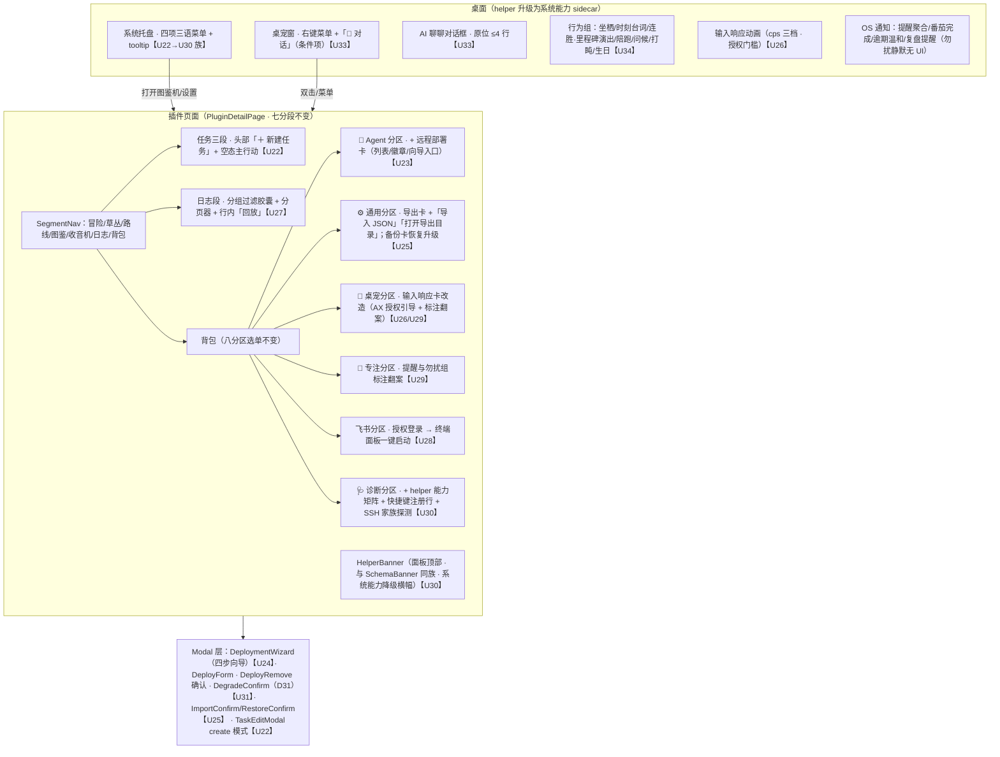
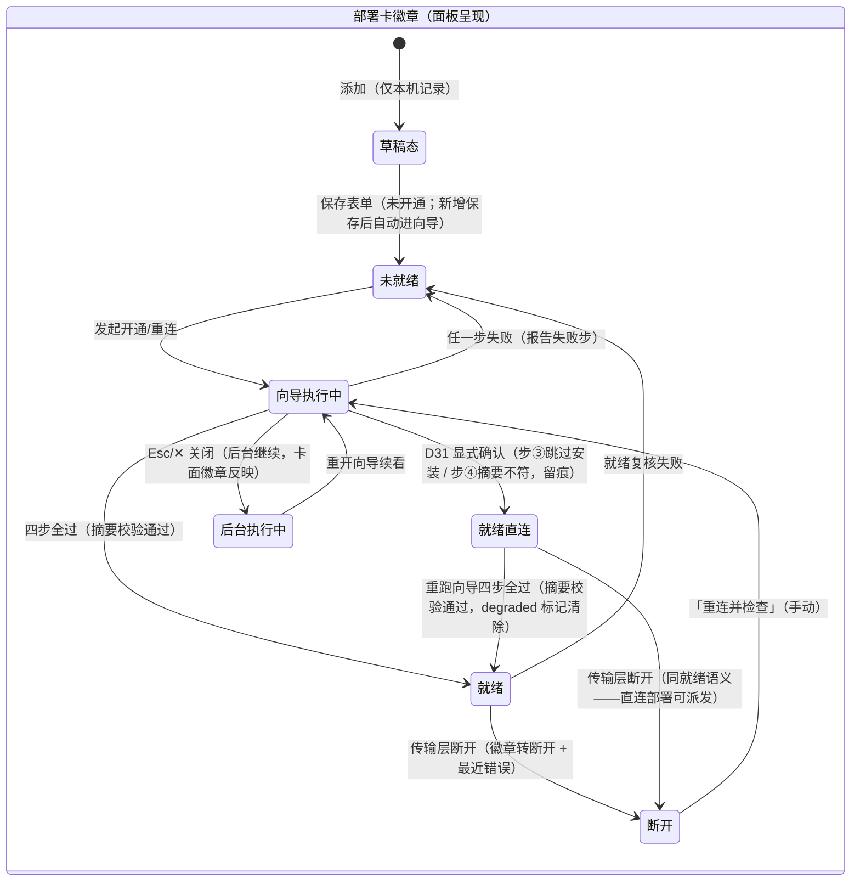

# dsh-plugin 独立形态全量补齐 + dsh 原生 SSH 远程派发 · UIUX 设计

> 输入：本目录 `requirements.md`（SDD 定稿，决策 D21–D32 见 §2）、`design.md`（轴 1a/2a/3a 方向）、
> 前序 `specs/dsh-plugin/uiux-design.md`（U1–U21 结构与交互基准；本文就地决策续编 **U22** 起）、
> `specs/dsh-plugin-style/uiux-design.md`（**视觉方向单源**——「副屏」渗透体系 T0/T1/T2 档位）、
> `dsh-plugin/src/client/`（model.ts 分段模型 / app·settings·tasks·radio·ui 组件与 *.module.css）、
> 桌面参照 `src/components/`（SectionPets perm-hint / BackupCard 两段式恢复 / ExportImportCard）与
> `src/PetApp.vue`（桌宠行为组语义）。
>
> 规模：**L 级**。并行 subagent 模式——歧义不向用户提问，就地决策【U#】标注，交主会话批量关卡。
> 配套视觉保真原型：本目录 `uiux-prototype.html`（§11）。

## 1. UIUX 影响评估

### 1.1 五维度总评

| 维度 | 评估问题 | 本特性结论 |
|------|---------|-----------|
| 展示 | 数据/结果用户需要看到吗？在哪看？ | **有影响**。远程部署实体（别名/就绪状态/最近错误）、开通向导各步进度与失败步报告、远端派发执行状态与迟到回传、helper 系统能力降级面、会话分页与执行世界快照、导入/恢复校验结果与自动备份说明——全部需要可见面 |
| 触发 | 用户如何发起？入口在哪？ | **有影响**。六类新入口：面板手动新建任务表单、部署增删改查与开通向导、导入/恢复文件选择、AX 辅助功能授权引导、会话回放、lark-cli 一键登录；另有托盘菜单四项与桌宠右键「对话」入口 |
| 反馈 | 进行中/完成后如何感知？ | **有影响**。向导分步进度（探测→安装→校验）、部署断连警示、勿扰静默（不发即全部反馈——静默本身是设计）、通知聚合送达、导入执行与六类变更刷新、演出可跳过与 reducedMotion 即时结算 |
| 异常 | 出错时如何知道并处理？ | **有影响**。免密失败指引（ssh-copy-id）、摘要不符拒绝就绪（不静默降级直连，D31 显式确认）、断连后任务转失败可重派、迟到回传不污染结论只留痕、导入校验整体拒绝/备份失败中止、恢复版本超窗拒绝、AX 授权被撤销提示重授权、SSH 家族缺失指引、helper 缺席降级横幅 |
| 变更 | 是否动到现有界面/导航/已有交互？ | **有影响但单向**。背包四张分区页的「作用于主应用」标注清单翻案缩减（提醒触达/输入响应/语音/陪跑/番茄通知——dsh 形态自执行）；通用段双形态说明文案更新；日志段加过滤与分页；派发确认弹层加执行世界与降级明示；桌面 app 零改动（单向补齐） |

**评估结论**：**需要 UIUX 设计**——三块全新表面（部署管理 + 开通向导、导入/恢复危险流、AX 授权引导）+ 两块既有面显著扩容（日志段分页回放、背包标注体系翻案）+ helper 侧一批新交互（托盘/对话/行为组/输入响应）。NFR-6（打断类默认 0）与 NFR-12（静默半工作 = 0）两条红线在新增面上的落法是本设计的核心命题。

### 1.2 逐故事影响判定（FR-A/B/C/RD/X9 全量过堂）

> 判定列 = 五维度中命中的维度缩写。**「无 UI 影响」的故事也逐条写明理由**。

| 故事 | 判定 | UI 面落法（无影响则给理由） |
|------|------|---------------------------|
| FR-A1 托盘常驻 | 展示/触发 | helper 托盘四项三语菜单（打开图鉴机/显示·隐藏桌宠/设置/退出）；「设置」= 打开插件页面背包分段（复用 host:pageOpen 目标分区锚点）；左键 = 打开图鉴机；「退出」= helper 连同桌宠托盘退出（确认一次，防误点）；helper 缺席 = 面板 HelperBanner + 诊断段能力矩阵【U30】 |
| FR-A2 全局快捷键 | 展示/异常 | 无新界面——注册成功即透明生效；**注册失败**在诊断段呈现一行状态「全局快捷键注册失败（可能被占用）」，面板内同组合键降级通道继续可用（U9 既有页面内键盘流不受影响） |
| FR-A3 提醒触达 | 展示/反馈/变更 | 通知本体在 helper（OS 通知面，文案规格见 §8）；面板侧 = 专注分区「提醒与勿扰」组**标注翻案**（移除「作用于主应用触达」badge【U29】）+ helper 缺席降级 = 页内 toast + 分段计数；勿扰静默 = **无 UI**（不补发、不提示、不标记静默事件——静默即语义，NFR-6） |
| FR-A10 跨形态仲裁 | （弱）反馈 | 双形态同发通知只出一条——用户不可见的正确性（CAS 在数据层）；UI 呈现 = 通用段双形态说明文案一句「同一到期任务全系统只发一条通知」（认知对齐，无新交互） |
| FR-A4 番茄通知/提示音 | 变更 | 专注分区 pomodoro_notify / pomodoro_chime 两键标注翻案（dsh 自执行【U29】）；提示音在 helper 合成，无新界面 |
| FR-A5 导入/恢复 | 触发/反馈/异常 | 全新危险操作流：导出卡「导入 JSON」→ helper 文件对话框 → 校验 → 二次确认弹层（明示整体替换 + **已自动备份**）→ 执行 → 结果；备份列表恢复升级同款确认【U25】 |
| FR-A6 打开导出目录 | 触发 | 通用分区导出卡新增「打开导出目录」按钮（helper 文件管理器定位 exports/）；失败 toast 行内提示 |
| FR-A7 桌宠 TTS | 变更 | 桌宠分区 pet_voice 键标注翻案（dsh 桌宠自出声【U29】）；失败静默 = 无 UI（锦上添花不阻塞气泡，对齐桌面） |
| FR-A8 桌宠 AI 聊聊 | 触发/反馈/异常 | helper 桌宠右键菜单条件项「💬 对话」（配了 agent 才出现）；原位 ≤4 行对话框（展开调高）、思考点、失败气泡回退、Esc/✕ 收起【U33】 |
| FR-A9 输入响应 | 触发/异常/变更 | 桌宠分区输入响应卡改造：标注翻案（dsh 自执行）+ **AX 授权引导块**（未授权指引 + helper 二进制路径可复制 + 一键直达系统设置辅助功能面板）+ 授权失效提示「授权已失效，需重新授权」；非 macOS 该功能整面隐藏（D32 终局口径）【U26】 |
| FR-B1 坐栖 | 展示/反馈 | helper 渲染层行为（底边 ≤72px 栖息、姿态幅度减半 + 落座台词、拎起即离开）；约束呈现见【U34】，无面板面 |
| FR-B2 时刻台词 | 展示 | helper 行为（生日 > 深夜 > 周五晚 > 整点优先级、频次闸门、禁播期），无面板面 |
| FR-B3 连胜与演出 | 展示/反馈 | helper 捕捉演出扩展（里程碑双排星星 / 连胜双球三摇）；**可点击跳过 + reducedMotion 即时结算**【U34】；面板图鉴段统计口径不变（数据面既有） |
| FR-B4 陪跑精灵 | 展示 | helper 行为（满 25 分钟一位客人、一次会话一位、默认关）；桌宠分区 pet_mate 键标注翻案【U29】 |
| FR-B5 问候与打盹 | 展示 | helper 行为（四档问候每日各一次；无任务 5 分钟无交互打盹、任意交互唤醒），无面板面 |
| FR-C1 手动新建任务 | 触发/异常 | 全新表单：任务三段（冒险/草丛/路线）头部「＋ 新建任务」+ 空态主行动入口；TaskEditModal 扩 **create 模式**（全字段同构编辑弹窗）【U22】 |
| FR-C2 会话分页与回放 | 展示/触发/异常 | 日志段：分组过滤胶囊（全部/收音机/派发/其他）+ 分页器（默认 20 条 + counts 汇总）+ 行内「回放」按钮（按执行世界快照路由）【U27】 |
| FR-C3 lark-cli 一键登录 | 触发/反馈 | 飞书分区「授权登录」升级：在 dsh 终端面板启动 lark-cli 登录命令行（已初始化 auth login / 未初始化 config init 接续），按钮态与引导文案【U28】 |
| FR-RD1 部署管理 | 展示/触发/异常 | 全新「远程部署」卡：背包·Agent 分区挂载；列表 + 状态徽章三态（就绪/未就绪/断开 + 最近错误）+ 增删改查 + 移除确认（关连接 + 远端自清理尽力说明）【U23】 |
| FR-RD2 开通向导 | 触发/反馈/异常 | 全新四步向导 Modal（免密探测 → 远端 Node → helper 上传安装 → SHA-256 摘要校验）：每步失败即停报告、可重试、幂等重跑跳过已完成、摘要不符给 D31 显式降级确认【U24/U31】 |
| FR-RD3 远程无头派发 | 展示/反馈/异常 | 派发徽标与时间线扩展**执行世界快照**列（在哪台机器执行）；断连 = 徽标转失败 + 时间线记断连原因 + 迟到回传**追加留痕行**（不覆盖失败结论）【U32】 |
| FR-RD4 远程交互派发 | 触发/反馈 | 派发确认弹层明示执行世界与「终端面板启动」通道；同任务重派注入同一执行上下文；原会话已关闭兜底新开并明示 toast【U32】 |
| FR-RD5 远端 worktree | 反馈（弱） | 派发确认弹层一行说明（worktree 隔离开时）；建立失败降级原目录 = 时间线留痕提示；无独立界面（对齐桌面语义） |
| FR-RD6 降级链 | 展示/异常 | 派发确认弹层**降级态明示三枚举**（直连模式/复制命令行/非 POSIX 目标，M1）+ 派发前远端占用探测条件行（M2）；D31 显式降级确认弹层 + 留痕——降级后「就绪（直连）」可派发【U31】 |
| FR-RD7 兼容探测 | 展示/异常 | SSH 家族缺失 = 部署卡与派发入口呈现「需要 dsh-ssh 家族（附装载指引）」——**不可用入口以指引态呈现，不出现点击后无响应的入口**【U31】；诊断段探测状态行 |
| FR-X9-1 独立安装全功能 | 异常 | 各外部依赖缺失的降级指引面（lark-cli/agent CLI/pk/dsh-ssh 家族——指引文案统一模式见 §4.2）；无新独立页面 |
| FR-X9-2 迁移执行权收编 | 异常（弱） | 只读保护横幅 = 既有 SchemaBanner 语义不变（FR-X2 延续）；恢复通道版本超窗拒绝归入 FR-A5 流【U25】 |
| FR-X9-3 规格回流 | 无 UI 影响 | 纯文档一致性行为（前序 SDD §4.7 标 superseded），无界面 |
| FR-X9-4 helper 分发 | 异常 | helper 载体缺席/运行时获取失败 = 面板 HelperBanner（系统能力面降级横幅）+ 诊断段手动放置指引【U30】 |

---

## 契约需求面（必选）

> UIUX → AD 的单向契约需求传递面。动词约定沿用前序：`host:*` = 客户端半边调用宿主半边的命令；
> `helper:*` = host 经 stdio 桥向 helper 下发的命令；`event:*` = 宿主推送至客户端 slot 的事件；
> `helper-event:*` = helper 回传 host 的事件。**只列需求不定义实现**——命令签名/错误码枚举归 AD（PROTOCOL §2 单源）。
> 既有命令（configRead/configWrite/dispatch*/larkTest/backupRun/backupList/logQuery/pageOpen/petShow/petHide 等）不重复列，只列**本特性新增或语义扩展**的需求。

### 契约收敛纪要（主会话 · 2026-10-17，与本表并行阅读）

AD 契约供给面（architecture.md §4）与本节四表比对完毕，**交互呈现设计全部维持不变**，以下为传输层收敛裁决（正文表保留原始表述，以本纪要为准）：

1. **命令命名对齐 AD**（对齐既有 nounVerb 风格 / 命令职责分离）：
   `deploymentRemove→deploymentDelete`；`deploymentProvision(含 confirmDegrade)→provisionRun + provisionStatus + deploymentDegradeConfirm`（三分）；`importJson→importValidate + importRun`（两步）；`restoreBackup→restoreRun`；`helper:openExportDir→host:exportDirOpen`（桥 open-path）；`larkAuth 语义扩展→新命令 larkLoginStart`（larkAuth 契约不变）；`axPermissionStatus→macAuthorizationStatus{kind}`；`helper:openAccessibilityPane→桥 mac-auth-query`（直达辅助功能面板的桥命令，AD 定名）；`helper:pickOpenFile→桥 dialog-request/dialog-result`；`helper:notifySend→桥 sys-notify`；`helper:inputWatchStart/Stop→sys-config.inputResponse`（单一启停面）；`helper:quit→上行 tray-action{action:quit}`（host 复用 supervisor 停 helper）；`sessionReplay 入参→rowId`（账本行 id）。
2. **事件→拉式收敛**（AD A34：events 推送面零新增）：反馈通道表全部 `event:*` 行落拉式——向导步进 = provisionStatus 轮询；部署状态 = deploymentList/deploymentRecheck；远端回传/迟到回传 = 既有派发面；AX = 聚焦复查轮询；helper 能力 = diagnosticsSnapshot 新字段 `helperCaps`；快捷键注册 = 新字段 `shortcutRegistered`；SSH 家族 = 新字段 `sshFamily`（既有命令响应面增量，签名不变）。UI 呈现状态（四态步进条/徽章/留痕行）不变。
3. **错误码终集映射**（AD §4.2，15→21）：`REMOTE_NODE_MISSING/PROVISION_INSTALL_FAILED→PROVISION_STEP_FAILED(step)`；`DEPLOYMENT_DISCONNECTED→状态面三态徽章 + 派发时 DEPLOYMENT_NOT_READY`；`IMPORT_PRE_BACKUP_FAILED→BACKUP_FAILED`；恢复超窗复用 `DB_SCHEMA_TOO_NEW`；`SESSION_REPLAY_TARGET_GONE→DEPLOYMENT_NOT_READY`（hint 给替代）；`AX_PERMISSION_DENIED/HELPER_UNAVAILABLE/DSH_CAPABILITY_MISSING→状态面 + HELPER_CAPABILITY_MISSING`。**补充穷尽（复评 M-1 修订）**：①摘要不符独立码按 **AD 定名 `HELPER_HASH_MISMATCH`**（AD §4.2——本文原文 HELPER_DIGEST_MISMATCH 为命名漂移，实施以 AD 为准，不并入 PROVISION_STEP_FAILED）；②交互状态表「BACKUP_VERSION_TOO_NEW（AD 定）」= 复用 `DB_SCHEMA_TOO_NEW`（已定）；③`PROVISION_IN_PROGRESS` 无独立错误码——AD §4.1 provisionRun 定案为单步同步客户端驱动，向导并发重入由该模型消解（呈现为中性提示态，非错误）；④`LARK_CLI_MISSING` 无独立错误码——lark-cli 缺失走既有 LARK 面（`LARK_UNAUTHORIZED` 语境 + NFR-12 指引文案），终端注入失败复用 `DISPATCH_LAUNCH_FAILED`。
4. **轻漂移裁决**：①部署编辑 = 字面 CRUD（编辑后回落未就绪 + 提示复核）✓；②托盘「设置」= pageOpen settings 锚点 ✓；③**被 D33 推翻**——每日自动备份由 dsh 形态自执行（host backupLoop），U35 badge 撤销、backup_* 并入 U29 移除清单；④能力矩阵 = hello.caps 8 能力位、六能力行归并呈现 ✓；⑤向导中止与移除分离（provisionRun 幂等续跑）✓。
5. **零契约变更（评审 L1 修正）**：托盘「设置」落点 = 复用既有 `pageOpen(section:"settings")`（AD 评审 L2 核实现行已支持），无 target 枚举增量。

### 触发入口表

| 入口名 | 用户操作 | 调用能力 | 期望端点动词 |
|--------|---------|---------|-------------|
| 新建任务表单 | 任务三段头部「＋ 新建任务」/ 空态按钮 → 填字段提交 | 手动建卡（全字段：标题必填/备注/分类/优先级/截止/提醒/排期/标签；状态 = 排期?scheduled:inbox；审计 + 刷新广播） | host:taskCreate（新） |
| 部署列表管理 | 背包·Agent 分区·远程部署卡：新增/编辑/移除 | 部署 CRUD（别名/远端 Node/工作目录/备注）；移除 = 关连接 + 触发远端 helper 托管自清理（尽力） | host:deploymentList / deploymentUpsert / deploymentRemove（新） |
| 开通向导 | 部署卡「开通」/「重连并检查」 | 四步 provisioning（免密探测→远端 Node→helper 上传安装→摘要校验）；幂等重跑；D31 显式降级确认转直连（留痕诊断段） | host:deploymentProvision（新，含 confirmDegrade 参数） |
| 导入 JSON | 通用分区导出卡「导入 JSON」 | helper 文件对话框选文件 → 结构校验 → 前置自动备份 → 整体替换 → 六类变更广播 | helper:pickOpenFile（新）+ host:importJson（新，入参文件路径） |
| 恢复备份 | 备份列表行「恢复」/「从文件恢复…」 | 恢复（托管备份条目或外部备份文件）：版本窗口校验 → 前置自动备份 → 恢复 → 补跑迁移与种子 | host:restoreBackup（新；外部文件经 helper:pickOpenFile 取路径） |
| 打开导出目录 | 通用分区导出卡「打开导出目录」 | 文件管理器定位 `<数据目录>/exports/`（不存在先建） | helper:openExportDir（新） |
| 会话回放 | 日志段行卡「回放」 | 按执行世界快照路由唤起回放（本机 = 终端面板 tmux attach 优先/--resume 次之/兜底选择器；远端 = 对应部署唤起；快照压过当前配置） | host:sessionReplay（新，入参会话 id；路由由 host 判定） |
| lark 一键登录 | 飞书分区「授权登录」 | 在 dsh 终端面板启动 lark-cli（已初始化 auth login；未初始化 config init 接 auth login） | host:larkAuth（语义扩展：改经 dsh 终端面板启动，返回 launched + 需初始化标志） |
| AX 授权引导 | 桌宠分区输入响应卡「去授权」/路径点击复制 | 一键直达系统设置辅助功能面板 + 定位 helper 二进制；授权状态查询 | helper:openAccessibilityPane（新）+ host:axPermissionStatus（新，含 helper 二进制路径回显） |
| 托盘菜单 | 托盘右键四项 / 左键 / tooltip | 打开图鉴机（pageOpen）/ 显隐桌宠（petShow/petHide）/ 设置（pageOpen 目标分区）/ 退出 helper | 复用 host:pageOpen + petShow/petHide；helper:quit（新） |
| 桌宠右键「对话」 | 桌宠右键 → 💬 对话（配了 agent 才出现） | 原位 AI 聊聊（主 agent 执行、任务快照假名化、问题 ≤200 字、历史内存 3 条） | 复用既有 agent 会话通道（PET_CHAT 语义——AD 定契） |
| 输入响应开关 | 桌宠分区输入响应（+专注态子项） | 开启需 AX 授权门槛；授权通过后 helper 启动只计数监听 | 复用 host:configWrite（pet_input_response*）+ helper 输入计数启停（helper:inputWatchStart/Stop，新） |
| 通知配置 | 专注分区提醒与勿扰组 | 提醒调度参数（提前量/勿扰/开关）——dsh 形态自执行（D24） | 复用 host:configRead/configWrite（无新命令） |

### 反馈通道表

| 场景 | 机制 | UI 状态 |
|------|------|---------|
| 开通向导步骤推进 | 异步（host 执行 + event:* 步骤事件推送） | 步骤条逐态更新（等待/进行中/完成/失败）；失败步即停 + 原因 + [重试]；已完成步骤重跑时显示「跳过（已完成）」 |
| 部署状态变化（断开检测/就绪复核） | 异步 event:* | 部署卡徽章转态 + 最近错误行；无弹窗无 toast（静态状态面） |
| 远端派发执行状态与成本回传 | 异步 event:*（既有派发通道扩展执行世界字段） | 派发徽标流转 + 时间线落账（时长/退出码/会话 id/**执行世界快照**） |
| 断连后迟到回传 | 异步 event:* | 时间线**追加**「迟到回传」留痕行（中性标记，不改写失败结论） |
| 提醒送达（helper 在位） | host timer + helper:notifySend | OS 通知（聚合文案见 §8）；面板无 UI |
| 提醒送达（helper 缺席降级） | 页内 toast | 右下角 toast + 分段计数呈现待处理提醒数；reminded 照常置位 |
| 番茄完成通知/提示音 | helper 通知/合成音 | OS 通知 + 桌宠气泡出口（既有）；无新增面板面；helper 缺席 → 页内 toast 降级（同 §4.2 能力降级模式，L3） |
| 导入/恢复执行 | 同步命令 + 六类变更事件（既有广播） | 执行中按钮态 → 结果行内反馈 → 全面板视图刷新（两形态） |
| AX 授权状态变化 | 事件或面板聚焦复查（对齐桌面窗口聚焦复查语义） | 输入响应卡指引块显隐切换；撤销时提示「授权已失效，需重新授权」 |
| helper 系统能力可用性变化 | helper 探测结果 + event:* | HelperBanner 显隐 + 诊断段能力矩阵刷新（静态，不闪烁） |
| helper 崩溃自愈 | 既有守护 | 用户无感（托盘随恢复，FR-A1） |
| 全局快捷键注册结果 | 启动期一次 | 诊断段状态行（成功不显示/失败提示）；无弹窗 |

### 展示字段表

| 视图 | 字段名 | 来源实体.属性 | 格式约束 |
|------|--------|--------------|---------|
| 部署列表 | 别名 | 远程部署.别名 | text + 等宽呈现（图鉴编号位） |
| 部署列表 | 远端三元组 | 远程部署.远端 Node 路径/工作目录/备注 | text（路径等宽截断 + title 全文） |
| 部署列表 | 就绪状态 | 远程部署.就绪状态 | 四呈现徽章（就绪 / 就绪（直连）[琥珀点变体，H1] / 未就绪 / 断开）+ 文字标签（非颜色冗余） |
| 部署列表 | 最近错误 | 远程部署.最近错误 | 单行摘要 + 时间相对化 |
| 部署列表 | 降级模式标记 | 远程部署.直连降级（D31 留痕） | 「直连模式」角标（有留痕才显示） |
| 开通向导 | 步骤名与状态 | provisioning.各步骤结果 | 四步固定序（探测→Node→安装→校验）× 四态（等待/进行中/完成/失败） |
| 开通向导 | 步骤输出 | provisioning.探测与安装日志 | 只读日志屏（LCD 词汇，② 类目复用【U24】） |
| 派发时间线 | 执行世界快照 | 派发.执行世界（本机/部署别名+路径） | 徽章「本机」/「别名」 |
| 派发时间线 | 迟到回传留痕 | 派发.迟到回传记录 | 追加行「迟到回传 · {会话摘要}」中性标记 |
| 日志段 | 会话分组过滤 | 会话账本.来源分组 | 过滤胶囊四选（全部/收音机/派发/其他；未知分组按全部） |
| 日志段 | 分页 | 会话账本.分页（limit 1–100 默认 20/offset/id 倒序） | 页码控件 + counts 汇总常显（不随翻页变化） |
| 日志段 | 执行世界快照 | 会话账本.执行世界快照 | 行内徽章（回放路由依据；远端快照压过当前配置） |
| 导入/恢复确认 | 校验结果 | 导入.结构校验（不符整体拒绝） | 弹层内原因列表（0 行变更承诺） |
| 导入/恢复确认 | 自动备份说明 | 导入/恢复.前置备份产物（命名含时间戳） | 「已自动备份：{文件名}」实文件名（非承诺语） |
| 诊断段 | helper 能力矩阵 | helper 系统能力面.各能力可用性 | 六能力（托盘/快捷键/通知/对话框/TTS/输入计数）× 两态 + 缺失指引 |
| 诊断段 | 快捷键注册状态 | 插件运行状态.快捷键注册结果 | 一行文字状态（失败才显示） |
| 诊断段 | SSH 家族探测 | capability.dsh-ssh 家族（apply 期真实探测） | 就绪/缺失（缺失附装载指引） |
| 通知文案（helper） | 聚合提醒 | 提醒事件.到期任务集 | 点名前 3 标题 + 「等 N 项」；任一紧急 → 标题整体 ‼ 前缀（点名条目自身不带） |
| 托盘 | 菜单四项 | —（固定文案） | 三语：打开图鉴机/显示桌宠（隐藏时「显示桌宠」，显示时「隐藏桌宠」）/设置/退出；tooltip「就决定是你了」 |
| 新建任务表单 | 全字段集 | 任务.标题（必填 trim）/备注/分类/优先级/截止/提醒/排期/标签 | 对齐桌面 TaskEditModal 字段序与控件；标签全量替换关联 |

### 交互状态表

| 状态 | 触发条件 | 期望错误码（供 AD 补全/定名） |
|------|---------|------------------------|
| 权限·SSH 免密不满足 | 向导第一步探测失败（BatchMode 超时/拒绝） | SSH_AUTH_REQUIRED（既有） |
| 失败·远端 Node 缺失 | 向导第二步失败 | REMOTE_NODE_MISSING（新，命名归 AD） |
| 失败·helper 安装 | 向导第三步失败（上传/安装/断网） | PROVISION_INSTALL_FAILED（新） |
| 失败·摘要不符 | 向导第四步校验失败（拒绝就绪不降级） | HELPER_HASH_MISMATCH（AD 定名，§纪要③） |
| 异常·部署断开 | 传输层断开（就绪态转入） | DEPLOYMENT_DISCONNECTED（新，事件态） |
| 失败·导入校验 | JSON 结构/app 字段不符（整体拒绝 0 行变更） | IMPORT_VALIDATION_FAILED（新） |
| 失败·导入前置备份 | 自动备份失败（磁盘满等，中止导入） | IMPORT_PRE_BACKUP_FAILED（新） |
| 异常·恢复版本超窗 | 备份 user_version 超插件兼容窗口（拒绝，库不变） | 复用 DB_SCHEMA_TOO_NEW 语义或 BACKUP_VERSION_TOO_NEW（AD 定） |
| 权限·AX 未授权/被撤销 | 输入响应开启但辅助功能权限缺失/中途撤销 | AX_PERMISSION_DENIED（状态面非阻断错误） |
| 异常·helper 缺席 | helper 未运行/运行时获取失败（系统能力面降级） | HELPER_UNAVAILABLE（状态面） |
| 异常·SSH 家族缺失 | dsh-ssh 家族未装载（远程派发面指引态） | DSH_CAPABILITY_MISSING（状态面，附指引） |
| 失败·会话回放不可达 | 远端会话的部署已被移除 | SESSION_REPLAY_TARGET_GONE（新） |
| 失败·lark-cli 缺失 | 一键登录时 lark-cli 不在（指引安装） | 复用既有 LARK 面（LARK_UNAUTHORIZED 语境 + NFR-12 指引文案，§纪要③） |
| 校验·标题空 | 新建任务标题 trim 后为空（表单行内拒绝） | 前端行内校验（无需后端码） |
| 幂等·向导并发重入 | 向导执行中再次发起 | 无独立错误码（provisionRun 单步同步客户端驱动消解——AD §4.1；呈现为中性提示态，§纪要③） |

```json
{
  "entryPoints": [
    {"name": "新建任务表单", "userAction": "任务三段头部「＋ 新建任务」/空态按钮→填字段提交", "capability": "manualTaskCreate", "endpointVerb": "host:taskCreate"},
    {"name": "部署列表管理", "userAction": "远程部署卡：新增/编辑/移除", "capability": "deploymentCRUD", "endpointVerb": "host:deploymentList/deploymentUpsert/deploymentRemove"},
    {"name": "开通向导", "userAction": "部署卡「开通」/「重连并检查」（四步幂等）", "capability": "provisioning", "endpointVerb": "host:deploymentProvision(含 confirmDegrade 参数)"},
    {"name": "导入 JSON", "userAction": "导出卡「导入 JSON」→选文件→校验→二次确认", "capability": "importJson", "endpointVerb": "helper:pickOpenFile + host:importJson"},
    {"name": "恢复备份", "userAction": "备份行「恢复」/「从文件恢复…」", "capability": "restoreBackup", "endpointVerb": "host:restoreBackup(外部文件经 helper:pickOpenFile)"},
    {"name": "打开导出目录", "userAction": "导出卡「打开导出目录」", "capability": "openExportDir", "endpointVerb": "helper:openExportDir"},
    {"name": "会话回放", "userAction": "日志段行卡「回放」", "capability": "sessionReplay", "endpointVerb": "host:sessionReplay"},
    {"name": "lark 一键登录", "userAction": "飞书分区「授权登录」", "capability": "larkLogin", "endpointVerb": "host:larkAuth(语义扩展:终端面板启动)"},
    {"name": "AX 授权引导", "userAction": "输入响应卡「去授权」/路径复制", "capability": "axPermissionGuide", "endpointVerb": "helper:openAccessibilityPane + host:axPermissionStatus"},
    {"name": "托盘菜单", "userAction": "托盘左键/右键四项", "capability": "tray", "endpointVerb": "host:pageOpen/petShow/petHide + helper:quit"},
    {"name": "桌宠右键「对话」", "userAction": "右键→💬 对话(agent 已配置才出现)", "capability": "petChat", "endpointVerb": "既有 agent 会话通道(PET_CHAT 语义)"},
    {"name": "输入响应开关", "userAction": "桌宠分区输入响应(+专注态子项)开启(经 AX 授权门槛)", "capability": "inputResponse", "endpointVerb": "host:configWrite(pet_input_response*) + helper:inputWatchStart/Stop"}
  ],
  "feedbackChannels": [
    {"scenario": "开通向导步骤推进", "mechanism": "异步 event:*", "uiState": "步骤条四态逐更新;失败即停+原因+[重试];重跑显示「跳过(已完成)」"},
    {"scenario": "部署状态变化", "mechanism": "异步 event:*", "uiState": "徽章转态+最近错误行;静态无弹窗"},
    {"scenario": "远端派发状态与成本回传", "mechanism": "异步 event:*", "uiState": "派发徽标+时间线落账(含执行世界快照)"},
    {"scenario": "断连后迟到回传", "mechanism": "异步 event:*", "uiState": "时间线追加「迟到回传」留痕行;不改写失败结论"},
    {"scenario": "提醒送达(helper 在位)", "mechanism": "host timer + helper:notifySend", "uiState": "OS 通知(聚合文案);面板无 UI"},
    {"scenario": "提醒送达(helper 缺席降级)", "mechanism": "页内 toast", "uiState": "右下 toast+分段计数;reminded 照常置位"},
    {"scenario": "导入/恢复执行", "mechanism": "同步命令+六类变更事件", "uiState": "按钮态→行内反馈→全面板刷新"},
    {"scenario": "AX 授权状态变化", "mechanism": "事件/聚焦复查", "uiState": "指引块显隐;撤销提示「授权已失效,需重新授权」"},
    {"scenario": "helper 能力可用性变化", "mechanism": "helper 探测+event:*", "uiState": "HelperBanner 显隐+诊断段能力矩阵刷新(静态)"},
    {"scenario": "全局快捷键注册结果", "mechanism": "启动期一次", "uiState": "诊断段状态行(失败才显示)"}
  ],
  "displayFields": [
    {"view": "部署列表", "fieldName": "别名", "source": "远程部署.别名", "format": "text 等宽(图鉴编号位)"},
    {"view": "部署列表", "fieldName": "远端三元组", "source": "远程部署.远端Node/工作目录/备注", "format": "text 路径等宽截断+title"},
    {"view": "部署列表", "fieldName": "就绪状态", "source": "远程部署.就绪状态", "format": "四呈现徽章(就绪/就绪(直连)[琥珀点,H1]/未就绪/断开)+文字标签"},
    {"view": "部署列表", "fieldName": "最近错误", "source": "远程部署.最近错误", "format": "单行摘要+相对时间"},
    {"view": "部署列表", "fieldName": "降级模式标记", "source": "远程部署.直连降级留痕", "format": "「直连模式」角标(有留痕才显示)"},
    {"view": "开通向导", "fieldName": "步骤名与状态", "source": "provisioning.各步骤结果", "format": "四步固定序×四态"},
    {"view": "开通向导", "fieldName": "步骤输出", "source": "provisioning.日志", "format": "只读日志屏(LCD 词汇 ② 类目复用)"},
    {"view": "派发时间线", "fieldName": "执行世界快照", "source": "派发.执行世界", "format": "徽章「本机」/「别名」"},
    {"view": "派发时间线", "fieldName": "迟到回传留痕", "source": "派发.迟到回传记录", "format": "追加行中性标记"},
    {"view": "日志段", "fieldName": "分组过滤", "source": "会话账本.来源分组", "format": "胶囊四选(未知分组按全部)"},
    {"view": "日志段", "fieldName": "分页", "source": "会话账本.分页", "format": "limit 1-100 默认20+offset+counts 常显"},
    {"view": "日志段", "fieldName": "执行世界快照", "source": "会话账本.执行世界快照", "format": "行内徽章(回放路由依据)"},
    {"view": "导入/恢复确认", "fieldName": "校验结果", "source": "导入.结构校验", "format": "弹层原因列表(0 行变更承诺)"},
    {"view": "导入/恢复确认", "fieldName": "自动备份说明", "source": "导入/恢复.前置备份产物", "format": "「已自动备份:{文件名}」实文件名"},
    {"view": "诊断段", "fieldName": "helper 能力矩阵", "source": "helper 系统能力面.可用性", "format": "六能力×两态+缺失指引"},
    {"view": "诊断段", "fieldName": "快捷键注册状态", "source": "插件运行状态.快捷键注册", "format": "一行文字(失败才显示)"},
    {"view": "诊断段", "fieldName": "SSH 家族探测", "source": "capability.dsh-ssh 家族", "format": "就绪/缺失(附装载指引)"},
    {"view": "通知文案", "fieldName": "聚合提醒", "source": "提醒事件.到期任务集", "format": "前3标题+「等N项」;任一紧急→标题整体‼"},
    {"view": "托盘", "fieldName": "菜单四项", "source": "固定文案", "format": "三语;tooltip「就决定是你了」"},
    {"view": "新建任务表单", "fieldName": "全字段集", "source": "任务.各字段", "format": "对齐桌面 TaskEditModal 字段序与控件"}
  ],
  "interactionStates": [
    {"state": "权限", "trigger": "向导免密探测失败", "expectedErrorCode": "SSH_AUTH_REQUIRED"},
    {"state": "失败", "trigger": "远端 Node 缺失", "expectedErrorCode": "REMOTE_NODE_MISSING"},
    {"state": "失败", "trigger": "helper 上传/安装失败", "expectedErrorCode": "PROVISION_INSTALL_FAILED"},
    {"state": "失败", "trigger": "摘要校验不符(拒绝就绪不降级)", "expectedErrorCode": "HELPER_HASH_MISMATCH"},
    {"state": "异常", "trigger": "部署传输层断开", "expectedErrorCode": "DEPLOYMENT_NOT_READY(状态面三态徽章)"},
    {"state": "失败", "trigger": "导入结构校验不符(整体拒绝)", "expectedErrorCode": "IMPORT_VALIDATION_FAILED"},
    {"state": "失败", "trigger": "导入前自动备份失败(中止)", "expectedErrorCode": "BACKUP_FAILED"},
    {"state": "异常", "trigger": "恢复版本超窗(拒绝,库不变)", "expectedErrorCode": "DB_SCHEMA_TOO_NEW"},
    {"state": "权限", "trigger": "AX 未授权/被撤销", "expectedErrorCode": "AX_PERMISSION_DENIED(状态面)"},
    {"state": "异常", "trigger": "helper 缺席(系统能力面降级)", "expectedErrorCode": "HELPER_UNAVAILABLE(状态面)"},
    {"state": "异常", "trigger": "dsh-ssh 家族未装载", "expectedErrorCode": "DSH_CAPABILITY_MISSING(状态面,附指引)"},
    {"state": "失败", "trigger": "远端会话的部署已被移除", "expectedErrorCode": "DEPLOYMENT_NOT_READY"},
    {"state": "失败", "trigger": "一键登录时 lark-cli 不在", "expectedErrorCode": "LARK_UNAUTHORIZED(复用+指引文案)"},
    {"state": "校验", "trigger": "新建任务标题 trim 后为空", "expectedErrorCode": null},
    {"state": "幂等", "trigger": "向导执行中再次发起", "expectedErrorCode": null}
  ]
}
```

> contract.json 交互状态段说明：`null` = 非错误态（前端行内校验 / 中性提示）；错误码终集与消解记录见「契约收敛纪要」§3。

---

## 2. 信息架构

### 2.1 新增面挂载地图



**挂载判据**（新增面挂到哪个分段/设置区，逐条给理由）：

| 新面 | 挂载点 | 理由 |
|------|--------|------|
| 新建任务表单 | 任务三段头部 + 空态（Modal 弹层） | 建卡是任务面能力；图鉴段（统计面）与收音机段（消息面）不放——入口贴着列表才省一次认知 |
| 远程部署卡 | 背包·Agent 分区（agent 列表卡之后） | 部署是 agent 派发路由的**执行世界资产**，与 agent 卡同域（桌面 SSH 远程也在 Agent 域，AgentSshGroup 先例）；独立成卡不并入 agent 卡——部署是跨 agent 共享资产（多 agent 可路由同一部署），生命周期独立于任何 agent |
| 开通向导 | 部署卡内 Modal | 一次性流程不占导航位；向导完成即关闭，状态回部署卡徽章 |
| 导入/恢复 | 背包·通用分区（导出卡 + 备份卡） | 桌面 ExportImportCard/BackupCard 都在通用区，dsh 侧导出卡与备份列表已在此——导入/恢复是同一数据资产族的邻位操作 |
| AX 授权引导 | 背包·桌宠分区·输入响应卡内 | 对齐桌面 SectionPets perm-hint 同位；授权是开关的伴随态不是独立设置 |
| 会话分页与回放 | 日志段（AgentLedger 既有） | 会话账本唯一浏览面；过滤/分页/回放都是该列表的看图能力 |
| lark 一键登录 | 背包·飞书分区·授权状态行 | larkAuth 既有入口位升级语义，不挪位 |
| helper 降级横幅 + 能力矩阵 | 面板顶部 HelperBanner + 诊断分区 | 横幅 = 「有降级」的被动可见性（SchemaBanner 同族）；矩阵 = 完整细节与指引的归宿（诊断段是既有的健康面） |
| 托盘/快捷键/通知/TTS/输入计数 | helper 侧（无面板配置面） | 配置键都在既有分区（专注/桌宠），能力本体在 helper；面板只呈现降级态 |

### 2.2 入口可达性

- **新建任务**：任务三段头部一步可达（按钮常驻）；空态主行动按钮同位。表单提交后列表即时呈现（乐观刷新 + 广播）。
- **部署管理**：背包 → Agent 分区 → 远程部署卡（两步 + 滚动）；向导从卡内一步进入。派发路由选择处在派发确认弹层引用部署（不回写路由——既有语义）。
- **导入/恢复**：背包 → 通用分区（两步）；恢复从备份列表行内一步。危险操作的确认都在弹层内完成，不依赖二次导航。
- **回放**：日志段行内一步（终端面板由宿主呈现，面板本身零跳转）。
- **托盘**：桌面常驻零步——左键开图鉴机；「设置」直达背包（pageOpen 目标分区锚点复用）。
- **桌宠对话**：右键一步（agent 已配置时）；对话态 Esc/✕ 收起，不打断专注流。
- **全局快捷键**：⌘⇧K（面板聚焦降级通道同键位）、⌘⇧D——OS 级零步；注册失败时降级通道仅面板聚焦域内生效（U9 口径延续）。

### 2.3 注意力友好红线在新增面的落法（NFR-6/NFR-12）

| 红线 | 新增面落法 |
|------|-----------|
| 打断类默认 0 | 输入响应默认关（且授权前零监听）、TTS 默认静音、陪跑默认关、勿扰静默不补发、向导/导入全部用户主动触发无自动弹层；通知聚合把 N 条到期压成 1 条（点名前 3 + 等 N 项） |
| 零闪烁 | HelperBanner/部署徽章/向导步骤全部静态换态；面板无 animation 新增（唯一 transition = 主行动按钮 80ms 按压，reduced-motion 归零） |
| 被动信号优先 | 部署断连 = 卡片徽章与最近错误行（不出 toast 不弹窗）；迟到回传 = 时间线追加行；快捷键注册失败 = 诊断段一行 |
| 静默半工作 = 0 | 三类不可达态统一模式（§4.2「能力降级模式」）：helper 缺席 → HelperBanner + 诊断段矩阵；SSH 家族缺失 → 入口呈现指引态（无死入口）；部署断开/未就绪 → 徽章 + 错误行 + 向导重连 |
| 时间盲友好 | 向导每步有文字状态（等待/进行中/完成/失败——非仅 spinner）；部署徽章点 + 文字标签双冗余；勿扰静默的任务**无任何补偿性提示**（静默即语义，结束不补发） |

---

## 3. 页面与组件

### 3.1 面板组件树（增量，挂到既有树）

```
PluginDetailPage（七分段不变）
├── HelperBanner（面板顶部 · helper 缺席/运行时获取失败时呈现 · 点击锚到诊断段 · 与 SchemaBanner 同族不叠抢：schema 拒绝优先在上【U30】）
├── 任务三段（AdventureView / GrassView / RouteView）
│   ├── SegmentToolbar（段头工具行：「＋ 新建任务」按钮——三段常驻，宿主档次按钮非主行动黄）
│   └── EmptyState（升级：被动文案 + 主行动「＋ 新建任务」buttonDex——空态唯一主推进动作）
├── LogSegment（日志段扩容）
│   ├── SessionFilterBar（分组过滤胶囊四选：全部/收音机/派发/其他——一等选中黄；未知分组数据归「全部」；**归组映射（M9）**：classify（收音机分类判定）/capture（发报·快捕）→ 收音机，dispatch_headless/dispatch_interactive → 派发，pk（复盘/体检等 pk CLI 会话）→ 其他，未知/新增来源 → 仅入「全部」不进三组；无命中空态「该分组暂无会话」（复用诊断段 LogViewer 空态口径））
│   ├── SessionPager（counts 汇总常显「共 N 条」+ 页码/上一页/下一页（limit 默认 20；1–100 钳制在控件内）)
│   └── AgentLedger（既有行卡 + 执行世界徽章 + 行内「回放」按钮；快照指向**已移除部署**的行 = 徽章删除线呈现 + 回放给中性提示「该会话的远程部署已被移除」）
├── SettingsSegment（背包 · 八分区不变）
│   ├── AgentSection（+）
│   │   └── DeploymentCard（远程部署卡：DeploymentRow 列表 + 「＋ 添加部署」）
│   │       ├── DeploymentRow（别名[等宽编号位]/远端三元组截断/状态徽章四呈现——就绪 / **就绪（直连）** / 未就绪 / 断开——+ 最近错误行；操作：开通·编辑·移除；断开态给「重连并检查」；**直连态可派发**（派发确认处带 ⚠ 直连警示行，H1①）；向导后台执行中给「向导执行中」中性徽章【M8】）
│   │       ├── DeployFormModal（新增/编辑：别名/远端 Node 路径/默认工作目录/备注；别名与路径行内校验）
│   │       ├── DeploymentWizard（四步向导 Modal【U24】）
│   │       │   ├── WizardSteps（步骤条：①免密探测 ②远端 Node ③helper 安装 ④摘要校验——每步 等待/进行中/完成/失败/跳过(已完成)）
│   │       │   ├── WizardLog（只读输出屏——LCD 词汇 ② 类目复用）
│   │       │   ├── StepFailure（失败步报告：原因 + ssh-copy-id 指引(①)/装载指引 + [重试此步])
│   │       │   └── DegradeConfirm（D31 显式降级确认：风险说明 + 「留痕到诊断段」声明 + 两键）
│   │       └── DeployRemoveConfirm（移除确认：关连接 + 远端 helper 托管自清理尽力执行·失败不阻塞）
│   ├── GeneralSection（+）
│   │   ├── ExportCard（+「导入 JSON」「打开导出目录」两按钮）
│   │   │   └── ImportConfirmModal（校验中/校验失败原因列表/二次确认：明示整体替换 + 「已自动备份：{文件}」实文件名【U25】）
│   │   └── BackupCard（恢复升级：行内「恢复」→ RestoreConfirmModal（同款确认 + 版本兼容结果行）；+「从文件恢复…」走 helper 对话框）
│   ├── PetSection（输入响应卡改造【U26】）
│   │   ├── InputResponseToggle（开关 + 专注态子项——badge 翻案移除【U29】）
│   │   └── AxPermHint（未授权指引块：说明 + helper 二进制路径 code[点击复制] + [去授权]直达系统设置辅助功能面板；失效态提示「授权已失效，需重新授权」；非 macOS 整卡隐藏 D32）
│   ├── FocusSection（提醒与勿扰组——badge 移除【U29】；控件不变）
│   ├── FeishuSection（授权状态行：[授权登录] → 终端面板启动反馈【U28】）
│   └── DiagnosticsSection（+）
│       ├── HelperCapabilityMatrix（六能力 × 可用/降级 + 缺失指引行；运行时来源与版本）
│       ├── ShortcutStatusLine（全局快捷键注册状态——失败才显示）
│       └── SshFamilyStatus（dsh-ssh 家族探测——就绪/缺失+装载指引）
└── Modal：TaskEditModal（create 模式扩展【U22】：task 入参可选；缺省 分类=第一个启用/优先级=normal/状态=排期?scheduled:inbox；标题必填行内校验）
```

### 3.2 helper 侧组件树（增量）

```
PetHelper（300×330 · 升级为系统能力 sidecar）
├── TrayIcon（系统托盘：tooltip「就决定是你了」；左键=打开图鉴机；右键菜单四项三语——打开图鉴机/显示·隐藏桌宠/设置(→背包)/退出(确认一次)）
├── ContextMenu（右键菜单 + 条件项「💬 对话」——agentConfigured 才出现，位序对齐桌面 menuChat【U33】）
├── ChatBox（AI 聊聊：原位展开 ≤4 行——最近回答 + 思考点(三点) + 输入行(≤200 字) + 快捷 chips；展开窗口调高、收起恢复；Esc/✕ 收起；失败气泡回退「(它歪了歪头……)」不崩；历史内存 3 条不持久化）
├── 行为组【U34】
│   ├── PerchSensor（坐栖：拖拽落定底边 ≤72 逻辑像素 → 姿态幅度减半 + 落座台词（首次判定即说）；拎起即离开）
│   ├── TimeLineScheduler（时刻台词：生日 > 深夜(23:00–04:59) > 周五晚(≥18) > 整点(9:00–18:59) 优先级；普通类每天一次/整点类每时一次；睡觉/urgent/对话/演出/拖拽期间禁播；生日带陪伴天数）
│   ├── CatchShow 扩展（连胜演出 = 今日首捕且连胜 ≥3 天：双球三摇；里程碑 = 跨 {10,50,100,200,500,1000} 阈值：双排星星贺词，优先且互不叠加；点击跳过；reducedMotion 即时结算 0ms）
│   ├── MateSprite（陪跑：专注满 25 分钟一位图鉴宝可梦来陪坐（排除当前与主宝可梦，图鉴空回退伊布），一次会话一位；reducedMotion 直接 sit 相位）
│   ├── GreetingScheduler（每日时段问候：早/午/晚/深夜各一次）
│   └── NapSensor（打盹：无进行中任务且 5 分钟无交互 → 小睡；任何交互揉眼唤醒）
├── InputResponse（cps 三档动画：<2 静默 / 2–5 轻微微抖回头 / ≥5 密集；停顿 >3s 哈欠；专注态子开关 hop 耦合 ≤+10%；演出中跳过；reducedMotion 不启动；授权门槛见 AxPermHint）
└── NotificationFace（OS 通知：聚合提醒（前 3 + 等 N 项、任一紧急整体 ‼）/番茄完成/逾期温和/复盘提醒；点击无动作——动作入口在桌宠气泡 ✔/⇨（既有））
```

### 3.3 关键组件说明

| 组件 | 职责 | 关键交互 | 状态数 |
|------|------|---------|--------|
| DeploymentCard | 远程部署资产总览与操作入口 | 添加/开通/编辑/移除/重连；徽章四呈现（就绪/就绪（直连）/未就绪/断开）+ 最近错误；SSH 家族缺失时整卡转指引态 | 行 5（就绪/就绪·直连/未就绪/断开/指引态）+ 卡 2（空/有列表） |
| DeploymentWizard | 把一台远端机器带到「就绪」的一次性流程 | 四步顺序推进（不可跳步）；失败即停 + 步级重试；幂等重跑显示跳过；**D31 两分支显式次级入口**：步③「跳过安装，转直连…」（helper 从未安装分支）与步④摘要不符「转直连」（摘要不符分支）——均触发 DegradeConfirm + 留痕，确认后向导收束、部署转「就绪（直连）」（H1②）；**关闭语义（M8）**：Esc/✕ 关闭 = 向导后台继续执行（卡面「向导执行中」徽章反映，重开向导续看），[中止] 才是显式停止（部署停当前态、幂等续跑）；新增部署保存后自动进向导（草稿→探测中，与状态机一致） | 步 5 态 ×4 步 + 卡 4（执行中/失败停/完成/后台执行中） |
| DegradeConfirm | D31 显式降级确认（危险） | 风险说明（绕过摘要校验的直连风险）+ 留痕声明 + [确认转直连][取消]；确认后向导关闭、部署卡带「直连模式」角标 | 2 |
| ImportConfirmModal | 导入危险操作防线 | 校验中 → 校验失败（原因列表 + [换一个文件]）/ 通过 → 二次确认（整体替换 + 已自动备份实文件名）→ 执行中 → 成功/失败（备份失败则中止且明示） | 5（选文件/校验中/校验失败/确认/执行中）+ 结果 2 |
| RestoreConfirmModal | 恢复危险操作防线 | 版本兼容结果行（超窗 = 拒绝态 + 指引，确认键禁用）+ 前置自动备份说明 + 两键 | 4（兼容/超窗拒绝/确认/执行中） |
| TaskEditModal·create | 面板手动建卡 | 全字段（标题必填 trim 非空行内校验「标题不能为空」）；标签全量替换关联；提交即建（分类缺省/优先级 normal/状态按排期推导） | 表单 3（干净/校验阻断/提交中） |
| SessionFilterBar + Pager | 会话账本的看图能力 | 胶囊四选即时刷新；页码翻页（counts 不变）；回放按钮（本机 → 终端面板；远端 → 部署唤起；部署已移除 → 中性提示） | 过滤 4 × 分页 3（有数据/空/越界回正） |
| AxPermHint | 输入响应的授权门槛引导 | 「去授权」直达系统设置辅助功能面板 + 定位 helper 二进制；路径点击复制（⌘⇧G 手动兜底提示）；授权后指引块消失；被撤销 → 失效提示 + 重新出现 [去授权] | 3（未授权/已授权/失效） |
| HelperCapabilityMatrix | 系统能力面的真相源 | 只读矩阵 + 每能力缺失行的指引；与 HelperBanner 联动（横幅锚点落到此） | 能力 ×2 |
| ChatBox | 与宝可梦说话 | 输入 ≤200 字 → 思考点 → 回答前 2 句；历史 3 条滚动；Esc/✕ 收起；失败回退气泡 | 4（输入/思考/回答/失败） |
| TrayIcon | 面板关掉后的可达性 | 左键开图鉴机；右键四项；「退出」确认一次 | 2（在位/随自愈恢复） |

---

## 4. 交互状态

### 4.1 核心对象状态流转（远程部署 · 呈现层）



（业务转换严格对齐 SDD §3.3；本图只定义徽章与卡面如何呈现每态。断开**不自动重连**——重连是训练家显式动作，插件不制造自动重试的注意力负担。**直连态（H1）**：经 D31 显式确认降级的部署 =「就绪（直连）」——**可派发**（琥珀点变体徽章 + 「直连模式」角标，派发确认处带 ⚠ 直连警示行），不落入「未就绪不可选」死路；**degraded 标记跟随部署实体保留**（编辑字段不丢角标与留痕），直至重跑向导四步全过（摘要校验通过）方清除回升「就绪」。**关闭语义（M8）**：Esc/✕ = 后台继续（非中止）；[中止] 为显式动作。）

### 4.2 数据场景状态（6 类 × 新表面）+ 能力降级统一模式

| 状态 | 远程部署卡 | 开通向导 | 导入/恢复 | 日志段（分页回放） | 桌宠/托盘 |
|------|-----------|---------|----------|-------------------|----------|
| **空** | 「还没有远程部署。添加一台远端机器，把 agent 派去远方」＋[＋ 添加部署]（主行动） | —（向导必有部署上下文） | 备份列表空（既有空态） | 「还没有会话记录」（既有） | 无部署引用时不渲染部署相关 UI |
| **loading** | 列表骨架行 | 步骤「进行中…」文字 + 输出屏追加日志（无 spinner 独占——文字状态优先） | 「校验中…」按钮态 | 首载骨架 + 翻页时保留旧页不闪空（stale-while-revalidate） | helper 冷启动 ≤3s（无进度 UI） |
| **成功** | 徽章就绪 ● / **就绪（直连）●**（静态；直连变体 = 琥珀点 + 墨字标签，可派发，派发确认处带 ⚠ 直连警示行——H1） | 四步全 ✓ → 向导自动收起 → 卡片徽章就绪（无庆祝动效——安静纪律）；D31 确认后收束转「就绪（直连）」 | 「已导入 N 项 · 已自动备份：{文件}」行内反馈 + 全面板刷新；恢复成功「已恢复 · 已自动备份：{文件}」+ 补跑迁移说明（M6） | 回放启动 → 中性提示「已在终端面板打开回放」 | 通知送达（面板无 UI） |
| **失败** | 徽章未就绪 ● + 最近错误行 | 失败步 ▲ + 原因 + [重试此步]（①步附 ssh-copy-id 指引；②步附 Node 指引；③步附重试或 D31 跳过入口；④步给 D31 降级次级入口） | 校验失败原因列表（0 行变更承诺）＋[换一个文件]；执行失败保留原因可重试；恢复失败「恢复失败：{原因}。当前库保持恢复前状态」（M6） | 回放目标部署已移除 → 「该会话的远程部署已被移除」中性提示 | AI 聊聊失败回退气泡 |
| **异常** | 徽章断开 ● + 「重连并检查」按钮 | 断网中止 → 停在当前步 + 报告 | 版本超窗 → 拒绝态（确认键禁用 + 升级指引） | — | helper 缺席 → HelperBanner |
| **权限** | SSH 家族缺失 → 整卡指引态（「需要 dsh-ssh 家族」+ 装载指引；**添加入口并入整卡指引态**（含复制指引按钮），**无死入口**） | 免密失败 = SSH_AUTH_REQUIRED（①步失败呈现指引：ssh-copy-id / 密钥加入 agent） | AX 无关 | — | AX 未授权 → 指引块 |

**能力降级统一模式（三类不可达态 + 外部依赖缺失同构，E 项横切 / 评审 H3 扩充）**：

| 不可达态 | 入口处呈现 | 全局面 | 细节归宿 |
|---------|-----------|--------|---------|
| helper 缺席（托盘/通知/对话框/TTS/输入计数全降级） | 相关按钮禁用 + title 说明（不发死入口） | HelperBanner：「系统能力面降级：桌宠与系统通知暂不可用（helper 未运行）· 查看诊断」静态横幅 | 诊断段 HelperCapabilityMatrix（六能力 × 状态 + 手动放置指引——运行时获取失败时给下载位路径与校验说明） |
| SSH 家族缺失 | 部署卡整卡指引态；派发确认处目标为远程时明示不可用 | 无全局面（局部能力，不打扰全局） | 诊断段 SshFamilyStatus（装载指引） |
| 部署断开/未就绪 | 部署徽章 + 错误行 + 重连按钮；派发确认处该部署不可选（**就绪（直连）除外——可派发带警示行，H1**） | 无全局面 | 部署卡内闭环 |
| 外部依赖缺失（lark-cli / agent CLI / pk，FR-X9-1·评审 H3） | 各自功能面入口转指引态：飞书分区「授权登录」→ lark-cli 安装指引；派发确认处无可用 agent → agent CLI 安装指引；pk 消费面（技能安装等）→ pk 安装指引——**不出现点击后无响应的入口** | 无全局面（局部能力，不打扰全局） | 指引内嵌在各自入口处（依赖属环境事实，诊断段不设独立行）；文案见 §8 |

**只读模式（SchemaBanner）对新写面的禁用清单（评审 M7 扩展）**：以下操作在只读态全部置灰（title 沿用 SchemaBanner 语义「待办库版本较新，需升级插件」）——新建任务（段头与空态按钮、建卡表单提交）、部署增删改与开通/中止/降级确认（列表浏览与表单打开允许、保存禁用）、「导入 JSON」与「从文件恢复…」、会话回放（远端唤起属写路径副作用）、lark 一键登录；**裁决：托管备份列表的「恢复」通道在只读态放行**——恢复旧版本备份是解除只读态的既有通道（版本兼容行照常校验，超窗仍拒绝，恢复成功后库版本回落即解除只读）；「打开导出目录」与各导出（只读操作）不受限。

### 4.3 危险操作确认矩阵（本特性全部危险操作）

| 操作 | 防线设计 |
|------|---------|
| 导入 JSON（整体替换） | 弹层二次确认：明示「整体替换」+ 秘钥与提示词覆盖行不随导入覆盖的说明 + 「已自动备份：{实文件名}」（备份失败则中止导入并明示原因——确认弹层内直接呈现失败态） |
| 恢复备份 | 弹层二次确认（版本兼容结果行前置——超窗即拒绝态）；恢复前自动备份同导入口径 |
| D31 转直连降级 | 显式确认弹层：风险说明（绕过摘要校验）+ 「此选择将留痕到诊断段」+ 两键；未经确认不得静默转入 |
| 移除部署 | 确认弹层：本机记录删除 + 连接关闭 + 远端 helper 托管自清理**尽力执行**（失败不阻塞移除，仅诊断段留最近错误） |
| 托盘「退出」 | 菜单内一次确认（helper 连同桌宠托盘退出，dsh 宿主不受影响——误点代价高） |
| 新建/编辑任务提交 | 非危险——行内校验（标题空阻断）即可，无确认 |

### 4.4 组件交互状态

| 组件 | default | hover | focus | active | disabled | skeleton |
|------|---------|-------|-------|--------|----------|----------|
| 部署行卡（entityCard 同构） | T1 墨档实体卡基态 | `--pcy-hover` 底 + 重墨线（一等弱） | 宿主蓝环 | 操作钮按压 | 断开态行操作仍可用（重连）；SSH 家族缺失时添加钮转指引态非置灰 | 灰条占位 |
| 向导步骤项 | 步骤名 + 状态点 | —（非可点项） | [重试此步] 按钮聚焦可达 | 重试按压 | 未到达步骤禁用（不可跳步） | — |
| 「＋ 新建任务」（段头） | 宿主档次按钮 | 宿主 hover | 宿主 focus ring | 宿主 active | 只读模式置灰 | — |
| 空态「＋ 新建任务」（主行动） | buttonDex（黄底墨字 + 墨线 + 2px 硬阴影） | 底色加深 | 3px outline | translate(1px,1px)+阴影收缩 | 只读模式置灰 | — |
| 过滤胶囊（分组四选） | 一等选中黄（当前）/透明边占位（其余） | `--pcy-hover` | 宿主 focus ring + aria-pressed | 按压 | — | — |
| 回放按钮 | 宿主次按钮 | 宿主 hover | focus ring | 按压 | 无 session_id 的行不渲染按钮（非置灰） | — |
| 分页器 | 页码 + 上下页 | 宿主 hover | focus ring | 按压 | 首页/末页置灰 | — |
| 导入/恢复确认两键 | [确认导入]/[确认恢复] buttonDex；[取消] 宿主档 | 同上 | focus trap 内 Tab 可达 | 按压 | 版本超窗时确认键禁用 + 原因行 | — |
| AX「去授权」 | buttonDex | 同上 | focus ring | 按压 | — | — |
| 托盘菜单项 | OS 原生菜单项（helper 侧） | OS 原生 | OS 原生 | OS 原生 | — | — |

---

## 5. 组件级微交互

> 面板侧动效纪律延续：**唯一新增 transition = 主行动按钮按压 80ms**（`--t-tap` 对齐，`prefers-reduced-motion` 归零）；helper 侧沿用本仓动效令牌（可爱三律）。本特性新增面零 animation。

| 元素 | hover | press/active | focus | 动效意图 | reduced-motion 降级 |
|------|-------|--------------|-------|---------|---------------------|
| 向导步骤换态 | — | [重试此步] 按压 | 步骤按钮可达 | 状态推进用形与色（✓/▲ + 文字）表达，无动效 | 无动效可降 |
| 部署徽章转态 | — | — | — | 静态换态（断开不闪不跳——断连是状态不是警报） | 同左 |
| HelperBanner 出现 | — | — | — | 直接出现（静态横幅，与 SchemaBanner 同族） | 同左 |
| 空态主行动按钮 | 底色加深 | translate(1px,1px) + 阴影收缩 80ms | 3px outline | 机壳按压感（buttonDex 档） | 80ms 归零（即时换态） |
| 过滤胶囊切换 | `--pcy-hover` | 按压 | focus ring | 选择即过滤（即时刷新） | 即时 |
| 分页翻页 | 宿主 hover | 按压 | focus ring | 翻页保留旧页内容直到新页到达（不闪空白） | 即时替换 |
| 桌宠坐栖落定 | — | — | — | 落座挤压回弹（sit 420ms，可爱三律） | 直接切姿态（静帧） |
| 连胜/里程碑演出 | — | 演出期间点击跳过 | — | 仪式感（双球三摇/双排星星，品牌时刻） | 即时结算（0ms 等待，时序保留） |
| 陪跑精灵登场 | — | — | — | walk 相位走入 | 直接 sit 相位 |
| 打盹/唤醒 | — | — | — | 睡眠呼吸 + 揉眼醒来 | 静帧呈现（状态语义保留） |
| 输入响应动画 | — | — | — | cps 分档微抖/回头/哈欠（打字节奏的陪伴反馈） | 不启动（NFR：reducedMotion 全关） |
| ChatBox 展开/收起 | — | ✕/Esc 收起 | 输入行聚焦 | 展开调高（透明窗多余高度不可见——桌面同法） | 直接切换高度 |

---

## 6. 视觉风格

### 6.1 视觉方向（frontend-design 框架 · L 级含 build）

> **总立场：延续「副屏」渗透体系（单源 `specs/dsh-plugin-style/uiux-design.md`），本特性的视觉工作是把新增面**归档**进既有 T0/T1/T2 语言，而非开新方向。** frontend-design brief 里「brief 已钉死视觉方向时严格跟随」的条款在此适用——方向单源已过评审，本次行使的是**新组件的落档决策**并渲染验证。

**风格定位（新增面的主张）——「远方的图鉴机」**：

- 部署管理是本特性唯一的新信息族，视觉主张 = **把一台远端机器写进图鉴**。部署卡读作「远端机器的图鉴条目」：别名用等宽「编号位」呈现（与任务卡 `No.xxx` 同一「丝印」词汇——`ui-monospace` + `letter-spacing: 1px`）、状态徽章 = 状态点 + 文字标签（`--pcy-ok/warn/fail` 既有三态色）、卡体走 T1 墨档实体卡（entityCard 同构）。凭据零存储的安全语义在视觉上落为「卡上没有密钥栏」——别名即身份，别造锁形图标。
- **开通向导的输出屏 = 「远方传来的电波」**：向导的探测/安装日志复用 LCD 屏词汇（`--pcy-lcd` 三件套 + 静态扫描线 + 内阴影）——归类为既有 T2 ②「诊断日志屏」类目的**类目复用**（同为只读诊断输出面），**不开第四个 T2 签名位**；向导壳与步骤条走 T0 壳 + T1 墨（黄只标当前步，一等选中语言）。
- 新建任务/导入恢复/授权引导 = **视觉中性面**（既有 Modal、表单、确认弹层的同构复用），不新增视觉词汇——大胆已花在部署族与桌宠。
- 桌宠 helper 侧 = DESIGN_SYSTEM 全量原样（LCD 对话框既为 signature；ChatBox 对话态 = 对话框内的 chat 变体，桌面 PetApp 同构）；托盘图标与菜单 = OS 原生件（不图鉴化——托盘是系统领地，图标沿用插件精灵剪影）。

**palette 方向（命名引用既有，不新造 hex）**：

- 部署四呈现：`--pcy-deploy-ready` → 引用 `--pcy-ok`（#2f7d3c）/ `--pcy-deploy-ready-direct` → `--pcy-warn`（#b58900，就绪（直连）变体——琥珀点，H1）/ `--pcy-deploy-notready` → `--pcy-warn`（#b58900）/ `--pcy-deploy-disconnected` → `--pcy-fail`（#b3590f）——语义命名新增、值零新增（AD/实现期映射，防第二套状态色漂移）。**徽章着色规范（L2 钉死）**：徽章**文字恒用墨色/宿主文字色**，仅状态点用彩色——彩色不承担文字对比度，与展示字段表「非颜色冗余」口径一致（文字标签本身即冗余通道）。
- 向导输出屏：`--pcy-lcd` 系全套（含 `--pcy-lcd-dim` 时间戳、`--pcy-lcd-log-error/warn` 步骤错误行）。
- 危险确认：`--pcy-danger` 既有。
- 桌宠 helper：DESIGN_SYSTEM 全量不变。

**字体配对方向**：面板 = 宿主字体独占 + `ui-monospace` 等宽加重（部署别名/路径/摘要、counts 数字——丝印感词汇延续）；helper = Press Start 2P + Fusion Pixel + Noto Sans CJK（不变）。

**signature 元素**：面板 signature 不变（精灵条目卡）；本特性新增**次级 signature = 部署卡的「图鉴化远端条目」**（等宽别名 + 三态点 + 墨线实体卡——一眼读出「这是被收编进图鉴的远端资产」）。桌宠 signature 不变（初代战斗布局 + 捕捉演出，连胜双球三摇为其扩展变体）。

**反 AI 模板自检（L 级，基于 build 后原型截图）**：build 后对原型全页截图执行两轮视觉评审（修正前 + 修正后）——结论一致：①复古语言成立（墨线描边硬边卡片、黄底墨字选中/主行动、LCD 绿屏输出区、纸色横幅、像素桌宠对话框贯穿全页）；②生成式默认簇逐项未命中（无全大写眉题、无中点连接 meta 串、非同圆角同阴影卡片海——层级靠描边与档位区分、无装饰性渐变——LCD 屏内为功能性表达）；评审提示的小字对比度（暗色 muted ≈6.9:1、LCD dim 5.1:1）与密集区间距已对照 token 值核实通过，helper 拼贴区已改 auto-fit 网格修正。多模态终审按流程由隔离 uiux-reviewer 复评执行（截图驱动），本节不预支结论。

**文案/动效意图**：部署词汇进世界观——「开通」而非「配置 SSH」（一次向导长期可用）；「远方的图鉴机」叙事只出现在空态引导一句，不铺陈；危险操作文案直说后果（「整体替换」「已自动备份：{实文件名}」），不用感叹号不卖萌；helper 通知文案延续三视角（§8）。

### 6.2 设计系统与实现规则（沿用双系统引用，不发明第三套）

> **委托说明（沿前序已过审口径）**：本特性实现级 token 两侧均已存在——面板侧 = dsh 宿主 token（外部）+ `--pcy-*` scoped 表（`specs/dsh-plugin-style` §4 定稿，亮暗配对齐备）；helper 侧 = 本仓 DESIGN_SYSTEM/dex.css 全量。**不调 ui-ux-pro-max 另行生成 token 系统**：生成第三套 token 将同时违反宿主圆角守卫、「桌宠与主应用视觉一致」、以及「副屏」渗透体系的档位纪律三条硬约束。本特性新增的只有 §6.1 所列**语义别名映射**（deploy 三态 → 既有 ok/warn/fail），零新色值。

- **面板侧规则**：新组件归档——DeploymentRow/DeploymentWizard 壳/DegradeConfirm/ImportConfirmModal/TaskEditModal·create = T0 壳 + T1 墨档（entityCard/一等选中黄/墨线）；WizardLog = LCD 屏（② 类目复用，「扫描线不出 LCD 之外」红线内）；空态新建按钮/向导主行动/导入确认 = buttonDex 档（该区块唯一主推进动作判据）；HelperBanner = 纸色点缀底 + 墨线（批量托盘同词汇）。scoped 纪律、亮暗双主题、四条 a11y 断言（role=status / focus trap / 非颜色冗余 / 命中区 ≥32px）全部延续。
- **helper 侧规则**：DESIGN_SYSTEM §1–§8 全量 + PET_INTERACTION_DESIGN；ChatBox 对话态复用初代对话框双线框（chat 变体 = 桌面 PetApp chat-box 同构）；托盘 = OS 原生菜单（三语文案经 helper 内 i18n——**与主应用 tray 三语同源词汇**，契约需求面已列）。
- **栈实现指南（给 AD/实施）**：面板 = React（既有 CSS Modules 体系增量）；helper = Electron 渲染层（PetApp.vue composables 移植语义）；托盘/通知/快捷键/对话框/TTS/输入计数 = Electron main 进程系统能力模块，经 stdio 桥协议与 host 互通（NFR-14 双向兼容约束）。

### 6.3 视觉契约同步点（给 AD）

1. `--pcy-deploy-*` 四语义别名 → ok/warn/fail 的映射表由面板实现层维护（与 `--pcy-*` 表同文件），防第二套状态色漂移；**徽章与向导步骤条文字恒墨色、仅状态点/✓▲ 标记着色**（L2 + 复评 H-1 扩展——步骤条 done/fail 整行文字着色在暗色主题低对比，与既有客户端「状态色只作 statusDot 背景、文字走 ink 变体」纪律统一；实现层断言：`.badge` 系列与 `.steps li` 不设彩色 text）；
2. 向导输出屏与诊断日志屏共用 LCD 容器组件（同一实现件两个落位——「② 类目」的唯一性以组件单源保证）；
3. helper 托盘/通知三语文案与主应用 i18n 同源词汇（键结构对齐，三文件 key 集相等断言扩展到 helper 侧文案面）。

## 7. 响应式与断点

- **插件页面**：延续「无自有断点、宽度 = main 区可用宽」口径；本特性新增面全部落在既有布局骨架内：
  - 宽屏（约 ≥960px 指示值）：部署行卡三元组单行排开（别名 + Node 路径 + 工作目录）；向导步骤条单行四步 + 输出屏全宽；日志段过滤胶囊与分页器同行。
  - 窄屏（约 <960px）：部署三元组折行（别名与状态徽章首行、路径次行截断 + title 全文）；向导步骤条横向滚动（不折格）；过滤胶囊与分页器两行。
  - 背包结构不随宽度变化（U21 口径延续）。
- **Modal 层**：向导/导入确认/建卡弹层宽度上限 560px（与既有 Modal 档一致），窄窗口内自适应收窄；向导输出屏固定等宽字体 12–13px 保证日志可读。
- **桌宠 helper**：固定 300×330；ChatBox 展开调高（透明窗多余高度不可见——桌面同法）；快捷屏 590 宽不变；无响应式概念。
- **托盘/通知**：OS 原生件自适应，无插件侧断点。
- **移动端/横竖屏**：N/A（dsh 桌面工作台）。

## 8. 文案规格（真实文案 · 简中为源，繁中同构转换，EN 对译）

> 三视角延续：按钮/状态 = 训练家视角；气泡/陪伴 = 宝可梦视角（{p} = 宝可梦名）；加载/诊断/错误 = 图鉴机两层结构。新键挂 `dsh.*`（面板）与 `pet.*`/`helper` 侧（桌宠/托盘/通知——与主应用同源词汇结构）；三文件 key 集相等断言覆盖全部新键（NFR-16）。

| 场景 | 位置 | 简中文案 | EN |
|------|------|---------|----|
| 新建任务入口 | 任务三段头部 / 空态 | ＋ 新建任务 | + New task |
| 空态升级（任务段） | 空态主行动下 | 草丛静悄悄——在会话里说一句、用 ⚡发报，或直接新建第一只 | The tall grass is quiet — say it in chat, send a wire, or create your first one |
| 标题校验 | 建卡表单 | 标题不能为空 | Title can't be empty |
| 建卡成功 | 列表即时呈现（无 toast） | —（新卡入列即为反馈） | — |
| 部署卡标题 | 背包·Agent 分区 | 远程部署 | Remote deployments |
| 部署空态 | 部署卡 | 还没有远程部署。添加一台远端机器，把 agent 派去远方 | No remote deployments yet. Add a machine to send agents afar |
| 部署表单 | DeployFormModal | OpenSSH 别名（凭据由别名承载，插件不存私钥）/ 远端 Node 路径 / 默认远端工作目录 / 备注 | OpenSSH alias (credentials stay with ssh; nothing stored here) / Remote Node path / Default remote workdir / Note |
| 部署表单校验 | DeployFormModal（行内，保存禁用） | 别名不能为空 / Node 路径不能为空 | Alias required / Node path required |
| 部署编辑回落 | DeployFormModal 保存后（编辑模式） | 已保存。部署已回落为未就绪——路径变更后请重跑开通向导复核 | Saved. Deployment reset to not-ready — re-run the wizard to re-verify |
| 部署状态徽章 | 部署行卡 | 就绪 / 就绪（直连） / 未就绪 / 断开 | Ready / Ready (direct) / Not ready / Disconnected |
| 部署降级角标 | 部署行卡 | 直连模式（未经摘要校验） | Direct mode (digest unchecked) |
| 部署最近错误 | 部署行卡 | 最近错误：{摘要} · {相对时间} | Last error: {summary} · {rel time} |
| 向导步骤名 | DeploymentWizard | ① 免密连接探测 ② 远端 Node 探测 ③ helper 上传安装 ④ 摘要校验 | ① Passwordless SSH probe ② Remote Node check ③ Helper upload & install ④ Digest check |
| 向导步骤态 | 向导步骤条 | 等待 / 探测中… / 安装中… / 校验中… / 完成 / 失败 / 跳过（已完成） | Waiting / Probing… / Installing… / Verifying… / Done / Failed / Skipped (already done) |
| 免密失败指引 | 向导①失败 | 免密连接未通过。先在本机跑 ssh-copy-id（或把公钥加入 ssh-agent），再回到这里重试 | Passwordless SSH failed. Run ssh-copy-id first (or add your key to ssh-agent), then retry |
| 向导步②失败 | 向导失败报告 | 远端 Node 探测失败：{原因}。修正路径或安装可用 Node（≥18）后重试 | Remote Node check failed: {reason}. Fix the path or install Node (≥18), then retry |
| 向导步③失败 | 向导失败报告 | helper 上传安装失败：{原因}。可重试；或经「跳过安装，转直连」显式降级（留痕） | Helper upload/install failed: {reason}. Retry, or explicitly skip to direct mode (logged) |
| 向导按钮组 | DeploymentWizard | ［重试此步］［中止（部署停当前态，可幂等续跑）］；Esc/✕ 关闭 = 后台继续（卡面「向导执行中」徽章反映） | [Retry this step] [Abort (stays put, resumable)]; Esc/✕ close = keep running in background (card badge reflects) |
| 向导并发重入 | 部署卡「开通」（向导已在执行时） | 向导正在执行中——等待完成、重开续看，或先中止 | Wizard already running — wait, reopen to watch, or abort first |
| 摘要不符 | 向导④失败 | 远端 helper 摘要与预期不符——拒绝置为就绪。可重新安装，或经下方入口显式转直连（留痕） | Remote helper digest mismatch — refusing to mark ready. Reinstall, or explicitly switch to direct mode below (logged) |
| D31 降级确认 | DegradeConfirm | 转为直连后，该部署的派发不再经过 helper 摘要校验，安全性下降。此选择会留痕到诊断段。［确认转直连］［取消］ | Direct mode skips helper digest checks for this deployment — weaker guarantees. This choice is logged to diagnostics. [Confirm] [Cancel] |
| 移除部署确认 | DeployRemoveConfirm | 移除「{别名}」将关闭连接，并尽力触发远端 helper 自清理（清理失败不阻塞，仅记录到诊断段）。本机记录随之删除。［确认移除］［取消］ | Removing “{alias}” closes the connection and best-effort cleans the remote helper (failures logged, never blocking). Local records are deleted. [Confirm] [Cancel] |
| 断开重连 | 部署行卡（断开态） | 重连并检查 | Reconnect & check |
| 派发确认·执行世界 | 派发确认弹层 | 即将派发：{agent} · {本机｜部署 {别名}} · {目录}。远端执行时模型与会话留本机。 | Dispatching: {agent} · {local | deployment {alias}} · {dir}. Models & sessions stay local on remote runs. |
| 派发降级·直连 | 派发确认弹层（目标 = 就绪（直连）部署） | ⚠ 直连模式：未经 helper 摘要校验 | ⚠ Direct mode: helper digest unchecked |
| 派发降级·复制命令行 | 派发确认弹层（交互通道降级——无终端面板能力时） | ⚠ 交互通道降级：将复制完整命令行，请自行在终端运行 | ⚠ Interactive degraded: full command copied — run it in your own terminal |
| 派发降级·非 POSIX | 派发确认弹层（目标非 POSIX 端点） | ⚠ 目标非 POSIX：仅支持无头直连派发 | ⚠ Non-POSIX target: headless direct dispatch only |
| 派发前占用探测 | 派发确认弹层（远端检测到同任务活动进程时，条件行） | 远端仍有该任务的活动进程（会话 {id}）——继续派发将共用同一 worktree 并行运行，建议先收口 | This task still has a live process on the remote (session {id}) — continuing shares the same worktree; consider closing it first |
| 迟到回传留痕 | 派发时间线 | 迟到回传 · 会话 {id} 已找到（原失败结论保留） | Late report · session {id} found (failure verdict stands) |
| 原会话已关闭 | 交互重派 toast | 原会话已关闭，已开新会话注入任务命令 | Original session closed — reopened in a new one |
| 会话过滤胶囊 | 日志段 | 全部 / 收音机 / 派发 / 其他 | All / Radio / Dispatch / Other |
| 会话分页 | 日志段 | 共 {N} 条 · 第 {p}/{总页} 页 ‹ 上一页 / 下一页 › | {N} total · page {p}/{pages} ‹ Prev / Next › |
| 回放反馈 | 日志段 | 已在终端面板打开回放（本机 / 部署 {别名}） | Replay opened in the terminal panel (local / deployment {alias}) |
| 回放不可达 | 日志段 | 该会话的远程部署已被移除，无法回放 | That session's deployment was removed — can't replay |
| 导入入口 | 导出卡 | 导入 JSON / 打开导出目录 | Import JSON / Open exports folder |
| 打开导出目录失败 | 导出卡 toast | 打开导出目录失败：{原因}（目录已尝试创建，可手动前往 {路径}） | Couldn't open exports folder: {reason} (folder created; path: {path}) |
| helper 缺席禁用 title | 受系统能力面降级影响的按钮 | 系统能力面降级中（helper 未运行）——该操作暂不可用 | System features degraded (helper not running) — unavailable for now |
| 导入校验失败 | ImportConfirmModal | 文件结构校验未通过：{原因列表}。库内容未改动（0 行变更）。［换一个文件］ | Validation failed: {reasons}. Database untouched (0 changes). [Pick another file] |
| 导入二次确认 | ImportConfirmModal | 导入将**整体替换**当前待办数据（秘钥与提示词覆盖行保留）。已自动备份：{文件名}。执行后不可撤销，请确认。［确认导入］［取消］ | Import **replaces** all todo data (secrets & prompt overrides kept). Auto-backup created: {file}. This can't be undone — confirm to proceed. [Confirm] [Cancel] |
| 导入成功 | ImportConfirmModal 结果态 | 已导入 {N} 项 · 已自动备份：{文件名} | Imported {N} items · auto-backup: {file} |
| 导入备份失败中止 | ImportConfirmModal | 导入前自动备份失败：{原因}。已中止导入，库内容未改动。 | Pre-import backup failed: {reason}. Import aborted; database untouched. |
| 恢复确认 | RestoreConfirmModal | 恢复「{文件名}」将整体替换当前库，恢复前已自动备份当前数据。恢复后自动补跑迁移与默认分类补种。［确认恢复］［取消］ | Restoring “{file}” replaces the database; current data is auto-backed up first. Migrations & default categories re-run after. [Confirm] [Cancel] |
| 恢复版本超窗 | RestoreConfirmModal | 该备份版本（v{N}）超出本插件兼容窗口，需升级插件后恢复。当前库未改动。 | Backup version (v{N}) is beyond this plugin's window — upgrade first. Database untouched. |
| 恢复成功 | RestoreConfirmModal 结果态 | 已恢复 · 已自动备份：{文件名}。已自动补跑迁移与默认分类补种 | Restored · auto-backup: {file}. Migrations & default categories re-run |
| 恢复失败 | RestoreConfirmModal 结果态 | 恢复失败：{原因}。当前库保持恢复前状态 | Restore failed: {reason}. Database unchanged |
| AX 授权引导 | 桌宠分区·输入响应卡 | 输入响应需要「辅助功能」授权，且只统计按键频率——不记录键值、键名、窗口或应用。［去授权］（直达系统设置 · 辅助功能） | Input response needs Accessibility permission, and only counts keystroke rhythm — never keys, windows, or apps. [Authorize] (opens System Settings · Accessibility) |
| AX 路径指引 | 同上 | 若列表中找不到，把此路径拖入或复制后 ⌘⇧G 定位：{helper 二进制路径}（点击复制） | If missing from the list, drag this in or copy & ⌘⇧G: {helper path} (click to copy) |
| AX 失效提示 | 同上 | 授权已失效，需重新授权。授权恢复前输入响应保持停止 | Permission revoked — re-authorize to resume. Counting stays off until then |
| lark 一键登录 | 飞书分区 | 授权登录（在终端面板完成 lark-cli 登录）→ 已在终端面板启动登录，请到终端完成授权 | Authorize (lark-cli login in the terminal panel) → Login launched in the terminal panel — finish it there |
| lark 缺失指引 | 飞书分区 | 未找到 lark-cli。安装后回到这里一键登录（指引：{安装命令}） | lark-cli not found. Install it, then come back (guide: {command}) |
| 依赖缺失·agent CLI | 派发确认处（无可用 agent 时） | 没有可用的 agent CLI——安装后回到这里派发（指引：{安装说明}） | No usable agent CLI — install one, then dispatch from here (guide: {install}) |
| 依赖缺失·pk | pk 消费面（技能安装等） | 未找到 pk CLI。技能安装与桌面侧判定依赖它（指引：{安装命令}） | pk CLI not found — skill install & desktop-side judging need it (guide: {command}) |
| HelperBanner | 面板顶部 | 系统能力面降级：桌宠与系统通知暂不可用（helper 未运行）。核心待办不受影响 · 查看诊断 | System features degraded: pet & notifications unavailable (helper not running). Core todos unaffected · Diagnostics |
| 诊断·能力矩阵 | 诊断分区 | 系统能力面：托盘 ● / 全局快捷键 ● / 通知 ● / 文件对话框 ● / 语音 ● / 输入计数 ●（●=可用 ○=降级；降级行附指引） | System features: tray / shortcuts / notifications / file dialogs / voice / input counting (each ok or degraded, with guidance) |
| 诊断·快捷键 | 诊断分区 | 全局快捷键注册失败（可能被占用）——面板聚焦时 ⌘⇧K 仍可快捕 | Global shortcut registration failed (possibly taken) — ⌘⇧K still works while the panel is focused |
| 诊断·SSH 家族 | 诊断分区 | dsh-ssh 家族：未装载——远程派发需要它（装载指引：{命令}） | dsh-ssh family: not loaded — remote dispatch needs it (guide: {command}) |
| 托盘菜单 | 系统托盘 | 打开图鉴机 / 隐藏桌宠（隐藏时：显示桌宠）/ 设置 / 退出 · tooltip：就决定是你了 | Open Pokédex / Hide pet (Show pet) / Settings / Quit · tooltip: I choose you! |
| 托盘退出确认 | 托盘菜单 | 退出将关闭桌宠与托盘（dsh 宿主不受影响）。确定退出？ | Quit closes the pet & tray (dsh host unaffected). Quit? |
| 通知·单条提醒 | OS 通知 | {分类宝可梦名}：该捉「{标题}」了 | {pokemon}: time to catch “{title}” |
| 通知·聚合 | OS 通知 | ‼ {N} 项到期：{标题1}、{标题2}、{标题3} 等 {N} 项（任一紧急才带 ‼；点名条目自身不带） | ‼ {N} due: {t1}, {t2}, {t3} and {N} more (‼ only when any is urgent; items themselves unmarked) |
| 通知·逾期温和 | OS 通知 | 草丛里溜进来几只逾期的——有空时清一清 | Some overdue ones wandered into the grass — clear them when you can |
| 通知·复盘提醒 | OS 通知 | 一周过去了，看看图鉴复盘一下？ | A week's gone by — review the Pokédex? |
| 通知·番茄完成 | OS 通知 | 🍅 这轮番茄收工了 | 🍅 Pomodoro done |
| 桌宠对话入口 | 右键菜单 | 💬 对话 | 💬 Chat |
| 桌宠对话思考 | ChatBox | （{p}歪着头思考…） | ({p} tilts its head, thinking…) |
| 对话快捷 chips | ChatBox 输入行上方 | 连胜几天了？ / 接下来做什么？ / 今天辛苦了 | Streak lately? / What's next? / Good work today |
| 行为组台词键归属 | i18n（声明行） | FR-B2 时刻台词 / FR-B4 陪跑 / FR-B5 问候与打盹台词**复用主应用 pet.\* 同源键**（不新造 dsh 键，三语断言沿用主应用字典口径） | B2/B4/B5 lines reuse main-app pet.* keys (no new dsh keys) |
| 桌宠对话失败 | ChatBox 气泡 | （{p}没听清，再说一次？） | ({p} didn't catch that — once more?) |
| 坐栖台词 | 桌宠气泡 | {p}在桌沿坐下来了 | {p} settles on the desk edge |
| 生日台词 | 桌宠气泡 | 今天是和{p}相遇的第 {n} 天！ | Day {n} with {p}! |
| 双形态说明更新 | 背包·通用分区 | 双形态小贴士：dsh 与主应用共用同一份待办数据与设置——同一到期任务全系统只发一条通知（双形态自动让位）；郑重时刻的演出与语音只在完成动作的那一侧发生；提示词两处可编辑，同时改动会提示并刷新到最新。 | Two forms, one database & settings — one notification per due task system-wide (the other form yields); ceremonies & voice only on the side where you completed; prompts editable on both, with refresh prompts on conflicts. |
| 作用域 badge 更新（D33 修订） | 配置行尾 | 移除清单：提醒触达/番茄通知/输入响应/语音/陪跑/**每日备份 backup_\***（→ dsh 形态自执行——每日备份由 host backupLoop 承担，D33 推翻 U35）；保留：终端偏好（作用于主应用交互派发）/**关闭到托盘**（作用于主应用——dsh 无主窗口关闭行为，只翻 backup_*）【U29】 | Removals: reminders, pomodoro alerts, input response, voice, companion, **daily backup** (now native to dsh, D33); kept: terminal preference & close-to-tray (main-app only — dsh has no main window to close) |

## 9. UIUX 验收（Gherkin）

```gherkin
Scenario: 新建任务最小路径
  Given 训练家在冒险分段点「＋ 新建任务」
  When 仅填标题「写周报」提交
  Then 任务即时入列（分类 = 第一个启用分类，优先级 = normal，状态 = inbox）
  And 提交按钮不出现成功 toast（入列即反馈）

Scenario: 标题空校验
  When 提交 trim 后为空的标题
  Then 表单不关闭并显示「标题不能为空」（行内，焦点回到标题输入）

Scenario: 向导失败即停与步级重试
  Given 部署「gpu-1」的向导执行到第二步（远端 Node 缺失）
  Then 步骤条呈现 ①完成 ②失败 ▲，③④保持「等待」
  And 失败报告给出原因与 [重试此步]，部署徽章停为未就绪

Scenario: 向导幂等重跑
  Given 上次向导在安装步失败
  When 再次发起开通
  Then ①②显示「跳过（已完成）」不重复执行，直接从③继续

Scenario: 摘要不符拒绝与显式降级（D31）
  Given 远端 helper 摘要与预期不符
  Then 向导④失败呈现「拒绝置为就绪」文案
  When 点「转直连」次级入口
  Then 弹出显式降级确认（风险 + 留痕声明），确认后部署卡出现「直连模式」角标
  And 部署徽章转「就绪（直连）」且可作为派发目标（派发确认处呈现「⚠ 直连模式」警示行）
  And 未经确认的任何路径都不出现该角标

Scenario: helper 未装分支的跳过入口（D31 第一分支）
  Given 向导步③当前且远端 helper 从未安装
  When 点「跳过安装，转直连…」并确认降级弹层
  Then 向导收束、部署转「就绪（直连）」+ 留痕诊断段
  And 编辑该部署后「直连模式」角标与留痕保留，直至重跑向导四步全过方清除

Scenario: 断连不自动重连不轰炸
  Given 部署「gpu-1」就绪且派发执行中
  When SSH 传输层断开
  Then 部署徽章静态转「断开」+ 最近错误行（无 toast 无弹窗无闪烁）
  And 派发徽标转失败、时间线记断连原因，任务可重派
  And 不出现任何自动重连尝试的界面活动

Scenario: 迟到回传只留痕不改写
  Given 派发 P 已因断连置失败，远端实际跑完
  When 连接恢复后会话信息可查
  Then 时间线追加一行「迟到回传 · 会话 {id} 已找到（原失败结论保留）」
  And 失败徽标不翻转、无新通知

Scenario: 导入危险操作三防线
  Given 训练家选择了一个 app 字段不符的 JSON
  Then 确认弹层呈现校验失败原因列表与「0 行变更」承诺，确认键不可用
  Given 选择了合法文件
  Then 二次确认明示「整体替换」并显示实备份文件名「已自动备份：{文件}」
  When 导入前自动备份失败（磁盘满）
  Then 导入中止、弹层内呈现失败原因、库内容未改动

Scenario: 恢复版本超窗拒绝
  Given 备份 user_version = 3 且插件窗口上限 2
  When 打开恢复确认
  Then 呈现「版本超出兼容窗口，需升级插件」，确认键禁用，当前库不变

Scenario: AX 授权门槛与撤销
  Given macOS 且输入响应开关开启但未授权
  Then 输入响应卡显示授权引导块（说明 + helper 路径可复制 + [去授权]）
  When 点击 [去授权]
  Then 打开系统设置辅助功能面板（helper 二进制已定位）
  Given 授权后被系统中途撤销
  Then 卡片提示「授权已失效，需重新授权」且计数停止
  Given 非 macOS 平台
  Then 输入响应整卡不渲染（非置灰——D32 整面隐藏）

Scenario: 会话分页与回放路由
  Given 日志段当前过滤「派发」共 57 条、每页 20
  Then 汇总行常显「共 57 条」且翻页时不变化
  When 点击某远端会话（快照 = gpu-1，即使该 agent 现已改绑本机）的「回放」
  Then 在部署 gpu-1 上唤起回放并提示「已在终端面板打开回放（部署 gpu-1）」
  When 点击某会话其部署已被移除的「回放」
  Then 中性提示「该会话的远程部署已被移除，无法回放」

Scenario: SSH 家族缺失无死入口
  Given dsh 安装未装载 dsh-ssh 家族
  Then 部署卡整卡呈现指引态（「需要 dsh-ssh 家族」+ 装载指引）
  And 页面内不存在点击后无响应的远程派发入口

Scenario: helper 缺席降级横幅
  Given helper 未运行
  Then 面板顶部呈现静态 HelperBanner（含「查看诊断」锚点）
  And 诊断段能力矩阵呈现降级能力与手动放置指引
  When helper 恢复（自愈或手动）
  Then 横幅消失，托盘随之恢复

Scenario: 勿扰静默零反馈
  Given 勿扰 22:00–08:00 开启且当前 23:00
  And 普通任务甲到期、紧急任务乙到期
  Then 甲无任何通知/toast/横幅（reminded 照常置位，时段结束不补发、无补发提示）
  And 乙正常送达（‼ 紧急敲门）

Scenario: 托盘三语与退出确认
  Given language = zh-Hant
  Then 托盘菜单四项为繁中文案且 tooltip「就決定是你了」
  When 选择「退出」
  Then 呈现一次确认（helper 连同桌宠托盘退出，宿主不受影响）

Scenario: 桌宠对话条件入口与失败回退
  Given 未配置任何 agent
  Then 桌宠右键菜单不出现「💬 对话」项
  Given 已配置 agent 且打开对话
  When 提交一个 201 字的问题
  Then 输入行阻止提交（≤200 字限制）
  When agent 执行失败
  Then 对话框回退气泡「（{p}没听清，再说一次？）」且桌宠不崩溃

Scenario: 演出可跳过与即时结算
  Given 连胜 ≥3 天且今日首捕、reduce_motion = true
  Then 演出即时结算（0ms 等待），时序动画跳过、连胜账目照常入账
  Given reduce_motion = false 且演出播放中
  When 点击精灵
  Then 演出立即跳过进入结算

Scenario: 部署卡移除的清理语义
  When 移除断开态部署「gpu-1」
  Then 确认弹层说明「尽力自清理·失败不阻塞」
  And 清理失败时移除照常完成、仅诊断段留最近错误

Scenario: 提醒聚合与紧急前缀
  Given 5 个任务同时到期（2 个 urgent）
  Then 仅一条通知：前 3 标题 + 「等 5 项」，标题整体带 ‼（点名条目自身不带前缀）
```

## 10. 变更影响

- **桌面 app 界面**：零改动（单向补齐；共享库迁移走 contracts 追加纪律）。
- **dsh 面板**：SegmentNav 七分段与背包八分区结构**不变**；增量 = 任务三段工具行、日志段过滤/分页/回放、Agent 分区部署卡族、通用分区导入/恢复、桌宠分区授权引导、专注/桌宠/通用分区 badge 与说明文案翻案（U29）、面板顶部 HelperBanner、诊断段能力矩阵三件。既有组件改动 = TaskEditModal 扩 create 模式（task 可选参）、DispatchOps 确认弹层加执行世界与降级明示、FeishuSection 授权按钮语义升级。
- **helper**：从桌宠 sidecar 升级为系统能力 sidecar——新增托盘/快捷键/通知/对话框/TTS/输入计数模块（Electron main）+ 桌宠行为组（渲染层移植）+ ChatBox；桥协议扩展（NFR-14 向后兼容）；三语文案面扩展（托盘/通知——与主应用同源词汇）。
- **i18n**：`dsh.*` 新键（部署/向导/导入/回放/横幅/矩阵族）+ helper 侧文案键（托盘/通知/对话/行为台词——对齐主应用 pet.* 词汇）；三文件 key 集相等断言扩面（NFR-16）。
- **文档同步义务（实施期）**：`docs/USER_GUIDE.md` dsh 章节补部署/导入/授权节；`docs/compatibility.md` 矩阵补 dsh-ssh 家族行（SDD 变更影响已列）；前序 `specs/dsh-plugin/uiux-design.md` §4.2「SDD 降级清单逐项 UI 呈现」表中 D1/D3/D4 行随翻案标 superseded 指向本稿。

## 11. 规格可视化 HTML

**产出**：本目录 `uiux-prototype.html`（L 级视觉保真原型，frontend-design build 产出视觉层）。

**覆盖面**（本特性全部新增面板面 + helper 侧代表面）：
- 面板：①背包·Agent 分区·远程部署卡全样（列表三态徽章 + 直连角标 + SSH 家族缺失指引态 + 空态）②开通向导 Modal（四步条全态 + LCD 输出屏 + 失败步报告 + D31 降级确认弹层）③通用分区导入/恢复流（导出卡两新按钮 + ImportConfirmModal 三态：校验失败/二次确认/备份失败中止 + 恢复超窗拒绝态）④任务段「＋ 新建任务」+ 空态主行动 + 建卡表单 ⑤日志段过滤胶囊/分页/回放行 ⑥桌宠分区 AX 授权引导块（未授权/失效两态）⑦诊断段能力矩阵 + HelperBanner ⑧派发确认弹层（执行世界 + 直连明示）。
- helper：托盘菜单与三语切换、桌宠右键菜单（含条件「💬 对话」）、ChatBox 对话态、坐栖/陪跑/打盹静帧示意、演出跳过说明层。
- 可切换：亮/暗主题（暗色 = pcy 配对值实效）、部署状态（就绪/就绪（直连）/未就绪/断开/向导执行中/SSH 缺失/空）、向导步骤推进（含步①失败 ssh-copy-id 变体与步③跳过安装入口）、导入弹层态序、reduced-motion 开关（80ms 按压归零演示）。
- 真实文案全部取 §8；token 全取 `--pcy-*` 表与宿主档位示意；精灵图 PokeAPI CDN（断线回落 emoji）；面板刻意不用像素字体（U6 纪律——设计稿不比实现多给承诺），helper 示意区用 CDN 像素字体（保真 helper 实态，先例 pet-interaction-demo 同法）。
- 反模板自查截图已执行（build 后两轮全页截图 + 视觉评审：修正前一轮、helper 区网格修正后一轮；结论记入 §6.1；多模态终审按流程由隔离 uiux-reviewer 复评执行）。原型各节为**分面纵排的规格文档形态**——产品中它们分布于不同分段/分区/Modal，不构成单页堆叠（评审中「中段卡片密度」提示属原型工件非产品结构）。
- **评审 r1 同步（复评轮截图核对点）**：卡面「向导执行中」徽章态、向导步①失败变体（ssh-copy-id 指引）、步③「跳过安装，转直连」入口（D31 第一分支）、DeployFormModal 添加/编辑双模式（编辑含回落提示）、「就绪（直连）」徽章（琥珀点 + 墨字）与派发 ⚠ 直连警示行、分页命中区 ≥32px、徽章文字恒墨色（仅状态点着色）——交互冒烟（35 元素点击零 JS 错误）与视觉复核均已通过。
- **复评 r2 修订**：向导步骤条 done/fail 文字改恒墨色 + ✓/▲ 标记着色（暗色对比度 ≥4.5:1）；分页器补「第 {p}/{总页} 页」指示；繁中托盘「隱藏桌寵」用字修正；SSH 家族缺失态添加入口机制改述「并入整卡指引态」（对齐原型实现）。**省略声明**：导入/恢复流的「校验中/执行中/成功 N 项/恢复结果态」四个状态未做原型可视化——文案与布局已在 §4.2/§8 定案、无新视觉语言决策，省略原型呈现；部署表单「别名不能为空」行内校验同此（overlay-note 已示意）。

---

## ⚠️ 需求边界漂移（回流触发）

| # | 漂移 | 类型 | 位置 | 建议 |
|---|------|------|------|------|
| 1 | **部署「编辑」入口未在 SDD 明示**：FR-RD1 写「增删改查」，查 = 列表可见、增/删有 Gherkin，**改**（别名/Node/工作目录/备注修改）无场景——但「改」是 CRUD 面的必要能力（路径变更后需重跑向导） | 轻回流（契约层增量：deploymentUpsert 覆盖编辑） | 契约需求面·触发入口表 | 就地按 FR-RD1「增删改查」字面落地 DeployFormModal 编辑模式；编辑后部署回落未就绪、提示重跑向导（对齐状态机「就绪复核」语义）。交主会话契约收敛确认 |
| 2 | **托盘「设置」项的落点**：SDD FR-A1 只列「设置」未定去哪（桌面去主窗口设置页；dsh 无对应物） | 轻回流（入口增量） | §2.2 | 就地决策：直达插件页面背包分段（pageOpen 目标分区锚点复用，零新命令）。交主会话确认 |
| 3 | **每日自动备份的 dsh 归属**：FR-A5 只覆盖导入/恢复前置备份；`backup_enabled`（每日自动备份调度）是否随 dsh 形态自执行未明——只装 dsh 的机器上每日备份是否发生影响 badge 标注真实性 | 轻回流（契约语义增量） | **已裁决关闭（收敛纪要④③ / D33）**：每日备份由 dsh 形态自执行（host backupLoop），backup_* badge 撤销并入 U29；close_to_tray 维持 badge |
| 4 | **helper 能力矩阵的探测粒度**：诊断段展示六能力各自可用性，SDD 数据实体无「helper 系统能力面.各能力可用性」逐能力字段（§6 有「helper 系统能力面」名词但属性未列粒度） | 轻回流（展示字段增量） | 契约需求面·展示字段表 | 就地按 NFR-12（静默半工作 = 0，逐面指引）推导逐能力粒度需求；字段结构归 AD |
| 5 | **向导执行中的「中止」语义**：SDD 状态图有「安装中 --> [*]: 移除（中止安装）」，但移除部署（FR-RD1）与中止向导（不删部署）是两个动作——中止后部署应停在当前态可重跑 | 轻回流（交互语义增量） | §3.3 DeploymentWizard | 就地向导提供 [中止]（部署停留当前态、幂等重跑续接）与移除（删部署）分离；不新增场景，语义并入既有幂等重跑口径 |

无重回流（无新用户故事/新功能/核心流程变更；全部展示字段可溯源至 SDD §6 实体或「helper 系统能力面」名词的合理细化，全部入口可溯源至 FR-A/C/RD/X9 用户故事）。

## 就地决策汇总（【U#】续 specs/dsh-plugin U1–U21，供批量 review 一并裁决）

| # | 就地决策 | 位置 | 依据 |
|---|---------|------|------|
| U22 | **新建任务入口** = 任务三段（冒险/草丛/路线）段头工具行「＋ 新建任务」（宿主档次按钮，非主行动黄）+ 空态主行动 buttonDex；表单 = TaskEditModal 扩 **create 模式**（task 可选参，全字段同构） | §2.1/§3.1 | 图鉴段（统计面）/收音机段（消息面）不放建卡入口；空态从纯被动引导升级出一个主行动（FR-C1 能力出现后空态应给主动出口）；复用编辑弹窗保肌肉记忆一致 |
| U23 | **远程部署管理挂载** = 背包·Agent 分区·独立 DeploymentCard（不并入 agent 卡）；向导/表单/确认全 Modal 化 | §2.1 | 部署 = 跨 agent 共享的执行世界资产（桌面 SSH 在 Agent 域的先例 + 生命周期独立）；一次性流程不占导航位 |
| U24 | **开通向导输出屏** = LCD 屏词汇的「② 诊断日志屏」类目复用（与诊断日志屏同一容器组件），不开第四个 T2 签名位；向导壳/步骤条 = T0+T1，黄只标当前步；**关闭语义（M8 裁决）**：Esc/✕ = 向导后台继续（卡面「向导执行中」中性徽章反映，重开续看），[中止] 为显式停止动作；新增部署保存后自动进向导（草稿→探测中） | §6.1/§3.3 | 「全页仅三处 LCD」以类目+组件单源维持；探测输出与诊断日志同属只读诊断面 |
| U25 | **导入/恢复确认** = 弹层二次确认（明示整体替换 + 实备份文件名 + 版本兼容结果行前置），**升级**桌面 BackupCard 的 4 秒红字两段式 | §4.3 | D25 定调危险操作 + 前置自动备份是新增防线，信息量超出按钮内联红字承载力；弹层 focus trap 一致 |
| U26 | **AX 授权引导** = 桌宠分区输入响应卡内 AxPermHint（对齐桌面 SectionPets perm-hint 同位同构：说明 + helper 路径可复制 + 一键直达）；授权状态 = 事件/聚焦复查；非 macOS 整卡隐藏（D32） | §3.1/§8 | 桌面肌肉记忆对齐；「隐藏非降级」为 D32 终局口径的 UI 直译 |
| U27 | **会话分页回放** = 日志段 SessionFilterBar（胶囊四选，未知分组归「全部」）+ SessionPager（counts 常显）+ 行内「回放」（无 session_id 的行不渲染按钮）；部署已移除给中性提示 | §3.1 | 全部约束来自 FR-C2（limit 钳 1–100 默认 20/offset/倒序/counts 不随翻页变/快照压过当前配置）；回放是行级动作贴行放 |
| U28 | **lark 一键登录反馈** = 按钮态「已在终端面板启动登录，请到终端完成授权」；lark-cli 缺失给安装指引（NFR-12） | §8 | FR-C3 语义（终端面板承接、不自建回调 listener）；外部依赖缺失不静默 |
| U29 | **badge 翻案清单**：专注分区（pomodoro_notify/pomodoro_chime/notifications_enabled/remind_ahead_minutes/quiet_*）与桌宠分区（pet_input_response×2/pet_voice/pet_mate）的「作用于主应用×」badge 全部移除（dsh 形态自执行）；通用段 review_enabled/review_dow 同步移除（FR-A3 复盘提醒同口径）；**backup_enabled/backup_keep 亦移除**（D33 推翻 U35——每日备份由 dsh host backupLoop 自执行）；保留：terminal_preference（作用于主应用交互派发）、close_to_tray（作用于主应用——dsh 无主窗口关闭行为，评审 r1 裁决）；双形态说明文案更新（仲裁单发 + 郑重时刻归属） | §8 | D1/D4 翻案 + D24/D28 仲裁语义的标注层直译；「作用于主应用」badge 的存在前提（dsh 不执行）已不成立 |
| U30 | **HelperBanner 家族** = 面板顶部静态横幅（helper 缺席/运行时获取失败）+ 诊断段 HelperCapabilityMatrix 联动（锚点跳转）；与 SchemaBanner 同族——schema 拒绝优先在上不叠抢 | §3.1/§4.2 | NFR-12 静默半工作 = 0 的被动可见性；SchemaBanner 先例（状态性横幅静态常驻） |
| U31 | **降级态模式（评审 r1 修订）**：SSH 家族缺失 = 部署卡整卡指引态（无死入口）；D31 转直连 = **两分支显式入口**——向导步③「跳过安装，转直连…」（helper 从未安装分支）与步④摘要不符「转直连」（摘要不符分支），均触发 DegradeConfirm + 留痕；降级后部署徽章 = **「就绪（直连）」可派发**（琥珀点变体 + 「直连模式（未经摘要校验）」角标），派发确认处带「⚠ 直连模式」明示行——不落入「未就绪不可选」死路；**degraded 标记跟随部署实体保留**（编辑不丢），直至重跑向导全过（摘要校验通过）方清除 | §4.2/§4.3 | FR-RD6「降级态在派发确认处明示」+ FR-RD7「不出现点击后无响应的入口」+ D31 留痕；评审 H1 修正状态模型洞 |
| U32 | **断连呈现** = 部署徽章静态转「断开」+ 最近错误行 + 「重连并检查」按钮（手动，不自动重连）；迟到回传 = 时间线追加留痕行（中性，不改写失败结论、无新通知）；交互重派原会话已关闭 = toast 明示兜底新开 | §4.1/§8 | FR-RD3「不自动重放」「迟到留痕」+ FR-RD4 兜底明示；自动重连是注意力负担，重连权归训练家 |
| U33 | **桌宠对话** = 右键菜单条件项（agentConfigured 才出现，位序对齐桌面 menuChat）；ChatBox 原位 ≤4 行、展开调高、Esc/✕ 收起、失败气泡回退、历史内存 3 条 | §3.2 | FR-A8 全口径 + 桌面 PetApp usePetChat 同构（parity 目标） |
| U34 | **桌宠行为组呈现约束**：坐栖（幅度减半+首次判定即说+拎起即走）、时刻台词（优先级与频次闸门、禁播期）、演出（点击跳过 + reducedMotion 0ms 即时结算）、陪跑（默认关、一次一位、reducedMotion 直接 sit）、打盹（交互唤醒）、问候——全部 helper 渲染层、对齐桌面 PetApp.vue 语义，面板零呈现 | §3.2/§5 | FR-B1–B5 是行为本体非面板面；reducedMotion 全降级为 NFR-6 延续 |
| U35 | **backup_enabled 每日备份归属保守处理**：维持「作用于主应用」badge（SDD 未明 dsh 自执行——漂移 3）。**〔收敛修订 2026-10-17〕被 D33 推翻**：每日备份由 dsh 形态自执行（host backupLoop，last_backup_date CAS 双形态仲裁）——badge 撤销，backup_* 并入 U29 移除清单；close_to_tray 维持「作用于主应用」badge（dsh 无主窗口关闭行为——评审 r1 裁决，只翻 backup_*） | §8 | 收敛裁决已关闭（D33）；本行存档演进轨迹，现行口径以 U29 为准 |
