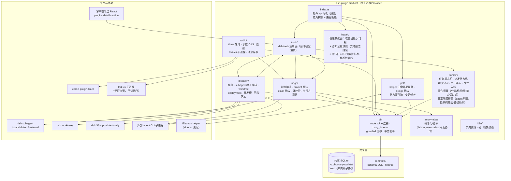
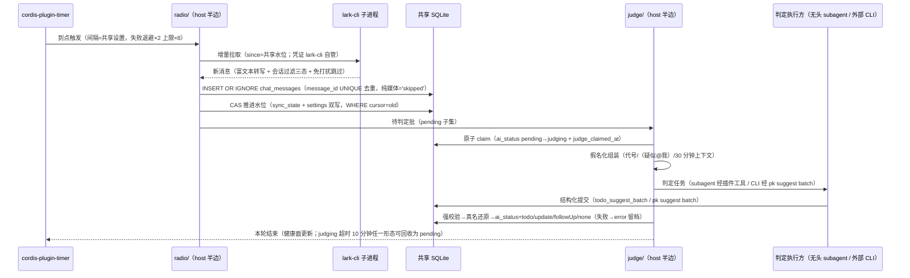
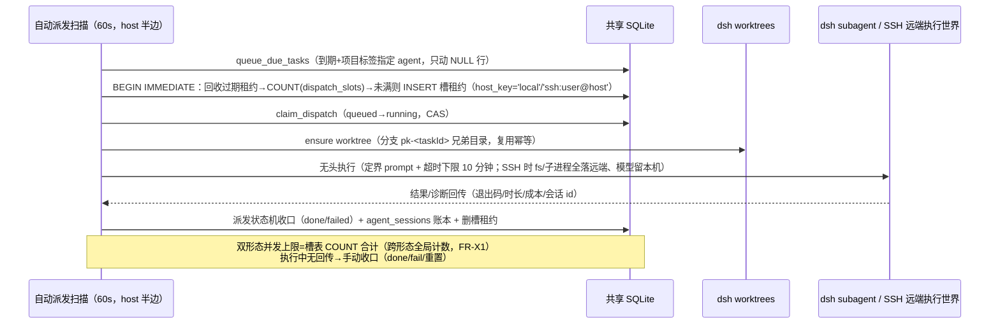
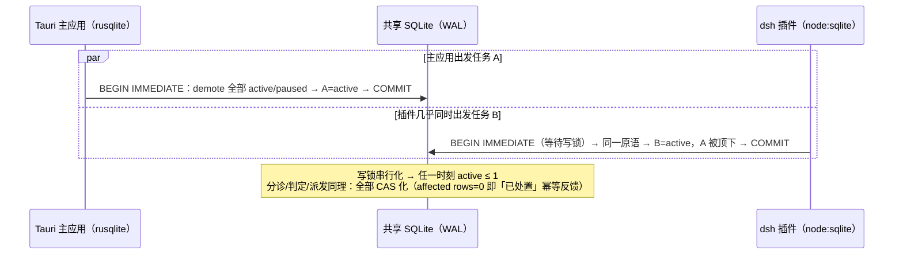
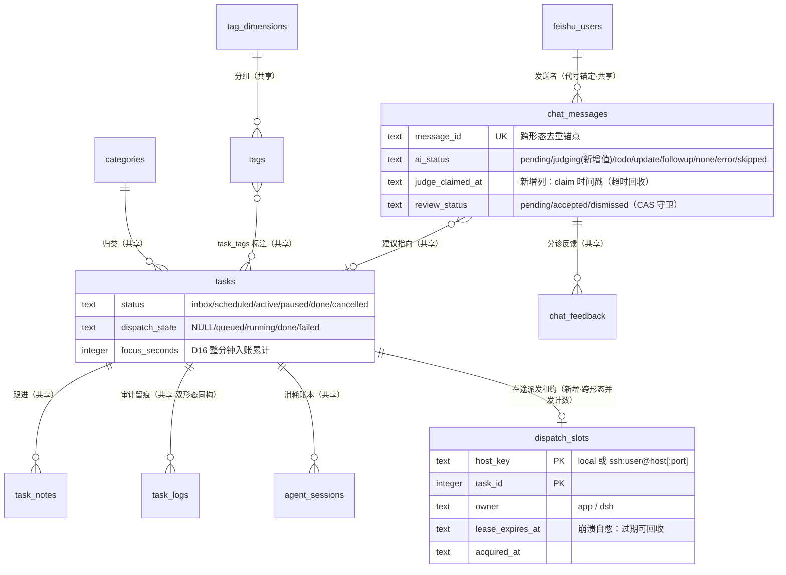

# dsh 插件形态（第二形态）架构设计文档 (AD)

> 输入：`specs/dsh-plugin/requirements.md`（SDD，16 处【待确认】、D14 已裁决分支 A）、
> `specs/dsh-plugin/design.md`（方向性设计，方案 B 全量 TS 重写）、主应用现行代码
> （`src-tauri/src/` 实读：db.rs / anonymize.rs / ai/ / commands/ / scheduler.rs / feishu.rs /
> bin/pk/）、`.devcontainer/stack.json` / `lefthook.yml` / `.github/workflows/ci.yml`。
> dsh 平台事实（0.2.0-rc.2）已由任务输入核实，本文不作重新考证。
> 契约口径铁律（FR-X3）：**一切「双实现共享契约」以主应用现行代码行为逆向为准**，本文的状态图/协议描述与 SDD/主应用代码冲突时以代码为准。

## 1. 架构决策概要

核心决策三句话：

1. **同一 SQLite 直连，不开同步层**：dsh 插件宿主半边以 Node 内建 SQLite（`node:sqlite`）直连 `~/.choose-you/data/pokemon-choose-you.db`（WAL 模式），成为 Tauri 主应用与 pk CLI 之外的第三个直连方——WAL 多进程并发是现行已验证模型（pk 与 GUI 并存），并发正确性不靠进程隔离而靠**库内原子操作（compare-and-swap）+ 短写事务（BEGIN IMMEDIATE）**。
2. **「双实现、单契约」落在一个仓库内的 `contracts/` 契约单一源**：迁移 SQL、状态机/判定协议/假名化/注入定界的 JSON fixtures 由 Rust（主应用，契约 oracle）生成并锁定、由 TS 实现回放，CI 双侧执行、任一侧漂移即红。
3. **平台面分层隔离**：确定性逻辑（轮询/判定编排/状态机）全部落在自研 TS 模块、只消费 dsh 的稳定原语（timer / subagent / worktrees / SSH / storage / slots）；桌宠 OS 面走 dsh-pet 先例的 sidecar Electron helper + stdio JSON 行桥，不依赖 dsh 未承诺的桌面 API——RC 期破坏性变更被限制在薄适配层。

**架构特性排序（冲突时按序取舍）**：

**数据一致性（双形态不分叉）> 契约可验证性（双实现差异可机器裁决）> 平台演进韧性（dsh RC 变更影响面最小化）**

- 数据一致性压倒性能与功能丰富度：任何「两边各自缓存提速」「插件私有副本」类设计一律让位；
- 契约可验证性压倒代码复用：宁可 TS 重写（用户已拍板），不允许「调 pk 二进制复用逻辑」破坏契约可测性；
- 平台演进韧性压倒 dsh 原生纯度：能用自研确定性模块解决的不赌平台 API 稳定性（判定编排不进 schedule 模型回合、桌宠不赌 Desktop API）。

## 2. 技术栈选择

主应用栈（Vue 3 + Tauri 2 + Rust + rusqlite + Vitest + Playwright）不动。插件新增选型如下：

| 层级 | 技术 | 版本基线 | 备选与否决理由 |
|------|------|----------|----------------|
| SQLite 驱动（host 半边） | **Node 内建 `node:sqlite`（DatabaseSync）** | Node ≥ 24（dsh 宿主与仓库工具链同基线） | ① `better-sqlite3`：API 更成熟，但为原生模块——dsh desktop 由 Electron 托管，宿主 Node ABI 与预编译产物不一定匹配，插件分发到任意机器需现场重编，风险不可控，否决；② `sql.js`（WASM）：纯内存、无文件锁与 WAL，多进程并发直连场景下**会写坏库**，绝对否决；③ 经 pk CLI 间接读写：方案 A 已被用户否决。`node:sqlite` 零原生依赖、同步 API 与 rusqlite 同构、随 Node 分发。【就地决策 A1，待确认：以 dsh 宿主实际 Node 运行时实测 `node:sqlite` 可用性；若宿主为 Electron 内嵌且该模块被裁剪，回落 better-sqlite3 + 按 ABI 分发预编译产物。风险补充：Electron 内嵌 Node 版本滞后、未必 ≥24（`node:sqlite` 22.5+ 才引入且长期 experimental）；better-sqlite3 在 Electron 下需 electron-rebuild 按其 ABI 产出二进制——「宿主 Node 版本 / `node:sqlite` 模块可用性」探测纳入 apply 期能力探测清单（§6 NFR-3 ②，与 A1 联动）】 |
| ORM / 数据访问 | **无 ORM，薄 SQL 层**（`db/` 模块：连接、busy_timeout、事务助手、SQL 语句集中常量） | — | ORM（Drizzle/Prisma/Kysely）：schema 由共享迁移 SQL 单源定义，ORM 模型会形成第二份 schema 描述，直接违反「单契约」；且现有 SQL（CAS 语义、部分索引、CHECK）是契约本体，必须原文共享。否决。 |
| 插件框架 | Cordis 插件（host 半边 Node + `dsh.client` React 客户端半边——plugins.detail.section 页面载体，同包分发） | dsh 0.2.0-rc.2 | 平台约束，非选型。客户端半边被迫 React（与主应用 Vue 不同栈）——按「客户端半边只做视图、全部业务在 host 半边 TS 核心与共享库」收敛双栈成本。 |
| 桌宠 helper | **sidecar Electron helper**（独立小应用：透明置顶局部小窗 + stdio JSON 行桥 + 宿主存亡绑定），Electron 运行时自动探测/下载 `~/.dsh/electron/`（dsh-pet 先例机制） | Electron 稳定版 | ① 复用主应用 Tauri 二进制当 helper：主应用是单实例 + Accessory 常驻设计，无法按「第二形态桌宠」单独生命周期管理，且把主应用进程拉进 dsh 存亡链违反「主应用不受影响」，否决；② 不做 OS 桌宠（纯面板内宠物）：SDD FR-P1 明确 helper 常驻形态，否决。 |
| 测试 | **Vitest（沿用仓库现有栈）** + 覆盖率 v8 provider | 现行 | Jest：仓库已全量 Vitest，双测试栈徒增门禁复杂度，否决。 |
| i18n | **共享主应用字典源直接 import：`src/i18n/*.ts`（zh-Hans.ts / zh-Hant.ts / en.ts，`export default` 纯对象字面量，非 JSON 文件）——插件经仓内 path alias（如 `@app-i18n`）跨包引 TS 源，零拷贝零同步步骤** + 自研轻量 `t()`（`{name}` 插值）+ dsh 专属键（`dsh.*` 命名空间）插件内维护 | — | ① vue-i18n / react-i18n：前者进不了 React，后者引入框架绑定且插值语法与现有字典不保证兼容，均否决——字典源是纯对象字面量、无框架绑定；② 插件自建独立字典：违反「世界观词汇与主应用术语一致」（FR-X8），否决。三语键集一致性由构建期校验（缺键即失败，NFR-7）。 |
| 判定执行方 | 无头 subagent（dsh 原生，默认）/ 外部 agent CLI 子进程（复用主应用 invocation 约定） | — | 见 §4.5 判定链路。 |
| 遥测/分析 | **无**（NFR-2：遥测 = 0） | — | — |

## 3. 系统模块与组件树

### 3.0 仓库布局与插件包结构（开放项 3）

候选对比：

| 候选 | 说明 | 结论 |
|------|------|------|
| A. 顶层新目录 `dsh-plugin/` + 启用 pnpm workspace（`pnpm-workspace.yaml` 增 `packages:`） | 插件包（host+client 同包）+ helper 子包 + 根级 `contracts/` 契约单一源 | **推荐** |
| B. `packages/` 下多包细分（core/plugin/helper 分包） | core 被 plugin 独占消费，分包徒增版本协调；v1 无第二消费方 | 否决（YAGNI；若日后 pk 退役为独立包再拆） |
| C. 独立仓库 | 契约 fixtures 必须与两侧实现同仓原子演进（FR-X3 差异即 CI 红），跨仓即「两个 CI 窗口内不一致」，否决 | 否决 |

```
contracts/                     跨实现契约单一源（新增目录；唯一被 Rust 与 TS 共同消费）
  schema/
    001_v1.sql                 迁移 SQL（= 现 db.rs SCHEMA_V1 外置；Rust include_str! 消费）
  scenarios/                   契约场景输入（状态机序列 / 协议载荷样本 / 假名化语料）
  fixtures/                    Rust 执行场景的期望输出（oracle 生成、TS 回放比对）
  PROTOCOL.md                  判定协议 JSON Schema、错误码、注入定界不变式说明
dsh-plugin/                    Cordis 插件包（pnpm workspace member）
  package.json                 含 dsh.client 声明、dsh 兼容声明、插件清单
  src/host/                    宿主半边（Node，见 3.1）
  src/client/                  客户端半边（React，plugins.detail.section 页面载体，见 3.2）
  docs/compatibility.md        dsh 依赖子系统 × 最低版本兼容矩阵（FR-X7）
  __tests__/                   Vitest（单元 + 契约回放 + 组件测试）
dsh-plugin/helper/             Electron helper 子包（workspace member，独立构建产物）
```

主应用侧唯一结构性改动：`src-tauri/src/db.rs` 的 `SCHEMA_V1` 常量外置为 `include_str!("../../../contracts/schema/001_v1.sql")`（编译期内联，运行时行为零变化，FR-X4 不破）。

### 3.1 宿主半边模块划分（package-by-feature，先答边界再谈分层）



模块职责与依赖约束（依赖只允许向下/向共享层，禁止反向）：

- **`db/`**：连接生命周期（`CHOOSE_YOU_HOME` 归一化根解析，与主应用 `db.rs` 同规则）、`PRAGMA journal_mode=WAL; busy_timeout=5000`、guarded 迁移（§5.3）、`BEGIN IMMEDIATE` 写事务助手。全插件唯一握连接的模块。
- **`domain/`**：任务六态状态机、派发五态状态机、建议分诊（CAS 幂等）、审计日志同构写入（`task_logs`，origin 标 `dsh`）、D16 专注整分钟入账、背包词表管理（分类/标签/维度/会话过滤——直写共享表，级联与不变式对齐主应用现行，§5.2 背包词表面）、**共享配置键面**（36 设置键读写、`ai_agents` 列表条级 CRUD、`ai_prompt_*` 提示词覆盖读写与校验、修订检测——§5.2 配置对齐面）。纯逻辑 + SQL 原语，**契约 fixtures 的 TS 实现侧**。
- **`radio/`**：timer 载体轮询（D14 分支 A）、共享水位读取与 CAS 推进、指数退避（2 分钟默认、上限 8 倍，与主应用同口径 D8）、lark-cli 子进程调用面（凭证由 lark-cli 自管）、消息入库（`INSERT OR IGNORE` + `message_id` UNIQUE 去重）。
- **`anonymize/`**：`AnonRules` 等价实现——同表 `feishu_users.alias` 懒分配/碰撞探测/长名优先/还原；**与 Rust 行为逐 fixtures 对齐**（含「群名不脱敏」现行设计，见 §9 就地决策 A12）。
- **`judge/`**：判定编排——批次组装（30 分钟同会话上下文、@提及标注）、判定 claim（§5.4）、执行方适配器（subagent / 外部 CLI）、结构化提交强校验、落库还原。
- **`dispatch/`**：项目路由解析（`dsh:` 配置键）、派发 prompt 定界组装（FR-D8 不变式对齐）、无头/交互编排、worktree（dsh worktrees 子系统）、SSH deployment 引用、机器级并发槽（`dispatch_slots`）、状态/成本回传写路径、会话续接。
- **`pet/`**：helper 进程监督（崩溃 10 秒内自拉起）、stdio JSON 行桥、任务状态事件流（本形态写后直推 + 跨形态 ≤2 秒侦听）、位置持久化。
- **`tools/`**：dsh tools 注册（§4.1），会话模型与判定 subagent 的统一消费面——薄壳，全部转发到 domain/judge/dispatch。
- **`health/`**：上次成功/下次轮询/连续失败/待处理积压（D13 最小可视面），读写 `sync_state` + 内存态；诊断全量快照（两条链路完整字段，§4.1.1 `diagnosticsSnapshot`）与支持报告组装（三层脱敏，§6 NFR-2 ⑥）；**插件运行日志**：host 半边内存环形缓冲（2000 条滚动，A24）+ `logQuery` 查询面（级别/来源过滤 host 侧执行、返回文本经同一三层脱敏管线，§4.1.1）。
- **`i18n/`**：字典装配与键集校验（构建期）。

### 3.2 客户端半边组件树（plugins.detail.section 页面载体；视觉/交互细节归 uiux-design.md，此处只定结构与数据契约）

```
本插件 detail page（Plugins 页 → 本插件详情；dsh main 区页面路由仅开放 conversation 与 Plugins 页——用户关卡回流裁决，§8）
├── Config 表单（dsh 原生：ConfigEditor live 渲染本插件 Config schema，非本插件组件）
│   └── 插件私有配置：桌宠开关/减弱动效/随宿主启动/判定执行方等（白吃 volatile HMR + 平台持久化，A2）
└── PkyDetailSection（自定义 section：ctx.plugins.detail.section 注册，React；组件根 = 插件页面容器——SegmentNav 七分段：
    面板六分段 + 「背包」独立分段[设置整页 · 宽窄一致——用户再回流裁决 §8⑥⑦]；
    双击桌宠精灵经 host→客户端 pageOpen（§4.1.1）直达并锚定目标分段）
    ├── 面板分段
    │   ├── AdventureView（冒险：进行中 + 今日到期）
    │   ├── RouteView（路线；逾期默认折叠一行 + 一键归草丛）
    │   ├── GrassView（草丛）
    │   ├── DexView（图鉴：完成/逃走留档 + 统计）
    │   ├── RadioView（收音机）
    │   │   ├── SuggestionList（待处理建议卡：◎捕捉/✕逃走/◎应用更新 · 新标签提议「＋」）
    │   │   ├── FailureGroup（判定失败组：单条/整组重判 · 强制捕捉/逃走）
    │   │   ├── EscapedGroup（逃走留档：原因码 + ↩恢复）
    │   │   ├── QuickCapture（⚡发报输入框 · 5 秒撤销）
    │   │   └── RadioHealthCard（上次成功/下次轮询/失败计数/立即拉取）
    │   ├── SessionsView（日志：agent 会话账本按来源过滤回放）
    │   └── TaskDetailDrawer（任务详情：跟进/Agent 执行时间线/派发操作/手动收口）
    └── SettingsView（「背包」独立分段（显示名，技术名不变）：SegmentNav「背包」进入设置整页，宽窄一致（U17/U18）；背包内分段演进：五段→七段（§8⑧/U19）→**八分区同名同构**（对齐主应用设置页 8 个 Section：🍅专注/🗂分类与标签/🐾桌宠/👀显示/🤖Agent/飞书/🩺诊断/⚙️通用——配置 100% 对齐回流，§8⑨/U20/D20）；共享配置读共享库 settings 而非 Config schema——
        双形态共享语义不变；36 共享设置键全量读写（§5.2 配置对齐面）；与 Config 表单同页（detail page）呈现，标注数据归属「插件私有 · Config schema ↔ 双形态共享 · 共享库」；形态专属行为项标注「作用于主应用」（U20 作用域原则））
        ├── SectionNav（八分区选单：🍅专注 / 🗂分类与标签 / 🐾桌宠 / 👀显示 / 🤖Agent / 飞书 / 🩺诊断 / ⚙️通用——顶部横向选单、选中切换，一次只显示一个分区整页——「每类设置单独一个页面」用户裁决 U21，对齐主应用「上选单下内容」）
        └── SectionContent（分区整页 ×8：每分区完整表单 + 标题行「保存」按钮提交（保存制对齐主应用，未保存离开确认——U21；host 命令面不变，仅提交时机从即时改保存）
            ├── FocusSection（专注：番茄开关/时长/短休息/完成通知/提示音/通知总开关/提前提醒/勿扰 3 键——共享键；触达类键标「作用于主应用」）
            ├── CategoryTagSection（分类与标签：categoryUpsert（含换装绑定 pokemon 字段）/ categoryDelete（放生级联）/ tagUpsert / tagDelete / dimensionUpdate——直写共享表，A23）
            ├── PetSection（桌宠：主宝可梦与台词 + 输入响应×2/语音/陪跑[共享键，行为作用于主应用桌宠] + 减弱动效[reduced_motion 共享键，dsh helper 同读]/显示桌宠/随宿主启动[Config 双轨，A2]）
            ├── DisplaySection（显示：语言/日期格式/时间制式/逾期模式/相对截止——共享键；逾期模式与相对截止 dsh 面板同读同生效；语言切换经 lang 桥消息联动 helper）
            ├── AgentSection（Agent：agent 列表 + 主 agent ai_agent_id + 终端偏好[作用于主应用交互派发] + 项目路由 routeUpsert + 自动派发/并发/worktree——对齐主应用 agents 分区）
            │   ├── AgentConfigCard（Agent 列表条级 CRUD agentUpsert/agentDelete——整读-改-整写 + 修订检测，A24）
            │   └── PromptOverrideEditor（4 处系统提示词查看/覆盖/恢复默认 promptList/promptGet/promptOverride/promptReset + dispatch 只读示例项；修订检测冲突 SETTING_MODIFIED_ELSEWHERE，A24）
            ├── FeishuSection（飞书：启用/轮询间隔/我的称呼 + larkAuth/larkTest 授权入口 + 会话过滤三态管理 filterList/filterUpsert——私聊固定跟随不可设，A23）
            ├── DiagnosticsSection（诊断：diagnosticsSnapshot 健康完整面板 + supportReport 脱敏文本一键复制）
            │   └── LogViewer（插件运行日志查看器：logQuery 分页/级别/来源过滤、最新在上、返回文本已脱敏——对齐主应用 diag 分区「健康 + 日志」结构，A24）
            └── GeneralSection（通用：复盘提醒×2/备份×2/关闭到托盘[共享键，作用于主应用] + 待办库状态/使用指南）

Electron helper 窗体（独立进程，非客户端 section）
└── PetWindow（300×330 透明置顶局部小窗，逐 pet 一窗）
    ├── SpriteStage（精灵：换装/跳跃/变灰/庆祝/拖动 4px 阈值）
    ├── DialogBubble（台词气泡：时长自适应淡出 · 悬停暂停 · 点击收起）
    ├── PomodoroPill（番茄药丸 ⏸/▶/✔ + 🍦先试 5 分钟 + 倒计时色环）
    ├── QuickDexScreen（悬停 ☰ 唤出 LCD 今日列表，点选出发）
    └── HitRegionLayer（命中区悬停翻转 setIgnoreMouseEvents）
```

### 3.3 Electron helper 子包（开放项 6/7 的工程面）

- **进程模型**：插件宿主半边 `pet/` 为父——spawn helper 主进程（每宠一 BrowserWindow：transparent + alwaysOnTop + skipTaskbar + 不可激活；**禁止全屏透明画布**，Windows DWM 视频合成黑屏坑位）；helper 渲染进程跑桌宠 UI（复用主应用 `public/pokemon/` 素材分发口径：内置 6 只离线 + CDN 候选链，PokeAPI sprites 版权声明随包保留，NFR-9）。
- **与宿主半边通信**：dsh-pet 桥模式——主进程 ↔ 插件走 **stdio JSON 行协议** + 心跳管道（Desktop 访问闸门拦裸 HTTP，故不用本地 HTTP；自定义 scheme 仅在渲染进程需要时按先例引入）；渲染进程 ↔ helper 主进程走 Electron IPC。
- **生命周期**：helper 侧宿主存亡探测（管道守卫 + PID 探测，宿主退则 helper 10 秒内自杀）；插件侧监督（helper 崩溃 10 秒内自拉起、状态与位置恢复，FR-P1）；用户「隐藏桌宠」= 插件停 helper 进程（其余功能不受影响）。
- **standalone 伪 ctx 模式**（dsh-pet 先例）：helper 与桥协议的集成测试用它——不拉起 dsh 宿主即可跑协议级 E2E（§7 测试形态）。
- **降级路径**（评审 M5 留白补全，就地决策 A20）：① **素材双缺**（任务分类绑定的精灵非内置 6 只、且 CDN 候选链不可达）——helper 回退渲染内置主宝可梦（或固定占位精灵），台词气泡单次提示「素材缺失」；插件页面设置分段·桌宠显示「『<分类>』的精灵素材缺失，已回退」报错行，网络恢复后插件重新下发 `sprites` 自动换回；② **Electron 首装离线/下载失败**——helper 无法拉起时桌宠功能整体停用（等同「隐藏桌宠」态，不弹窗、其余功能不受影响），插件页面设置分段·桌宠显示「Electron 运行时未就绪（下载失败/离线）」+ 重试按钮，运行时探测成功后自动恢复常驻。

## 4. 关键接口定义

### 4.1 dsh tools 契约（FR-T2：与 pk 面等价；会话模型与判定 subagent 共用）

工具统一约束：全部同步走 host 半边 domain 层 → 共享库；错误返回 `{ error: { code, message, hint? } }`（对齐 pk 的 `{"error":"..."}` + 可操作提示风格）；写操作全部落审计（origin=`dsh:<sessionId>`）。camelCase 字段与主应用 serde `rename_all = "camelCase"` 对齐（契约 fixtures 锁定字段集）。

| 工具 | 参数 | 响应/效果 | pk 对应 |
|------|------|-----------|---------|
| `todo_context` | — | `{ now, openTasks[], categories[], tags[], dimensions[], tagFeedback[] }`（假名化口径同 pk context：人名=代号） | `pk context` |
| `todo_task_list` | `{ scope: open\|done\|today\|all, limit? }` | `{ tasks: Task[], truncated }` | `pk task list` |
| `todo_task_get` | `{ id }` | `Task`（含跟进记录、标签、派发状态、agent 时间线摘要） | `pk task get` |
| `todo_task_search` | `{ query }` | `{ tasks: Task[] }`（标题/备注/跟进/标签） | `pk task search` |
| `todo_task_create` | `{ title, category, due?, priority?, tags?, note?, dryRun? }` | `{ task }`（有截止→scheduled，无→inbox；分类标签必须来自 context 词表） | `pk task create` |
| `todo_task_update` | `{ id, ...可变字段（due:"" 清空） }` | `{ task }` | `pk task update` |
| `todo_task_done` / `todo_task_undone` | `{ id }` | 任务状态流转（撤销按分流规则落位） | `pk task done` / 撤销 |
| `todo_task_start` / `todo_task_pause` | `{ id? }` | 出发（全局唯一进行中 + 顶下 demote）/ 暂停 | `pk task start/pause` |
| `todo_task_current` | — | `{ task \| null }` | `pk task current` |
| `todo_task_delete` | `{ id }` | 放生：级联删标签关联+跟进，审计留墓碑 | `pk task delete` |
| `todo_task_escape` | `{ id }` | 逃走（任何未完成态可逃，留档可恢复） | 主应用右键逃走 |
| `todo_note_add` | `{ taskId, content, source? }` | 跟进记录追加（内容真名还原后落库） | `pk note add` |
| `todo_tag_list` / `todo_tag_create` | — / `{ name, dimension }` | 标签面（FR-T2 对等 pk tag 能力） | `pk tag` |
| `todo_suggest_batch` | `{ results: AiSuggestion[] }` | **判定唯一出口**：强校验（§4.2），整批拒绝即报错 | `pk suggest batch` |
| `todo_dispatch_done` / `todo_dispatch_fail` | `{ taskId, note }` | 派发回传（状态机 CAS 收口 + agent_sessions 落账） | `pk dispatch done/fail` |
| `todo_session_log` | `{ taskId?, agentId, sessionId?, costUsd?, durationMs?, exitCode? }` | 消耗账本补录 | `pk session log` |
| `todo_pet_hide` / `todo_pet_show` | — | 桌宠显隐（helper 生命周期） | —（dsh 形态新增） |

会话内自然语言建任务（FR-T1）= 会话模型组合 `todo_context` → `todo_task_create`，5 秒撤销 = `todo_task_delete`；「只答不执行」（FR-T7）= 只读工具组合，prompt 侧约束（技能文档义务，随插件分发一份 dsh 版 agent 技能说明，对应 `src-tauri/skills/` 的 dsh 形态对应物）。

### 4.1.1 host 命令契约（客户端半边 → 宿主半边 RPC；评审 M4 补全）

**消费方区分（与 §4.1 工具面）**：`todo_*` 工具 = **dsh 会话模型**消费（模型回合内调用，判定 subagent 亦用，进 prompt 语境）；本节 host 命令 = **客户端半边**消费（React 插件页面直接调用；Electron helper 经 §4.3 bridge `cmd` 消息转发到同一命令面，不另设第二协议）——不经会话模型、不进 prompt。同一业务能力两面料各自暴露（页面 `taskStart` ≠ 工具 `todo_task_start`），内部落同一 domain 层原语。uiux-design.md 契约需求面触发入口归并为下表 49 个 client→host RPC 命令 + 1 条 host→客户端推送 `pageOpen`（共 50 条目；背包全量补齐回流自 33+1 扩 9 条背包命令，§8⑧；配置 100% 对齐回流再扩 7 条命令（agentUpsert / agentDelete / promptList / promptGet / promptOverride / promptReset / logQuery），§8⑨）；`pageOpen`（打开插件页面，双击精灵触发——用户关卡回流，§8）经 dsh 客户端导航/事件通道承载，`tool:captureNatural / undoCapture`（会话对话捕捉）归工具面。

**错误码**：单源 = uiux-design.md 契约需求面交互状态表的 15 码枚举（JUDGE_TIMEOUT / JUDGE_INVALID_RESULT / LARK_FETCH_FAILED / LARK_UNAUTHORIZED / DISPATCH_TIMEOUT / DISPATCH_LAUNCH_FAILED / DB_SCHEMA_TOO_NEW / DSH_VERSION_UNSUPPORTED / SSH_AUTH_REQUIRED / SUGGESTION_ALREADY_RESOLVED / DISPATCH_ALREADY_ACTIVE / CONFIG_VALIDATION_FAILED / AGENT_COMMAND_INVALID / PROMPT_VALIDATION_FAILED / SETTING_MODIFIED_ELSEWHERE——第 12-14 码（配置校验/agent 命令/提示词校验）与第 15 码（设置修订检测失配：agent 列表/提示词覆盖在编辑期间已被另一形态修改，提示「已在另一处被修改」，确认后带 `force` 重发整值覆盖——A24）随配置 100% 对齐回流新增（§8⑨/U20 联动）），实现落入 `contracts/PROTOCOL.md`；响应统一 `{ ok, data? }` / `{ error: { code, message, hint? } }`（与工具面同构）。所有 host 写命令在库超窗时先撞 `DB_SCHEMA_TOO_NEW`（下表不逐行重复，仅列各自业务码）；除「异步完成」注明外均为同步返回。

| 域 | 命令 | 参数 | 响应 data | 业务错误码 |
|---|------|------|-----------|-----------|
| 任务 | `taskStart` | `{ taskId }` | `{ task }` | — |
| | `taskPause` / `taskResume` | `{ taskId? }`（缺省 = 当前进行中） | `{ task \| null }` | — |
| | `taskComplete` | `{ taskId? }` | `{ task }` | — |
| | `taskCancel`（逃走） | `{ taskId, reasonCode }`（6 枚举） | `{ task }` | reasonCode 非法 → 参数错 |
| | `taskDelete`（放生） | `{ taskId }` | `{ taskId }`（墓碑审计确认） | — |
| | `taskReschedule` | `{ taskId, due? }`（空串 = 清空截止） | `{ task }` | — |
| 快捕 | `captureTodo` | `{ text }` | `{ messageId, outcome }`（新建议卡 / 命中现有 → 更新卡或并入跟进） | JUDGE_TIMEOUT / JUDGE_INVALID_RESULT；撤销走二次调用（5 秒窗口内 UI 态） |
| 分诊 | `reviewAccept` / `reviewApplyUpdate` | `{ messageId }` | `{ task \| message }` | SUGGESTION_ALREADY_RESOLVED（CAS affected=0） |
| | `reviewDismiss` | `{ messageId, reasonCode }` | `{ message }` | SUGGESTION_ALREADY_RESOLVED |
| | `reviewRestore` | `{ messageId }` | `{ message }` | SUGGESTION_ALREADY_RESOLVED（非逃生态/已处置） |
| | `reviewBatch` | `{ messageIds[], op: accept\|dismiss, reasonCode? }` | `{ results[] }`（逐条成败） | SUGGESTION_ALREADY_RESOLVED（逐条标记） |
| 失败组 | `retryJudge` | `{ messageIds[] \| "all" }` | `{ accepted }`（判定结果异步走 slot 推送） | — |
| | `forceCapture` / `forceDismiss` | `{ messageId, reasonCode? }` | `{ task \| message }` | SUGGESTION_ALREADY_RESOLVED |
| 收音机 | `pollNow` | — | `{ health }`（触发一轮；拉取结果异步 slot 推送） | LARK_FETCH_FAILED / LARK_UNAUTHORIZED |
| 派发 | `dispatchInteractive` / `dispatchHeadless` | `{ taskId, routeOverride? }` | `{ dispatch }` | DISPATCH_ALREADY_ACTIVE / DISPATCH_LAUNCH_FAILED / SSH_AUTH_REQUIRED（远程免密不满足） |
| | `dispatchClose` | `{ taskId, result: done\|failed, note? }` | `{ dispatch }` | 幂等：已收口径按成功反馈（transition_or_already 语义） |
| | `dispatchReset` / `dispatchCancel` | `{ taskId }` | `{ dispatch }` | 状态机不满足迁移 → 参数错（附可操作提示） |
| | `dispatchRedo` | `{ taskId }` | `{ dispatch }` | DISPATCH_ALREADY_ACTIVE |
| 设置 | `configRead` | `{ keys[] }` | `{ keyValues }` | — |
| | `configWrite` | `{ keyValues }`（**36 共享设置键全量读写**（= 主应用 SETTING_KEYS 现行全集，含我的称呼/勿扰/逾期模式等纯设置键——配置 100% 对齐，§8⑨；纯设置键不另设命令）；含 `dsh:` 内部态键；插件私有用户配置走 Config schema——A2） | `{ ok }` | — |
| | `routeUpsert` | `{ route }`（项目路由 CRUD） | `{ route }` | 参数校验错 |
| | `larkAuth` / `larkTest` | — | 授权跳转态 / `{ identity, chatCount }` | LARK_UNAUTHORIZED（test 侧） |
| 背包 | `categoryUpsert` | `{ id?, name, pokemon?, sprite?, enabled?, description? }`（新增/改名/启停一体；换装绑定 = `pokemon` 字段，A23 合并决策） | `{ category }` | 参数校验错（空名/重名）；停用最后一个启用分类 → 参数错（至少保留一个启用，对齐主应用现行） |
| | `categoryDelete`（放生分类） | `{ id }` | `{ id, movedTaskCount }`（级联：任务归第一个启用分类——对齐主应用现行） | 参数错（最后一个分类不可删） |
| | `tagUpsert` | `{ id?, name, dimension, description? }` | `{ tag }` | 参数校验错（空名/维度停用/配额满/维度内重名） |
| | `tagDelete` | `{ id }` | `{ id }`（级联删 task_tags 关联，审计留痕） | — |
| | `dimensionUpdate` | `{ key, name, maxTags?, enabled? }`（改名/上限/停用；key 与单多选 cardinality 建后不可改——对齐主应用现行） | `{ dimension }` | 参数校验错（空名/不可变字段越改） |
| | `filterList` | — | `{ chats[], counts }`（会话过滤清单 + 计数，排除私聊；三态 follow/alwaysFilter/alwaysPull——follow = 无偏好行） | — |
| | `filterUpsert` | `{ chatId, state: follow\|alwaysFilter\|alwaysPull }`（follow = 删偏好行） | `{ filter }` | 私聊（chat_type=p2p）设置 → 参数错（固定跟随，API 层拦截——对齐主应用现行） |
| | `agentUpsert` | `{ agent: AgentConfig, expectedAgentIds?, force? }`（字段集对齐主应用 ai/config.rs 现行 camelCase：id/name/command/args/historyArgs/workdir/skillDir/timeoutSecs/enabled/remote{host,port,keyPath,tunnel,persistent}；写路径 = 整读 `ai_agents` → 按 id upsert 条目 → 整写回（单条 BEGIN IMMEDIATE），A24） | `{ agents }`（保存后完整列表，前端零推导） | 参数校验错（空 command——对齐 `load_agents` 过滤语义，写入即需可读出）；expectedAgentIds 与整读 id 集失配 → SETTING_MODIFIED_ELSEWHERE（force 重发覆盖） |
| | `agentDelete` | `{ id, expectedAgentIds?, force? }` | `{ agents }`（删除后完整列表；「用于收音机分类」正指向被删 id 时 `ai_agent_id` 一并清空——主应用现行前端行为同构化） | 同上（修订检测） |
| | `promptList` | — | `{ specs[] }`（固定 5 项 = 4 可编辑 + dispatch 只读示例项；视图模型对齐主应用 `list_ai_prompt_specs` 的 PromptSpecInfo camelCase 字段集：id/storageKey/editable/defaultText/requiredPlaceholders/lengthLimit/overrideText/source/missingPlaceholders/overlong；source 枚举值按主应用现行 snake_case 字面量 default/custom/default_warned——FR-X3 代码为准） | — |
| | `promptGet` | `{ key }` | `PromptSpecInfo`（单项最新状态 = 编辑器基线，expectedValue 取自本次 overrideText） | 未知键 → 参数错（「该提示词不支持编辑」——对齐主应用键白名单现行） |
| | `promptOverride` | `{ key, value, expectedValue?, force? }` | `{ spec, unknownPlaceholders }`（对齐主应用 SavePromptResult；未知占位符非阻断警告） | 键白名单外（dispatch 无键/未知键）→ 参数错；超长（>20000 code points）/缺必要占位符 → 参数错（文案含上限值/占位符名——对齐 `validate_prompt_save` 现行）；空白或与默认逐字一致 = 删行（恢复默认语义）；expectedValue 与库内当前行失配 → SETTING_MODIFIED_ELSEWHERE（force 重发覆盖） |
| | `promptReset` | `{ key, expectedValue?, force? }` | `{ spec }`（恢复默认 = 删行——「保存空白 → DELETE」现行语义的显式命令形态） | 同 promptOverride（白名单/修订检测） |
| 诊断 | `diagnosticsSnapshot` | — | `{ links[] }`（两条链路：feishu 收音机 / ai 判定，各含 状态档 + lastSuccessAt / nextPollAt / consecutiveFailures / lastError(+At) / pendingCount 积压 / primaryAgent——字段集对齐主应用 integration_health 现行） | — |
| | `supportReport` | — | `{ text }`（版本 + 平台 + 健康快照 + 最近 200 条日志的脱敏文本（条数对齐主应用 build_support_report 现行），由前端复制到剪贴板；三层脱敏见 §6 NFR-2 ⑥） | — |
| | `logQuery` | `{ minLevel?, target?, offset?, limit? }` | `{ entries[], total }`（插件 host 半边自身运行日志查看器：数据源 = 内存环形缓冲 2000 条滚动、不落盘（随宿主进程存亡，跨重启排障走支持报告与宿主进程日志——A24）；entry = time/level/target/message 对齐主应用 LogEntry；最新在上；级别/来源过滤 host 侧在环形缓冲上执行、不拉全量；limit 默认 500 上限 2000（对齐主应用日志查看器 tail 口径）；message 出 host 边界前经三层脱敏管线——与支持报告同源，§6 NFR-2 ⑥） | — |
| 桌宠 | `petShow` / `petHide` | — | `{ ok }`（helper 生命周期） | — |
| | `petMove` | `{ pos }` | `{ ok }`（持久化 `dsh:pet_pos`） | — |
| 页面 | `pageOpen` | `{ section? }`（目标分段锚点：panel\|settings，可选） | —（host→客户端推送：经 dsh 客户端导航/事件通道打开 Plugins 页 → 本插件 detail page 并锚定分段；桌宠双击 `open-page` 桥 cmd 触发，见 §4.3） | — |
| 通用 | `dbStatus` | — | `{ userVersion, pluginWindow: {min, max}, mode }` | 只读模式时面板呈现 `DB_SCHEMA_TOO_NEW` 横幅 |
| 专注 | `pomoTryFive` | `{ taskId? }` | `{ ok }`（helper 本地 5 分钟计时，结束不自动接休息） | — |

### 4.2 判定协议（FR-R4：结构化提交 + 强校验；契约形态 = JSON Schema + fixtures）

- **AiSuggestion JSON**（与 `ai/types.rs` 字段一一对应，camelCase）：`{ messageId, action: todo|update|followUp|none, title?, note?, category?, priority?(low|normal|high|urgent), due?, tags: [{name, dimension, isNew}]?, followUpTaskId?, updateTaskId?, reason?, confidence?(high|medium|low) }`。
- **提交期校验集**（= pk `validate_suggestion` 现行行为；整批原子：任一条违规**整批拒绝**并指明第几条、错误文案含 messageId 供执行方自纠）：① 消息存在且 `review_status='pending'`（已人工确认过即拒绝——防重复分诊/重复挂跟进）；② action 枚举封闭且载荷匹配：todo 必须带非空 title、update 必须带 updateTaskId、followUp 必须带 followUpTaskId，且目标待办必须存在；③ priority/confidence 非空时必须命中枚举；④ category 非空时必须命中启用分类；⑤ tags：`isNew=true` 时维度必须存在且剩余配额 >0（**配额满/维度停用 = 整批拒绝**，文案引导改选现有标签或换维度）；未标 `isNew` 的名字必须在词表内（按「维度+名」精确或按名全局兜底命中，**词表外 = 整批拒绝**）；⑥ 批内 messageId 重复 = 整批拒绝（follow-up 场景防重复挂跟进）。
- **接受期解析集**（= 落库/分诊/捕捉路径 `resolve_proposed_tags` 等现行行为；发生在建议被接受采纳的解析阶段，**非拒绝语义**——与提交期是两个阶段，勿混）：词表内按「维度+名」精确命中、未中按名全局兜底；`isNew=true` 的词表外名字直接创建（origin=ai），配额满/维度停用时**跳过该标签并告警**；未标 `isNew` 的词表外名字**告警跳过**（AI 违反协议的观测点）；category 未命中回落第一个启用分类、priority 非法回落 normal；`due` 为空串/纯空白时**归一为 NULL 接受**（模型「留空」常输出空串，落 `''` 会绕过草丛不变量的 IS NULL 判定——现行即归一，非拒绝）。
- 组装/落库侧配套兜底（词表与 prompt 侧约束 + 落库路径）：tags 每待办 ≤3、project 维度 ≤1；未知维度 key 归 topic（现行兜底）；批内判重（规范化标题相同的多条 todo 只留首条，其余降级 none + reason 指向保留条）。
- **契约基线冻结**：生成 fixtures 前，先对 `validate_suggestion` 与接受期解析路径做**行为快照冻结**作契约基线——本节文字描述与代码行为再冲突时，以 fixtures 锁定的代码行为为准（FR-X3 铁律）。
- **校验失败 ≠ 判定失败**：校验失败整批报错回执行方修正重试（协议允许剔除「已人工确认」消息），**重试自限：执行方会话内 ≤2 次**，超限整批落 `error` 组走 FR-R6 人工重判（防「校验失败↔重试」活锁，就地决策 A21）；执行方超时/崩溃 = 消息回 `error` 组留档可重判（FR-R6）。
- 契约载体：`contracts/PROTOCOL.md` 内 JSON Schema + `contracts/fixtures/judge-protocol/*.json`（Rust 现行 `review/suggest` 校验行为逆向生成）。

### 4.3 桌宠 bridge 协议（stdio JSON 行，每行一个 JSON 对象）

| 方向 | 消息 | 数据结构 |
|------|------|----------|
| 插件 → helper | `task-state` | `{ activeTask: {id,title,categoryPokemon,status} \| null, badge: {pendingSuggestions, failures}, ts }`（≤2 秒送达：本形态写后直推 + 跨形态 DB 侦听） |
| 插件 → helper | `pomodoro-config` | `{ durations: [15,25,45,60], breakMin, lang }`（本地计时由 helper 自持，D2） |
| 插件 → helper | `lang` | `{ lang: zh-Hans\|zh-Hant\|en }`（即时切换） |
| 插件 → helper | `sprites` | `{ builtin: [6 只内置], cdnBase }`（素材分发口径；双缺时 helper 按主宝可梦回退渲染并上报，见 §3.3 降级路径） |
| 插件 → helper | `heartbeat` | `{ ts }`（管道守卫；超时 helper 自杀） |
| helper → 插件 | `cmd` | `{ op: start\|pause\|resume\|done\|switch\|capture\|hide\|open-page\|pet-interact, taskId?, text?, pos? }`（op 转发 domain 层；`pos` 为拖动后位置持久化；`open-page` = 双击打开插件页面——host 半边收到后经 host→客户端 `pageOpen` 推送（§4.1.1）走 dsh 客户端导航/事件通道，打开 Plugins 页本插件 detail page，目标分段经 `section` 可选锚定） |
| helper → 插件 | `focus-settle` | `{ taskId, localSessionId, elapsedMin }`（D16：任务离开进行中/番茄终止时整分钟入账，按 localSessionId 幂等；幂等账本 = 共享库 settings 键 `dsh:focus_settled`——JSON 数组滚动保留最近 100 个 localSessionId，含则跳过入账，就地决策 A20） |
| helper → 插件 | `hello` / `crash-diag` | 握手携带版本/能力位；崩溃前环形缓冲诊断 |

### 4.4 契约 fixtures 机制（开放项 2：谁生成、放哪、CI 怎么跑红）

```
contracts/scenarios/*.json   场景输入（初始库快照 + 操作序列/输入载荷）
        │  ① cargo test（Rust 契约模块，oracle）：执行场景 → 生成/校验 fixtures
        ▼
contracts/fixtures/*.json    期望输出（任务行终态 + task_logs 审计序列 + 派发状态 + 建议状态 + 校验裁决）
        │  ② vitest（dsh-plugin 契约套件）：同一场景喂 TS 实现 → 逐字段比对 fixtures
        ▼
差异即 CI 红（Rust 侧漂移：fixtures 重生成比对失败；TS 侧漂移：回放断言失败）
```

- **生成与更新**：fixtures 由 Rust 侧契约测试生成（`UPDATE_FIXTURES=1 cargo test` 重生成；无环境变量时仅比对——Rust 行为漂移必须显式重生成 fixtures，形成「契约变更 = 有意的两步动作」）。场景覆盖矩阵（FR-X3 全集）：任务状态机全部合法迁移 + 全部非法拒绝 + 顶下 demote + 撤销分流 + 任意未完成态逃走 + 「路线无截止从未出发强制回草丛」不变量 + 删除级联/墓碑；派发状态机迁移矩阵 + 原子 claim + 排队回收 + 重置；判定协议全部校验拒绝规则 + 批内判重 + 标签解析（对象/字符串旧协议/维度缺省/isNew 配额）；假名化（稳定/懒分配/碰撞探测/长名优先/同名风险/还原/群名不脱敏）；背包词表级联与不变式（放生分类级联归第一个启用分类、最后分类/最后启用分类守卫、维度 key 与 cardinality 不可改、配额满/维度停用拒绝新建、私聊固定跟随拒写——§5.2 背包词表面）；配置对齐（提示词覆盖：键白名单/空白与等于默认删行/超长/缺占位符拒绝/未知占位符警告/三态回落；agent 列表：条级 upsert/删除联动清 ai_agent_id/空 command 拒绝；修订检测：expectedValue/expectedAgentIds 基线失配 → SETTING_MODIFIED_ELSEWHERE、force 覆盖——§5.2 配置对齐面）；支持报告三层脱敏（敏感键名/值形态/名词表，对齐主应用 `commands/diagnostics.rs` 现行——§6 NFR-2 ⑥，logQuery 同管线同源）；注入定界不变式（定界符恰一次、伪造定界洗裁、数据声明在场——FR-D8）；冷启动种子（默认分类/维度）。
- **场景完备性机检**（评审 M3a）：Rust 契约模块与 TS 回放套件**各自**断言「执行场景数 == `contracts/scenarios/` 目录文件数」——新增场景文件未挂进任一侧执行清单即 CI 红（防清单与文件集静默漂移）。
- **两类断言形态**（评审 M3b）：确定性场景（状态机序列 / 协议载荷 / 假名化语料）= 逐字段字节回放比对；**并发压测场景（双连接各 50+ 混合读写）不做字节回放**——并发交错次序非确定，降级为不变式/计数断言：active ≤1、审计条数守恒（= 期望写操作数）、无重复建议/无重复跟进；该类场景的 fixtures 锁定不变式断言集而非终态快照。另一处时序锁定：现行 `start_task_conn` 的 demote 审计是**事务提交后补写**（demote 快照在事务外读、COMMIT 后 `log_change`，commands/tasks.rs）——TS 若把审计并入同事务会与 oracle 产生微差；契约按**实际时序**锁定（TS 同为提交后补写），「语义等价」而非「字面同构」（§5.4 出发原语同口径）。
- **假名化别名的参数化断言**（评审 M3c，就地决策 A18）：现行 anonymize.rs 以 `DefaultHasher` 生成「成员_xxxx」后缀（std 不承诺跨版本/跨实现稳定，代码注释自述）——fixtures 对**新分配别名不做具体值断言**：比对前将 `成员_` 形态别名归一为占位符，仅断言「同 open_id → 同占位符（稳定）+ 场景内唯一 + 前缀形态」；跨实现别名稳定性由 `feishu_users.alias` 落库承载（NFR-2 的 100% 稳定经存储而非算法达成）。后续可选项：双实现同步换 SHA-256 截短等跨实现稳定算法写入 `contracts/PROTOCOL.md`（属主应用演进；只影响新分配，存量别名不受影响）。
- **CI**：新增 `plugin` job（§7.3）顺序执行 ①②；Rust 契约模块挂在现有 `rust` job 的 `cargo test` 内（零新增 runner 成本），TS 回放在 `plugin` job。两侧都吃同一份 checked-in fixtures，任一单边演进不重生成即红。
- **schema 同源断言**：Rust `include_str!` 与 TS 构建（把 `contracts/schema/*.sql` 打进插件包）之外，CI 增加一步字节相等断言（防有人只改一边的复制路径）。

### 4.5 关键链路序列图

**轮询判定链路（D14 分支 A：timer 载体，拉取步零 LLM）**



**无头派发链路（含跨形态并发槽）**



**双形态并发写（FR-X1 不变式保障）**



## 5. 数据模型

### 5.1 共享 SQLite 访问模型（开放项 1）

- **直连同一库文件**：`~/.choose-you/data/pokemon-choose-you.db`（`CHOOSE_YOU_HOME` 覆盖优先，与 `db.rs` 同一解析规则）。连接建立即 `PRAGMA journal_mode=WAL; PRAGMA synchronous=NORMAL; PRAGMA busy_timeout=5000`（与主应用一致 + 补 busy_timeout）。WAL 多进程并发已被 pk CLI × GUI 现行实践验证；插件是第三个直连方，**不引入任何中间层**。
- **写路径铁律**：所有写操作走「单条 `BEGIN IMMEDIATE` 短事务」；跨行不变式（全局唯一进行中、分诊唯一生效、claim、并发槽）一律用 **compare-and-swap UPDATE（WHERE 守卫）受影响行数判定**，与主应用 `claim_dispatch`/demote 同构。禁用长事务；禁止在事务内做任何子进程调用/await。

### 5.2 ER 图（现有表 + 本设计新增）



- 现有 15 张表全部沿用，**零表名/列名变更**；新增 1 表（`dispatch_slots`）+ 1 列（`chat_messages.judge_claimed_at TEXT NOT NULL DEFAULT ''`）+ 1 个 `ai_status` 枚举值（`judging`）。settings 表（key-value）继续作为共享行为偏好与 `dsh:` 前缀键（共享语义 dsh 侧键与 host 半边内部态；用户面插件私有配置走 Config schema，见下条与 A2）的载体，不与业务表建外键关系。
- **配置来源双轨（A2，用户关卡回流微调）**：插件**私有**用户配置（桌宠开关/减弱动效/随宿主启动、判定执行方等）优先走 dsh 插件 **Config schema**——Plugins 页本插件 detail page 原生 ConfigEditor live 表单（白吃 volatile HMR 与平台持久化），不进共享库；**共享**配置（语言/轮询间隔/专注档/项目路由/主宝可梦与台词）仍写共享库 `settings` 键——双形态共享语义不变，插件页面设置分段对应分段读写共享库而非 Config schema；两种来源同页呈现、标注数据归属。`settings` 表 `dsh:` 前缀键保留给共享语义 dsh 侧键与 host 半边内部态（项目路由 `dsh:dispatch_routes`、桌宠位置 `dsh:pet_pos`、focus-settle 幂等账本 `dsh:focus_settled` 等）：随库备份/导出（同库保证 dsh 写入被主应用备份覆盖，§4.6 SDD 处置表）、不产生第二存储域。**dsh deployment 连接细节本身由 dsh 平台管理，插件只存引用标识（deployment 名 + 连接目标 user@host）**。
- 项目路由联接：dsh 侧 `dsh:dispatch_routes` 以**项目标签名**为键（与主应用 `tags.meta` 平行的双轨各一份，以标签名对齐，SDD §3.2 口径）。
- **背包词表面 = 已有共享实体直写**（用户关卡回流·背包全量补齐，§8⑧/A23）：分类（`categories`，含 `pokemon` 换装绑定列与 `sprite`/`enabled`）、标签（`tags`）、维度（`tag_dimensions`）、会话过滤（`chat_filter_prefs` + `feishu_chats` 快照）均为主应用背包现行管理面**同源表，零新增表列**（§5.3 迁移面不变）。插件直写共享库，**级联与不变式与主应用一致、写入侧强校验**：放生分类级联（任务归第一个启用分类、至少保留一个分类/一个启用分类）、维度 key 与单多选 cardinality 建后不可改、维度停用/配额满不进 AI 新建选项（与 §4.2 校验集同源）、私聊（p2p）固定跟随不可设过滤。行为契约由 fixtures 锁定（§4.4 场景矩阵背包词表组）。
- **配置对齐面 = 36 共享设置键全量 + 提示词覆盖键，零新增表列**（用户裁决「可以配置的内容要完完全全一致」，§8⑨/A24）：① **36 键** = 主应用 `SETTING_KEYS` 现行全集（语言/专注/勿扰/逾期模式/显示偏好/主宝可梦与台词/收音机/派发/`ai_agents`/`ai_agent_id` 等），经既有 `configRead`/`configWrite` 全量读写（纯设置键不另设命令）；「100% 对齐」= 键值面等效（两形态任一处改、另一处读同值），不含主应用壳层操作面复刻（立即备份/更新检查/导出导入向导等归主应用，键本身仍可写）。② **提示词覆盖存储 = settings 表键非独立表**（核对 `ai/prompt_overrides.rs` 现行）：4 个可编辑键（`ai_prompt_im_classify`/`ai_prompt_capture`/`ai_prompt_pet_chat`/`ai_prompt_tag_health`，前缀谓词 `ai_prompt_`）+ dispatch 只读第 5 项（无存储键）；上限 20000 code points、必要占位符保存/运行时双重校验、空白或与默认逐字一致 = 删行（恢复默认）、三态生效来源 default/custom/default_warned 与运行时回落——TS 侧同源读写同构校验（§4.1.1 `promptList/Get/Override/Reset`）；通用原语旁路口径对齐主应用现行：`configRead`/`configWrite` 不拦 `ai_prompt_*` 键（主应用 `get_setting`/`set_setting` 同样可旁路），运行时解析校验兜底（judge 组装侧 resolve 等价物，坏覆盖回落默认不挂管道）。③ **agent 列表 = `ai_agents` JSON 数组键整读-改-整写**（主应用现行即此形态，前端组装、后端无条级命令）；插件 `agentUpsert`/`agentDelete` 把条级 CRUD 固化到 host 命令层，单条 `BEGIN IMMEDIATE` 事务内「整读 → 比对 → 改 → 整写」原子完成。④ **双形态并发编辑冲突**：整值覆盖语义 + 保存时修订检测（后写提示「已在另一处被修改」——错误码 `SETTING_MODIFIED_ELSEWHERE`，确认后 force 重发；**不引入字段级合并**）：提示词以 expectedValue（读时 overrideText 基线）、agent 列表以 expectedAgentIds（读时 id 集）为基线，写事务内比对失配即拒；修订检测为插件编辑会话**单向尽力**——主应用维持现行整写（无检测、后写直接胜出，不加配套演进项），最终一致性以整值覆盖收口（§5.4 同族口径）。行为契约由 fixtures 锁定（§4.4 场景矩阵配置对齐组）。

### 5.3 schema 演化与迁移归属（开放项 1：FR-X2 / D15）

**迁移 SQL 单源在 `contracts/schema/`，执行权 = 「主应用 + 插件」双执行方、guarded 协议**：

| 候选 | 结论 | 理由 |
|------|------|------|
| Rust db.rs 独占迁移，插件永不迁移 | 否决（作为完整方案） | 纯 dsh 冷启动（D15）后主应用缺席时，schema 升级会让插件永久卡死在旧版本——「冷启动可用」只在 v1 成立 |
| TS 接管迁移 | 否决 | 迁移只追加不修改的既有约定锚定在 Rust 侧；主应用正常演进节奏不应被插件发布节奏绑架 |
| **双执行方 + 库内原子互斥（guarded migration）** | **推荐** | 见下 |

**guarded 迁移协议**（两实现共享、fixtures 锁定）：

1. 事务内取号：`BEGIN IMMEDIATE; v = PRAGMA user_version;`（IMMEDIATE 立即取写锁 → 读到的一定是提交后的新鲜值）；
2. `v` 已达目标 → `COMMIT`（no-op）；否则执行 `contracts/schema/` 第 `v+1` 步 SQL + `PRAGMA user_version = v+1` → `COMMIT`（与主应用现行「迁移与版本号同事务」语义一致）；
3. 兼容窗口：插件声明 `[minSchema, maxSchema]`（= 构建时主应用发布版的 schema 区间）。启动时 `user_version > maxSchema` → **只读模式 + 明确拒绝写操作**（错误码 `DB_SCHEMA_TOO_NEW`——契约收敛裁决：与 uiux-design.md 契约需求面枚举统一命名），指引「待办库版本较新，需升级插件」；浏览不损坏，FR-X2；`< minSchema` → 执行 guarded 迁移。**迁移目标封顶 minSchema**（就地决策 A19，评审 M2）：只迁至 minSchema 即停；区间内（含 maxSchema）不动，「把库版本推进到更高」**只由主应用执行**——若插件先行把库推到 vN+1，共存窗口内的旧主应用 GUI 会命中现行 FutureVersion 拒启（db.rs 迁移入口：`user_version` 超过程序期望即报错拒开，db.rs:302-304），破坏 FR-X4 可感承诺；封顶后插件永不制造「窗口内主应用打不开的库」。
4. 纯 dsh 冷启动（D15）：库文件不存在 → 建目录 → guarded 迁移**至 minSchema**（与共存窗口下限对齐：纯 dsh 功能只需窗口下限 schema，产物仍是任何窗口内主应用可直接打开的同构库）→ 写默认分类/维度种子（种子内容为契约 fixture，与 `db.rs` 完全同构）。
5. 残余竞态说明（就地决策 A4，论据按评审 Low① 修正）：现行 `SCHEMA_V1` 全部 `IF NOT EXISTS`（幂等 CREATE，db.rs 内 27 处），并发重放无害——「duplicate column」类冲突只会在**未来 ALTER 型迁移条目**出现。旧主应用（deferred 事务、事务外读版本号）与插件同时迁移时：基线期实际无害（双方重放同一幂等 SQL，user_version 终值一致）；ALTER 型条目期后到者撞列名错误而失败——失败后重读版本号已达标即自愈（重启或下次启动恢复）。主应用方向遇插件已推进的库则按其现行 FutureVersion 语义明确拒绝（属 FR-X2 预期行为，非损坏；配合 A19 封顶后该窗口进一步收窄——插件最多推到 minSchema）。该窗口为分钟级极小概率，接受，结论不变（不做租约化加重）。

**发布状态前提（待确认 A3）**：上述「新增 1 表 1 列并入 v1 基线」按 `db.rs` 现行注释「应用未正式发布、schema 变更直接改基线」设计；**若实施时主应用已有正式发布版存量库，则改为追加迁移条目 `002_*.sql`**（只追加，不修改已发布条目），协议不变。

### 5.4 双形态并发协调（D11 裁决 + FR-X1 全部不变式）

**D11 机制选型：消息级幂等（库内原子 claim + UNIQUE 去重），否决互斥单游标。**

| 候选 | 机制 | 否决/采纳理由 |
|------|------|----------------|
| 互斥单游标 | 轮询租约（sync_state 租约行 + 过期回收），同一时刻全局只有一个形态拉取 | 租约的崩溃恢复、时钟漂移、双形态租约竞争都是新增失败模式；且**挡不住判定与分诊的并发**（拉取互斥 ≠ 判定互斥），还要再造第二套机制。否决 |
| **消息级幂等** | 拉取自由并发（`message_id` UNIQUE 去重入库 + 水位 CAS 推进）；判定/分诊/派发各自由库内 CAS 守卫 | 与现行 WAL 多进程模型同构（pk 已如此）；每个不变式一个原子原语，失败模式为零（CAS 失败=幂等反馈）。**采纳** |

FR-X1 五个不变式的落点：

| 不变式 | 机制 |
|--------|------|
| 同一消息至多一条待处理建议 / 不重复判定 | 判定 claim：`UPDATE chat_messages SET ai_status='judging', judge_claimed_at=now WHERE message_id IN (…) AND ai_status='pending'`——只判 claim 到的子集；judging 超 10 分钟任一形态可回收为 pending（崩溃自愈）。**迟到 claimant 落库封闭**（评审 H3：现行 `apply_suggestion_conn` / pk 写回是无守卫 `WHERE message_id=?` 覆盖写，且迟到落库是真实现象——judge.rs 以 30 秒延迟回看兜底迟到孤儿）：落态 UPDATE 一律加 `AND ai_status='judging' AND judge_claimed_at=<本 claim 时间戳>`（affected=0 = claim 已被回收/重归属 → 本次结果丢弃并记审计，不污染新判定）；followUp 幂等键 = (message_id, 本 claim 令牌)（替代现行 `review_status='accepted'` 单键，区分迟到的 followUp 与新 claim 的 followUp）。TS 侧全量生效；pk suggest 子进程路径不改命令面（D9）→ **判定发起方回读侧代守卫**（消费前校验 claim 归属，见 §7.1 条目 3）。**主应用配套演进 ①**：其判定路径同样先 claim + 消费侧守卫 |
| 建议分诊结果幂等（双形态同时点捕捉/逃走） | 分诊 CAS：`UPDATE … SET review_status='accepted' WHERE id=? AND review_status='pending'`，affected=0 → 返回「已处置」幂等反馈。**主应用配套演进 ②**：现行为 read-check-then-write，需加 WHERE 守卫（review.rs 多处） |
| 同一任务至多一个活动派发执行 | 沿用 `claim_dispatch` CAS（跨进程语义本就成立，SQLite 写锁串行化） |
| 机器级自动派发并发上限跨形态合计 | `dispatch_slots` 租约表（§4.5 序列图）：领取即插租约、完成即删、过期即回收；上限检查 = `BEGIN IMMEDIATE` 内 COUNT。**主应用配套演进 ③**：`auto.rs` 内存 `inflight()` 计数器改为共享槽表（含 host_key 归一 `ssh:user@host[:port]`） |
| 全局唯一进行中 + 双形态并发写不损坏 | 出发原语 = 单条 `BEGIN IMMEDIATE` 事务内「demote 全部 active/paused + 本任务置 active」（**语义等价 TS 化**——评审 Low② 修正：主应用现行实情是 deferred BEGIN + demote 快照事务外读 + 提交后补审计（`start_task_conn`），并非全程 IMMEDIATE；TS 以 IMMEDIATE 承载同一可串行化原语、审计时序照抄现行（提交后补写），事务隔离与审计时序以 fixtures 锁定**实际行为**，见 §4.4） |

### 5.5 事务边界与一致性策略

- 全部业务写入为**本地短事务**（单库单事务），无跨服务写入 → 无 Saga/最终一致需求；一致性等级 = SQLite 串行化写 + CAS 守卫。
- 跨形态**可见性**（FR-T5 ≤10 秒）：不引入推送——**两侧各自轻量变更侦听**。插件侧：对库做 ≤2 秒变更标记轮询（`MAX(task_logs.id)` + active 聚合 + chat_messages 计数的一次合取查询，亚毫秒级，A17）；桌宠跨形态联动（FR-P2 ≤2 秒）复用同一侦听，不设第二机制。主应用侧：**现行为不刷新**——前端只监听自家 Tauri 命令触发的 events 广播（events.rs `broadcast` 仅在主应用自身写命令后调用，App.vue 挂的正是这些事件），pk 等外部进程写入今天就进不了这条链；故配套演进 **§7.1 条目 7** 为主应用补同款 ≤2 秒合取单查询，命中外部变更即触发既有 events 广播（前端零改动复用现有监听链）。轮询间隔即一致性延迟上界，远低于 10 秒阈值；FR-T5「dsh 完成 → 主应用 ≤10 秒可见」与主应用桌宠对 dsh 写入的联动均以条目 7 落地为前提。
- 崩溃一致性：迁移/claim/分诊/派发槽全部事务原子；judging/租约有超时回收路径；无任何「半完成」持久态。

## 6. 非功能性设计 (NFR)

| NFR | 架构保障点 |
|-----|-----------|
| **NFR-1 数据一致性** | ① WAL + busy_timeout + BEGIN IMMEDIATE 短事务（§5.1）；② 五不变式全部 CAS 化（§5.4 表）；③ 审计 oracle：`task_logs` 双形态同构写入（origin 区分形态），对账测试 = 契约套件中的双连接压测场景（两连接各 50+ 混合读写，断言形态为不变式/计数而非字节回放，见 §4.4；fixtures 断言不变式与审计完整）；④ 跨形态可见性 ≤2 秒侦听（上界远优于 10 秒 P95）。 |
| **NFR-2 假名化与隐私** | ① `anonymize/` 与 Rust 逐 fixtures 对齐（含懒分配/碰撞探测/长名优先/同名风险/还原/「我」与（疑似@我））；② prompt 组装路径测试：判定/捕捉/派发三类 prompt 对替身数据断言真名出现次数=0（vitest，不依赖真实 LLM）；③ 真名-代号映射只存本机共享库（feishu_users / settings）；④ 遥测=0：无分析依赖（供应链 job 的 pnpm audit + 依赖清单审查兜底）；⑤ lark-cli 凭证不进插件（子进程自管）；⑥ **支持报告与日志查看器共用三层脱敏管线**（背包·诊断段 `supportReport` / `logQuery`，配置 100% 对齐回流 §8⑨）：对齐主应用诊断现行三层脱敏——敏感键名（secret/token/password/api_key/apikey/authorization/bearer/access_key 命中即遮值，含 Bearer 凭证连遮）→ 值形态（邮箱 → `***@***`；sk-/ghp_/gho_/ghu_/ghs_/github_pat_/AKIA/xox*/xapps- 前缀 + ≥8 位串）→ 本库名词表（feishu_users 真名 / feishu_chats 群名 / settings 我的称呼，长名优先）——现行实现 = `src-tauri/src/commands/diagnostics.rs`（redact_line/redact_values/redact_names；裁决口径称 logshare，该文件实为 PK_LOG_FILE 日志共享机制、脱敏本体在 diagnostics.rs，按 FR-X3 以代码为准），TS 侧等价重写 **单管线双消费**：支持报告组装与 `logQuery` 日志查看器共用同一脱敏模块（同一 fixtures 锁定脱敏行为，§4.4——查看器返回文本即脱敏后口径，原始明文仅存 host 内存环形缓冲、不出 host 边界）；报告文本仅返回前端复制到剪贴板，不经任何上传通道（遥测=0 延续）。 |
| **NFR-3 平台跟踪（FR-X7）** | ① 插件清单声明 dsh 兼容范围（`engines.dsh` 字段【就地决策 A8：以 dsh 插件清单实际字段为准，启动探测兜底】）；② `index.ts` apply 期能力探测：逐项探测 timer/subagent/worktrees/ssh/storage/slots/terminal 表面**及宿主 Node 运行时 / `node:sqlite` 模块可用性**（A1：Electron 内嵌 Node 未必 ≥24，探测失败按回落链处理或明确报错），缺关键项 → 抛错载入失败 + 指引（不静默半工作）；③ `docs/compatibility.md` 兼容矩阵（依赖子系统 × 最低版本），单测断言矩阵覆盖探测清单全集（矩阵与代码不一致即红）；④ 平台面收敛在 index/pet/dispatch 适配层，业务核心零 dsh 依赖（演进韧性）。 |
| **NFR-4 性能** | 轮询默认 2 分钟/判定超时 120 秒（共享设置键，两形态同值即同口径 D8）；捕捉 ≤30 秒（subagent/CLI 启动即主要成本，无中间层）；桌宠联动 ≤2 秒（直推 + ≤2 秒侦听）；helper 冷启动 ≤3 秒（Electron 复用探测下载缓存）；派发就绪本地 ≤10 秒 / SSH ≤30 秒（超时提示）；无头超时下限 10 分钟（共享配置键）。 |
| **NFR-8 常驻资源** | helper 空闲 CPU ≤5%（动画 CSS/帧率自适应，事件驱动而非忙轮询；插件侧 DB 侦听为亚毫秒级查询×0.5–1Hz）；内存 ≤250MB（Electron helper 基线）；宿主冷启动增量 ≤1 秒——`apply()` 只做能力探测与惰性注册，DB 连接/字典装载/helper 拉起全部延迟到 activate/idle；同步 SQLite 调用全部短路径，宿主 UI 延迟无可测量劣化。 |
| NFR-5 可测试性 | §4.4 契约机制 + vitest 覆盖率 ≥85%（business core 目录：domain/radio/judge/anonymize/dispatch 的纯逻辑与 SQL 原语；client 组件与平台胶水不入口径——对齐主应用「GUI 胶水排除」现行口径）；外部依赖（lark-cli/subagent/CLI/飞书）全部替身化（子进程 fake 脚本模式，沿用 Rust wiremock/假 lark-cli 测试先例）。 |
| NFR-6 注意力友好 | 默认值清单在 `settings` 键层面断言（打断类默认全关）；桌宠同屏闪烁 ≤1 由 helper 渲染层单闪烁槽实现；插件不向会话主动发言（tools 只应答）。 |
| NFR-7 i18n | 共享字典 import + 构建期三语键集相等校验（缺键即构建失败）；dsh.* 专属键同校验；用户自定义台词不翻译。 |
| NFR-9 版权 | 素材分发沿用 `public/pokemon/`（内置 6 只 + CDN 候选链）；PokeAPI sprites 版权声明在插件包 README 保留 100%；**不新增商用渠道**【就地决策 A9：v1 以本地路径/file 安装分发（自用），是否发布 npm 待用户裁决（涉及公开再分发口径）】。 |

## 7. 变更影响评估

### 7.1 主应用配套演进项（「主应用正常演进」框架内，非插件存在性引起的行为变化；FR-X4 口径 = 插件装不装都不改主应用行为，下列是主应用自身版本演进）

| # | 改动 | 位置 | 性质 |
|---|------|------|------|
| 1 | `SCHEMA_V1` 外置为 `contracts/schema/001_v1.sql`（include_str!） | `src-tauri/src/db.rs` | 编译期内联，行为零变化 |
| 2 | schema 基线新增 `dispatch_slots` 表 + `chat_messages.judge_claimed_at` 列（或按 A3 追加迁移） | `contracts/schema/` | 同上 |
| 3 | 判定路径采纳 claim 协议（pending→judging→落态 + 超时回收）+ **迟到落库消费侧守卫**（评审 H3）：判定发起方在回读/迟到回看消费结果前校验 `judge_claimed_at` 仍属本批 claim，失配不采纳不广播、按重判处理——pk suggest 子进程落库无法携带 claim 令牌且不改命令面（D9 保持），由消费侧代守卫；`apply_suggestion_conn` 与 pk 面零改动 | `commands/radio/judge.rs` | 小改；行为对单形态用户不变（claim 即落态衔接）；迟到孤儿写污染新判定属现行缺陷封闭 |
| 4 | 分诊/逃走/恢复写路径加 `WHERE review_status='pending'` 守卫 | `commands/radio/review.rs`、`suggest.rs` | 小改；单形态下守卫恒真 |
| 5 | 自动派发内存 `inflight()` 改共享 `dispatch_slots` 槽表（含 host_key 归一 user@host） | `commands/dispatch/auto.rs` | 小改；上限语义不变、跨形态生效 |
| 6 | Rust 契约测试模块（fixtures 生成/校验） | `src-tauri`（测试目录） | 纯增量 |
| 7 | **主应用侧 DB 变更标记轮询**（评审 H2）：后台任务以 ≤2 秒间隔跑与插件同款的合取单查询（`MAX(task_logs.id)` + active 聚合 + chat_messages 计数），检测到**外部进程写入**（dsh / pk）即触发既有 events 广播 → 前端既有监听链刷新（前端零改动） | `src-tauri/src/scheduler.rs` / `events.rs` | 小改；**能力新增**：现行为 pk 外部写入 GUI 不刷新（events.rs 仅自家命令后广播、App.vue 只挂这些事件）——FR-T5「dsh 写 → 主应用 ≤10 秒可见」（P0）与主应用桌宠对 dsh 写入的联动以本条目落地为前提 |
| 8 | **派发迁移写路径 CAS 化**（评审 M1a）：`dispatch_transition_conn` 由 read-check-then-write 改为 `UPDATE … SET dispatch_state=<to> WHERE id=? AND dispatch_state=<from>`（affected=0 → 重读判定，目标态已达成按幂等成功——`transition_or_already` 语义泛化），跨进程 done/failed 并发不再互相覆盖 | `commands/dispatch/state.rs` | 小改；封闭跨形态（及现行 pk×GUI 跨进程）并发覆盖窗口 |
| 9 | **主应用连接补 `PRAGMA busy_timeout=5000`**（评审 M1b）：现仅 pk CLI 有（bin/pk/cli.rs:83），db.rs init 无——第三写方常态化后 GUI 撞写锁即时报 `database is locked` | `src-tauri/src/db.rs` | **行为修正、非零变化**（A11 声明）：撞写锁由即时报错变为等待 ≤5 秒重试，属缺陷修复 |

pk CLI 与 `src-tauri/skills/` **零改动**（D9：不动 pk 命令面）；外部 agent CLI 判定路径复用 pk suggest batch 原样。除上表 9 项外主应用功能行为零改动，行为变化已在表内显式声明（条目 7 能力新增、条目 9 行为修正，其余条目单形态下新守卫恒真/无观测差异）；pk 全命令面回归由现有 `bin/pk/tests.rs` + CI 保证（FR-X4）。

### 7.2 工程设施变更

- `pnpm-workspace.yaml` 增 `packages: [dsh-plugin, dsh-plugin/helper]`（现文件仅 allowBuilds/auditConfig，无 packages 字段）；
- `.devcontainer/stack.json` `services[]` 增 `dsh-plugin` 条目（lint_check = eslint+prettier+tsc、test_cmd = vitest）——lint-gate / 质量棘轮 / 文档机检链自动路由；
- 质量棘轮基线 json 增 dsh-plugin 服务条目（初始基线 = 首次测量值，之后只准收缩）；
- `check:duplicates`（jscpd）纳入 `dsh-plugin/src`（TS↔TS 重复率；TS↔Rust 的有意双实现不入口径——跨语言本就检测不到）；
- pnpm audit / gitleaks 天然覆盖新包（workspace 语义）。

### 7.3 CI 变更（开放项 9）

```
ci.yml
├── frontend（现有，不动）
├── rust（现有 + cargo test 内含契约模块：fixtures 生成/校验）
├── plugin（新增 job：pnpm install → lint（eslint + prettier + tsc --noEmit）→
│          vitest 单元+组件（happy-dom）→ 覆盖率门禁（≥85%，business core 口径）→
│          契约回放（消费 fixtures，与 rust job 同一 commit 的 checked-in 版本）→
│          schema 同源字节断言 → i18n 键集断言 → 兼容矩阵一致性断言）
└── supply-chain（现有；pnpm audit 经 workspace 自动覆盖插件与 helper 依赖）
```

E2E 形态（开放项 9，v1 分层替身）：① 客户端半边组件测试（React Testing Library + happy-dom）；② 宿主半边集成测试 = **伪 ctx**（dsh-pet standalone 先例：伪 timer/伪 subagent/内存 storage 驱动真实 host 模块 + 真实临时 SQLite 文件）；③ helper 桥协议测试（fake helper 进程走真 stdio JSON 行 + 真 SQLite）；④ 真实 dsh 宿主内的端到端冒烟列为手动验收项【就地决策 A10，待确认：dsh 稳定测试钩子出现后再自动化】。主应用 Playwright E2E 不动。

### 7.4 文档同步义务

`docs/USER_GUIDE.md` 增 dsh 形态章节（双形态并存注意事项：轮询协调、桌宠双开、提醒触达归属 D1）；`docs/ARCHITECTURE.md` / 子目录 AGENTS.md 增 `dsh-plugin/` 与 `contracts/` 模块条目；ADR 记录 D11/D14 落地机制（消息级幂等 / timer 载体）与迁移双执行方协议。实施时按 repo-knowledge 技能流程同步。

## 8. 契约映射表（已收敛）

> **主会话契约收敛记录（2026-10-11）**：uiux-design.md 已并行产出并完成比对。①**错误码枚举单源 = uiux-design.md 契约需求面**（11 码：JUDGE_TIMEOUT / JUDGE_INVALID_RESULT / LARK_FETCH_FAILED / LARK_UNAUTHORIZED / DISPATCH_TIMEOUT / DISPATCH_LAUNCH_FAILED / DB_SCHEMA_TOO_NEW / DSH_VERSION_UNSUPPORTED / SSH_AUTH_REQUIRED / SUGGESTION_ALREADY_RESOLVED / DISPATCH_ALREADY_ACTIVE），实现时落入 `contracts/PROTOCOL.md`；本文名已对齐（原 DB_FUTURE_VERSION 改名 DB_SCHEMA_TOO_NEW）。②**命名约定**：dsh tools 沿 pk 语义命名；插件页面 host 命令（client→host RPC）用 camelCase（pollNow / petShow / dbStatus / taskStart / pomoTryFive / captureTodo 等）——uiux 契约需求面 19 个触发入口已归并落入 §4.1 工具面与 §4.1.1 host 命令契约表（33 个 client→host RPC 命令 + 1 条 host→客户端推送 `pageOpen`，共 34 条目，每项参数/响应/错误码映射已定义；原 `slot:focusPanel` 事件推送随回流废止、由 `pageOpen` 承载，`tool:captureNatural` 归工具面）。③A12 群名不脱敏口径已回写 SDD（新增 D17）。④UIUX 轻回流 2 条已吸收进 SDD（D18：桌宠恢复入口与随宿主启动开关、语言共享设置）。⑤**用户关卡回流裁决（2026-10-11）——面板+设置收进插件页面**：图鉴机主面板与设置从「右侧栏 tab + 宿主设置卡」改为「插件自己的页面」（Plugins 页 → 本插件 detail page，`plugins.detail.section` 自定义内容承载面板与设置分段；平台事实：dsh main 区页面路由仅开放 conversation 与 Plugins 页，detail page 支持 Config schema live 表单 + 自定义 section）。配套吸收：§3.2 组件树改插件页面容器（面板区 + 设置区同页）、§4.1.1 增 `pageOpen` host→客户端推送（命令面 33→34）、§4.3 桥 `open-panel` 改 `open-page` 并接 pageOpen 链、A2 配置来源双轨微调（私有 → Config schema / 共享 → 共享库 settings，§5.2 同步）。⑥**用户关卡再回流裁决（2026-10-11）——背包 = 独立分区心智**：设置从「宽屏双栏副栏 / 窄屏折分段」混合形态改为 SegmentNav 常驻「设置」独立分段（第 7 段，进入设置整页，宽窄一致；UIUX U17）——§3.2 组件树（SettingsView）、§4.1.1 `pageOpen` 的 `section` 参数取值含 settings 分段锚点不受影响。⑦**用户关卡再回流裁决（2026-10-11）——段名「设置」→「背包」**：设置分段显示名改为「背包」（对齐主应用世界观词汇；UIUX U18）；技术标识不变（组件 SettingsView、锚点参数 `settings`、i18n 键）。⑧**用户关卡回流裁决（2026-10-11）——背包全量补齐**：背包内五段→七段（+分类与标签、+诊断；收音机段扩会话过滤、通用段扩显示偏好；UIUX U19 / SDD D19 并行联动）。§4.1.1 命令面扩 9 条背包命令（categoryUpsert / categoryDelete / tagUpsert / tagDelete / dimensionUpdate / filterList / filterUpsert / diagnosticsSnapshot / supportReport）：33+1 → **42 个 client→host RPC + 1 条推送（共 43 条目）**；两项合并决策（A23）：换装绑定并入 `categoryUpsert`（`pokemon` 字段，不另设命令）、显示偏好走既有 `configRead`/`configWrite` 共享键（不另设命令）。数据面：分类/标签/维度/会话过滤均为主应用现行共享表直写、级联与不变式写入侧强校验（§5.2 背包词表面）；支持报告三层脱敏对齐主应用诊断现行（§6 NFR-2 ⑥）。⑨**用户关卡回流裁决（2026-10-11）——配置 100% 对齐（「可以配置的内容要完完全全一致」；UIUX U20 / SDD D20+FR-S6-S8 并行联动）**：背包配置面与主应用设置页全量对齐——① **36 共享设置键全量读写**走既有 `configRead`/`configWrite`（共享库 settings 表，两形态键值等效；我的称呼/勿扰/逾期模式等纯设置键**不新增命令**）；对齐口径 = 键值面等效，不含主应用壳层操作面复刻。② **§4.1.1 命令面再扩 7 条**（agentUpsert / agentDelete / promptList / promptGet / promptOverride / promptReset / logQuery）：42+1 → **49 个 client→host RPC + 1 条推送（共 50 条目）**；错误码枚举 11 → 15（+CONFIG_VALIDATION_FAILED / AGENT_COMMAND_INVALID / PROMPT_VALIDATION_FAILED [UIUX 契约面同回流新增] / SETTING_MODIFIED_ELSEWHERE [修订检测，A24]，单源仍在 uiux 契约需求面、U20 联动）。③ **提示词覆盖数据面**（核对主应用现行：settings 键非独立表）：`ai_prompt_*` 4 键 TS 同源读写、校验/删行/三态语义同构（§5.2 配置对齐面②）；**双形态并发编辑冲突 = 整值覆盖语义 + 保存时修订检测**（后写提示「已在另一处被修改」，确认后 force 覆盖；不引入字段级合并；A24）。④ **日志查看器**：logQuery 数据源 = 插件 host 半边自身日志内存环形缓冲（2000 条，A24），级别/来源过滤 host 侧执行，返回文本与支持报告共用三层脱敏管线（§6 NFR-2 ⑥）。⑤ 背包内七段→**八分区同名同构**（🍅专注/🗂分类与标签/🐾桌宠/👀显示/🤖Agent[含提示词覆盖编辑]/飞书/🩺诊断/⚙️通用——对齐主应用设置页 8 个 Section；§3.2 组件树八卡 AgentConfigCard / PromptOverrideEditor / LogViewer 等同步）。⑩**用户关卡再回流裁决（2026-10-11）——背包分区独立页面**：废弃小卡片网格，背包内改为八分区选单（顶部横向、选中切换）+ 分区整页（每类设置单独一个页面，保存制提交——对齐主应用「上选单下内容」；UIUX U21）；host 命令面与数据面零变化（仅提交时机语义）。以下映射表覆盖状态按收敛后口径生效。

| UIUX 契约需求面（推断自 SDD） | AD 对应契约 | 覆盖状态 |
|-------------------------------|-------------|----------|
| 五视图任务列表/详情渲染（状态、优先级、逾期折叠标记） | `todo_task_list/get/search` 响应结构（Task camelCase 字段集，fixtures 锁定） | 已覆盖 |
| 收音机建议卡渲染（四动作、置信档位、理由、新标签提议「＋」、逃走原因码 6 枚举） | chat_messages 建议列集 + `contracts/PROTOCOL.md` AiSuggestion Schema；分诊操作 = host 工具（CAS 幂等反馈「已处置」错误码） | 已覆盖 |
| 判定失败组 / 逃走组 / 批量分诊操作 | ai_status='error' 组语义 + 重判/强制捕捉/逃走 host 工具 | 已覆盖 |
| 收音机健康卡（上次成功/下次轮询/失败计数/立即拉取） | `health/` 数据结构 + 手动拉取工具 | 已覆盖 |
| 快速捕捉（⚡发报 + 5 秒撤销） | capture 走判定管线（判定消息留档，chat_type 标记）+ `todo_task_delete` 撤销 | 已覆盖 |
| 专注控制（档位/短休息/跨形态打断收尾） | 番茄为本地态（D2）；focus-settle 桥协议（D16 整分钟入账，localSessionId 幂等） | 已覆盖 |
| 派发：路由可见可改选、状态时间线、手动收口、重派 | `dsh:dispatch_routes` 结构 + dispatch 状态机 + `todo_dispatch_done/fail` 工具 + agent_sessions 时间线查询 | 已覆盖 |
| 桌宠：任务状态驱动动画/台词、番茄药丸、快捷图鉴屏、搭话撸宠、拖动 | bridge 协议（§4.3）：task-state/badge/lang/配置下发 + cmd/focus-settle 回传 | 已覆盖 |
| 设置面（背包八分区：🍅专注/🗂分类与标签/🐾桌宠/👀显示/🤖Agent/飞书/🩺诊断/⚙️通用——36 键全量 + 实体管理面 + 提示词覆盖 + 日志查看器） | 插件页面背包分段双轨（A2 微调）：插件私有配置 = dsh Config schema（detail page 原生表单）、共享配置 = 共享 settings 键读写工具（configRead/configWrite——**36 键全量**，§8⑨）；分类/标签/维度/会话过滤 = 背包命令直写共享表（categoryUpsert 等，级联/不变式对齐主应用，A23）；Agent 列表与提示词覆盖 = agentUpsert/agentDelete + promptList/promptGet/promptOverride/promptReset（条级 CRUD/整值覆盖 + 修订检测，A24）；诊断 = diagnosticsSnapshot/supportReport/logQuery（脱敏 NFR-2 ⑥，脱敏管线与日志查看器共用）；lark-cli 授权流程入口（对等主应用） | 已覆盖 |
| 三语即时切换 | 共享字典 + dsh.* 键 + `lang` 桥消息 | 已覆盖 |
| 插件安静默认值（角标不弹窗） | NFR-6 默认值断言清单（键级） | 已覆盖 |
| 具体信息架构/组件视觉/交互状态机 | uiux-design.md 已产出（含 uiux-prototype.html） | 已收敛（视觉/交互归 UIUX 文档） |

## 9. 就地决策汇总（歧义均已就地决策；【待确认】条目供批量 review 裁决）

| # | 决策 | 位置 |
|---|------|------|
| A1 | SQLite 驱动 = `node:sqlite`（零原生依赖优先）。【待确认：dsh 宿主（含 Electron 托管形态）实测该模块可用性；不可用回落 better-sqlite3 按 ABI 分发（Electron 下需 electron-rebuild）】。宿主 Node 版本 / `node:sqlite` 模块探测纳入 apply 期能力探测清单（§6 NFR-3 ②）——Electron 内嵌 Node 未必 ≥24（该模块 22.5+ 引入且长期 experimental） | §2/§6 |
| A2 | 配置来源双轨（用户关卡回流微调）：**插件私有配置**（桌宠开关/减弱动效/随宿主启动/判定执行方等）优先走 **dsh 插件 Config schema**——Plugins 页本插件 detail page 原生 ConfigEditor live 表单（白吃 volatile HMR 与平台持久化），不进共享库；**共享配置**（语言/轮询间隔/专注档/项目路由/主宝可梦与台词等）仍写共享库 `settings` 键——双形态共享语义不变，detail page 内对应分段读写共享库而非 Config schema；两种来源同页呈现、标注数据归属。`settings` 表 `dsh:` 前缀键保留给共享语义 dsh 侧键（项目路由）与 host 半边内部态（桌宠位置/幂等账本），随库备份/导出、不产生第二存储域；不另开 dsh-storage 域存业务配置（dsh-storage 只放纯 dsh 平台态如 helper 位置备份） | §3.2/§5.2/§8 |
| A3 | 新增表/列并入 v1 基线（按 db.rs「未正式发布改基线」注释）。【待确认：实施时若已有正式发布存量库，改为追加迁移 002】 | §5.3 |
| A4 | guarded 双执行方迁移的残余竞态（旧主应用 deferred 事务窗口）接受为自愈型极小概率事件，不做租约化加重。论据修正（评审 Low①）：现行 SCHEMA_V1 全部 IF NOT EXISTS 幂等、并发重放无害；「duplicate column」仅可能出现在未来 ALTER 型迁移条目（后到者失败重读版本号自愈），结论不变 | §5.3 |
| A5 | D11 = 消息级幂等（claim + UNIQUE + CAS），否决互斥单游标/轮询租约 | §5.4 |
| A6 | judging 超时回收窗口 10 分钟；dispatch 槽租约时长 = 无头超时 + 5 分钟余量（执行中方按监督心跳续租） | §5.4 |
| A7 | 判定执行方默认 = 无头 subagent；外部 agent CLI 模式需检测到 pk 可执行（经 pk suggest batch 写回），纯 dsh 冷启动用户隐藏该选项。对话式捕捉固定会话模型（FR-R10 既定） | §4.5/§6 |
| A8 | dsh 兼容声明 = 插件清单字段 + apply 期能力探测双保险。【待确认：以 dsh 插件清单实际字段名准（engines.dsh 为占位）】 | §6 NFR-3 |
| A9 | v1 分发 = 本地路径/file 安装（自用）；npm 公开发布另裁决（PokeAPI 公开再分发口径）。【待确认】 | §6 NFR-9 |
| A10 | v1 E2E = 分层替身（伪 ctx 集成 + 桥协议 + 组件测试），真实 dsh 宿主内 E2E 为手动验收。【待确认：平台测试钩子稳定后升级】 | §7.3 |
| A11 | 主应用配套演进项（§7.1 条目 3–9）随插件同窗口期发布；FR-X4 语义按「插件存在不改变主应用行为」执行（演进是主应用自身版本行为）。**行为变化显式声明**：条目 7 为能力新增（外部写入口径下 GUI/桌宠自动刷新，单形态不可感）；条目 9 为**行为修正、非零变化**——GUI 撞写锁由即时报 `database is locked` 变为等待 ≤5 秒（busy_timeout=5000），属缺陷修复；其余条目单形态下新守卫恒真/无观测差异 | §7.1 |
| A12 | **假名化「群名不脱敏」按现行代码为准**（SDD FR-R3 原文含「群名替换」，但 anonymize.rs 现行设计与 TOOLS_SYSTEM_PROMPT 明示群名不代号化、直接进 prompt）——契约以代码逆向为准（FR-X3 铁律），TS 对齐现行。**SDD 已在契约收敛中按代码口径修订（SDD D17）** | §5.4/§9 |
| A13 | 项目路由 dsh 侧以项目标签名为联接键存 `dsh:dispatch_routes`（与主应用 tags.meta 双轨各一份）；deployment 只存引用（名 + user@host），连接细节归 dsh 平台 | §5.2 |
| A14 | 会话续接：dsh subagent 路径按 dsh 会话续接语义 attach-or-create（D6：tmux 语义由 dsh 会话承载）；外部 CLI 路径沿用主应用 session_flags 契约（claude --resume / pi --session-id，预生成 uuid）；跨形态续接 best-effort（tasks.dispatched_session 共享列，运行时不匹配则新会话） | §4.1/§4.5 |
| A15 | 交互派发回传 = agent 经插件工具 `todo_dispatch_done/fail`（对等 pk dispatch 语义）；不解析终端输出；无回传手动收口兜底（SDD 既定，机制落点确认） | §4.1 |
| A16 | i18n 字典单源 = 主应用 `src/i18n/*.ts`（zh-Hans/zh-Hant/en，export default 纯对象，**非 JSON 文件**）——插件经仓内 path alias 直接 import TS 源（零拷贝）；自研 t() + 插件 dsh.* 增量键 | §2/§6 |
| A17 | 跨形态可见性侦听 = 变更标记轮询（≤2 秒，合取单查询），不用 SQLite update hook/推送（node:sqlite 不暴露，且轮询上界已远优于 NFR 阈值）；插件侧即本机制，主应用侧同款轮询 = §7.1 条目 7（配套演进，能力新增——主应用现只监听自家命令的 events 广播，外部写不刷新） | §5.5 |
| A18 | 假名化别名 fixtures 参数化断言（评审 M3c）：新分配别名不锁具体哈希值（DefaultHasher 跨实现不稳定、代码自述），比对前归一占位符、只断言稳定/唯一/形态；跨实现稳定性由 feishu_users.alias 落库承载；双实现同步换 SHA-256 截短为可选后续（只影响新分配） | §4.4 |
| A19 | 插件迁移目标封顶 minSchema（只迁至共存窗口下限即停、区间内不动）；「把库版本推进到更高」只由主应用执行——防「先升插件 → 旧主应用 GUI FutureVersion 拒启」破坏 FR-X4 可感承诺（评审 M2） | §5.3 |
| A20 | helper 桥留白补全（评审 M5）：素材双缺（绑定精灵非内置且 CDN 不可达）回退主宝可梦渲染 + 插件页面设置分段报错与恢复重下发；Electron 首装离线/下载失败 = 桌宠停用（同「隐藏」态）+ 插件页面设置分段报错与重试；focus-settle 幂等账本 = settings 键 `dsh:focus_settled`（JSON 数组滚动保留 100 个 localSessionId，含则跳过） | §3.3/§4.3 |
| A21 | 判定批次校验失败重试自限：执行方会话内 ≤2 次，超限整批落 error 组走 FR-R6 人工重判（防「校验失败↔重试」活锁，评审 M6） | §4.2 |
| A22 | 判定迟到落库封闭（评审 H3）：落态 UPDATE 加 claim 守卫（`AND ai_status='judging' AND judge_claimed_at=<本 claim>`，affected=0 即丢弃记审计）、followUp 幂等键 (message_id, claim 令牌)；TS 侧全量生效；pk 子进程路径不改命令面（D9）→ 判定发起方回读侧代守卫（消费前验 claim 归属，失配按重判处理不采纳不广播） | §5.4/§7.1 |
| A23 | **背包全量补齐的命令面与数据面**（用户关卡回流，§8⑧）。**命令面**：9 条背包 host 命令落 §4.1.1（分类/标签/维度/会话过滤/诊断/支持报告）；两项合并决策——① 换装绑定不另设命令，并入 `categoryUpsert` 的 `pokemon` 字段（主应用现行拆 set_category_pokemon，插件面合并为 upsert 参数）；② 显示偏好不另设命令，走既有 `configRead`/`configWrite` 共享设置键。**数据面**：分类/标签/维度/会话过滤均为已有共享实体（主应用背包现行同源表，零新增表列），插件直写共享库、级联与不变式与主应用一致（放生分类级联归第一个启用分类、维度 key/cardinality 建后不可改、维度停用/配额满不进 AI 选项——写入侧强校验，§5.2）。**口径澄清**：诊断状态档位以主应用 `health::level` 现行六态为准（off/paused/idle/ok/degraded/down），裁决表述「三档」为面板呈现聚合（归 UIUX）；支持报告脱敏对齐 `src-tauri/src/commands/diagnostics.rs` 现行三层（裁决所指 logshare.rs 实为 PK_LOG_FILE 日志共享机制、非脱敏本体，按 FR-X3 以代码为准） | §4.1.1/§5.2/§6/§8 |
| A24 | **配置 100% 对齐的三项就地决策**（用户裁决「可以配置的内容要完完全全一致」，§8⑨）。① **agent 列表 = 整读-改-整写 + 乐观并发提示**：主应用现行即 `ai_agents` JSON 键整读-改-整写（前端组装、后端无条级命令），插件 `agentUpsert`/`agentDelete` 同形态（单条 BEGIN IMMEDIATE 内整读→比对→改→整写），不拆条级行存储；并发提示 = expectedAgentIds 基线比对失配返回 SETTING_MODIFIED_ELSEWHERE（提示「已在另一处被修改」），确认后 force 重发——修订检测为插件编辑会话单向尽力，主应用维持现行整写（后写直接胜出，不加配套演进项），最终一致性以整值覆盖收口。② **提示词覆盖 = 整值覆盖 + 修订检测**：expectedValue（读时 overrideText）基线，同上失配/force 语义；不引入字段级合并（提示词为单值文本，无字段可分）。③ **日志环形缓冲上限 = 2000 条**（读 diagnostics.rs 核对：主应用日志查看器 `list_log_entries` tail 默认 500、上限 2000（`.unwrap_or(500).min(2000)`）；支持报告取 200 条）——插件 host 半边内存环形同 2000 上限、limit 口径同（默认 500 上限 2000）；落盘策略 = 不自建日志文件，环形随宿主进程存亡（重启清空），跨重启排障走支持报告文本与 dsh 宿主进程日志 | §4.1.1/§5.2/§6/§8/§3.1/§3.2 |

## 10. design.md 开放项核对表（④ 10 项 → 本文落点）

| design.md 开放项 | 本文落点 |
|------------------|----------|
| 1. 数据共享机制（最高优先） | §5.1 直连同库；§5.3 迁移归属（双执行方 guarded）；§5.4 D11 裁决；D15/FR-X2 于 §5.3 |
| 2. pk CLI 去留 | v1 零改动（D9）；外部 CLI 判定/交互路径复用 pk（§4.5/A7）；退役另立项（SDD 既定边界） |
| 3. 收音机触发归属 | D14 已裁决分支 A：cordis-plugin-timer + 自管水位（§4.5 轮询序列图） |
| 4. 假名化位置 | host 半边 `anonymize/` + judge 组装侧、落库还原边界（§3.1/§4.5）；A12 群名口径 |
| 5. 派发映射细节 | §4.5 派发序列图 + §5.2 路由/槽表 + A13/A14/A15 |
| 6. 桌宠 helper 工程细节 | §3.3 进程模型/桥/生命周期 + §4.3 协议 |
| 7. 注意力友好重述 | UIUX 主责；AD 供给 NFR-6 键级默认值断言面（§6） |
| 8. dsh RC 版本跟踪 | §6 NFR-3（清单声明 + 能力探测 + 兼容矩阵机检） |
| 9. 图鉴设计系统与三语延续 | i18n 单源（§2/A16）；视觉系统归 uiux-design.md（契约供给面见 §8） |
| 10. 测试与质量门禁映射 | §4.4 契约机制 + §7.2/§7.3 CI 与棘轮 |
