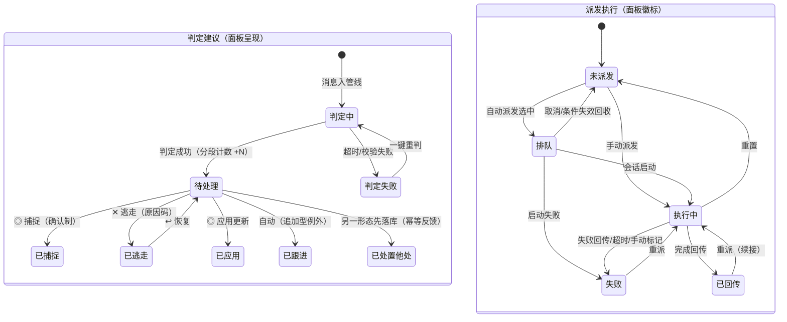

# dsh 插件形态（第二形态）UIUX 设计

> 输入：`requirements.md`（SDD 定稿，含 16 处【待确认 D#】）、`design.md`（方案 B 方向）、`README.md`（注意力友好七原则）、`docs/design/DESIGN_SYSTEM.md`、`docs/design/COPYWRITING.md`、`docs/design/PET_INTERACTION_DESIGN.md`、`src/views/`（TaskTab / RadioTab / SessionsTab / SettingsTab 信息架构参照）。
>
> **双表面体系（本文档的组织轴）**：dsh 形态的 UI 由两个约束完全不同的表面构成——
> ① **dsh 面板**（Web 客户端半边，经 package.json `dsh.client` 注入）：**插件自有 detail page**（Plugins 页 → 本插件，`plugins.detail.section` 自定义内容，main 区全宽、独立于会话——2026-10-11 用户关卡回流裁决，见 U16；不注册右侧栏 tab、不复刻宿主 settings cards）+ conversation 挂载点，**在 dsh 宿主设计系统内工作**（圆角 token 守卫、ui-primitives 组件、亮暗双主题跟随），不自带全局样式；
> ② **桌宠 helper**（sidecar Electron 独立小窗，dsh-pet 先例：透明置顶局部小窗 + 点击穿透 + 命中翻转 + 置顶看门狗 + 宿主存亡绑定）：**不受宿主设计系统约束**，图鉴复古风（本仓 DESIGN_SYSTEM）原样延续，与主应用桌宠 300×330 窗体同构。
>
> 就地决策以【U#】标注，汇总见文末；与 SDD【D#】决策对齐处随文引用。歧义不向用户提问（并行 subagent 模式）。

## 1. UIUX 影响评估

| 维度 | 评估问题 | 本功能结论 |
|------|---------|-----------|
| 展示 | 数据/结果用户需要看到吗？在哪看？ | **有影响**。任务（六态+派发轨道）、判定建议（四动作+置信档）、收音机健康（上次成功/失败计数/积压）、派发执行账本（时长/成本/退出码）、专注计时——全部需要在 dsh 内有可见面（插件页面任务分段/收音机分段/日志分段/背包分段/conversation chip/桌宠） |
| 触发 | 用户如何发起？入口在哪？ | **有影响**。三类新入口：会话对话（自然语言任务读写 FR-T1/T2/T7）、dsh 插件页面（分诊/捕捉/派发/设置）、桌宠（出发/暂停/完成/快捷屏/双击开插件页面） |
| 反馈 | 进行中/完成后如何感知？ | **有影响**。轮询健康状态灯、判定进行 chip、番茄倒计时（药丸+色环+chip）、派发状态徽标流转、捕捉庆祝演出、跨形态变更 ≤10s 可见——均为被动信号载体（FR-X5） |
| 异常 | 出错时如何知道并处理？ | **有影响**。飞书未授权/失效（单次提示+重授权入口）、拉取失败退避（计数+立即拉取）、判定失败组（留档+一键重判）、派发失败（徽标+时间线+手动收口）、schema 版本拒绝（只读横幅+指引）、dsh 版本不兼容（加载失败指引） |
| 变更 | 是否动到现有界面/导航/已有交互？ | **有影响但单向**。dsh 宿主 UI 新增表面（插件自有 detail page（`plugins.detail.section`）、conversation header 挂载、桌面 helper 窗；不注册 sidebarRightTabs、不新增宿主 settings cards——设置收进插件页面同页【U16】）；**主应用界面零改动**（FR-X4 回归保证） |

**评估结论**：需要 UIUX 设计（全新用户表面——面板与桌宠两套，非对现有界面的修改）。

**理由**：SDD 四大块（任务/收音机/桌宠/派发）在 dsh 形态全部有用户可感知的展示、触发、反馈与异常面；且注意力友好七原则需要在 dsh 载体重述落地（FR-X5），被动信号载体与默认值是本次设计的核心命题，而非附属。

---

## 契约需求面（必选）

> UIUX → AD 的单向契约需求传递面。端点动词列采用 dsh 语境：`tool:*` = 插件向 dsh 会话模型暴露的工具；`host:*` = 客户端半边调用宿主半边（或读共享库）的内部命令/查询；`slot:*` = 宿主事件推送至客户端 slot。AD 据此核对工具面与宿主-客户端通信契约的覆盖。
>
> **提交时机口径（U21 保存制，host 命令面不变）**：36 共享配置键（专注/桌宠/显示/飞书轮询与称呼/Agent 派发偏好/通用复盘备份托盘等 configWrite 项）改为**编辑草稿 + 分区页标题行「保存」统一提交**（对齐主应用 `settings.values` 草稿 + 标题行保存语义；`host:configRead / configWrite` 命令不变，仅提交时机由即时写改为保存提交）。**实体管理 CRUD 不走保存制、维持各自提交语义**（分类/标签/维度行内确认提交、agent 卡自持保存、提示词覆盖面板保存、会话过滤三态行内乐观写——对齐主应用各卡自持提交）；**即时动作按钮不受影响**（lark 授权/测试连接/立即拉取/手动重试/支持报告/库状态查询）。

### 触发入口表

| 入口名 | 用户操作 | 调用能力 | 期望端点动词 |
|--------|---------|---------|-------------|
| 会话对话捕捉 | 在会话中说自然语言待办 | 自然语言建任务（判定标题/分类/标签/截止/优先级） | tool:captureNatural（含 5 秒撤销 tool:undoCapture） |
| 会话对话任务读写 | 会话中要求改期/完成/查询 | 任务列表/详情/搜索/更新/完成/撤销/跟进/标签 | tool:taskList / taskGet / taskSearch / taskUpdate / taskComplete / taskUndoComplete / followupAdd / tagOps |
| 面板任务页操作 | 出发/暂停/继续/完成/撤销/逃走/放生/改期 | 任务状态机操作（全局唯一进行中） | host:taskStart / taskPause / taskResume / taskComplete / taskCancel / taskDelete / taskReschedule |
| 放生撤销 toast | 放生执行后 5 秒内点「撤销」 | 放生撤销（恢复任务与级联数据） | host:taskDeleteUndo |
| 面板快速捕捉条 | 输入一句话点「⚡ 发报」 | 快速捕捉判定（命中现有待办生成更新卡不重复建，5 秒可撤销） | host:captureTodo |
| 收音机建议分诊 | ◎ 捕捉 / ✕ 逃走（选原因码）/ ◎ 应用更新 / ↩ 恢复 | 建议分诊（确认制） | host:reviewAccept / reviewDismiss / reviewApplyUpdate / reviewRestore |
| 收音机批量分诊 | 批量条选多条一键分诊 | 批量分诊 | host:reviewBatch |
| 判定失败组操作 | 一键重判（单条/整组）/ 强制捕捉 / 强制逃走 | 重判与强制处置 | host:retryJudge / forceCapture / forceDismiss |
| 收音机手动拉取 | 点「立即拉取」 | 手动触发一轮轮询 | host:pollNow |
| 派发发起 | 任务详情点派发（选通道/临时改选路由） | 交互/无头派发（路由结果可见可临时改选） | host:dispatchInteractive / dispatchHeadless |
| 派发收口 | 标记完成 / 标记失败 / 重置 / 取消排队 / 重派 | 手动收口与重派（重派续接上下文） | host:dispatchClose / dispatchReset / dispatchCancel / dispatchRedo |
| 背包·专注段 | 番茄开关 / 番茄时长 15/25/45/60 / 短休息（含关闭）/ 完成通知 / 长番茄提示音 / 通知总开关 / 提前提醒量 / 勿扰时段（开/起/止）——后五项标「作用于主应用触达」【U20】 | 专注与提醒配置读写（共享训练家设置） | host:configRead / configWrite |
| 背包·分类与标签段 | 分类增改（名称/描述 = AI 判定参考规则）/ 放生分类（级联提示：任务归入第一个分类）/ 换装（搜索 1025 只：名称/编号/英文名）/ 标签增删 / 维度上限与停用 | 分类与标签维度 CRUD + 宝可梦绑定（key 与单多选建后只读）；新标签提议「＋」接受入口在建议卡侧（§3.3） | host:categoryUpsert（含换装绑定 pokemon 字段——AD A23 合并决策）/ categoryDelete / tagUpsert / tagDelete / dimensionUpdate |
| 背包·桌宠段 | 主宝可梦选择 / 专属台词编辑 / 输入响应（+专注态子项）/ 桌宠语音 / 陪跑精灵——以上四组标「作用于主应用桌宠」【U20】/ 减弱动效（默认跟随系统【U15】）/ 显示桌宠开关 / 随 dsh 启动 | 桌宠配置与 helper 生命周期控制（共享训练家设置 + 主应用桌宠行为配置） | host:configRead / configWrite / petShow / petHide |
| 背包·显示段 | 语言 / 日期格式 / 时间制式（带预览）/ 逾期展示模式 / 相对截止时间——后两项 dsh 面板同读同生效【U20】 | 语言与显示偏好编辑 + 保存提交（U21 保存制；UI locale 随语言下拉即时跟随——对齐主应用 draft 语义，落库走保存；逾期模式/相对截止同时驱动 dsh 面板呈现） | host:configRead / configWrite（不新增命令） |
| 背包·Agent 段 | agent 列表配置卡 CRUD（名称/命令/历史参数/技能根目录）/ 判定执行方 / 终端偏好（标「作用于主应用交互派发」）/ 项目派发路由 / 自动派发/并发/worktree / 提示词覆盖编辑（4 处系统提示词：查看/编辑覆盖/恢复默认）【U20——原派发段并入、原收音机段的判定执行方移入】 | agent 配置 CRUD + 派发配置与项目路由 CRUD + 提示词覆盖读写 | host:agentUpsert / agentDelete / configRead / configWrite / routeUpsert / promptList / promptGet / promptOverride / promptReset |
| 背包·飞书段 | 启用轮询 / 轮询间隔 / 我的称呼（多名字管理，判定「疑似指派」标注的依赖）【U20——原收音机段改组】/ 授权登录 / 测试连接 / 会话过滤管理（群聊三态：跟随/拉取/过滤；私聊固定跟随） | lark-cli 授权流程 + 配置读写 + 会话过滤读写 | host:larkAuth / larkTest / configRead / configWrite / filterList / filterUpsert |
| 背包·诊断段 | 链路健康查看（飞书/判定两链路 × 三档）/ 手动重试 / 支持报告一键复制 / 运行日志查看器（级别与来源过滤、分页、最新在上，脱敏同主应用——提前进 v1【U20】） | 诊断快照 + 重试（复用收音机既有 host:pollNow / retryJudge）+ 报告生成复制（版本+平台+健康快照+最近日志，已脱敏）+ 运行日志分页查询 | host:diagnosticsSnapshot / supportReport / logQuery |
| 背包·通用段 | 复盘提醒（开关+星期）/ 备份（开关+保留份数）/ 关闭到托盘——三项标「作用于主应用」【U20】/ 查看待办库状态 / 使用指南链接（静态，docs/USER_GUIDE.md dsh 章节） | 复盘/备份/托盘配置写入共享设置（主应用侧生效）/ 库版本与兼容状态查询 | host:configRead / configWrite / dbStatus |
| conversation chip | ⏸ 暂停 / ✔ 完成（暂停态 ▶ 🍦）/ 点击 chip 主体 | 进行中任务就近操作 + 打开插件页面（可选目标分段） | host:taskPause / taskComplete / taskResume / pageOpen |
| 桌宠药丸 | ⏸ / ▶ / ✔ / 🍦「先试 5 分钟」 | 专注就近控制 | host:taskPause / taskResume / taskComplete / pomoTryFive |
| 桌宠快捷图鉴屏 | 悬停精灵点 ☰ → 点选任务「▶ 出发」 | 不开面板切换目标（顶下原进行中） | host:taskStart |
| 桌宠窗口交互 | 双击开插件页面 / 右键菜单（隐藏桌宠等）/ 拖动（>4px） | 打开 pokemon-choose-you 插件页面（经宿主导航，可选目标分段）/ helper 控制 / 位置记忆 | host:pageOpen / host:petHide / host:petMove |

### 反馈通道表

| 场景 | 机制 | UI 状态 |
|------|------|---------|
| 轮询周期触发（分支 A，D14） | 宿主半边确定性定时回调（插件自管水位，拉取步零 LLM） | 无即时 UI（后台）；健康条「下次轮询」倒计刷新 |
| 一轮判定完成（产生 N 条建议） | 宿主事件推送 slot | 收音机分段导航计数 +N（静态数字，不闪烁不弹窗；页外被动信号 = 桌宠 ▼ 新事件闪 3 次后转静态存在）；建议卡入待处理组 |
| 拉取失败退避重试 | 宿主事件推送 | 健康状态点转 warn/红 + 连续失败计数（旁附文字状态，非颜色冗余）；恢复自动追平后回绿（无 toast 轰炸）；**连续失败 ≥3 时收音机分段计数叠加静态 ⚠ 前缀（不闪烁、不变色动画）——静默失败的被动可发现性【U14】** |
| 飞书授权失效 | 宿主事件推送（单次） | 收音机分段顶部单次横幅 + 重新授权入口；轮询暂停状态 |
| 快速捕捉建卡 | 同步返回 + 5 秒撤销窗口 | 右下角撤销 toast（不弹窗不抢焦点）；判重命中时提示「建议待确认」 |
| 放生执行 | 同步 + 5 秒撤销窗口 | 两层确认 → 执行级联删除 → 右下角撤销 toast（对齐捕捉撤销范式，role=status 可被读屏感知） |
| 跨形态任务变更（同库） | 同库 + 事件（NFR-1 P95 ≤10s） | 面板列表增量刷新；桌宠 ≤2s 换装/变灰（进程内事件直达） |
| 番茄计时 | 各形态本地计时器（D2 不同步） | 桌宠色环（绿→琥珀→红）+ 药丸倒计时 + conversation chip mm:ss |
| 番茄/短休息结束 | 本地计时器到期 | 桌宠气泡 + 药丸出口（▶/✔）+ 面板被动提示；绝不自动开下一轮 |
| 派发状态流转（排队→执行中→已回传/失败） | 宿主事件推送（无头结束 ≤10s 落库） | 任务卡派发徽标变色换形 + 时间线追加条目；无系统通知（D1/D7） |
| 建议分诊幂等冲突（另一形态先处置） | 同步写返回冲突 | 中性 toast「这条建议已在另一处处置过了」；建议卡收敛为已处置态 |
| 派发互斥冲突（DISPATCH_ALREADY_ACTIVE，FR-X1） | 同步写返回冲突 | 中性 toast「该任务已有进行中的派发，请先收口或重置」；派发按钮收敛为已派发态入口（跳转该活动执行的时间线） |
| schema 版本拒绝（FR-X2） | 写操作同步报错 | 面板顶部持久横幅 + 写操作禁用 + 只读浏览标记 |
| dsh 版本不兼容（FR-X7） | 插件加载期失败 | 宿主插件错误面呈现（插件声明所需 dsh 版本与指引文案） |
| 桌宠 helper 崩溃自愈 | 宿主半边守护（10s 内重启） | 用户无感（状态与位置恢复），无错误 UI |
| 支持报告一键复制（背包·诊断段，U19） | 同步生成并写剪贴板 | 按钮态「生成中…」→「已复制」+ toast（role=status）；内容已脱敏（无会话原文/代号还原真名） |
| 会话过滤三态切换（背包·飞书段，U19/U20） | 同步写共享过滤设置 | 行内即时生效（跟随/拉取/过滤文字状态）；私聊行固定跟随、控件置灰只读 |
| 提示词覆盖保存/恢复默认（背包·Agent 段，U20） | 同步写共享提示词覆盖 | 面板内 hint「已保存 / 已恢复默认」自隐 4s（不打断、无 toast）；下一次 AI 调用即生效；恢复默认两层确认 |
| 双形态同时编辑提示词冲突（背包·Agent 段，U20） | 同步写返回冲突或后写覆盖 | 中性提示「提示词已在另一形态更新，已为你刷新为最新版」+ 面板刷新为最新文本（写路径 CAS 或后写胜+提示，由 AD 定参） |

### 展示字段表

| 视图 | 字段名 | 来源实体.属性 | 格式约束 |
|------|--------|--------------|---------| 
| 任务列表 | 标题 | 任务.标题 | text，单行截断 |
| 任务列表 | 状态 | 任务.状态 | 六态枚举（草丛/路线/进行中/暂停/完成/逃走）→ 卡片五呈现：普通 / 进行中（♪ 捕获中 + 黄描边）/ **进行中·暂停变体（「⏸ 休息中」角标 + 降饱和灰调，与桌宠 paused 灰度呼应）** / 已捕捉（划线 + 灰度精灵）/ 已逃走（中性淡出） |
| 任务列表 | 分类徽章 | 任务.分类→分类.绑定宝可梦/徽章底色 | 类型色徽章 + 精灵图（pixelated） |
| 任务列表 | 优先级 | 任务.优先级（含紧急） | 圆点三档（普通/高/低）+ 紧急档形/色强化（放大点 + 双描边，**不闪烁**——面板零闪烁，与 §2.4/§5/§9 口径一致；闪烁名额唯一保留给桌宠 ▼） |
| 任务列表 | 截止时间 | 任务.截止时间 | 相对时间（主应用口径：显示偏好共享） |
| 任务列表 | 专注时长累计 | 任务.专注时长累计 | 「⏱ N 分钟」 |
| 任务列表 | 来源 | 任务.来源（手动/收音机/捕捉/派发） | 小图标 |
| 任务列表 | 派发状态徽标 | 派发执行.状态 | 五态徽标（未派发无标/排队⏳/执行中◉/已回传✓/失败▲） |
| 任务详情 | 跟进记录流 | 跟进记录.内容/来源/时间 | 追加型时间流 |
| 任务详情 | Agent 执行时间线 | 派发执行.时长/成本/退出码/会话标识/回传摘要 + agent 会话记录 | 可按来源过滤回放（对齐主应用日志页语义） |
| 图鉴分段 | 累计捕捉/逃走统计 | 任务.状态全量聚合 | 数字 + 里程碑贺词档位 |
| 冒险分段 | 今日进度 | 任务派生（今日到期/进行中/已完成） | 「CAUGHT x/y」进度条 |
| 收音机·列表 | 消息转写文本 | 判定消息.转写文本 | text（已代号化还原后显示） |
| 收音机·列表 | 所属会话/发送者 | 判定消息.会话/发送者代号（还原真名） | text |
| 收音机·列表 | 处理状态 | 判定消息.处理状态（未判定/已判定/失败） | 分组依据（待处理/无动作/失败组/已处理） |
| 收音机·建议卡 | 动作类型 | 判定建议.动作类型 | 四动作（新待办/更新建议/跟进记录/无动作） |
| 收音机·建议卡 | 判定理由 | 判定建议.判定理由 | text |
| 收音机·建议卡 | 置信档位 | 判定建议.置信档位 | 三档点/边框（高/中/低） |
| 收音机·建议卡 | 新标签提议 | 判定建议.新标签提议 | 「＋」徽标 + 依据，接受才创建 |
| 收音机·建议卡 | 逃走原因码 | 判定建议.逃走原因码 | 固定 6 枚举菜单 |
| 收音机·健康条 | 上次成功/下次轮询/连续失败/待处理积压 | 插件运行状态.各属性 | 时间相对化 + 计数 + 文字状态（正常/重试中/未授权——状态点非颜色冗余） |
| 日志页 | agent 会话账本 | agent 会话记录.全属性（agent/会话id/时长/成本/退出码/来源） | 行卡 + 来源过滤（收音机分类/捕捉/派发无头/派发交互） |
| 背包·专注段 | 提醒与勿扰 | 训练家设置.通知开关/提前提醒量/勿扰起止 | 开关 + 选择器 + 起止时间组（作用域标注「作用于主应用触达」，U20） |
| 背包·飞书段 | 授权状态 | lark-cli 授权态（不落库） | 状态行：身份 + 会话数（测试连接结果） |
| 背包·飞书段 | 我的称呼 | 训练家设置.称呼列表 | 多名字管理（逗号/列表分隔；命中消息标注「疑似指派给你」的判定依赖，U20） |
| 背包·飞书段 | 会话过滤 | 会话过滤.每会话三态 | 群聊三态（跟随/拉取/过滤）行内切换；私聊固定跟随（置灰只读） |
| 背包·分类与标签段 | 分类列表 | 分类.名称/描述/绑定宝可梦 | 卡列表：名称/描述可编辑（AI 判定参考规则）+ 绑定宝可梦缩略图 + 换装/放生入口 |
| 背包·分类与标签段 | 标签维度 | 标签维度.名称/key/上限/停用/单多选 | 维度卡：名称/上限/停用可调；key 与单多选建后只读呈现 |
| 背包·Agent 段 | agent 配置卡 | agent.名称/命令/历史参数/技能根目录/启用 | 配置卡 CRUD（参照主应用 AgentConfigCard；命令行内校验，U20） |
| 背包·Agent 段 | 提示词覆盖状态 | 提示词.4 处面板（生效文本/覆盖或默认态） | 折叠面板：查看生效文本 / 编辑覆盖 / 恢复默认（参照主应用 PromptsCard，U20） |
| 背包·诊断段 | 链路健康面板 | 插件运行状态.飞书/判定链路各属性 | 两链路 × 三档状态（点+文字，非颜色冗余）/ 上次成功 / 下次轮询 / 连续失败 / 最近错误；飞书含建议积压数 |
| 背包·诊断段 | 运行日志 | 运行日志.时间/级别/来源/内容 | 行列表 + 级别/来源过滤 + 分页，最新在上，脱敏同主应用（U20 提前进 v1） |
| 背包·显示段 | 显示偏好 | 训练家设置.语言/日期格式/时间制式/逾期展示模式/相对截止时间 | 选择器 + 实时预览（共享设置，两形态同源；逾期模式/相对截止同时驱动 dsh 面板呈现，U20） |
| 背包·通用段 | 复盘/备份/托盘 | 训练家设置.复盘开关与星期/备份开关与保留份数/关闭到托盘 | 开关 + 选择器（作用域标注「作用于主应用」，U20） |
| conversation chip | 进行中任务名 + 倒计时 | 任务.进行中 + 本地番茄计时 | 单行 chip，溢出截断；三态内容：运行「捕获中 mm:ss ⏸✔」/ 暂停「已暂停 mm:ss ▶🍦✔」/ **短休息「☕ 休息中 mm:ss ▶」**；无进行中零占位 |
| 桌宠 | 当前任务名/台词/倒计时/色环 | 任务 + 本地计时 | 气泡瞬态 + 药丸 + SVG 细环 |

### 交互状态表

| 状态 | 触发条件 | 期望错误码（供 AD 补全） |
|------|---------|------------------------|
| 空·冷启动空库 | 首启初始化同构空库（D15），无任务 | — |
| 空·收音机无消息 | 已授权但无新消息 | — |
| loading·面板首载 | 打开插件页面拉取列表 | — |
| loading·判定中 | 消息送判定（超时默认 120s，D8） | JUDGE_TIMEOUT |
| 成功·建卡 | 捕捉/发报成功；放生经两层确认执行后进入 5 秒撤销窗 | — |
| 失败·判定 | 判定执行方超时/结构化校验失败 | JUDGE_TIMEOUT / JUDGE_INVALID_RESULT |
| 失败·拉取 | 网络中断/飞书 API 错误（指数退避，上限 8 倍） | LARK_FETCH_FAILED |
| 失败·派发 | 无头异常退出/超时（下限 10 分钟）/会话启动失败 | DISPATCH_TIMEOUT / DISPATCH_LAUNCH_FAILED |
| 异常·schema 拒绝 | 库版本超出插件兼容范围（FR-X2） | DB_SCHEMA_TOO_NEW |
| 异常·宿主版本不兼容 | 插件加载于范围外 dsh 版本（FR-X7） | DSH_VERSION_UNSUPPORTED |
| 权限·飞书未授权/失效 | 未授权或 token 失效（轮询暂停，单次提示） | LARK_UNAUTHORIZED |
| 权限·SSH 免密不满足 | 远程部署免密前提缺失（派发前检查） | SSH_AUTH_REQUIRED |
| 幂等冲突·建议已处置 | 另一形态先落库（FR-X1） | SUGGESTION_ALREADY_RESOLVED |
| 幂等冲突·派发互斥 | 同一任务已有活动派发（跨形态） | DISPATCH_ALREADY_ACTIVE |
| 失败·配置校验 | 勿扰时段非法值（起=止/格式非法）等共享配置写入校验失败（行内防呆 + 后端兜底，U20） | CONFIG_VALIDATION_FAILED |
| 失败·agent 配置校验 | agent 命令非法（空命令/不可执行，U20） | AGENT_COMMAND_INVALID |
| 失败·提示词保存校验 | 提示词覆盖保存校验失败（缺必要占位符/超长度上限/后端拒绝，U20） | PROMPT_VALIDATION_FAILED |
| 幂等冲突·设置修订失配 | agent 列表 / 提示词覆盖在编辑期间被另一形态修改（保存时修订检测，U20——AD A24：确认后 force 重发整值覆盖） | SETTING_MODIFIED_ELSEWHERE |

```json
{
  "entryPoints": [
    {"name": "会话对话捕捉", "userAction": "在会话中说自然语言待办", "capability": "captureNatural", "endpointVerb": "tool:captureNatural + tool:undoCapture"},
    {"name": "会话对话任务读写", "userAction": "会话中要求改期/完成/查询", "capability": "taskCRUD", "endpointVerb": "tool:taskList/taskGet/taskSearch/taskUpdate/taskComplete/taskUndoComplete/followupAdd/tagOps"},
    {"name": "面板任务页操作", "userAction": "出发/暂停/继续/完成/撤销/逃走/放生/改期", "capability": "taskStateMachine", "endpointVerb": "host:taskStart/taskPause/taskResume/taskComplete/taskCancel/taskDelete/taskReschedule"},
    {"name": "放生撤销 toast", "userAction": "放生执行后 5 秒内点「撤销」", "capability": "taskDeleteUndo", "endpointVerb": "host:taskDeleteUndo"},
    {"name": "面板快速捕捉条", "userAction": "输入一句话点「⚡ 发报」", "capability": "captureTodo", "endpointVerb": "host:captureTodo"},
    {"name": "收音机建议分诊", "userAction": "◎ 捕捉 / ✕ 逃走 / ◎ 应用更新 / ↩ 恢复", "capability": "reviewSuggestion", "endpointVerb": "host:reviewAccept/reviewDismiss/reviewApplyUpdate/reviewRestore"},
    {"name": "收音机批量分诊", "userAction": "批量条选多条一键分诊", "capability": "reviewBatch", "endpointVerb": "host:reviewBatch"},
    {"name": "判定失败组操作", "userAction": "一键重判/强制捕捉/强制逃走", "capability": "retryJudge", "endpointVerb": "host:retryJudge/forceCapture/forceDismiss"},
    {"name": "收音机手动拉取", "userAction": "点「立即拉取」", "capability": "pollNow", "endpointVerb": "host:pollNow"},
    {"name": "派发发起", "userAction": "任务详情点派发（选通道/临时改路由）", "capability": "dispatch", "endpointVerb": "host:dispatchInteractive/dispatchHeadless"},
    {"name": "派发收口", "userAction": "标记完成/标记失败/重置/取消排队/重派", "capability": "dispatchControl", "endpointVerb": "host:dispatchClose/dispatchReset/dispatchCancel/dispatchRedo"},
    {"name": "背包·专注段", "userAction": "番茄开关/时长/短休息/完成通知/长番茄提示音/通知总开关/提前提醒量/勿扰时段(开/起/止)——后五项作用于主应用触达(U20)", "capability": "focusAndRemindConfig", "endpointVerb": "host:configRead/configWrite"},
    {"name": "背包·分类与标签段", "userAction": "分类增改/放生分类(级联:任务归入第一个分类)/换装(搜索1025只:名称/编号/英文名)/标签与维度管理", "capability": "categoryAndTagConfig", "endpointVerb": "host:categoryUpsert(含 pokemon 换装字段)/categoryDelete/tagUpsert/tagDelete/dimensionUpdate"},
    {"name": "背包·桌宠段", "userAction": "主宝可梦/台词编辑/输入响应(+专注态子项)/语音/陪跑精灵(以上作用于主应用桌宠)/减弱动效(默认跟随系统)/显示桌宠/随 dsh 启动(U20)", "capability": "petConfig", "endpointVerb": "host:configRead/configWrite/petShow/petHide"},
    {"name": "背包·显示段", "userAction": "语言/日期格式/时间制式(带预览)/逾期展示模式/相对截止时间——后两项 dsh 面板同读同生效(U20)", "capability": "displayConfig", "endpointVerb": "host:configRead/configWrite(不新增命令)"},
    {"name": "背包·Agent 段", "userAction": "agent 列表 CRUD(名称/命令/历史参数/技能根目录)/判定执行方/终端偏好(作用于主应用交互派发)/项目路由/自动派发/并发/worktree/提示词覆盖编辑(4 处:查看/编辑覆盖/恢复默认)(U20)", "capability": "agentAndDispatchConfig", "endpointVerb": "host:agentUpsert/agentDelete/configRead/configWrite/routeUpsert/promptList/promptGet/promptOverride/promptReset"},
    {"name": "背包·飞书段", "userAction": "启用轮询/轮询间隔/我的称呼(多名字管理,判定疑似指派标注依赖)/授权登录/测试连接/会话过滤管理(群聊三态,私聊固定跟随)", "capability": "larkAuthAndConfig", "endpointVerb": "host:larkAuth/larkTest/configRead/configWrite/filterList/filterUpsert"},
    {"name": "背包·诊断段", "userAction": "链路健康查看(飞书/判定两链路×三档)/手动重试/支持报告一键复制/运行日志查看器(级别与来源过滤,分页,最新在上,脱敏同主应用,提前进 v1)(U20)", "capability": "diagnostics", "endpointVerb": "host:diagnosticsSnapshot/supportReport/logQuery(重试复用 host:pollNow/retryJudge)"},
    {"name": "背包·通用段", "userAction": "复盘提醒(开关+星期)/备份(开关+保留份数)/关闭到托盘(三项作用于主应用)/查看待办库状态/使用指南链接(U20)", "capability": "generalConfig", "endpointVerb": "host:configRead/configWrite/dbStatus"},
    {"name": "conversation chip", "userAction": "⏸ 暂停 / ✔ 完成（暂停态 ▶ 🍦）/ 点击 chip 主体打开插件页面", "capability": "focusQuickControl + pageOpen", "endpointVerb": "host:taskPause/taskComplete/taskResume/pageOpen"},
    {"name": "桌宠药丸", "userAction": "⏸ / ▶ / ✔ / 🍦 先试 5 分钟", "capability": "pomoControl", "endpointVerb": "host:taskPause/taskResume/taskComplete/pomoTryFive"},
    {"name": "桌宠快捷图鉴屏", "userAction": "悬停点 ☰ → 点选任务「▶ 出发」", "capability": "quickStart", "endpointVerb": "host:taskStart"},
    {"name": "桌宠窗口交互", "userAction": "双击开插件页面/右键菜单/拖动", "capability": "petWindowControl", "endpointVerb": "host:pageOpen/host:petHide/host:petMove"}
  ],
  "feedbackChannels": [
    {"scenario": "轮询周期触发（分支 A，D14）", "mechanism": "轮询", "uiState": "无即时 UI；健康条「下次轮询」倒计刷新"},
    {"scenario": "一轮判定完成", "mechanism": "异步", "uiState": "收音机分段计数 +N（静态）；页外 = 桌宠 ▼ 闪 3 次转静态；建议卡入待处理组"},
    {"scenario": "拉取失败退避重试", "mechanism": "异步", "uiState": "健康点 warn/红 + 失败计数 + 文字状态；连续失败 ≥3 时分段计数叠加静态 ⚠；恢复回绿"},
    {"scenario": "飞书授权失效", "mechanism": "异步", "uiState": "单次横幅 + 重新授权入口；轮询暂停"},
    {"scenario": "快速捕捉建卡", "mechanism": "同步", "uiState": "5 秒撤销 toast（右下角，不抢焦点）"},
    {"scenario": "放生执行", "mechanism": "同步", "uiState": "两层确认 → 级联删除 → 5 秒撤销 toast（对齐捕捉撤销范式）"},
    {"scenario": "跨形态任务变更", "mechanism": "异步", "uiState": "面板列表增量刷新（P95 ≤10s）；桌宠 ≤2s 联动"},
    {"scenario": "番茄计时", "mechanism": "同步", "uiState": "桌宠色环 + 药丸倒计时 + chip mm:ss（本地）"},
    {"scenario": "番茄/短休息结束", "mechanism": "同步", "uiState": "气泡 + 药丸出口；绝不自动开下一轮"},
    {"scenario": "派发状态流转", "mechanism": "异步", "uiState": "派发徽标变色 + 时间线追加；无系统通知"},
    {"scenario": "建议分诊幂等冲突", "mechanism": "同步", "uiState": "中性 toast「已在另一处处置」"},
    {"scenario": "派发互斥冲突", "mechanism": "同步", "uiState": "中性 toast「该任务已有进行中的派发，请先收口或重置」；派发按钮收敛为已派发态入口"},
    {"scenario": "schema 版本拒绝", "mechanism": "同步", "uiState": "持久横幅 + 写操作禁用 + 只读标记"},
    {"scenario": "dsh 版本不兼容", "mechanism": "同步", "uiState": "宿主插件错误面（插件声明所需版本与指引）"},
    {"scenario": "桌宠 helper 崩溃自愈", "mechanism": "异步", "uiState": "用户无感（10s 内重启，状态位置恢复）"},
    {"scenario": "支持报告一键复制", "mechanism": "同步", "uiState": "生成中 → 已复制 toast（role=status）；内容已脱敏"},
    {"scenario": "会话过滤三态切换", "mechanism": "同步", "uiState": "行内即时生效（跟随/拉取/过滤）；私聊固定跟随只读"},
    {"scenario": "提示词覆盖保存/恢复默认（背包·Agent 段，U20）", "mechanism": "同步", "uiState": "面板内 hint「已保存/已恢复默认」自隐 4s（无 toast）；下一次 AI 调用生效；恢复默认两层确认"},
    {"scenario": "双形态同时编辑提示词冲突（U20）", "mechanism": "同步", "uiState": "中性提示「提示词已在另一形态更新，已为你刷新为最新版」+ 面板刷新（CAS 或后写胜+提示，AD 定参）"}
  ],
  "displayFields": [
    {"view": "列表", "fieldName": "标题", "source": "任务.标题", "format": "text"},
    {"view": "列表", "fieldName": "状态", "source": "任务.状态", "format": "enum:草丛|路线|进行中|暂停|完成|逃走 → 五呈现(含进行中·暂停变体「⏸ 休息中」+降饱和)"},
    {"view": "列表", "fieldName": "分类徽章", "source": "分类.绑定宝可梦+徽章底色", "format": "badge+sprite(pixelated)"},
    {"view": "列表", "fieldName": "优先级", "source": "任务.优先级", "format": "dot三档+紧急档形/色强化(放大点+双描边,不闪烁)"},
    {"view": "列表", "fieldName": "截止时间", "source": "任务.截止时间", "format": "relative-time"},
    {"view": "列表", "fieldName": "专注时长累计", "source": "任务.专注时长累计", "format": "minutes"},
    {"view": "列表", "fieldName": "来源", "source": "任务.来源", "format": "icon:手动|收音机|捕捉|派发"},
    {"view": "列表", "fieldName": "派发状态徽标", "source": "派发执行.状态", "format": "badge:排队⏳|执行中◉|已回传✓|失败▲"},
    {"view": "详情", "fieldName": "跟进记录流", "source": "跟进记录.内容/来源/时间", "format": "append-only timeline"},
    {"view": "详情", "fieldName": "Agent 执行时间线", "source": "派发执行+agent会话记录.时长/成本/退出码/会话标识/摘要", "format": "timeline+来源过滤"},
    {"view": "列表", "fieldName": "图鉴统计", "source": "任务.状态全量聚合", "format": "counter+里程碑档位"},
    {"view": "列表", "fieldName": "今日进度", "source": "任务派生", "format": "CAUGHT x/y 进度条"},
    {"view": "列表", "fieldName": "消息转写文本", "source": "判定消息.转写文本", "format": "text（代号还原后）"},
    {"view": "列表", "fieldName": "会话/发送者", "source": "判定消息.会话/发送者", "format": "text"},
    {"view": "列表", "fieldName": "处理状态", "source": "判定消息.处理状态", "format": "group:待处理|无动作|失败|已处理"},
    {"view": "详情", "fieldName": "动作类型", "source": "判定建议.动作类型", "format": "enum:新待办|更新建议|跟进记录|无动作"},
    {"view": "详情", "fieldName": "判定理由", "source": "判定建议.判定理由", "format": "text"},
    {"view": "详情", "fieldName": "置信档位", "source": "判定建议.置信档位", "format": "三档:高|中|低"},
    {"view": "详情", "fieldName": "新标签提议", "source": "判定建议.新标签提议", "format": "＋徽标+依据"},
    {"view": "详情", "fieldName": "逃走原因码", "source": "判定建议.逃走原因码", "format": "enum×6"},
    {"view": "列表", "fieldName": "健康面", "source": "插件运行状态.上次成功/下次轮询/连续失败/积压", "format": "相对时间+计数+文字状态(非颜色冗余)"},
    {"view": "列表", "fieldName": "agent 会话账本", "source": "agent会话记录.全属性", "format": "行卡+来源过滤"},
    {"view": "背包·专注段", "fieldName": "提醒与勿扰", "source": "训练家设置.通知开关/提前提醒/勿扰起止", "format": "开关+选择器+起止组（作用于主应用触达标注，U20）"},
    {"view": "背包·飞书段", "fieldName": "授权状态", "source": "lark-cli 授权态", "format": "身份+会话数"},
    {"view": "背包·飞书段", "fieldName": "我的称呼", "source": "训练家设置.称呼列表", "format": "多名字管理（疑似指派标注依赖，U20）"},
    {"view": "背包·飞书段", "fieldName": "会话过滤", "source": "会话过滤.每会话三态", "format": "群聊三态行内切换；私聊固定跟随只读"},
    {"view": "背包·分类与标签段", "fieldName": "分类列表", "source": "分类.名称/描述/绑定宝可梦", "format": "卡列表：可编辑+缩略图+换装/放生入口"},
    {"view": "背包·分类与标签段", "fieldName": "标签维度", "source": "标签维度.名称/key/上限/停用/单多选", "format": "维度卡：key与单多选建后只读"},
    {"view": "背包·Agent 段", "fieldName": "agent 配置卡", "source": "agent.名称/命令/历史参数/技能根目录/启用", "format": "配置卡 CRUD（参照主应用 AgentConfigCard，U20）"},
    {"view": "背包·Agent 段", "fieldName": "提示词覆盖状态", "source": "提示词.4 处面板", "format": "折叠面板：查看/编辑覆盖/恢复默认（U20）"},
    {"view": "背包·诊断段", "fieldName": "链路健康面板", "source": "插件运行状态.飞书/判定链路", "format": "2链路×3档+上次成功/下次轮询/连续失败/最近错误；飞书含建议积压"},
    {"view": "背包·诊断段", "fieldName": "运行日志", "source": "运行日志.时间/级别/来源/内容", "format": "行列表+级别/来源过滤+分页，最新在上，脱敏同主应用（U20）"},
    {"view": "背包·显示段", "fieldName": "显示偏好", "source": "训练家设置.语言/日期格式/时间制式/逾期模式/相对截止", "format": "选择器+实时预览（逾期模式/相对截止同时驱动 dsh 面板，U20）"},
    {"view": "背包·通用段", "fieldName": "复盘/备份/托盘", "source": "训练家设置.复盘星期/备份开关与份数/关闭到托盘", "format": "开关+选择器（作用于主应用标注，U20）"},
    {"view": "列表", "fieldName": "进行中任务 chip", "source": "任务.进行中+本地番茄", "format": "单行 truncate；运行/暂停/短休息三态内容"},
    {"view": "详情", "fieldName": "桌宠呈现", "source": "任务+本地计时", "format": "瞬态气泡+药丸+色环"}
  ],
  "interactionStates": [
    {"state": "空", "trigger": "冷启动空库（D15）/收音机无消息", "expectedErrorCode": null},
    {"state": "loading", "trigger": "面板首载/消息判定中（超时 120s，D8）", "expectedErrorCode": null},
    {"state": "成功", "trigger": "捕捉/发报/派发回传成功", "expectedErrorCode": null},
    {"state": "失败", "trigger": "判定超时或校验失败", "expectedErrorCode": "JUDGE_TIMEOUT|JUDGE_INVALID_RESULT"},
    {"state": "失败", "trigger": "拉取失败（指数退避上限 8 倍）", "expectedErrorCode": "LARK_FETCH_FAILED"},
    {"state": "失败", "trigger": "无头异常/超时（下限 10 分钟）/会话启动失败", "expectedErrorCode": "DISPATCH_TIMEOUT|DISPATCH_LAUNCH_FAILED"},
    {"state": "异常", "trigger": "库版本超出兼容范围（FR-X2）", "expectedErrorCode": "DB_SCHEMA_TOO_NEW"},
    {"state": "异常", "trigger": "dsh 版本范围外加载（FR-X7）", "expectedErrorCode": "DSH_VERSION_UNSUPPORTED"},
    {"state": "权限", "trigger": "飞书未授权/授权失效", "expectedErrorCode": "LARK_UNAUTHORIZED"},
    {"state": "权限", "trigger": "SSH 免密前提缺失", "expectedErrorCode": "SSH_AUTH_REQUIRED"},
    {"state": "失败", "trigger": "另一形态已处置同一建议（FR-X1）", "expectedErrorCode": "SUGGESTION_ALREADY_RESOLVED"},
    {"state": "失败", "trigger": "同一任务已有活动派发（跨形态互斥）", "expectedErrorCode": "DISPATCH_ALREADY_ACTIVE"},
    {"state": "失败", "trigger": "勿扰时段非法值等共享配置校验失败（行内防呆+后端兜底，U20）", "expectedErrorCode": "CONFIG_VALIDATION_FAILED"},
    {"state": "失败", "trigger": "agent 命令非法（空/不可执行，U20）", "expectedErrorCode": "AGENT_COMMAND_INVALID"},
    {"state": "失败", "trigger": "提示词覆盖校验失败（缺占位符/超长/后端拒绝，U20）", "expectedErrorCode": "PROMPT_VALIDATION_FAILED"},
    {"state": "失败", "trigger": "agent 列表/提示词编辑期间被另一形态修改（修订检测失配，U20/A24）", "expectedErrorCode": "SETTING_MODIFIED_ELSEWHERE"}
  ]
}
```

---

## 2. 信息架构

### 2.1 dsh 形态表面地图

```mermaid
flowchart TD
    subgraph DSH["dsh 工作台（宿主）"]
        subgraph MAINNAV["main 区页面路由（平台事实：仅 conversation / Plugins 两页）"]
            PL["Plugins 页（宿主插件列表）"]
            PL -->|"进入本插件 detail（左导航两步）"| PAGE
        end
        subgraph SESSION["会话区（每 Session）"]
            CH["conversation header 挂载：进行中任务 chip（被动信号 · 无进行中则零占位 · 点击打开插件页面）"]
            INPUT["会话输入区（宿主原生）——对话即捕捉/读写入口 FR-T1/T2/T7"]
        end
        subgraph PAGE["插件自有页面（plugins.detail.section · main 区全宽 · 独立于会话）"]
            SEG["分段导航（七段 · 含背包）"]
            SEG --> S1["冒险 · 今日到期+进行中+逾期折叠"]
            SEG --> S2["草丛 · 无截止"]
            SEG --> S3["路线 · 按日期"]
            SEG --> S4["图鉴 · 已捕捉统计+里程碑"]
            SEG --> S5["收音机 · 健康面+建议流+⚡发报（待处理计数落此段导航）"]
            SEG --> S6["日志 · agent 会话账本"]
            SEG --> S7["背包 · 分区选单+分区整页（独立分区 · 宽窄一致【U17/U18/U21】 · 页内八分区【U20】）"]
            PAGE --> DRAWER["任务详情抽屉 · 跟进+Agent 执行时间线+派发操作"]
            SET["「背包」分段（SegmentNav 进入 · 八分区横向选单 + 分区整页（一次只显示一个分区 · 每分区完整表单+保存制）· 同名同构主应用设置中心【U17-U21】）"]
            SET --> N1["SectionNav 分区选单（🍅专注/🗂分类与标签/🐾桌宠/👀显示/🤖Agent/飞书/🩺诊断/⚙️通用 · 对齐主应用上选单【U21】）"]
            SET --> C1["专注分区页（🍅 · 番茄钟+提醒与勿扰【U20】）"]
            SET --> C2["分类与标签分区页（🗂 · U19）"]
            SET --> C3["桌宠分区页（🐾 · 含输入响应/语音/陪跑配置·作用域标注【U20】）"]
            SET --> C4["显示分区页（👀 · 语言/日期/时间/逾期模式/相对截止 · 新【U20】）"]
            SET --> C5["Agent 分区页（🤖 · agent 列表+派发配置+提示词覆盖 · 原派发段并入【U20】）"]
            SET --> C6["飞书分区页（含我的称呼与会话过滤 · 原收音机段改组【U19/U20】）"]
            SET --> C7["诊断分区页（含运行日志查看器 · 提前进 v1【U19/U20】）"]
            SET --> C8["通用分区页（复盘提醒/备份/关闭到托盘/库状态/使用指南/双形态说明）"]
        end
    end
    subgraph DESKTOP["桌面（宿主外）"]
        PET["桌宠 helper（Electron 局部小窗 300×330 · 透明置顶·穿透翻转·看门狗·宿主存亡绑定）"]
        PET -->|"双击精灵（一步直达 host:pageOpen）"| PAGE
        PET -->|"悬停 ☰ 快捷图鉴屏（300×330↔590）"| PET
    end
    DB[("同一待办库（与主应用共享）")]
    PAGE -.同库读写.-> DB
    PET -.状态驱动事件 ≤2s.-> DB
```



**注册面汇总**：插件自有 detail page ×1（Plugins 页 → 本插件；`plugins.detail.section` 自定义内容承载面板六分段 + 「背包」独立分段——设置分区心智【U1/U16-U20】）、conversation header 挂载 ×1（chip）、桌面 helper 窗 ×1。**不注册 sidebarRightTabs、不复刻宿主 settings cards**（设置收进插件页面「背包」分段，SegmentNav 进入、宽窄一致）【U16-U18】。conversation input 挂载点**不占用**——理由见 2.3。

### 2.2 与主应用五视图的映射与裁剪

| 主应用视图/菜单（七项） | dsh 形态落点 | 裁剪说明 |
|---|---|---|
| 冒险 | 插件页面·冒险分段 | 逾期默认折叠 +「全部归草丛」fresh start 语义完整保留（FR-T6） |
| 草丛 | 插件页面·草丛分段 | 对等 |
| 路线 | 插件页面·路线分段 | 对等（按日期分组） |
| 图鉴 | 插件页面·图鉴分段 | 累计统计 + 里程碑贺词；筛选（全部/已捕捉/已逃走）对等 |
| 收音机 | 插件页面·收音机分段 | 版式改纵向流（见 3.2 U2）；分段内健康面为最小集（D13；完整链路健康与支持报告在背包·诊断段【U19】） |
| 日志 | 插件页面·日志分段 | agent 会话账本 + 来源过滤回放（收音机分类/捕捉/派发无头/派发交互）——与主应用日志页语义对等（FR-D3） |
| 背包（设置中心八分区） | 插件页面·「背包」分段（独立分区 · 八分区选单+分区整页全量【U19→U20/U21】——每分区完整表单+标题行保存制【U21】）+ 会话工具面补齐 | **八分区同名同构、配置项 100% 对齐主应用设置中心【U20】：专注 / 分类与标签 / 桌宠 / 显示 / Agent / 飞书 / 诊断 / 通用**；**每类设置单独一个分区页（八分区横向选单切换，一次只显示一个分区；U21 废弃小卡片网格）**。原则：配置写共享库两形态等效（36 配置键经各分区页「保存」提交，U21）；形态专属行为项标「作用于主应用」badge/说明行；dsh 自身呈现读共享值（逾期展示模式/相对截止/减弱动效）。原收音机段改组飞书段（+我的称呼）、原派发段并入 Agent 段（+agent 列表 CRUD/提示词覆盖编辑）；运行日志查看器提前进 v1（不再二期后置）。dsh 侧不承载：复盘向导/备份恢复/导入导出操作面（配置项在、操作面归主应用）、应用更新检查（主应用 UpdateCard）、OS 全局快捷键（D3）；分类/标签增改仍可经会话工具可达（FR-T2） |
| 桌宠 | 独立 helper 小窗 | 与主应用桌宠同构（§3.4 矩阵）；小剧场/彩蛋/坐栖降级（D4） |
| —（无对应） | **会话对话 = 第一入口** | dsh 独有优势：自然语言任务读写/查询只答不执行（FR-T7） |
| —（降级） | 复盘向导/备份导出 | 主应用承担（SDD §4.6 OUT） |

### 2.3 入口可达性

- **插件页面（图鉴机）**：经宿主左侧导航**两步**可达（Plugins → pokemon-choose-you）——平台事实：main 区页面路由只开放 conversation 与 Plugins 两页，插件自有页面 = Plugins 页 → 本插件 detail page，**独立于任何会话**（不寄生 per-Session 右侧栏 docking）【U16】。待处理计数（收音机待处理建议数聚合，静态数字）落在页面内收音机分段导航；页外被动性由桌宠 ▼ 承接（§2.4）。
- **会话对话**：无需任何 UI 操作即达——模型经插件工具面读写（FR-T1/T2/T7）；对话式捕捉固定由会话模型判定（FR-R10）。
- **conversation chip**：**零步（轻操作）**——进行中任务存在时常驻 header（被动信号就近——训练家的视线锚点在会话区），⏸/✔/▶/🍦 就近控制；点击 chip 主体打开插件页面（可选目标分段，host:pageOpen）；无进行中任务**零占位**。
- **桌宠**：桌面常驻；**双击精灵一步直达插件页面**（host:pageOpen 经宿主导航，**不是**主应用窗口，FR-P1）；右键菜单收纳低频（⇄ 换目标→快捷屏 / 打开图鉴机页面 / 隐藏桌宠，≤6 项）。
- **快速捕捉 ⚡发报**：位于插件页面收音机分段底部输入条（FR-R7 既有定位）；**不**在 conversation input 挂载点重复放置输入框——会话对话本身就是更强的捕捉入口，input 区再放一个输入框是重复入口且占用宿主输入区注意力【U3】。
- **背包分段**：SegmentNav 常驻「背包」分段，进入**分区选单 + 分区整页**（页内八分区横向选单，对齐主应用设置中心「上选单下内容」，一次只显示选中分区的完整表单；同名同构主应用设置中心：专注 / 分类与标签 / 桌宠 / 显示 / Agent / 飞书 / 诊断 / 通用【U19→U21】；每分区页 = 表单编辑 + 分区标题行右侧「保存」按钮【U21】），宽窄屏行为一致、锚点直达（host:pageOpen 可带目标段与目标分区），不进宿主设置页【U16-U21】。

### 2.4 注意力友好七原则的 dsh 形态重述（FR-X5 设计层落点）

> harness 是训练家**已选择打开**的工作台——插件在其中的立场是「工具替你守住注意力」，而非「在工作台里再造一个提醒器」。

| 原则 | dsh 形态重述 | 载体（设计落点） |
|---|---|---|
| 1 默认安静 | 插件不向会话主动发言、不弹窗、不发系统通知（D1 提醒触达整体不在 dsh 侧，反而守住此原则）。**「出声」的定义口径：系统通知、弹窗、向会话主动发言三者；桌宠自身的瞬态气泡（每日问候/交互回应）不属「出声」——它是桌宠载体内的陪伴表达，自动淡出、不跨载体索取注意力** | 无 notification 调用；无主动会话消息；全部输出为被动 UI |
| 2 打断必须可拒 | dsh 形态内的「打断」只有番茄/休息结束一种——桌宠气泡 + 药丸出口（▶ 继续 / ✔ 收工 / 忽略=不点）成对出现；绝不自动开下一轮番茄、下一任务 | 气泡出口成对；休息结束只提示「点 ▶ 开新一轮」 |
| 3 被动信号优先 | 新建议 = 收音机分段导航计数（静态，不闪烁不 badge 动画；页外被动信号 = 桌宠 ▼ 新事件闪 3 次后转静态存在）；进行中任务 = conversation chip 常驻；轮询健康 = 收音机分段内状态点（不出页）；派发完成 = 任务卡徽标变色；静默失败可发现性 = 连续失败 ≥3 时分段计数叠加静态 ⚠ 前缀【U14】 | 载体：分段导航计数（含 ⚠ 静态变体）/ header chip / 页内状态灯 / 桌宠 ▼（页外） |
| 4 动效即信息 | 面板侧**零闪烁动画**（徽标状态靠形与色，不靠闪）；闪烁名额唯一保留给桌宠对话框 ▼（新事件闪 3 次后停）；prefers-reduced-motion 双通道（系统偏好 + 桌宠段「减弱动效」开关，默认跟随系统【U15】） | 闪烁名额归桌宠；面板无闪烁 |
| 5 一次只强调一件事 | 待处理建议聚合为一个分段计数（5 条新建议 ≠ 5 次强调）；逾期聚合为一行折叠提示；派发完成不与判定完成抢同一时刻的强调（各自落在自己的卡片徽标上，无全局 toast） | 聚合呈现；无全局轰炸位 |
| 6 不制造羞耻 | 逾期 = 「昨天有 N 只溜走了」中性折叠 + 一键归草丛；判定失败组中性命名「AI 判定失败 · N 条」；逃走 = 留档可恢复；不红色催逼清零 | 折叠行/中性色/可恢复 |
| 7 常驻而不霸占 | 桌宠点击穿透（未命中区域不挡桌面操作）+ 可随时隐藏；插件页面 = 插件自有空间（独立于会话、不寄生 per-Session docking），训练家自主开合；chip 单行不膨胀 | 穿透/隐藏/开合 |

**默认值清单（NFR-6 可断言口径）**：

| 默认项 | 默认值 | 断言口径 |
|---|---|---|
| 弹窗 / 系统通知 / 主动会话发言 | 全关（且 v1 无任何开关可打开——D1） | 打断类功能默认开启数 = 0 |
| 分段导航计数 | 静态数字 | 无 badge 弹跳/闪烁动画 |
| 番茄结束 | 提示 + 出口，不自动续轮 | 自动开启下一占用环节次数 = 0 |
| 短休息结束 | 中性提示「点 ▶ 开新一轮」，不自动开始 | 同上 |
| 桌宠台词气泡 | 自动淡出（基础 3.5s + 每字 120ms、封顶 12s）、悬停暂停、点击收起 | 瞬态性 |
| 桌宠 ▼ 闪烁 | 默认静态，仅新事件闪 3 次后停 | 同屏闪烁 ≤1 |
| conversation chip | 无进行中任务时不渲染 | 零占位 |
| 桌宠显示 | 默认显示（常驻是安装插件的产品预期【U4】），可隐藏 | 隐藏后其余功能不受影响 |

---

## 3. 页面与组件

### 3.1 面板组件树（dsh Web 客户端，宿主组件为体）

```
DexPanelPlugin（dsh.client 注入）
├── PluginDetailPage（插件自有页面：Plugins 页 → 本插件 detail · `plugins.detail.section` 自定义内容，main 区全宽、独立于会话【U1→U16】）
│   ├── PageHeader（页面标题「图鉴机」+ 精灵剪影 + 待处理计数）
│   ├── SegmentNav（冒险 · 草丛 · 路线 · 图鉴 · 收音机[待处理计数 + ⚠ 变体] · 日志 · **背包**——设置独立分区，宽窄一致【U17-U20】）
│   ├── TaskSegment（任务分段 ×4）
│   │   ├── AdventureHeader（日期 + CAUGHT x/y 进度条）
│   │   ├── OverdueFold（逾期折叠行 + 「全部归草丛」）
│   │   ├── TaskList（精灵条目卡列表，见 3.3；卡尾「…」溢出菜单：逃走/改期/放生【U12】）
│   │   ├── EmptyState（冷启动/无任务引导）
│   │   └── SkeletonRows（首载骨架）
│   ├── RadioSegment（收音机分段）
│   │   ├── HealthStrip（上次成功 · 下次轮询 · 失败计数 · 积压 · ⚡立即拉取）
│   │   ├── AuthBanner（未授权/失效单次横幅 + 授权入口）
│   │   ├── SuggestionFeed（建议流：待处理组 / 无动作组 / 判定失败组 / 已捕捉组 / 已逃走组，后两组默认折叠）
│   │   │   ├── SuggestionCard（内联展开：LCD 全文 + AI 建议盒 + 操作条）
│   │   │   ├── BatchBar（批量分诊条：待处理组选中 ≥1 时浮现于建议流底部【U13】）
│   │   │   └── FailedGroup（一键重判 · 强制捕捉/逃走）
│   │   └── CaptureBar（⚡ 发报输入条，通栏垫底）
│   ├── LogSegment（日志分段：AgentLedger 行卡 + 来源过滤）
│   ├── SettingsSegment（「背包」分段·设置独立分区：SegmentNav「背包」进入，页内 = **分区选单 + 分区整页**【U21——废弃八分区卡多列网格/setcard 摘要行形态】——八分区**同名同构、配置项 100% 对齐主应用设置中心**（Section* 对应）：专注 / 分类与标签 / 桌宠 / 显示 / Agent / 飞书 / 诊断 / 通用；每分区页 = **完整表单**（非摘要）+ 分区标题行右侧「保存」按钮（编辑+保存提交制【U21】：36 共享配置键经保存统一 configWrite、实体 CRUD 与即时动作维持各自提交语义）；形态专属行为项标「作用于主应用」badge【U19→U21】；原宿主 settings cards 收进；业务设置不依赖宿主 Config schema live 表单渲染【U16-U21】）
│   │   ├── SectionNav（八分区横向选单【U21】：🍅 专注 / 🗂 分类与标签 / 🐾 桌宠 / 👀 显示 / 🤖 Agent / 飞书 / 🩺 诊断 / ⚙️ 通用——对齐主应用设置中心「上选单下内容」顶部选单；一次只选中一个分区，窄屏横向滚动；切换分区**保留未保存草稿**——对齐主应用编辑缓冲跨分区存活语义）
│   │   └── SectionContent ×8（分区整页【U21】：选中分区显示、其余隐藏；每分区罗列该分区全部配置项，布局参照主应用对应 Section*）
│   │       ├── FocusSection（专注分区页：番茄钟表单[开关/时长/短休息/完成通知/长番茄提示音] + 提醒与勿扰表单[通知总开关/提前提醒量/勿扰时段组（开/起/止）]——后五项标「作用于主应用触达」【U20】）
│   │       ├── CategoryTagSection（分类与标签分区页【U19】：分类列表——名称/描述可编辑（AI 判定参考规则）· 绑定宝可梦缩略图 · 换装入口（搜索 1025 只：名称/编号/英文名）· 放生（级联提示：任务归入第一个分类）；标签维度——每维度名称/上限/停用开关，key 与单多选建后只读呈现；新标签提议「＋」接受入口维持建议卡侧）
│   │       ├── PetSection（桌宠分区页：主宝可梦 / 台词编辑 / 输入响应（+专注态子项）/ 桌宠语音 / 陪跑精灵——以上四组标「作用于主应用桌宠」/ 减弱动效（默认跟随系统【U15】）/ 显示桌宠 / 随 dsh 启动【U20】）
│   │       ├── DisplaySection（显示分区页【U20·新】：语言（UI 即时跟随+保存落库【U21】）/ 日期格式 / 时间制式（带预览）/ 逾期展示模式 / 相对截止时间——后两项 dsh 面板同读同生效）
│   │       ├── AgentSection（Agent 分区页【U20】：AgentConfigCard（agent 列表配置卡 CRUD：名称/命令/历史参数/技能根目录，卡自持保存——对齐主应用 AgentConfigCard）+ 判定执行方 + 终端偏好[标「作用于主应用交互派发」] + 项目派发路由 + 自动派发/并发/worktree + PromptOverrideEditor——原派发段并入、判定执行方自原收音机段移入）
│   │       ├── FeishuSection（飞书分区页【U20·原收音机段改组】：启用轮询 / 轮询间隔 / 我的称呼（多名字管理，「疑似指派」标注依赖）——三项保存制【U21】/ 授权·测试连接（即时动作）/ 会话过滤（三态行内乐观写，实体 CRUD）
│   │       ├── DiagnosticsSection（诊断分区页【U19/U20】：链路健康完整面板——飞书/判定两链路 × 三档状态/上次成功/下次轮询/连续失败/最近错误/手动重试（飞书含建议积压数；重试为即时动作）+ 支持报告一键复制（版本+平台+健康快照+最近日志，已脱敏，即时动作）+ LogViewer 运行日志查看器（提前进 v1【U20】：级别与来源过滤、分页、最新在上、脱敏同主应用））
│   │       └── GeneralSection（通用分区页【U20】：复盘提醒（开关+星期）/ 备份（开关+保留份数）/ 关闭到托盘——三项标「作用于主应用」、保存制【U21】；待办库状态（dbStatus 即时查询）/ 使用指南 / 双形态说明；语言与显示偏好已移入显示分区页）
│   ├── TaskDetailDrawer（任务详情抽屉）
│   │   ├── FollowupStream（跟进记录流）
│   │   ├── DispatchTimeline（Agent 执行时间线 + 过滤回放）
│   │   ├── DispatchOps（派发 · 重派 · 收口：标记完成/失败/重置/取消 + 路由确认弹层 + 改期/逃走）
│   │   └── ReleaseGuard（放生危险区：两层确认（级联范围说明）+ 5 秒撤销 toast）
│   └── SchemaBanner（库版本拒绝持久横幅 + 只读模式）
├── ConversationChip（conversation header 挂载：精灵 16px + 任务名 + mm:ss + ⏸✔/▶🍦✔；点击主体打开插件页面 host:pageOpen[可选目标分段]）
└── i18nProvider（三语字典，训练家设置.语言）
```

### 3.2 桌宠组件树（Electron helper，图鉴复古风）

```
PetHelper（局部小窗 300×330 · 透明置顶 · 点击穿透+命中翻转）
├── SpriteStage（精灵 104px · 命中区固定 · pixelated · 换装=分类宝可梦）
│   ├── TimeRing（SVG 细环 · 全程被动 · 绿→琥珀→红）
│   ├── HoverMenu钮（☰ 浮现 → QuickDexScreen）
│   └── IdleScheduler（微动作池：眨眼/左右看/翻面/哈欠 4~9s 加权）
├── DialogBox（初代对话框 · 双线框 · 右下 ▼ · 瞬态气泡）
│   └── BubbleTimer（3.5s + 120ms/字 封顶 12s · 悬停暂停 · 点击收起）
├── PomoPill（番茄药丸：运行 ⏸✔ / 暂停 ▶🍦✔ / 休息 ☕ 倒计时）
├── QuickDexScreen（快捷图鉴屏 590 宽 · LCD 今日列表 · 点选「▶ 出发」）
├── ContextMenu（右键 ≤6 项：⇄ 换目标 / 打开图鉴机页面 / 隐藏桌宠…）
└── CaptureShow（捕捉演出 ≤1.5s 可跳过：蹲→球抛物线→三摇→星星）
```

### 3.3 关键页面/组件说明

| 页面/组件 | 职责 | 关键交互 | 状态数 |
|---|---|---|---|
| 插件页面（PluginDetailPage） | dsh 形态的图鉴机面板宿主——Plugins 页 → 本插件 detail（`plugins.detail.section`），main 区全宽、独立于会话；SegmentNav 七分段（五视图 + 收音机 + 日志 + 设置[背包独立分区]）承载五视图与配置裁剪 | 经宿主导航开合（左导航两步 / chip 点击 / 桌宠双击一步，host:pageOpen）；分段计数被动呈现 | 2（开/合）+ 计数 |
| TaskList·精灵条目卡 | 每条待办 = 一条图鉴条目（面板 signature，见 §6.1） | 点击开详情抽屉；卡内快捷操作（出发/完成，随状态）；卡尾「…」溢出菜单：逃走（原因码 6 项）/ 改期 / 放生（两层确认入口，与详情抽屉同集【U12】——dsh 无右键菜单惯例，用宿主 overflow menu 承接主应用右键语义） | 5 呈现（普通/进行中/进行中·暂停变体/已捕捉/已逃走）× 派发徽标 5 |
| OverdueFold | 逾期 fresh start（反羞耻） | 点开展开明细；「全部归草丛」 | 2（折叠/展开） |
| SuggestionCard | 判定建议分诊单元（内联展开式——主应用「列表栏+详情栏」在窄窗折为单卡展开【U2】） | ◎ 捕捉 / ✕ 逃走（原因码菜单 6 项）/ ◎ 应用更新 / ＋新标签接受；置信档位三态边框 + **行内文字档位标（高/中/低，非颜色冗余）** | 4（新待办/更新/跟进/无动作）× 置信 3 × 处置 4 |
| BatchBar | 待处理建议的批量分诊 | 待处理组建议卡 hover/聚焦显示复选框（键盘 Tab 可达）；选中 ≥1 时建议流底部浮现批量条：「已选 N 条」+ ◎ 全部捕捉 / ✕ 全部逃走（统一选一次原因码）/ 清除；只作用于待处理组，已处理组不出复选框【U13】 | 2（隐藏/浮现） |
| HealthStrip | 收音机分段内健康最小可视面（D13；完整链路健康与支持报告在背包·诊断段【U19】） | ⚡立即拉取；状态点三档 | 3（ok/warn/fail） |
| CaptureBar | 快速捕捉（⚡发报） | 提交 → 判定中 → 建卡/更新卡 + 5s 撤销 toast | 3（输入/判定中/撤销窗） |
| DispatchTimeline+Ops | 派发状态与成本回传 + 手动收口 | 派发（路由确认弹层可临时改选）/ 重派（续接）/ 收口三键 / 改期 / ✕ 逃走（原因码） | 派发 5 态 |
| ReleaseGuard·放生危险区 | 放生（级联删除）的确认与撤销防线 | 危险区按钮「放生（删除）」→ 第二层确认（说明级联范围：任务 + 标签关联 + 跟进记录一并删除、操作记录留档（审计墓碑，非图鉴呈现）、5 秒可撤销）→ 执行 → 右下角撤销 toast（对齐捕捉撤销范式） | 2（待确认/已执行+撤销窗） |
| ConversationChip | 进行中任务被动信号 + 就近控制 | ⏸/✔（暂停态 ▶🍦✔）；短休息态「☕ 休息中 mm:ss ▶」；点击主体打开插件页面（可选目标分段） | 4（无/运行/暂停/短休息） |
| SettingsSegment（「背包」分段） | 全量**八分区**配置（U19 七段 → U20 八分区完全对齐主应用设置中心：同名同构、配置项 100% 对齐；专注扩提醒与勿扰、桌宠扩输入响应/语音/陪跑、显示新立[语言+显示偏好+逾期模式/相对截止]、原派发段并入 Agent 段、原收音机段改组飞书段+我的称呼、诊断加运行日志查看器、通用扩复盘/备份/托盘），SegmentNav「背包」进入 = **分区选单 + 分区整页**（U21：废弃八分区卡多列网格/setcard 摘要行——每类设置单独一个分区页，每分区罗列该分区全部配置项的完整表单，布局参照主应用 Section*） | **分区选单切换**（SectionNav 点选，一次只显示一个分区整页、其余隐藏；切换保留未保存草稿）+ **保存制**（每分区页标题行右侧「保存」按钮——36 共享配置键编辑草稿、保存统一提交 configWrite，U21；未保存提示/保存中/失败重试/离开确认见 §4.2）；实体 CRUD 与 lark 授权/测试连接/立即拉取等即时动作不受保存制影响；分支 C 时判定执行方只读；形态专属行为项带「作用于主应用」badge；宽窄一致（§7——选单窄屏横向滚动，整页布局不随宽度变结构） | 各分区 2~5（新增组件见下数行）+ 保存流 4（干净/未保存/保存中/失败重试） |
| SectionNav（背包·分区选单）【U21 新增】 | 八分区横向选单：🍅 专注 / 🗂 分类与标签 / 🐾 桌宠 / 👀 显示 / 🤖 Agent / 飞书 / 🩺 诊断 / ⚙️ 通用——对齐主应用设置中心「上选单下内容」顶部选单（同名同序） | 点击切换分区整页（选中态 aria-pressed，键盘可达）；窄屏横向滚动（与主应用一致）；切换不清空未保存草稿（跨分区保留）；锚点直达（host:pageOpen 可带目标分区） | 8（选中项 ×1 轮换） |
| 通知勿扰组（背包·专注分区页·提醒与勿扰表单） | 提醒触达配置：任务提醒通知 / 提前提醒量 / 勿扰时段（开/起/止）——整组标「作用于主应用触达」【U20】；保存制【U21】 | 勿扰起止行内校验（跨零点合法如 22:00–08:00、起=止阻断保存不落库）；「保存」提交写共享设置两形态等效（dsh 侧无提醒调度，D1 口径不变） | 2（开/关）+ 校验阻断态 |
| AgentConfigCard（背包·Agent 分区页·agent 列表配置卡） | agent 列表 CRUD——名称/命令/历史参数/技能根目录（参照主应用 AgentConfigCard 同构）；Agent 分区页另聚合判定执行方 / 终端偏好（标「作用于主应用交互派发」）/ 项目派发路由 / 自动派发/并发/worktree【U20——原派发段并入】 | agent 卡**自持「保存」提交**（对齐主应用 AgentConfigCard 自持保存钮——实体 CRUD 不走分区页保存制）；命令行内校验（空/不可执行阻断，AGENT_COMMAND_INVALID 兜底）；分支 C 时判定执行方只读；终端偏好随分区页保存制写共享设置（主应用交互派发侧生效，U21） | 卡 3（查看/编辑/删除确认）+ 校验态 |
| PromptOverrideEditor（背包·Agent 分区页·提示词覆盖编辑） | 4 处系统提示词（dsh 消费面：IM 分类 / 快速捕捉 / 标签治理 / 派发）的查看/编辑覆盖/恢复默认——参照主应用 PromptsCard（归属 Agent 分区，同构）【U20】；面板自持保存（实体 CRUD，不走分区页保存制） | 折叠面板查看生效文本 → 编辑（预校验：缺必要占位符/超长阻断，后端兜底 PROMPT_VALIDATION_FAILED）→ 保存 hint「已保存」自隐 4s；恢复默认两层确认（confirming）；双形态同时编辑 → 中性提示「提示词已在另一形态更新，已为你刷新为最新版」（写路径 = 整值覆盖 + 修订检测，失配 SETTING_MODIFIED_ELSEWHERE 后 force 重发——AD A24 定参） | 5（查看/编辑/保存中/已保存 hint/确认恢复） |
| LogViewer（背包·诊断分区页·运行日志查看器） | 运行日志查看（**提前进 v1**【U20】）——级别/来源过滤、分页（host:logQuery）、最新在上，脱敏口径同主应用查看器 | 过滤即时生效 + 刷新（只读查询，不涉保存制）；分页加载（最新在上）；空态指向日志文件路径（~/.choose-you/logs/，对齐主应用 diag 文案） | 3（有日志/过滤无命中/空） |
| CategoryTagSection（背包·分类与标签分区页） | 分类与标签全量管理面【U19】——分类列表（名称/描述可编辑 = AI 判定参考规则、绑定宝可梦缩略图、换装入口、放生分类[级联提示：任务归入第一个分类]）+ 标签维度（每维度：名称/上限/停用开关；key 与单多选建后不可改的只读呈现） | 换装弹层搜索 1025 只（按名称/编号/英文名；loading/无结果态）；放生分类两层确认（级联去向说明，focus trap 同放生任务范式）；维度上限/停用行内确认提交即时生效（实体 CRUD，不走分区页保存制）；新标签「＋」接受入口在建议卡侧（SuggestionCard 既有） | 换装搜索 3（输入/搜索中/无结果）+ 放生分类确认 2（待确认/已执行）+ 维度 2（启用/停用） |
| DiagnosticsSection（背包·诊断分区页） | 链路健康完整面板 + 支持报告 + 运行日志查看器【U19/U20】——飞书/判定两链路各呈现三档状态/上次成功/下次轮询/连续失败/最近错误（飞书额外含建议积压数）；支持报告一键复制（版本+平台+健康快照+最近日志，已脱敏）；LogViewer 运行日志查看器（提前进 v1：级别/来源过滤、分页、最新在上、脱敏同主应用） | 手动重试（飞书 = 立即拉取语义、判定 = 重判语义，复用收音机既有命令——即时动作不受保存制影响）；支持报告「生成中… → 已复制」按钮态 + toast（role=status）；日志查看器分页过滤即查即显 | 链路 2 × 状态 3 档 + 支持报告 3（空闲/生成中/已复制）+ 日志查看器 3 |
| PetHelper | 桌宠陪伴 + 专注就近 + 被动状态镜像 | 单击搭话/长按 600ms 撸宠/双击开插件页面/悬停 ☰/右键/拖动 >4px | 见 3.4 矩阵 |
| QuickDexScreen | 不开面板换目标 | 点选 + 「▶ 出发」（或双击条目）→「就决定是你了！」 | 2 |

### 3.4 桌宠状态驱动动画矩阵（任务状态 × 动画 × 台词）

> 依据 PET_INTERACTION_DESIGN 状态机与 FR-P2，dsh 桌宠与主应用桌宠**同构**（同一矩阵），差异仅在：urgent 到期抖动随 D1 降级（v1 无提醒调度）；小剧场/彩蛋/坐栖随 D4 降级。

| 任务状态（数据层） | 桌宠状态机 | 精灵动画 | 台词气泡（宝可梦视角） | 时延/时序 |
|---|---|---|---|---|
| 无进行中 | idle.calm（→asleep：无任务+5min 无交互） | 慢呼吸 + 微动作池（眨眼/左右看/翻面/哈欠，加权 4~9s） | 每日首现时段问候一次（早/午/晚/深夜四档 + 主宝可梦名）；单击搭话出专属台词（用户内容原样显示） | asleep 任意交互揉眼醒来 |
| 进行中 | working | 换装为分类宝可梦 + pk-hop 跳跃（1.6s/3s）；微动作只留眨眼且减频 | 开始场景「就决定是你了！」→「{p}正在捕捉：{t}」 | 状态变化 ≤2s；气泡按时长淡出 |
| 进行中·番茄尾段 | working（焦急） | 跳跃加速（0.8s/0.6s） | 无新台词（动画即信号） | — |
| 暂停 | paused | 灰度 + 慢呼吸（不到 asleep） | 「{p}在原地休息」 | ≤2s |
| 短休息 | rest | 休息态（色环转 --rest-blue） | 「☕ 休息一下」+ 倒计时 | 结束提示「点 ▶ 开新一轮番茄，你来定」，不自动 |
| 番茄结束 | working + 出口 | 常规动画不抢戏 | 「🍅 这轮番茄收工了，休息一下？」+ 药丸 ▶✔ 成对出口 | 绝不自动下一轮 |
| 完成（任一形态） | celebrating | 捕捉演出 ≤1.5s 可跳过（蹲→球抛物线→三摇 ±14°→星星爆开） | 「✔ 捕捉成功！记入图鉴」；里程碑（10/50/100…）双排星星 + 贺词 | 今日捕捉 +1 |
| 进行中被逃走 | → idle | 淡出回主宝可梦 | 「{t} 逃走了，下次再遇到它」（不指责） | ≤2s |
| 进行中被另一形态打断（完成/顶下/逃走，D16） | → idle 或新进行中镜像 | 计时终止 + 换装/淡出 | 一次性中性气泡「{t} 已在别处收工 · 已记 N 分钟」（已专注整分钟入账的可见化，瞬态不弹窗）；conversation chip 直接消失可接受（不另做解释） | ≤2s；气泡瞬态 |
| 紧急优先级任务 | ~~urgent 抖动~~ | **v1 降级**【U10】（D1：无提醒调度，不做到期触发的敲门抖动） | — | — |
| 撸宠（长按 600ms） | petting | 纯弹跳 0.9s（可被打断） | 专属台词池优先 | 不打开任何面板 |
| 拖动（>4px） | dragging | 悬挂物理（8° 倾斜+头甩）+ 松手挤压回弹；原地点击不误触 | 无 | 位置重启保留（FR-P7） |

**气泡时序（与主应用同构）**：显示时长 = 基础 3.5s + 每字 120ms、封顶 12s；说完自动淡出；悬停暂停计时；点击立即收起；▼ 仅新事件闪 3 次后停（同屏唯一闪烁名额）。

**双桌宠并存的用户认知（FR-P6）**：
- 两只桌宠视觉**完全同构**（同一 DESIGN_SYSTEM，不加区分角标——视觉一致性优先，避免「哪只是正版」的视觉税【U5】）；归属认知靠行为差异：dsh 桌宠双击开 **dsh 插件页面**、右键菜单首项标注「dsh · 图鉴机」。
- 各自可隐藏、互不强制退出；两只对同一「进行中」任务呈现相同的工作动画（全局唯一进行中由数据层保证，两只是同一状态的镜像）。
- 首次同时检测到主应用桌宠在场时，dsh 桌宠初始落位与主应用桌宠记忆位置错开一个身位（避免重叠看不出有两只）【U5】。
- 双番茄为各形态本地状态（D2）：用户感知 = 两只桌宠各自倒计时可能不同步，但账目（专注时长累计）由数据层合并；跨形态打断收尾（D16）自动生效、无需用户操作。

---

## 4. 交互状态

### 4.1 核心对象状态流转（面板呈现层）



（状态机语义与 SDD 3.3 完全一致；本图定义的是**面板/徽标如何呈现**每个状态，不改业务转换。）

### 4.2 数据场景状态（6 类 × 关键表面）

| 状态 | 任务分段 | 收音机分段 | 派发（时间线/徽标） | 桌宠 |
|------|---------|-----------|--------------------|------|
| **空** | 冷启动空库：「草丛静悄悄——在会话里说一句，或用 ⚡发报，第一只野生宝可梦就会出现」（无按钮——被动引导，会话/发报才是入口） | 已授权无消息：「电波安静。有新消息会以计数提醒，不会打扰你」 | 无执行：「还没有派出过 agent」 | 无任务 → idle（默认态即空态） |
| **loading** | 首载骨架行（精灵+标题占位条） | 判定中：消息行 chip「判定中…」（超时 120s 后转失败组） | 排队 ⏳ / 执行中 ◉（徽标 + 时间线行进行态） | helper 冷启动 ≤3s（无进度 UI，出现即就绪） |
| **成功** | 状态即时流转（乐观 UI）+ 列表增量刷新 | 建卡 5s 撤销 toast（右下角）；批量分诊完成计数 | 已回传 ✓ + 时间线落账（时长/成本/退出码/会话 id） | 捕捉演出（完成庆祝） |
| **失败** | 操作失败 toast + 行内恢复（不阻塞列表） | 判定失败组「AI 判定失败 · N 条」+ 一键重判/强制捕捉/强制逃走 | 失败 ▲ + 原因（含超时）；收口三键（标记完成/失败/重置） | 无错误 UI（helper 自愈对用户透明） |
| **异常** | schema 拒绝：顶部持久横幅「待办库版本较新，需升级插件」+「只读模式」标记，浏览不挡。**禁用清单（全部置灰）**：任务状态机全部操作（卡片溢出菜单与抽屉内出发/暂停/完成/撤销/逃走/改期/放生）、「全部归草丛」、分诊与批量条、重判/强制、立即拉取、发报条（输入+按钮）、conversation chip ⏸/✔、背包分段全部写操作；查询与浏览可用；**会话工具写操作返回 DB_SCHEMA_TOO_NEW，由模型口播告知** | dsh 版本不兼容：宿主插件错误面（加载期，插件不可控） | SSH 免密缺失：派发前检查提示 + 去配置指引 | — |
| **权限** | — | 飞书未授权：「收音机还没调频」+「授权登录」；**失效：单次横幅**「飞书授权已失效，轮询已暂停」+ 重新授权（不刷屏） | 远程部署免密前提缺失（SSH_AUTH_REQUIRED） | — |

**背包·新增/扩展分区页交互状态（U19/U20/U21）**：

| 状态 | 触发条件 | 呈现 |
|---|---|---|
| 切换·分区选单【U21】 | SectionNav 点选另一分区 | 当前分区整页隐藏、目标分区整页显示（一次只显示一个分区，其余 hidden）；未保存草稿跨分区保留（切换不清空、不出确认——对齐主应用编辑缓冲跨分区存活语义）；选中态 aria-pressed + 焦点管理 |
| 未保存·变更提示【U21】 | 分区页表单存在未保存变更（任一控件离开已保存值） | 分区标题行「保存」按钮呈现静态角标「●」+ title「有未保存的修改」（静态提示，不闪烁——面板零闪烁口径不变）；SectionNav 对应分区项可带同款静态点提示 |
| 保存中/失败·保存提交【U21】 | 点分区标题行「保存」 | 保存中按钮禁用转「保存中…」；成功 hint「已保存」自隐 4s（role=status，不打断无 toast）+ 清除未保存角标；失败行内提示「保存失败：{原因}」+ 草稿保留可重试（CONFIG_VALIDATION_FAILED 等错误码就地呈现，不弹窗） |
| 确认·未保存离开【U21】 | 分区页有未保存变更且训练家离开背包（切换至其他分段 / 关闭插件页面 / 经 chip 或桌宠跳转） | 确认弹层一句「背包还有未保存的修改」［保存并离开］［放弃修改］［留在这里］；focus trap 同确认弹层范式；保存失败则留在当前分区页（不丢草稿） |
| 确认·放生分类 | 分类卡点「放生分类」 | 第二层确认弹层（级联说明：该分类下任务将归入第一个分类、标签维度与标签保留；focus trap 同放生任务范式） |
| loading·换装搜索 | 换装弹层输入后检索 1025 只 | 搜索中提示/候选列表骨架；命中按名称/编号/英文名 |
| 空·换装无结果 | 搜索无命中 | 「没有找到这只宝可梦，换个编号或名字试试」（空态引导，非错误） |
| 三档·诊断链路 | 飞书/判定链路各自状态 | 每链路独立三档（正常/重试中/失败——状态点+文字非颜色冗余）+ 手动重试；飞书行含建议积压数 |
| 生成中/已复制·支持报告 | 点「生成支持报告并复制」 | 按钮态「生成中…」→「已复制」+ toast（role=status）；内容已脱敏 |
| 只读·私聊过滤 | 会话过滤列表中的私聊行 | 固定「跟随」，三态控件置灰（title 说明：私聊不参与过滤） |
| 预览·显示偏好 | 显示段改日期格式/时间制式（U20 自通用段移入） | 预览行实时更新（如 2026-10-11 16:24 ↔ 10-11 · 4:24 PM） |
| 阻断·勿扰时段非法值 | 勿扰起止相同或格式非法【U20】 | 行内提示不落库（跨零点合法如 22:00–08:00；后端兜底 CONFIG_VALIDATION_FAILED）；不弹窗 |
| 阻断·agent 命令校验 | agent 配置卡命令为空/不可执行【U20】 | 行内防呆提示、保存禁用；AGENT_COMMAND_INVALID 兜底 |
| 编辑·提示词覆盖 | Agent 段「AI 提示词」卡展开面板进入编辑【U20】 | 生效文本查看态 → 编辑态（预校验：缺必要占位符/超长阻断）→ 保存 hint「已保存」自隐 4s；恢复默认两层确认（confirming）；PROMPT_VALIDATION_FAILED 阻断红呈现 |
| 冲突·双形态同时编辑提示词 | 主应用与 dsh 同时编辑同一提示词面板，另一形态先保存【U20】 | 中性提示「提示词已在另一形态更新，已为你刷新为最新版」+ 面板刷新为最新文本（写路径 CAS 或后写胜+提示，AD 定参）——不静默覆盖 |
| 空·运行日志无内容 | 日志查看器无日志或过滤无命中【U20】 | 「暂无日志。完整日志文件位于 ~/.choose-you/logs/ 下。」（对齐主应用诊断空态文案）；过滤无命中同空态不报错 |
| 标注·作用域 badge | 形态专属行为项（触达/桌宠/交互派发/主应用操作类）【U20】 | 配置行尾小 badge「作用于主应用×」+ 说明行（title 全句）；共享值项不加 badge（两形态等效） |

**SDD 降级清单逐项 UI 呈现**：

| SDD 降级项 | UI 呈现设计 |
|---|---|
| D1 提醒触达（到期/番茄完成系统通知） | dsh 侧**无提醒调度本体**（到期/番茄完成不发自 dsh 的系统通知）；U20 对齐后专注段**提供**通知开关/提前提醒/勿扰时段配置项——标「作用于主应用触达」、写共享设置（主应用在运行时按其触达）；番茄完成在 dsh 侧只走桌宠气泡+出口（非系统通知） |
| D2 番茄本地不同步 | 无 UI 标注（账目由数据层合并）；双形态说明文字在通用段一句带过 |
| D3 无 OS 全局快捷键 | 捕捉入口 = 会话对话 + 收音机分段发报条（tooltip 说明入口）；设置不承诺快捷键 |
| D4 桌宠小剧场/彩蛋/坐栖 | dsh 桌宠 v1 **不实现**输入响应/聊聊/语音/陪跑/时刻台词/连胜演出这些**行为本体**；背包·桌宠段按 U20 保留其配置项（标「作用于主应用桌宠」，写共享设置——主应用桌宠侧生效）；dsh 桌宠自身无时刻台词/连胜演出 |
| D5 远端 workspace 文件视图 | 派发路由只显示远端目录**文本**，不渲染文件树；无 shim 配置面（dsh 原生 SSH 替代） |
| D13 诊断完整面（**降级范围缩小，U19**） | 诊断段全量回补：链路健康完整面板（飞书/判定两链路 × 三档/上次成功/下次轮询/连续失败/最近错误/手动重试；飞书含建议积压数）+ 支持报告一键复制（已脱敏）+ 运行日志查看器（**提前进 v1，U20**：级别/来源过滤、分页、最新在上、脱敏同主应用）；收音机分段仍保留 HealthStrip 最小面（就地可见性） |
| 运行日志查看器（**提前进 v1，U19→U20**） | 诊断分区页内 LogViewer：级别与来源过滤、分页查询（host:logQuery）、最新在上、脱敏同主应用查看器；空态指向 ~/.choose-you/logs/ |
| D6 交互派发通道映射 | 交互派发 = dsh 终端面板（宿主原生）；面板派发确认弹层提示「将在终端面板启动，可随时观察接管」 |
| 双形态并存 | ①双轮询：结果幂等（FR-X1），UI 无重复建议；②双桌宠：见 3.4；③双番茄：本地计时+自动收尾；④提醒归属：触达配置作用于主应用（D1/U20）；⑤幂等冲突 toast 中性文案（§8）；⑥双形态同时编辑提示词：中性提示刷新（CAS 或后写胜+提示，U20，见 §4.2） |

### 4.3 组件交互状态

| 组件 | default | hover | focus | active | disabled | skeleton |
|------|---------|-------|-------|--------|----------|----------|
| 精灵条目卡（宿主容器） | 宿主列表行基态 | 宿主 hover token + 精灵微放大（≤1.05，静帧缩放） | 宿主 focus ring | 按宿主 active | 只读模式下操作区置灰 | 灰条占位（精灵块+两行文本条） |
| 分诊操作（◎/✕） | 宿主按钮 | 宿主 hover | 宿主 focus ring | 宿主 active | 判定中/已处置 | — |
| 药丸（桌宠） | 控件级 3px 描边档 | 底色加深（--hover） | 3px poke-yellow outline | 按压位移=阴影一半（--t-tap 80ms） | 无进行中时药丸隐藏（非置灰） | — |
| 快捷屏条目（桌宠） | LCD 行 | 反色（LCD 深底浅字） | ▶ 光标 | 反色+按压 | — | — |
| CaptureBar | 输入基态 | 宿主输入 hover | 宿主 focus | — | 判定中（按钮转 spinner） | — |
| conversation chip | 常驻单行 | 宿主 hover | 宿主 focus ring（tab 可达） | 按宿主 | — | — |

---

## 5. 组件级微交互

> 面板侧动效**全部让位宿主规范**（宿主 ui-primitives 动效 token，150–300ms，跟随宿主 reduced-motion）；桌宠侧沿用本仓动效令牌（--t-tap 80ms / --t-pop 150ms / --t-act 300ms / --t-scene 600ms + 可爱三律：落地必挤压、过冲必回弹、动作带预备帧）。

| 元素 | hover | press/active | focus | 动效意图 | reduced-motion 降级 |
|------|-------|--------------|-------|---------|---------------------|
| 分段计数更新 | 无（静态数字直接变） | — | — | 被动信号不强调 | 无动效可降 |
| 建议卡展开（内联） | 宿主 hover | — | 宿主 focus ring | 展开即上下文（150–300ms 宿主动效） | 宿主降级（即时展开） |
| 分诊成功 | 卡片收起入组（宿主过渡） | 按压反馈（宿主） | — | 确认制的「已确认」安全感 | 即时收起 |
| 撤销 toast 出现 | — | 「撤销」按压 | tab 可达 | 5 秒窗口的时间感知（进度条式淡出可选） | 即时出现、无位移 |
| conversation chip 倒计时 | 无动效（文本走秒） | ⏸/✔ 按压（宿主） | focus ring | 时间流逝本身即信息，不加动效 | 无需降级 |
| 桌宠跳跃 pk-hop | — | — | — | 「进行中」状态信息（1.6s/3s 循环） | 循环停播，保留「♪ 捕获中」角标语义 |
| 桌宠变灰（暂停） | — | — | — | 状态信息 | 灰度保留（静帧） |
| 捕捉演出 | — | 演出期间点击跳过 | — | 完成的仪式感（≤1.5s，品牌时刻） | 直接显示结果气泡，演出跳过 |
| 色环（时间盲友好） | — | — | — | 全程被动显示剩余时间 | 保留（非动效，是静态进度图形；环色阶变化保留） |
| ▼ 闪烁 | — | — | — | 「有新事件」信号（闪 3 次停） | 不闪（静态存在即语义） |
| 微动作池（眨眼等） | — | — | — | 「它活着」（受调度离散事件） | 全关 |
| 拖拽悬挂物理 | — | 松手挤压回弹 | — | 「拎着走」的趣味 | 直接跟随、无物理 |

---

## 6. 视觉风格

### 6.1 视觉方向（frontend-design 指导下的双轨策略）

**总立场：把大胆花在一处（桌宠），其余保持安静纪律（面板）。** frontend-design 的「spend your boldness in one place」在双表面体系下的落法：桌宠是情绪与品牌的大胆位；面板在宿主设计系统内做安静的「世界观渗透」，不与宿主争夺视觉主权。

**风格定位**：
- 面板 = 「**宿主为体，世界观为魂**」——挂载形态为插件自有 detail page（main 区全宽，U16），但仍是宿主 React 树内的渲染面，token 约束不变：视觉骨架 100% 宿主 ui-primitives（圆角 token 守卫、亮暗主题跟随、宿主间距），世界观收窄为三个**可带走**的 signature 载体（见下），绝不把 Tauri 图鉴机的机身红/LCD 硬阴影贴进 React 宿主。
- 桌宠 = 图鉴复古风**原样延续**（机身米白/navy 描边/LCD 绿屏/硬阴影/初代战斗布局）——与主应用桌宠同构是硬需求（FR-P6 视觉一致性），独立小窗无宿主约束。

**palette 方向（命名，不新造 hex——面板侧语义引用宿主，桌宠侧引用本仓 DESIGN_SYSTEM §1）**：
- 面板·宿主面（随亮暗主题）：surface / surface-raised / text / text-muted / border / interactive / focus-ring——全部消费宿主 token，不覆写。
- 面板·世界观 scoped 层（仅作用于小图形容器内部）：类型徽章六色（工作电黄/学习水蓝/生活草绿/健康一般褐/兴趣粉，沿用 DESIGN_SYSTEM 分类色，浅底深字 navy）、置信三档（高=ok 绿系/中=黄系/低=灰系）、优先级四点、派发徽标五态色。
- 桌宠：DESIGN_SYSTEM 全量（--dex-red 机身 / --lcd 三件套 / 墨色三档 / 状态色 / --rest-blue）。

**semantic token 命名约定（供 AD 与实现映射）**：
- 消费宿主（实现期映射到宿主实际 token 名）：`dsh:surface`、`dsh:surface-raised`、`dsh:text`、`dsh:text-muted`、`dsh:border`、`dsh:radius-card`（遵守宿主圆角守卫）、`dsh:focus-ring`、`dsh:interactive-hover/active`、`dsh:motion-fast/base`。
- 插件 scoped（`--pcy-*` 前缀，只挂在小图形容器上，不污染宿主全局）：`--pcy-type-{work|study|life|health|interest|…}`（分类徽章底，值=DESIGN_SYSTEM 分类色）、`--pcy-conf-{high|mid|low}`、`--pcy-prio-{urgent|high|normal|low}`、`--pcy-dispatch-{queued|running|done|failed}`、`--pcy-sprite-size`（条目卡精灵 24–32px）。
- 桌宠 helper：直接复用 dex.css 口径 token（Electron 窗内自带样式，与主应用桌宠同一份设计源）。

**字体配对方向**：
- 面板：**宿主字体体系独占正文与标题**（阅读清晰优先，DESIGN_SYSTEM 原则 1 在宿主内的延伸）；**不向宿主加载像素字体包**【U6】——像素字体是桌 helper 的身份语言，进宿主是全局成本（字体包体积 + 与宿主排版冲突）。面板的世界观识别交给精灵图与徽章，不靠字体。
- 桌宠：Press Start 2P（.px，8/16/24px）+ Fusion Pixel 12px（.px-cn，12/24px）+ Noto Sans CJK（正文）——与主应用完全一致，Electron helper 内本地打包。

**signature 元素**：
- 面板 signature = 「**精灵条目卡**」：宿主列表行容器内的 pixelated 精灵（PokeAPI sprites，NFR-9 声明保留）+ `No.xxx` 等宽编号 + 属性徽章三件套——在纯宿主设计系统里一眼认出「这是图鉴机」。这是面板唯一被记住的元素，其余让宿主说话。
- 桌宠 signature = 初代战斗布局（精灵在上、双线框对话框在下、右下 ▼）+ 捕捉演出三摇（「就决定是你了」品牌时刻）——延续既有，不新造。

**反 AI 模板自检**（对照 frontend-design 列的生成式默认长相）：
- 面板侧规避两个极端：①「把图鉴机皮肤硬贴进宿主」（机身红+硬阴影+像素字进 React = 宿主内的异物，被圆角守卫拒绝）②「宿主默认灰白列表零世界观」（等于没设计）。走中间路线：宿主组件层级 + 精灵条目卡 signature。非 SaaS 卡片套件（不搞同圆角卡片海，卡片密度与分组遵循宿主 list/group 形态）；无 cream+serif+terracotta、无 all-caps eyebrow、无 monospace 数据标签装饰。
- 桌宠侧完全不在 AI 默认簇（LCD 绿屏 + navy 硬阴影 + 像素 GIF + 初代布局是强主题复古语言）；**L 级基于 uiux-prototype.html 检视**：结构级自检已完成（三档圆角/四档阴影/动效令牌/可爱三律的成体系性是模板默认不会有的结构），**截图级视觉确认按流程由 uiux-reviewer 复评执行**（其评估即截图驱动多模态），本节不预支结论。

**文案/动效意图**：三视角文案延续（§8）；动效即信息——面板零闪烁、桌宠循环动画只传达状态、生命微动作是受调度离散事件（与主应用同口径）。

### 6.2 设计系统与实现规则（双系统引用，不发明第三套）

> **委托说明**：本功能的实现级 token 两边均已存在——面板侧 = dsh 宿主 token 体系（外部，按 §6.1 命名约定映射）、桌宠侧 = 本仓 DESIGN_SYSTEM/dex.css（内部，全量复用）。**不调用 ui-ux-pro-max 另行生成 token 系统**：生成第三套 token 会同时违反宿主圆角守卫与「桌宠与主应用视觉一致」两条硬约束（任务约束：实现级 token 不自行发明，两侧引用既有体系）。

- **面板侧规则**：
  - 组件优先宿主 ui-primitives；缺位时按宿主 token 自组合，圆角/间距/阴影一律取宿主档位（圆角 token 守卫内）。
  - 插件样式全部 scoped（CSS Modules / CSS-in-slot），禁止全局选择器、禁止 @import 全局字体、禁止覆写宿主变量。
  - 亮暗双主题：世界观 scoped 色（徽章底）为固定色值，在暗主题下加 1px 亮描边兜底小图形对比（对齐 DESIGN_SYSTEM「彩色小图形靠描边兜底 3:1」原则）【U7】。
  - a11y：宿主键盘体系内全可达（Tab 序 + 箭头导航列表）；focus-visible 不被插件样式抹除；信息文字对比 ≥4.5:1（消费宿主 text token 自动满足）；精灵图 alt/aria-label（分类宝可梦名）。**四条可测断言**：① toast/撤销提示等瞬态反馈 `role="status"` + `aria-live="polite"`（读屏可感知、不打断）；② 详情抽屉与确认弹层 focus trap（Tab 循环不出容器）、关闭时焦点回归触发元素、Esc 可关；③ 置信档位与健康状态点均有非颜色冗余（文字档位标「高/中/低」、健康点旁文字状态「正常/重试中/未授权」）；④ 插件自组合控件命中区 ≥32px（对齐 DESIGN_SYSTEM mini 档下限，conversation chip 按钮按 32px 实现）。
- **桌宠侧规则**：DESIGN_SYSTEM §1–§8 全量（色彩/字体三级/形状四档+胶囊/组件/动效令牌/4px 栅格/a11y 底线）+ PET_INTERACTION_DESIGN 动画规范，Electron helper 独立渲染进程内落地；素材 PokeAPI sprites 声明保留（NFR-9）。
- **栈实现指南**（给 AD/实施）：面板 = React（宿主 slots 组合：`plugins.detail.section` 自定义内容 + conversation header 挂载两点）；桌宠 = Electron helper（dsh-pet bridge 模式先例，工程细节归 AD）；两表面间无共享样式代码，共享的只有「世界观词汇表 + 实体语义」（i18n 字典三语与主应用同源词汇）。

### 6.3 视觉契约同步点（给 AD）

1. 精灵图来源与缓存口径（PokeAPI sprites 本地化策略）面板与桌宠一致；
2. 分类 → 宝可梦 → 徽章色的映射是共享数据（分类实体），两表面同源渲染；
3. `--pcy-*` scoped token 表由面板实现层维护，值与 DESIGN_SYSTEM 分类色同源（避免第二套色值漂移）。

## 7. 响应式与断点

- **插件页面**：无自有断点——宽度 = main 区可用宽（宿主窗口 − 左侧导航；窄窗口与分屏由训练家掌控，布局连续自适应）。两形态（U16 连带更新，原右侧栏 420/320 宽度档语义**废弃**）：
  - **宽屏（约 ≥960px，指示值）**：条目卡辅助行（分类徽章 + 截止 + 专注时长 + 派发徽标）单行排开；收音机建议卡全文展开；「背包」= 分区选单（横向单行）+ 分区整页，宽窄一致【U21】。
  - **窄屏（约 <960px）**：辅助信息折行（徽章优先保留，专注时长次行）；标题单行截断；详情一律走抽屉；「背包」分区选单横向滚动（不折行成网格），分区整页结构不变【U21】。
  - 背包为独立分段后，页面结构不再随宽度改变（无双栏/单栏形态切换）——宽度只影响分段内部的排布密度；U21 后背包内部 = 选单+分区整页固定结构（对齐主应用「上选单下内容」宽窄一致行为），八分区卡多列网格/单列折行口径废弃【U17/U18/U21】。
- **桌宠**：固定尺寸 300×330（主应用同构），快捷图鉴屏展开 590×330；多显示器：位置按屏记忆（重启保留，FR-P7）；无「响应式」概念（OS 窗口）。
- **conversation chip**：宿主 header 行高内单行；任务名溢出截断（title 属性给全名）；倒计时数字定宽（防跳动）。
- **移动端/横竖屏**：N/A——dsh 是桌面工作台，插件不声明移动表面。

## 8. 文案规格（真实文案 · 三语口径）

> 三视角判定（COPYWRITING）：按钮/统计 = 训练家；气泡/陪伴 = 宝可梦（说具体宝可梦名 {p}）；加载/诊断/错误 = 图鉴机（两层结构：图鉴机前缀 + 技术原文）。世界观词汇表逐条应用（捕捉/逃走/出发/放生/溜走/草丛/路线/图鉴/收音机）。i18n 命名空间：面板与桌宠新键挂 `dsh.*`，与主应用共享语义的键复用主应用字典结构（`pet.*`/`im.*` 口径延续），三文件 key 结构一致、缺键即构建失败（NFR-7）。装饰英文（POKé-DEX/CAUGHT）不入 i18n。下表简中为源文案，繁中按主应用繁中字典同构转换，EN 给对译。

| 场景 | 位置 | 简中文案 | EN |
|------|------|---------|----|
| 页面/分段名 | 插件页面（页面标题与分段导航） | 图鉴机（页面）；分段：冒险 / 草丛 / 路线 / 图鉴 / 收音机 / 日志 / 背包 | Pokédex |
| 空态·冷启动 | 面板区·任务分段 | 草丛静悄悄——在会话里说一句，或用 ⚡发报，第一只野生宝可梦就会出现 | The tall grass is quiet — say it in chat, or ⚡ send a wire, and your first wild Pokémon appears |
| 空态·收音机 | 收音机分段 | 电波安静。有新消息会以计数提醒，不会打扰你 | The airwaves are quiet. New messages show as a count — no interruptions. |
| 空态·派发 | 时间线 | 还没有派出过 agent | No agents dispatched yet |
| 未授权 | 收音机分段横幅 | 收音机还没调频——授权飞书后开始接收电波 ［授权登录］ | The radio isn't tuned — authorize Feishu to start receiving |
| 授权失效 | 收音机分段横幅（单次） | 飞书授权已失效，轮询已暂停 ［重新授权］ | Feishu authorization expired; polling paused |
| schema 拒绝 | 面板顶部横幅 | 图鉴机遇到了点状况：待办库版本较新，需升级插件后才能写入。浏览不受影响。 | The Pokédex hit a snag: the todo database is newer than this plugin — upgrade to write. Browsing still works. |
| 幂等冲突 | toast | 这条建议已在另一处处置过了 | This suggestion was already handled on the other side |
| 撤销 toast | 右下角 | 已捕捉「{标题}」［撤销 5s］ · 判重时：产生了更新建议，待你确认 | Caught “{title}” [Undo 5s] · Match: update suggestion awaits your call |
| 放生·第一层 | 详情抽屉危险区 | 放生（删除） | Release (delete) |
| 放生·第二层确认 | 确认弹层 | 放生后「{标题}」将连同标签关联与跟进记录一并删除，操作记录留档。执行后 5 秒内可撤销。［确认放生］［取消］ | Releasing “{title}” also removes its tag links and follow-ups; the action is kept in the audit log. Undo within 5 seconds. [Confirm] [Cancel] |
| 放生·撤销 toast | 右下角 | 已放生「{标题}」［撤销 5s］ | Released “{title}” [Undo 5s] |
| 批量分诊条 | 建议流底部（选中 ≥1 时浮现） | 已选 N 条 ［◎ 全部捕捉］［✕ 全部逃走（统一原因码）］［清除］ | N selected [Catch all] [Release all (one reason)] [Clear] |
| 跨形态收尾气泡 | 桌宠（一次性，D16） | {t} 已在别处收工 · 已记 N 分钟 | {t} was wrapped up on the other side · N min logged |
| 判定失败组 | 收音机分组 | AI 判定失败 · N 条 ［一键重判］［强制捕捉］［强制逃走］ | AI judging failed · N [Retry all] [Force catch] [Force release] |
| 逾期折叠 | 冒险分段 | 昨天有 N 只溜走了 ［全部归草丛］［展开］ | N slipped away yesterday [Send all to tall grass] [Expand] |
| 番茄结束 | 桌宠气泡 | 🍅 这轮番茄收工了，休息一下？ | 🍅 Pomodoro done — take a break? |
| 休息结束 | 桌宠气泡 | ☕ 休息好了。点 ▶ 开新一轮番茄，你来定 | ☕ Break's over. Press ▶ for another round — your call |
| 开始任务 | 桌宠气泡 | 就决定是你了！ → {p}正在捕捉：{t} | I choose you! → {p} is catching: {t} |
| 完成任务 | 桌宠气泡 | ✔ 捕捉成功！记入图鉴 | ✔ Caught! Logged in the Pokédex |
| 暂停 | 桌宠气泡 | {p}在原地休息 | {p} is resting |
| 逃走（进行中） | 桌宠气泡 | {t} 逃走了，下次再遇到它 | {t} got away — you'll meet again |
| 派发徽标 tooltip | 条目卡 | 排队中，等待执行 / agent 执行中 / 已回传，查看时间线 / 执行失败：{原因} | Queued / Agent running / Reported — see timeline / Failed: {reason} |
| 派发确认弹层 | 详情抽屉 | 即将派发：{agent} · {本机/远程} · {目录} · 来源：{项目}。可临时改选，不回写项目路由。交互通道将在终端面板启动，可随时观察接管。 | Dispatching: {agent} · {local/remote} · {dir} · via {project}. Changes here won't overwrite the route. Interactive runs launch in the terminal panel — watch or take over anytime. |
| conversation chip | 会话 header | {p} 捕获中 · 24:59 ⏸ ✔（title：暂停/完成捕捉） | {p} catching · 24:59 |
| 双形态说明 | 背包·通用段 | 双形态小贴士：dsh 与主应用共用同一份待办数据与设置——建议不会重复出现；两只桌宠可以同时在场，各自可隐藏；到期提醒由主应用承担（若在运行）；提示词在两处都可编辑，同时改动时会提示并刷新到最新；收音机会话过滤可在背包·飞书段直接调整（U19/U20）。 | Two forms, one database & settings — suggestions never duplicate. Both desktop pets can coexist (hide either). Reminders come from the main app when it's running. Prompts are editable on both sides; simultaneous edits prompt a refresh to the latest. Radio chat filters are editable in Backpack · Feishu (U19/U20). |
| 键盘提示 | 收音机分段 | J/K 上下条 · C 捕捉 · X 逃走 · U 应用更新 · R 恢复（逃走留档项） · T 接受新标签提议 · Esc 收起（仅插件页面聚焦域内生效，不注册全局快捷键【U9】） | J/K navigate · C catch · X release · U apply update · R restore · T accept tag · Esc close |
| 设置分段·判定执行方（分支 C 预案） | 背包·Agent 段（U20 自收音机段移入） | 当前：消费主应用结果（dsh 侧不自行判定） | Currently consuming results from the main app (dsh doesn't judge on its own) |
| 背包·八分区名 | 背包·分区选单（SectionNav） | 专注 / 分类与标签 / 桌宠 / 显示 / Agent / 飞书 / 诊断 / 通用（同名同构主应用设置中心，U20；每类设置单独一个分区页，U21） | Focus / Categories & Tags / Pet / Display / AI Agents / Feishu / Diagnostics / General |
| 保存按钮与未保存提示 | 背包·分区页标题行右侧（U21） | 保存（按钮常驻分区页标题行；表单有未保存变更时按钮带静态角标「●」，title「有未保存的修改」——不闪烁） | Save (per-section title bar; static dot marks unsaved changes) |
| 保存结果 | 背包·分区页内（U21） | 已保存（hint 自隐 4 秒，无 toast）／ 保存失败：{原因}——草稿已保留，可重试 | Saved (hint auto-hides in 4s, no toast) / Save failed: {reason} — draft kept, retryable |
| 未保存离开确认 | 离开背包分段确认弹层（U21） | 背包还有未保存的修改。［保存并离开］［放弃修改］［留在这里］ | Backpack has unsaved changes. [Save & leave] [Discard] [Stay] |
| 作用域标注 badge | 配置项行尾（形态专属行为项） | 作用于主应用触达 / 作用于主应用桌宠 / 作用于主应用交互派发 / 作用于主应用（title 全句说明；共享值项不加 badge，U20） | Affects main-app notifications / pet / interactive dispatch / Affects the main app (shared items carry no badge, U20) |
| 放生分类·第二层确认 | 分类卡确认弹层 | 放生分类「{名称}」后，其下 {N} 个任务将归入第一个分类「{首分类}」，标签维度与标签保留。［确认放生］［取消］ | Releasing category “{name}” moves its {N} tasks to the first category “{first}”; tag dimensions and tags are kept. [Confirm] [Cancel] |
| 换装搜索 | 分类卡·换装弹层 | 搜索宝可梦（1025 只 · 名称 / 编号 / 英文名）／ 搜索中… ／ 没有找到这只宝可梦，换个编号或名字试试 | Search Pokémon (1025 · name / No. / English) / Searching… / No match — try another name or number |
| 会话过滤 | 背包·飞书段（U20 改组） | 每个群聊三选一：跟随默认 / 仅拉取 / 过滤；私聊固定跟随，不参与过滤（置灰只读） | Per group chat: Follow default / Fetch only / Filter; DMs always follow (locked, read-only) |
| 我的称呼 | 背包·飞书段 | 我的称呼：命中这些称呼的消息会标注「疑似指派给你」（如：乔老板，老乔） | My names: messages mentioning these get a "possibly assigned to you" flag |
| 语言 | 背包·显示段（U20 自通用段移入；U21 保存制） | 语言：简体中文 / 繁體中文 / English——切换后面板文案**即时跟随**（对齐主应用——locale 随控件即时切换），点「保存」后写入共享训练家设置（两形态同语言，U8） | Language: UI text follows the picker immediately; Save writes the shared setting |
| 显示偏好 | 背包·显示段（U20 自通用段移入；U21 保存制——预览随控件实时更新，落库走保存） | 日期格式：2026-10-11 / 10-11 / 10月11日（预览实时更新）；时间制式：24 小时制 16:24 / 12 小时制 4:24 PM | Date format & time system, with live preview |
| 逾期展示模式 / 相对截止 | 背包·显示段 | 逾期任务展示（折叠提示等档位）；相对截止时间：显示为「3 小时后 / 明天 15:00 / 已逾期 2 天」，并按临近程度变色——两项 dsh 面板同读同生效（U20） | Overdue display mode & relative due times ("in 3 hours / tomorrow 15:00 / 2 days late") — shared, effective in dsh panels too |
| 诊断·链路健康 | 背包·诊断段 | 飞书链路 ● 正常 · 建议积压 {N}；判定链路 ● 正常 · 上次成功 {相对时间} · 下次轮询 {倒计} · 连续失败 {N} · 最近错误：{摘要} ［手动重试］ | Feishu link ● OK · backlog {N}; Judging link ● OK · last success / next poll / consecutive failures / last error [Retry] |
| 支持报告 | 背包·诊断段 | ［生成支持报告并复制］→ 生成中… → 已复制（版本 + 平台 + 健康快照 + 最近日志，已脱敏） | [Copy support report] → Copying… → Copied (version + platform + health snapshot + recent logs, redacted) |
| 运行日志查看器 | 背包·诊断段（U20 提前进 v1） | 📜 运行日志：级别 ▾ · 来源过滤 ▾ · 刷新；最新在上；暂无日志。完整日志文件位于 ~/.choose-you/logs/ 下 | 📜 Logs: level / source filters + refresh; newest first; "No logs yet — full logs live under ~/.choose-you/logs/"
| 提醒与勿扰 | 背包·专注段 | 任务提醒通知（系统通知与桌宠敲门提醒一起开关）；提前提醒：准时 / 提前 N 分钟；勿扰时段：时段内静默非紧急提醒（紧急任务仍敲门），支持跨零点如 22:00–08:00 ［勿扰开始］［勿扰结束］——作用于主应用触达 | Task reminders / lead time / quiet hours (overnight OK, e.g. 22:00–08:00) — affects main-app notifications |
| 桌宠陪伴配置 | 背包·桌宠段 | 输入响应（空闲时随你敲键盘的节奏做小回应）；专注时也响应；桌宠语音（用系统语音说一句）；陪跑精灵（专注满 25 分钟来陪坐一会儿）——均作用于主应用桌宠 | Input response / respond while focused / pet voice / companion sprite — all affect the main app's pet |
| AI 提示词卡 | 背包·Agent 段（U20） | AI 提示词：查看与自定义各 AI 功能的系统提示词，保存后下一次 AI 调用即生效。（4 处面板：IM 分类 / 快速捕捉 / 标签治理 / 派发）［编辑覆盖］→ 已保存（自隐）［恢复默认…］→ 已恢复默认，回到内置版本 | AI prompts: view and customize system prompts per feature; effective on the next AI call. (Panels: IM classify / Quick capture / Tag health / Dispatch) [Edit override] → Saved [Restore default] → Restored to built-in |
| 提示词冲突提示 | 背包·Agent 段 | 提示词已在另一形态更新，已为你刷新为最新版 | This prompt was updated on the other side — refreshed to the latest |
| 终端偏好 | 背包·Agent 段 | 终端偏好：主应用交互派发打开哪个终端（作用于主应用交互派发，dsh 交互派发固定走终端面板） | Terminal preference: which terminal the main app's interactive dispatch opens (dsh dispatch always uses the terminal panel) |
| 复盘 / 备份 / 托盘 | 背包·通用段（U20） | 每周复盘提醒：到设定星期发系统通知（作用于主应用）；每日自动备份：保留 N 份（作用于主应用）；关闭主窗口时收到托盘（作用于主应用） | Weekly review reminder / daily backup (keep N) / close to tray — all affect the main app |

## 9. UIUX 验收（Gherkin）

```gherkin
Scenario: 被动信号——新建议只产生计数与桌宠静态提示
  Given 插件全新安装、默认设置未改动
  When 一轮判定产生 5 条新建议
  Then 桌宠 ▼ 以新事件闪烁 3 次后转静态存在（页外唯一被动信号）
  And 打开插件页面时收音机分段导航计数显示数字 5（静态，无闪烁/弹跳动画）
  And 不弹窗、不抢焦点、不向会话发言

Scenario: 打断可拒——番茄结束出口成对
  Given 一轮番茄倒计时结束
  Then 桌宠气泡显示「🍅 这轮番茄收工了，休息一下？」且药丸呈现 ▶继续 与 ✔收工 两个出口
  And 10 秒后无任何操作时不自动开始下一轮番茄、不自动开始下一个任务

Scenario: 逾期折叠不羞耻
  Given 库中有 5 个昨日截止未开始任务
  When 打开插件页面冒险分段
  Then 逾期折叠为一行「昨天有 5 只溜走了」
  And 点「全部归草丛」后 5 条任务截止清空、回落草丛分段、无红色警告

Scenario: 幂等冲突中性反馈
  Given 一条待处理建议同时出现在两形态
  When 另一形态已点「◎ 捕捉」后本形态再点「◎ 捕捉」
  Then 本形态显示 toast「这条建议已在另一处处置过了」且不创建第二个任务

Scenario: 桌宠状态驱动时延
  Given dsh 桌宠 helper 运行中且空闲展示主宝可梦
  When 在任一形态出发一个「工作」分类任务
  Then 桌宠 2 秒内换装为工作分类宝可梦并进入 working 动画
  And 气泡依次出现「就决定是你了！」与「{p}正在捕捉：{t}」并按时长自动淡出

Scenario: 气泡瞬态性
  Given 桌宠正在显示台词气泡
  When 悬停对话框 / 点击对话框
  Then 分别触发「暂停计时」/「立即收起」
  And 无操作时气泡在封顶 12 秒内自动淡出

Scenario: 同屏闪烁唯一
  Given 桌宠对话框 ▼ 正在闪烁（新事件）
  Then 桌宠窗口内无第二个闪烁元素
  And 面板侧不存在任何闪烁动画

Scenario: conversation chip 零占位与就地控制
  Given 无进行中任务
  Then 会话 header 不渲染 chip
  When 出发任务后 chip 出现且显示任务名与倒计时
  And chip 上 ⏸ 与 ✔ 可用 Tab 聚焦并回车触发

Scenario: 插件页面入口与桌宠双击直达
  Given dsh 当前停留在任一会话页
  When 训练家双击桌宠精灵
  Then 打开 pokemon-choose-you 插件页面（经宿主导航，main 区路由至 Plugins → 本插件 detail）
  And 会话区不受影响（面板不寄生 per-Session 右侧栏）
  When 训练家点击 conversation chip 主体
  Then 打开 pokemon-choose-you 插件页面并定位目标分段（host:pageOpen 可选分段参数）

Scenario: 未授权单次提示不刷屏
  Given 飞书授权失效且轮询启用
  Then 收音机分段横幅只呈现一次
  And 连续轮询失败不重复弹出横幅、健康点显示失败计数

Scenario: schema 拒绝的只读呈现
  Given 库版本超出插件兼容范围
  Then 面板顶部呈现持久横幅且禁用清单内全部写操作置灰（含 chip ⏸/✔、发报条、分诊与批量、放生与「全部归草丛」、立即拉取）
  And 任务列表仍可浏览、退出不损坏数据
  And 会话内写操作由模型口播「待办库版本较新，需升级插件」

Scenario: 放生两层确认与撤销
  Given 训练家在任务详情抽屉危险区
  When 点「放生（删除）」
  Then 呈现第二层确认，说明级联范围（任务+标签关联+跟进记录）与 5 秒可撤销
  When 点「确认放生」
  Then 任务删除、右下角出现「已放生「{标题}」」撤销 toast（5 秒，role=status）
  And 5 秒内点「撤销」则任务与级联数据恢复、超时不可撤销

Scenario: 瞬态提示与焦点管理（a11y）
  Given 面板出现撤销 toast 或错误提示
  Then toast 元素带 role="status" 且 aria-live="polite"（读屏可感知不打断）
  When 打开详情抽屉或放生确认弹层
  Then 焦点移入容器且 Tab 循环不出容器（focus trap）
  And Esc 或关闭后焦点回归触发它的卡片/按钮

Scenario: 短休息的 chip 呈现
  Given 番茄结束且自动进入短休息
  Then conversation chip 显示「☕ 休息中 mm:ss ▶」且不含 ✔ 完成钮
  And 休息结束提示「点 ▶ 开新一轮番茄，你来定」后 chip 回到隐藏（无进行中零占位）

Scenario: 三语切换——UI 即时跟随、落库走保存（U21）
  Given 面板与桌宠当前为简体中文
  When 在背包·显示段将语言切换到繁體中文 / English
  Then 面板系统文案与桌宠内置演出文案即时全量切换、无缺键或混排（对齐主应用语义——locale 随控件即时跟随，已核实主应用 bindLocaleToSettings 随 draft 即时切换）
  And 训练家自定义台词原样显示不翻译
  And 点该分区页「保存」后写入共享训练家设置，两形态同语言（U8）

Scenario: 分区选单切换——一次只显示一个分区整页（U21）
  Given 训练家在插件页面背包分段（当前显示「专注」分区页）
  When 点击分区选单「桌宠」
  Then 显示桌宠分区的完整表单页（该分区全部配置项），其余七个分区整页隐藏
  And 分区选单选中态随切换更新（aria-pressed）
  And 专注分区页的未保存草稿保留——切回「专注」时仍在，切换不出确认、不清空

Scenario: 分区页编辑保存写入共享库（U21 保存制）
  Given 训练家在背包·专注分区页将「番茄时长」从 25 改为 45 且未保存
  Then 分区标题行「保存」按钮呈现静态未保存角标「●」（title「有未保存的修改」，不闪烁）
  When 点分区标题行右侧「保存」
  Then 保存按钮经「保存中…」后 hint 显示「已保存」自隐 4 秒（无 toast），新值经 configWrite 写入共享设置
  And 主应用设置中心同一配置项显示 45 分钟（共享库两形态等效）
  And 未保存角标清除

Scenario: 未保存离开确认（U21）
  Given 背包某分区页存在未保存修改
  When 训练家切换到其他分段（或关闭插件页面）
  Then 呈现确认弹层「背包还有未保存的修改。」［保存并离开］［放弃修改］［留在这里］（focus trap 同确认弹层范式）
  And 点「保存并离开」先提交成功再离开；点「放弃修改」丢弃草稿离开；点「留在这里」或 Esc 留在当前分区页
  And 保存失败时留在当前分区页且草稿不丢（可重试）

Scenario: 减弱动效
  Given 系统 prefers-reduced-motion 开启（或桌宠设置开关开启）
  Then 桌宠循环动画与微动作全停、演出跳过、气泡直接显示
  And 色环保留（静态进度语义不丢）、「♪ 捕获中」角标语义保留

Scenario: 收音机键盘流
  Given 插件页面收音机分段获得焦点
  Then J/K 可在建议间移动、C 执行捕捉、X 执行逃走（原因码菜单可键盘选择）、U 应用更新、R 恢复逃走留档项、T 接受新标签提议、Esc 收起展开卡

Scenario: 双桌宠并存
  Given 主应用桌宠与 dsh 桌宠同时运行
  Then 两只均可各自隐藏且互不强制退出
  And 出发任一任务后两只在 2 秒内呈现相同的 working 换装动画（同一进行中状态的镜像）

Scenario: 换装搜索选择绑定宝可梦
  Given 训练家在背包·分类与标签段打开「工作」分类的换装入口
  When 分别输入「皮卡丘」「25」「pikachu」
  Then 搜索在 1025 只宝可梦内按名称/编号/英文名匹配并呈现候选（搜索中与无结果态可见）
  When 点选一只宝可梦并确认
  Then 该分类绑定宝可梦即时更新，任务卡分类徽章与桌宠换装随之同源刷新

Scenario: 放生分类的级联确认
  Given 背包·分类与标签段中「兴趣」分类下有 4 个任务
  When 点「放生分类」
  Then 第二层确认弹层说明级联去向：4 个任务将归入第一个分类，标签维度与标签保留
  When 确认放生
  Then 分类删除、4 个任务归入第一个分类且无任务被删除

Scenario: 支持报告复制且已脱敏
  Given 训练家在背包·诊断段
  When 点「生成支持报告并复制」
  Then 按钮经历「生成中…」后反馈「已复制」
  And 剪贴板内容包含版本+平台+健康快照+最近日志，且不含会话内容原文与代号还原真名

Scenario: 会话过滤三态切换与私聊固定
  Given 背包·飞书段的会话过滤管理列表
  When 将某群聊从「跟随默认」切为「过滤」
  Then 设置即时生效且下一轮拉取不再拉取该群
  And 私聊会话呈现固定「跟随」且不可切换（置灰只读）

Scenario: 提示词覆盖生效与恢复默认
  Given 背包·Agent 段的「AI 提示词」卡
  When 训练家展开「IM 分类」面板编辑覆盖文本并保存
  Then 面板显示「已保存」提示（4 秒自隐）且当前生效文本为覆盖版
  And 下一次收音机判定调用使用覆盖后的系统提示词
  When 点「恢复默认…」并二次确认
  Then 覆盖删除、生效文本回到内置默认，「恢复默认」入口收起

Scenario: 运行日志查看器的过滤与空态
  Given 背包·诊断段的运行日志查看器（U20 提前进 v1）
  When 切换级别过滤为「错误」并选择某来源
  Then 列表仅显示该级别与来源的日志行且最新在上
  When 过滤条件无命中或尚无日志
  Then 显示空态「暂无日志。完整日志文件位于 ~/.choose-you/logs/ 下」
  And 日志内容与主应用查看器同源同脱敏

Scenario: 双形态同时编辑提示词的冲突提示
  Given 主应用与 dsh 背包同时打开「AI 提示词」卡的同一面板
  When 主应用先保存覆盖、dsh 侧随后保存
  Then dsh 侧不静默覆盖——呈现中性提示「提示词已在另一形态更新，已为你刷新为最新版」
  And 面板刷新为另一形态保存后的最新文本（写路径 CAS 或后写胜+提示，由 AD 定参【U20】）
```

## 10. 变更影响

- **主应用界面**：零改动（FR-X4 回归口径）；既有 DESIGN_SYSTEM / COPYWRITING / PET_INTERACTION_DESIGN 不修改。
- **dsh 宿主 UI**：新增注册面——插件自有 detail page ×1（`plugins.detail.section`，main 区全宽、独立于会话）、conversation header 挂载 ×1、桌面 helper 窗 ×1；**不注册 sidebarRightTabs、不新增宿主 settings cards**（设置八分区收进插件页面同页——分区选单+分区整页+保存制，U16-U21）；不改动宿主既有 UI 结构与其他插件表面。
- **文档同步义务（实施期）**：`docs/USER_GUIDE.md` 增补 dsh 形态章节（SDD 变更影响已列）；DESIGN_SYSTEM 后续增补「dsh 宿主映射」小节（scoped token 表）；`src/i18n/` 三语字典新增 `dsh.*` 命名空间（三文件同构）。
- **pk CLI / 主应用行为**：不动（D9）。

## 11. 规格可视化 HTML

**产出决策**：产出 `specs/dsh-plugin/uiux-prototype.html`。价值评估：面板 UI 受宿主设计系统强约束，原型对「宿主内视觉」保真度有限（该层的真值在实现期由宿主 token 决定）；**桌宠与信息架构是原型价值所在**——桌宠侧可完整渲染真实 palette/字体/signature（DESIGN_SYSTEM 全量 token，先例 `pet-interaction-demo.html` 同法 CDN 引字体），面板侧以中保真呈现信息架构 + 全部交互状态（含降级态），视觉显式标注「宿主 token 示意（非最终视觉）」。

**必含 checklist**：
- 覆盖表面：插件页面（面板区六分段 + 精灵条目卡 + 逾期折叠 + 详情抽屉含放生危险区 + 设置区**分区选单+八分区整页**（U21：每分区完整表单示意 + 标题行「保存」按钮 + 未保存角标 + 离开确认弹层——[专注分区页：番茄钟+提醒与勿扰+「作用于主应用触达」badge；桌宠分区页：输入响应/语音/陪跑+「作用于主应用桌宠」badge+减弱动效；显示分区页（新）：语言（即时跟随+保存落库）/日期/时间带预览+逾期模式/相对截止；Agent 分区页（原派发段并入）：agent 列表配置卡+提示词覆盖入口+项目路由/并发/worktree+终端偏好标注；飞书分区页（原收音机段改组）：我的称呼+会话过滤三态；诊断分区页：两链路三档+支持报告+运行日志查看器示意；通用分区页：复盘提醒/备份/关闭到托盘+使用指南/库状态；分类与标签分区页（换装搜索入口/放生分类级联提示/维度只读呈现）]）、收音机分段（健康条/建议卡含批量复选与批量条/失败组/无动作组/发报条）、conversation chip（宿主 header 上下文，运行/暂停/休息/隐藏四态）、桌宠（状态矩阵 ×5 态 + 气泡 + 药丸 + 色环 + 快捷屏）。
- 可切换状态：面板 default/空/loading/错误（schema）/未授权/授权失效 + 降级说明层；桌宠 idle/working/paused/rest/celebrating + reduced-motion 开关；背包八分区互切（一次一分区、其余隐藏）+ 保存流（未保存角标/保存中/已保存 hint）+ 未保存离开确认。
- 可点导航：七分段互切（含背包）、背包内八分区互切、条目卡开抽屉、桌宠 ☰ 展开快捷屏。
- 窗口形态：宽屏全宽 / 窄窗收窄切换（对应 §7 排布密度两档；原型以窄窗模式演示辅助行折行与设置卡单列；页面结构不随宽度变化【U17】）。
- 真实文案：全部取 §8。
- 桌宠侧视觉保真：真实 palette（DESIGN_SYSTEM hex）、字体配对（Press Start 2P + Fusion Pixel CDN）、signature（初代布局 + 捕捉演出示意）、动效令牌节奏。

---

## ⚠️ 需求边界漂移（回流触发）

| # | 漂移 | 类型 | 位置 | 建议 |
|---|------|------|------|------|
| 1 | **桌宠「显示/隐藏」恢复入口与「随 dsh 启动」开关**：SDD FR-P1 只说「可随时隐藏」，未定义隐藏后的恢复入口与 helper 是否随宿主启动自动拉起；UI 必须有恢复入口（否则隐藏=永久消失） | 轻回流（设置面/入口增量） | §3.1 背包·桌宠段段 | 就地决策【U4】：桌宠段提供「显示桌宠」开关（恢复入口）与「随 dsh 启动」开关（默认开）；交主会话契约收敛确认 |
| 2 | **dsh 面板语言切换的取值来源**：SDD FR-X8 要求面板三语即时切换，训练家设置.语言为共享实体——dsh 侧切换会同步改主应用语言（共享语义未明说） | 轻回流（契约语义增量） | §3.1 通用段 | 就地决策【U8】：dsh 通用段语言切换写入共享训练家设置（两形态同语言，一处切换全局一致）；若需独立语言需 SDD 明确，交主会话收敛 |

无重回流（无新用户故事/新功能/核心流程变更；全部展示字段可溯源至 SDD §6 实体，全部入口可溯源至 SDD 用户故事 FR-T/R/P/D/X）。

**2026-10-11 用户关卡回流（已裁决，非待确认漂移）**：背包七段全量补齐——见 U19。需求侧并行增量（新 FR-S 组 + D19）尚未体现在 requirements.md 当前版本时，本文档以用户裁决为准先行落地；新增展示字段（分类/标签维度/链路健康/会话过滤/显示偏好）与新增入口待需求侧合入后即恢复可溯源。

**2026-10-11 用户关卡二轮回流（已裁决，非待确认漂移）**：背包与主应用设置中心**八分区同名同构、配置项 100% 对齐**——见 U20。需求侧并行增量（D20 / FR-S6-S8）尚未体现在 requirements.md 当前版本，本文档以用户裁决为准先行落地；新增入口（agent CRUD / 提示词覆盖 / 日志查看器）与新错误码待需求侧合入后即恢复可溯源。

**2026-10-11 用户关卡三轮回流（已裁决，非待确认漂移）**：背包内交互模型改**每类设置单独一个页面**——废弃八分区卡多列网格/setcard 摘要行，改分区选单 + 分区整页 + 保存制（对齐主应用「上选单下内容、保存按钮在标题行右侧」）——见 U21。host 命令面不变（仅提交时机语义）；语言切换即时性已按主应用现状核实（locale 随控件即时跟随、落库走保存），无遗留待确认项。

## 就地决策汇总（【U#】，供批量 review 一并裁决）

| # | 就地决策 | 位置 | 依据 |
|---|---------|------|------|
| U1 | **（已演进，见 U16）**初版：只注册**一个**右侧栏 tab（图鉴机），五视图以 tab 内分段承载，不复刻主应用 200px 机脊七项菜单——现改判为：**不注册 sidebarRightTabs**，主面板五视图 + 设置五段收进插件自有 detail page；延续不变的是「一台图鉴机」单页单点心智与被动计数聚合 | §2.1 | 初版依据：右侧栏 tab 是与宿主其他表面竞争的稀缺资源；演进依据：用户关卡回流裁决（2026-10-11，U16）——面板不应寄生 per-Session docking，要插件自有的独立于会话的空间 |
| U2 | 收音机分段由主应用「列表栏 3:2 详情栏」横向分栏改为**纵向流 + 建议卡内联展开** | §3.3 | 插件页面虽 main 区全宽（U16），窄窗口/分屏下仍会收窄，横向分栏不稳健；纵向流 + 内联展开在全宽度域成立；分区语义（待处理/无动作/失败/已处理折叠）完整保留 |
| U3 | conversation input 挂载点**不占用**（不放大捕捉输入框）；快速捕捉仅在收音机分段 | §2.3 | 会话对话本身就是捕捉入口（FR-T1）；input 区重复入口消耗宿主输入区注意力；FR-R7 已把捕捉定在「面板收音机分段」 |
| U4 | 桌宠段提供「显示桌宠」开关（隐藏恢复入口）与「随 dsh 启动」开关（默认开）；桌宠默认显示 | §3.1 / 漂移 1 | FR-P1「可随时隐藏」必须有恢复路径；常驻是安装预期（默认安静原则针对打断类功能，桌宠属被动陪伴） |
| U5 | 双桌宠**不加区分角标**，认知靠行为（双击去处/右键菜单首项「dsh · 图鉴机」）+ 首启落位错开一个身位 | §3.4 | 视觉一致性（FR-P6）优先；常驻角标是视觉税 |
| U6 | 面板**不加载像素字体**（宿主字体独占正文/标题），像素字体仅在桌宠 helper | §6.1 | 字体包进宿主是全局成本且与宿主排版冲突；面板世界观靠精灵+徽章+词汇承载 |
| U7 | 世界观 scoped 色（徽章底）为固定色值，暗主题下加 1px 亮描边兜底 | §6.2 | 对齐 DESIGN_SYSTEM「彩色小图形靠 navy 描边兜底 3:1」原则在暗主题的等价物 |
| U8 | 面板语言切换写入**共享训练家设置**（两形态同语言） | 漂移 2 | FR-X8「即时切换」+ 训练家设置共享的最简一致解释；独立语言需 SDD 扩语义 |
| U9 | 面板侧不注册任何全局快捷键；键盘流（J/K/C/X/Esc）仅在插件页面**聚焦域内**生效 | §8 | dsh 宿主与 OS 层快捷键冲突风险（D3 已降级 OS 级）；页面聚焦域内键盘流是对主应用肌肉记忆的安全延续 |
| U10 | dsh 桌宠 v1 **不含 urgent 抖动/敲门状态**（状态矩阵列出但标注降级） | §3.4 | urgent 抖动依赖提醒调度，随 D1 整体降级；状态驱动动画（working/paused/celebrating）不受影响 |
| U11 | **（已作废，2026-10-11——U19 裁决）**初版：收音机「会话过滤」管理面 v1 不在 dsh 设置分段复刻（SDD §4.6 最小集未列；过滤偏好在共享设置中生效）——现修订为：**会话过滤管理回 dsh 侧**（背包·收音机段：会话列表 + 跟随/拉取/过滤三态切换，私聊固定跟随不参与过滤），见 U19（注：U20 后该面位于背包·飞书段） | §2.1 / §2.2 / 契约需求面 | 初版忠于 SDD §4.6 裁剪口径；作废依据 = 用户关卡裁决（U19） |
| U12 | 面板任务操作落位 = 条目卡尾「…」溢出菜单（逃走[原因码]/改期/放生）+ 详情抽屉同集——dsh 无右键菜单惯例，以宿主 overflow menu 承接主应用右键语义 | §3.1 / §3.3 | 逃走/改期/放生在面板需要可达入口（S3-2 修复）；宿主平台惯例优先 |
| U13 | 批量分诊选择机制 = 待处理组建议卡 hover/聚焦显示复选框（键盘 Tab 可达），选中 ≥1 浮现批量条；只作用于待处理组 | §3.3 BatchBar | 对齐主应用批量条语义，宿主列表内最轻的多选惯例 |
| U14 | 分段计数 ⚠ 静态变体阈值 = 连续失败 ≥3（收音机分段计数叠加前缀、不闪烁——U16 后计数载体从 tab 角标内移为分段导航计数），与指数退避倍数解耦 | §2.4 / §4.2 / 反馈通道表 | 静默失败的被动可发现性；不违反「面板零闪烁」 |
| U15 | 桌宠段「减弱动效」开关默认值 = 跟随系统（prefers-reduced-motion）；开启后桌宠循环动画/微动作/演出全停、语义不丢 | §2.4 / §6.2 / 契约入口表 | 双通道降级的 dsh 侧应用内开关落位（桌宠 helper 不读系统偏好时的手动兜底） |
| U16 | **用户关卡裁决（回流，2026-10-11）**：主面板五视图 + 设置五段全部收进**插件自有 detail page**（Plugins 页 → 本插件：`plugins.detail.section` 自定义内容承载；业务设置不依赖宿主 Config schema live 表单渲染），**不注册 sidebarRightTabs、不复刻宿主 settings cards**。理由：解绑会话（面板不寄生某个 Session 的右侧栏）+ main 区全宽（平台事实：main 区页面路由只开放 conversation 与 Plugins）+ 插件自有的独立于会话的空间。代价：可达性路径深（左导航两步）；缓解：conversation chip 承担高频轻操作（零步）+ 桌宠双击一步直达 + chip 点击直达（host:pageOpen，可选目标分段）。连带：原 tab 角标内移为分段导航静态计数（U14 载体同步）、原 420/320 宽度档语义废弃（§7 重写为宽屏双栏/窄屏单栏） | §2.1 / §2.3 / §3.1 / §7 / 契约需求面 | 用户裁决；平台事实已核实 dsh master slots 层级（main 区页面路由仅 conversation 与 Plugins 两页，插件自有页面 = Plugins 页 → detail page） |
| U17 | **用户关卡裁决（再回流，2026-10-11）**：**背包 = 独立分区心智**——SegmentNav 常驻设置分段（第 7 段），进入设置整页（页内五段：收音机/专注/派发/桌宠/通用），宽窄屏行为一致；**废弃 U16 连带的「宽屏双栏副栏 / 窄屏折分段」混合形态**（§7 重写：页面结构不随宽度变化，宽度只管分段内部排布密度——条目卡辅助行折行、设置五段卡网格列数）。对齐主应用「设置中心 = 独立分区页」的心智模型。**（结构演进注记，2026-10-11 三轮回流）**「页内段数」演进见 U19→U20；「分段卡网格列数」内部布局口径已被 U21 分区选单+分区整页取代（页面结构不随宽度变化的原则保留） | §2.1 / §2.2 / §3.1 / §3.3 / §7 | 用户裁决（「想要主应用那种背包=独立分区的心智」） |
| U18 | **用户关卡裁决（再回流，2026-10-11）**：设置分段**显示名 = 「背包」**（对齐主应用世界观词汇——训练家的道具收纳处）；技术标识不变（组件 SettingsSegment/SettingsView、锚点参数 `settings`、i18n 键 dsh.*.settings）。三语文案：背包 / 背包 / Backpack（EN 沿用主应用术语表口径） | §2.1 / §3.1 / §8 | 用户裁决（「名称不要叫设置，改成背包」） |
| U19 | **用户关卡裁决（再回流，2026-10-11）**：背包**全量补齐**，五段 → **七段**——收音机（扩：会话过滤管理）/ 专注 / 派发 / 桌宠 / **分类与标签（新）** / **诊断（新）** / 通用（扩：显示偏好[日期格式/时间制式，带预览]）。分类与标签段 = 分类列表卡（名称/描述可编辑[AI 判定参考规则] · 绑定宝可梦缩略图 · 换装入口[搜索 1025 只：名称/编号/英文名] · 放生[级联提示：任务归入第一个分类]）+ 标签维度卡（每维度：名称/上限/停用开关；key 与单多选建后不可改的只读呈现）；新标签提议「＋」接受入口维持建议卡侧。诊断段 = 链路健康完整面板（飞书/判定两链路 × 三档状态/上次成功/下次轮询/连续失败/最近错误/手动重试；飞书含建议积压数）+ 支持报告一键复制（版本+平台+健康快照+最近日志，已脱敏）；运行日志查看器二期后置（D13 降级范围缩小）。连带：U11 作废（会话过滤管理回 dsh 侧）；契约面新增 host 命令 categoryUpsert（含换装 pokemon 字段）/ categoryDelete / tagUpsert / tagDelete / dimensionUpdate / filterList / filterUpsert / diagnosticsSnapshot / supportReport——命令表单源 = AD §4.1.1（42+1 条目，A23：换装并入 categoryUpsert 为合并决策）（显示偏好走既有 configRead/configWrite，不新增）。**（结构演进注记，2026-10-11 二轮回流）**本决策的七段结构已被 U20 八分区完全对齐取代——收音机段改组飞书段、派发段并入 Agent 段、显示偏好与语言自通用段移入新显示段、运行日志查看器提前进 v1；分类与标签/诊断/专注/桌宠/通用段保留并扩容 | §2.1 / §2.2 / §2.3 / §3.1 / §3.3 / §4.2 / §7 / §8 / §9 / 契约需求面 / 原型 | 用户裁决（2026-10-11 关卡回流）；需求侧并行增量（新 FR-S 组 + D19），以本裁决为准 |
| U20 | **用户关卡裁决（二轮回流，2026-10-11：「可以配置的内容要完完全全一致」）**：背包与主应用设置中心**八分区同名同构、配置项 100% 对齐**——七段扩为八分区并按主应用 Section* 重排：**专注**（+提醒与勿扰：完成通知/长番茄提示音/通知总开关/提前提醒量/勿扰时段）/ **分类与标签**（不动）/ **桌宠**（+输入响应[+专注态子项]/语音/陪跑精灵）/ **显示**（新：语言/日期/时间制式带预览/逾期展示模式/相对截止时间）/ **Agent**（原派发段并入 + 判定执行方移入：agent 列表配置卡 CRUD[名称/命令/历史参数/技能根目录]/终端偏好/项目派发路由/自动派发/并发/worktree/**提示词覆盖编辑 4 处**[查看/编辑覆盖/恢复默认，参照主应用 PromptsCard——已核实其归属主应用 Agent 分区，dsh 同构归 Agent 分区]）/ **飞书**（原收音机段改组：启用/轮询间隔/**我的称呼**[多名字管理，「疑似指派」标注依赖]/授权/会话过滤）/ **诊断**（+运行日志查看器**提前进 v1**：级别与来源过滤、最新在上、脱敏同主应用）/ **通用**（复盘提醒[开关+星期]/备份[开关+份数]/关闭到托盘 + 使用指南/待办库状态）。**作用域标注原则**：配置写共享库两形态等效；形态专属行为项标「作用于主应用」badge/说明行（触达/桌宠/交互派发三类变体+通用）；dsh 自身呈现读共享值（逾期模式/相对截止/减弱动效）。**就地注记（批量 review 确认项）**：①减弱动效开关留桌宠段（U15 语义——控制桌宠动效；主应用侧该开关位于显示分区，归属差异显式保留）；②提示词 4 处 = dsh 消费面（IM 分类/快速捕捉/标签治理/派发），主应用 5 面板中的「桌宠对话」不在 dsh v1 消费面——待需求侧 FR-S7 合入后以 SDD 为准；③双形态同时编辑提示词的写路径（CAS 或后写胜+提示）由 AD 定参。**契约面连带**：新 host 命令 7 条（agentUpsert / agentDelete / promptList / promptGet / promptOverride / promptReset / logQuery）——命令表单源 = AD §4.1.1（42+1 → 49+1，AD 侧并行同步）；其余新配置项走既有 configRead/configWrite（共享设置 36 键全量，不新增命令）；新错误码 3（CONFIG_VALIDATION_FAILED / AGENT_COMMAND_INVALID / PROMPT_VALIDATION_FAILED）；U19 七段结构就此演进为八分区 | §2.1 / §2.2 / §2.3 / §3.1 / §3.3 / §4.2 / §7 / §8 / §9 / §10 / §11 / 契约需求面 / 原型 | 用户裁决（2026-10-11 关卡二轮回流）；需求侧并行增量（D20 / FR-S6-S8），以本裁决为准 |
| U21 | **用户关卡裁决（三轮回流，2026-10-11：「不要小卡片，每类设置单独一个页面，跟桌面应用保持一致」）**：背包内交互模型 = **分区选单 + 分区整页 + 保存制**，对齐主应用设置中心「上选单下内容、保存按钮在标题行右侧」——①**废弃八分区卡多列网格与 setcard 摘要行形态**（§3.1/§3.3/§7/原型同步）；②背包内 = SectionNav 八分区横向选单（🍅专注/🗂分类与标签/🐾桌宠/👀显示/🤖Agent/飞书/🩺诊断/⚙️通用，对齐主应用上选单；窄屏横向滚动）+ 选中分区**完整表单整页**（一次只显示一个分区，其余隐藏；布局参照主应用 Section*）；③**保存制对齐主应用**：每分区页标题行右侧「保存」按钮——36 共享配置键由「toggle 即时写 configWrite」改为「编辑草稿 + 保存统一提交」（host 命令不变，仅提交时机）；未保存变更提示（静态角标「●」，不闪烁）+ 未保存离开确认（离开背包分段时：保存并离开/放弃修改/留在这里）；分区切换保留未保存草稿（对齐主应用编辑缓冲跨分区存活语义）；lark 授权/测试连接/立即拉取等**即时动作按钮不受影响**，实体 CRUD（分类/标签/维度/agent 卡自持保存/提示词覆盖/会话过滤三态）维持各自提交语义；④组件重命名：原 *Segment 系列 → *Section 视图（FocusSection/CategoryTagSection/PetSection/DisplaySection/AgentSection[含 AgentConfigCard+PromptOverrideEditor]/FeishuSection/DiagnosticsSection[含 LogViewer]/GeneralSection）+ 新增 SectionNav。**语言切换即时性已核实主应用现状**（src/i18n/index.ts bindLocaleToSettings 随 draft 即时切换 UI locale、src/views/SettingsTab.vue 标题行保存落库）——dsh 同构：locale 随下拉即时跟随、落库走保存，无【待确认】遗留 | §2.1 / §2.2 / §2.3 / §3.1 / §3.3 / §4.2 / §7 / §8 / §9 / §11 / 契约需求面 / 原型 | 用户裁决（2026-10-11 关卡三轮回流） |
