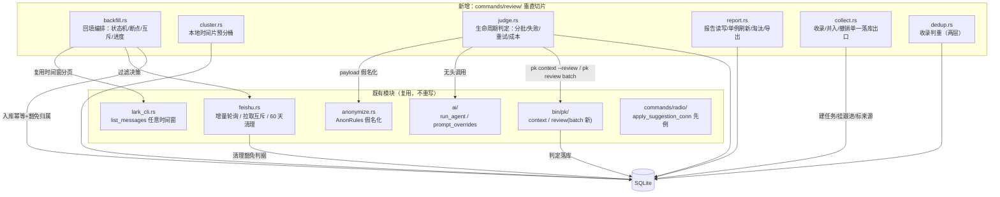
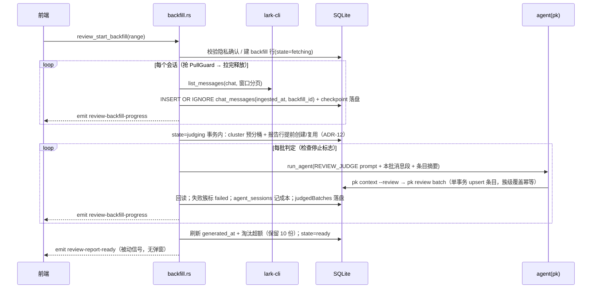
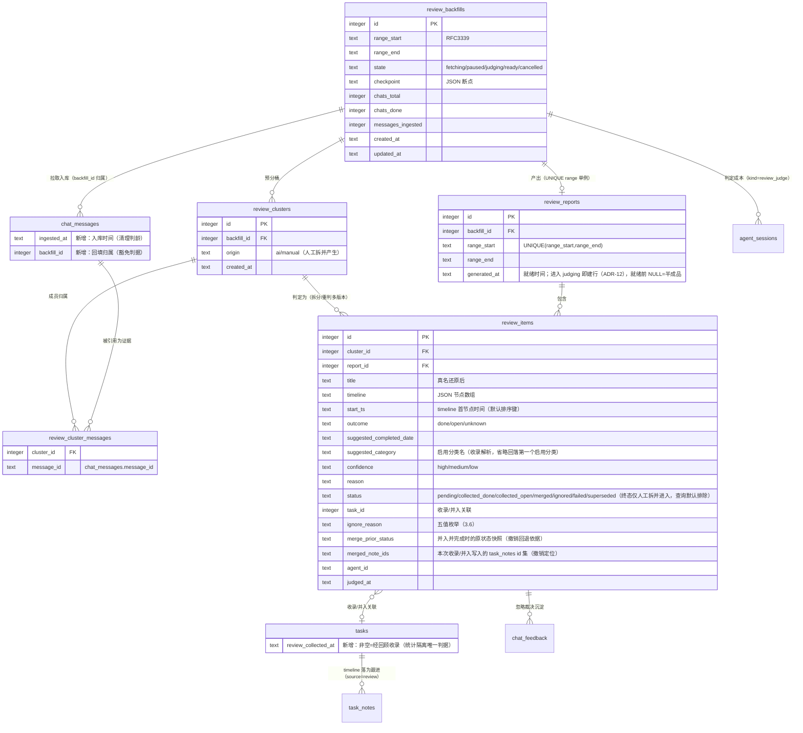

# 飞书历史回顾（feishu-history-review）架构设计文档 (AD)

> 产出方式：经 `ad-architect` 技能产出。输入 = `specs/feishu-history-review/requirements.md`（SDD，已过 1 轮隔离评审并修复）+ `design.md`（方案 B 已定方向）+ `docs/proposals/FEISHU_MESSAGE_ANALYSIS.md`（现有收音机链路策略）+ 仓库代码事实。
> 修订记录：① 契约收敛轮（UIUX 同步产出，主会话收敛结论 9 条落位）；② **评审修复轮（隔离 ad-reviewer 3 High + 8 Medium + 7 Low，High/Medium 全修，Low 全修；主会话协调裁定 3 条对齐落实）**。
> 并行声明：UIUX 已同步产出并经主会话完成契约收敛（本修订轮按收敛结论增量更新，仅动受影响处）；界面信息架构归 UIUX 文档——前端组件目录/命名以 UIUX 为准（`src/components/history/`），后端模块名保持 `commands/review/`（见 §3.8 命名分工）。

## 1. 架构决策概要

核心决策（3 句）：在既有收音机链路（拉取/假名化/tools 判定/单一落库出口）之上新增一个**回顾垂直切片模块** `review/`，回填拉取复用 lark-cli 与会话过滤、以「会话粒度互斥 + 断点落盘」与增量轮询共存；聚合采用**「本地时间片预分桶 + agent 判定时归并」的混合方案**（聚合与生命周期判定在一次 agent 调用内完成，跨时间片靠已产出条目摘要串联）；收录/并入/撤销延续 `apply_suggestion_conn` 先例建**单一落库出口** `collect_review_item_conn`，统计隔离以 `tasks.review_collected_at` 来源标记为唯一判据逐面落实。

**架构特性排序：可靠性 > 可测试性 > 成本可控**。理由与取舍含义：回填是数月消息量级的重操作，中断/并发/误删的代价不可逆（宁可贵一点也要幂等可续跑，冲突时选可靠性）；聚合与统计隔离是核心路径，必须离线夹具可断言（冲突时选可测试性而非极致简单）；token 与时长用护栏（预估/分批/可中止）约束而非硬预算（冲突时允许花更多成本换前两者）。

### 决策索引（轻量 ADR 一览，详见各章）

| # | 决策 | 理由要点（被弃选项） |
|---|------|---------------------|
| ADR-1 | 新增 `src-tauri/src/commands/review/` 垂直切片模块，不摊入 feishu.rs/radio | 回填是独立限界上下文（重操作生命周期自成一体）；feishu.rs 已 2100+ 行（弃：塞进 feishu.rs） |
| ADR-2 | 任务回顾来源标记用**独立列 `tasks.review_collected_at`**，不扩展 source 枚举 | source 语义是「渠道」（local/feishu/capture），撤销安全域已依赖；「并入并完成」要在既有任务上标记完成来源，source 是行级改不动（弃：source='review' 枚举扩展——渠道与方式两轴混淆） |
| ADR-3 | 清理豁免 = **新增 `chat_messages.ingested_at`（入库时间）判龄 + `backfill_id` 归属豁免** | 修正现状缺口（created_at 写的是发送时间，回填消息入库即满足删除条件）；报告存续期豁免由「backfill 活跃或存在存活报告」动态判定，报告删除后自然回归清理，无需联动清标记（弃：静态 exempt 标记——需在报告删除时联动重算；弃：仅改口径不动归属——「取消后消息保留」无法满足） |
| ADR-4 | 聚合 = **本地时间片预分桶（确定性）+ 判定调用内语义归并 + 既有条目摘要跨片串联** | 跨会话同一事项是 P0（纯本地聚类不可达）；全量消息单次送 agent 会 token 爆炸（弃：纯 agent 聚合）；聚合与判定合一省一遍全量 pass（弃：独立聚合 pass） |
| ADR-5 | 生命周期判定用**独立系统提示词 `REVIEW_JUDGE_SYSTEM_PROMPT` + 独立 pk 出口 `pk review batch`** | 与增量四动作语义完全不同（事项/时间线/结局 vs todo/update/followUp/none），共用 prompt 会让可编辑覆盖互相牵连（弃：扩展 TOOLS_SYSTEM_PROMPT） |
| ADR-6 | 可编辑提示词新增第 5 处覆盖点 `review_judge` | 生命周期判定是高频迭代对象（宁漏勿滥调优），符合 editable-prompts 既有模式；dispatch 第 5 只读项顺延为第 6 |
| ADR-7 | 判重上下文 = **`pk context --review` 旗标扩展**（追加 recentDoneTasks，默认不含） | 单一 context 入口、增量判定零影响；`pk task list` 截断 50 条先例 + openTasks 无上限的已知缺口一并按上限收敛 |
| ADR-8 | 回填与增量互斥 = **共享拉取互斥、回填以「单会话拉取」粒度持锁 + 增量侧周期内短间隔重试且互斥冲突不进退避**（POLL_IN_FLIGHT 先例泛化） | 满足「回填进行中增量 ≤1 周期恢复」；单发 CAS 撞会话间隙概率低，增量侧行为必须写实（评审 H2）；整轮回填级互斥会饿死增量数小时（弃：整级互斥）；无互斥则 lark-cli 子进程翻倍竞态 |
| ADR-9 | 迁移 = **追加 `SCHEMA_V2` 迁移条目**（不修改已存在的 SCHEMA_V1 基线） | 遵守「迁移只追加」铁律；开发者本地库 user_version=1 自动升级，无需手动 ALTER 对齐 |
| ADR-10 | 报告单例 = `review_reports` 上 `UNIQUE(range_start, range_end)`，再生成 upsert | SDD 单例刷新语义的直接落库表达；淘汰（保留 10 份）/手动删除走同一删除事务 |
| ADR-11 | 收录未完成的任务**也打来源标记**，其后续自然完成仍被统计排除 | 口径封闭性：防「收录为未完成再完成」绕过隔离制造虚假连胜（SDD「隔离按来源标记判定，与日期无关」的推论；代价是漏激励，取向保守符合宁漏勿滥） |
| ADR-12 | **报告行提前到进入 judging 时创建**（state=judging 事务内建/复用报告行；就绪时只刷新 generated_at） | 条目判定落库时报告必须已存在（report_id NOT NULL + pk 由 cluster 推归属的时序前提，评审 H1）；judging 中段取消的半成品报告可见可审阅、豁免语义自洽（弃：判定后建报告——stdin 契约推不出尚不存在的 report、孤儿条目不可见） |
| ADR-13 | **同一时刻至多一个活跃回填**（存在任意活跃回填即 Invalid，不限同范围） | UIUX 单进度卡假设；多回填并发的进度呈现/互斥/成本护栏复杂度不值当；「取消重跑同范围」由报告单例刷新承接 |

## 2. 技术栈选择

**完全沿用项目现有技术栈**：Tauri 2 / Rust（rusqlite 直连 SQLite WAL）/ Vue 3 + Pinia / Vitest + cargo test。**不引入任何新第三方依赖**——事件簇的本地预分桶与判重相似度用自实现字符串相似度（`tag_health` 的本地相似度预筛先例），不引 ML/聚类库；Markdown 导出复用既有 export 管线的字符串拼装方式。

| 层级 | 决策 | 说明 |
|------|------|------|
| 后端 | 沿用 | 新模块 `commands/review/`，无新 crate |
| 数据库 | 沿用 | SQLite + 追加迁移 SCHEMA_V2 |
| AI 判定 | 沿用 | agent 无头调用 + pk tools 模式（`ai::run_agent` / `pk review batch`） |
| 前端 | 沿用 | 新增历史回顾组件目录 `src/components/history/`（UIUX 定稿命名；与既有每周复盘的 `ReviewWizard.vue` 区分，见 §3.1 辨析） |
| 测试 | 沿用 | 假 lark-cli 脚本 + fake-agent 脚本先例（`feishu.rs` / `judge.rs` 既有测试模式） |

## 3. 系统模块与组件树

### 3.1 后端模块划分



| 模块 | 职责 | 对外接口（command / conn 函数） |
|------|------|--------------------------------|
| `review/backfill.rs` | 回填任务状态机（拉取中/已暂停/判定中/报告就绪/已取消）、断点读写、与增量轮询的互斥、停止标志、进度事件发射 | `review_estimate_backfill` / `review_start_backfill` / `review_stop_backfill` / `review_cancel_backfill` / `review_get_backfill` / `review_confirm_privacy` |
| `review/cluster.rs` | 纯函数：按时间片 × 会话对已入库消息预分桶产出候选簇；人工拆分/合并的簇结构（origin=manual）维护 | `build_batches_conn` / `split_cluster_conn` / `merge_clusters_conn` |
| `review/judge.rs` | 判定编排：payload 组装（假名化 + 处置状态上下文 + 既有条目摘要）、分批调用 agent、批次失败标记、幂等重试、`agent_sessions` 成本记录 | `judge_pending_conn`（内部）/ `review_retry_failed` / `review_regenerate_report` |
| `review/report.rs` | 报告生成（单例 upsert）、汇总统计（从条目实况派生不缓存计数）、保留 10 份淘汰、手动删除、Markdown 导出 | `review_list_reports` / `review_get_report` / `review_delete_report` / `review_export_report_md` |
| `review/collect.rs` | 收录（已完成/未完成）、并入（挂跟进/并入并完成）、忽略、恢复、撤销收录/并入的**单一落库出口**（单事务） | `collect_review_item_conn` / `review_collect_item` / `review_merge_item` / `review_ignore_item` / `review_restore_item` / `review_undo_collect` |
| `review/dedup.rs` | 收录判重：未完成待办 + 已完成任务（图鉴）两层候选检索 | `find_duplicates_conn` |

**依赖方向**：review 只依赖既有基础设施（lark_cli / anonymize / ai / db），不反向被 feishu.rs 依赖；feishu.rs 仅感知两处——共享拉取互斥、清理 SQL 的豁免判据。这保证「回填失败不阻塞增量轮询」在结构上成立（增量不 import review 的任何执行路径）。

**命名辨析（评审 L5）**：后端模块 `commands/review/` 与仓库既有「每周复盘」链路存在名称重叠——前端复盘向导是 `src/components/ReviewWizard.vue`、其 settings 键为 `review_enabled`/`review_dow`/`review_last_notified`/`review_last_done`（scheduler.rs）、`commands/radio/` 下亦有 `review.rs`（收音机分诊）。为避免语义漂移：① 本特性 settings 键统一用 **`history_review_`** 前缀（如 `history_review_privacy_confirmed_at`，提示词覆盖键 `ai_prompt_review_judge` 沿用 editable-prompts 既有 `ai_prompt_*` 命名不受影响）；② 前端组件目录用 `src/components/history/`（UIUX 定稿）；③ 后端模块名保留 `commands/review/`（包内符号 `review::` 与 radio::review 不在同一命名空间，无编译冲突），消费其公共 API 时一律经全限定路径。

### 3.2 回填编排（backfill.rs）——断点、互斥、可中止

**状态机**（与 SDD §3.3 回填任务状态图一一对应）：`fetching → judging → ready`；`fetching/judging → paused`（停止/中断/失败）；`paused → fetching|judging`（续跑按断点阶段）；`fetching/paused/judging → cancelled`（取消）。三条配套约定（评审 H1/M5/M7）：

- **报告行提前创建（ADR-12）**：进入 `judging` 的事务内即建（或复用）报告行——同范围已有存活报告（取消后重跑/再生成场景）则 upsert 复用并重挂 `backfill_id`，既有条目按再生成语义保留（已收录/已并入/已忽略不翻转）；无则新建。就绪时只刷新 `generated_at` 并执行淘汰。由此：判定阶段条目落库时报告必然存在（`report_id NOT NULL` 成立、pk 由 cluster 推归属可解析）；`judging` 中段取消/暂停的**半成品报告可见可审阅**（已判条目正常呈现，未判部分随进度事件补齐），其消息豁免语义自洽（§5.3 的 EXISTS 判据天然覆盖）。
- **启动与崩溃和解（M5）**：应用启动时把遗留的非终态行（`fetching`/`judging`——进程死亡痕迹）统一置 `paused`（断点保留可续跑）；「活跃回填」判定 = state ∈ {fetching, paused, judging}，和解后不存在 stale 行卡死启动。
- **并发单活跃（ADR-13/M7）**：`review_start_backfill` 前置检查——存在**任意**活跃回填（不限同范围）即 `Invalid`；前端新回顾按钮据 `review_list_reports.activeBackfill`（§4.1）同步禁用。

**断点存储**（`review_backfills.checkpoint` JSON，每步落盘，落盘率 100%）：

```json
{
  "phase": "fetch",
  "chatCursor": { "index": 12, "pageToken": null, "chatsTotal": 47 },
  "judgedBatches": [1, 2, 4],
  "batchesTotal": 9
}
```

- 拉取阶段断点粒度 = **会话 + 页 token**：会话列表在启动时一次性确定并按序处理，中断后从 `chatCursor` 续；已入库消息靠 `message_id UNIQUE` 天然幂等（`INSERT OR IGNORE` + 归属认领，见 §5.2）。
- 判定阶段断点粒度 = **批次号**（重做粒度 ≤1 批次，SDD NFR）；`judgedBatches` 记已成功批次，重试/续跑只处理缺失与 `failed` 态。

**与增量轮询及手动「立即拉取」的互斥**（ADR-8）：把 `feishu.rs` 的 `POLL_IN_FLIGHT`（static AtomicBool）泛化为共享的 `feishu::PullGuard`（同 CAS 语义，语义最近复用 `AppError::External` 冲突报错）：

- 增量 `poll_once`：整轮持有；抢锁失败的**侧写改造（评审 H2，feishu.rs 轮询循环的直接依赖改动）**——① `spawn_poll_loop` 识别互斥冲突错误（PullGuard 专用错误标记或错误串匹配「仍在进行中」），**不计入 backoff**（backoff 保持 1，不侵蚀退避基线）；② 周期到达抢锁失败时进入**周期内短间隔重试**（每 3s 重试 CAS 直到本周期预算耗尽），任一次成功即执行整轮——回填会话粒度持锁 + 500ms 让路间隙下，数秒内必能插入。周期末仍未成功（极端）记一次跳过（日志 debug，不登记健康失败、不退避）。理由核对：现状单发 CAS + External 错误路径会把互斥冲突推入 ×2 退避（上限 ×8=16 分钟档），数小时回填期间增量大概率整程零成功——直接违反 SDD P0「回填进行中增量照常恢复 ≤1 周期」，故增量侧行为必须写实如上。
- 回填：**每拉取一个会话的分页序列前抢一次锁，拉完该会话即释放**，会话之间固定让路间隙（500ms，兼作 lark-cli 限速）；回填抢不到锁（增量在跑）→ 秒级退避重试而非失败。
- **启动语义（契约收敛定稿：排队等待式，不设 MUTEX_CONFLICT 错误码）**：`review_start_backfill` 启动即建行 `state=fetching` 并返回 backfillId，首个会话抢 PullGuard 失败时在内部秒级退避等待，**不向用户返回互斥错误**。理由：增量整轮可耗时数分钟，拒绝式把系统调度问题转嫁为用户手动重试，违背注意力友好；会话粒度锁 + 500ms 让路已结构性保证增量优先，回填等待是有限代价。前端据 `state=fetching && chatsDone=0` 呈「排队/等待中」子态（文案归 UIUX）。
- 同库写并发：入库为短事务 + WAL；**应用侧连接补 `PRAGMA busy_timeout=5000`（评审 M3）——现仅 pk CLI 侧设置（`bin/pk/cli.rs` 打开连接处），`db::init` 的应用连接同样设置**，GUI 与 pk 并发写不再依赖侥幸。

**可中止（≤10s）**：`backfill.rs` 持有进程内 `AtomicBool` 停止标志，在每个「会话拉取完成」「判定批次完成」检查点检查；进行中的单个 lark-cli 调用/agent 调用可等待完成（SDD 允许）。停止后置 `paused` 并落盘断点。

**失败归宿**：单会话分页失败 → 本轮整体转 `paused`（不产生半会话数据假象——该会话消息不入库或整会话完整入库后才推进 chatCursor），与增量「游标整轮成功才推进」同一失败哲学。

**拉取方向**：时间从旧到新（`start_s` 固定为范围起点，逐会话分页到 `end_s`）。旧→新的处理序使跨时间片判定天然按时间线累积条目摘要（§3.4）。

**预估**（`review_estimate_backfill`，≤5s）：会话数 = `list_chats` 一次调用（精确）；消息量级 = 抽样至多 3 个未过滤活跃会话各拉一页（50 条）看时间跨度外推密度（诚实标注「抽样估算」）；预计时长/成本 = 批次数 × `agent_sessions` 历史均值（`kind IN ('classify','review_judge')`，无历史时如实「无法预估」，禁止假数字）。**单次 lark-cli 调用设 8s 超时预算（评审 L7）**：任一抽样调用超时/失败即整体落 `estimateBasis:"unknown"`（已得部分仍返回，缺失字段 null），不重试拖满 5s、不假数字兜底。隐私确认标记（`settings.history_review_privacy_confirmed_at`，前缀见 §3.1 辨析）在 start 前强制检查——未确认则拒绝启动（确认前拉取消息数 = 0）。

### 3.3 事件簇聚合（cluster.rs）——算法选型

**三方案 trade-off**：

| 方案 | 做法 | 优点 | 缺点 | 结论 |
|------|------|------|------|------|
| A 纯本地确定性聚类 | 相似度/规则归簇 | 零 token、完全可测 | 跨会话同一事项（群布置+私聊催办）语义合并不可达——SDD 故事 3 场景 1 是 P0 | 弃 |
| B 纯 agent 自主聚合 | 全量消息一次/多次送 agent 归簇 | 语义质量上限最高 | 数千条消息全量上下文 token 爆炸；聚合错误无人工兜底前不可测 | 弃 |
| C 混合（**推荐，ADR-4**） | 本地时间片预分桶 → 判定调用内语义归并 → 既有条目摘要跨片串联 | 本地部分确定性可离线测试；token 按片受控；跨会话靠 agent 语义判定；人工拆分/合并兜底聚合错误 | 两阶段结构略复杂 | **选** |

**具体机制**：

1. **本地预分桶**（纯函数 `build_batches_conn`）：把回填范围内全部已入库消息（含重叠期内增量已处置消息——处置状态作上下文）按「时间片（默认 14 天，常量可调）」切分，片内按会话分组，产出候选簇 = 会话 × 片的连续消息段；按累计内容长度组批（每批 ≤ 约 200 条消息或内容截断后 ≤ 约 60k 字符，先例：content_anon 截断 200 字/条）。**此阶段不做语义合并**——只保证「同一会话同一时段的消息在同一批」。
2. **判定调用内归并**（§3.4）：每批判定 prompt 中，消息按候选簇分段呈现，agent 输出「条目」（= 语义簇），允许把多个候选段并为一个条目（跨会话归簇在此发生），条目引用证据消息 id 集合。
3. **跨片串联**：批判定 payload 尾部附**已产出条目摘要**（此前时间片的条目：标题 + 结局 + 关键词，上限 50 条、超出按标题相似度预筛）——agent 可把本片消息 `mergeInto` 既有条目（追加时间线节点）。时间从旧到新处理使条目摘要自然构成时间线累积。
4. **人工纠偏兜底**：拆分/合并操作直接改 `review_cluster_messages` 归属（新簇 origin=manual），受影响条目重送判定（§3.4）；再生成不推翻 manual 簇（SDD 故事 9）。

**「宁漏勿滥」落地**：判定 prompt 明确「证据不足判 outcome=unknown、置信度 low，不要为了产出条目而强行归纳」（§3.5）；空片/纯噪音片允许输出零条目。

### 3.4 生命周期判定（judge.rs）

**链路**（复用 `classify_and_apply` 的全部工程模式）：payload 组装（锁内点查、释锁拼装）→ `ai::run_agent` 无头调用 → agent 经 `pk review batch --agent <id>` 把判定写库 → 应用从库回读（`load_review_judgments_conn`）→ 失败挽救（已落库的收下、未落库的标 `failed`）→ `agent_sessions` 落成本（kind=`review_judge`，100% 记录）。

**批次失败重试幂等**：批内簇标记 `pending`→判定成功覆盖；失败标 `failed`；重试只处理 `failed` 态（`WHERE status='failed'` 的条件更新，天然幂等）；单批失败不阻塞其余批次（循环逐批、批间无事务耦合）。拆分/合并产生的新簇重送判定走同一入口。**判定崩溃窗口（评审 M1）**：checkpoint 的 `judgedBatches` 在 pk 落库**之后**写——崩溃介于两者之间时，续跑会重放同批判定；由 pk 侧**簇级覆盖幂等**（§3.7：同簇再判 = 覆盖更新既有条目，不新建行）消化，重放结果 = 覆盖，无双条目。

**payload 契约**（假名化复用 `AnonRules` 同一映射，同代号=同人）：

- 消息段：`[om_xxx] 来源：飞书·群聊「真实群名」/ 发送者：成员_a1b2 或 我 / 时间：MM-DD HH:MM / 内容：content_anon`；纯媒体占位符仅作上下文（先例）。
- **处置状态上下文**（SDD 流程图 J 节点）：消息若已被增量处置，附标注——`已捕捉为待办（标题过 rules.scrub_titles）` / `已人工逃走（原因码）` / `AI 判定无关`——让 agent 知道该事项已有出口，判重并入而非新建双记（SDD 故事 7「已被增量处置的消息」场景）。
- 既有条目摘要段（跨片串联，§3.3）。
- 判重上下文：agent 自行 `pk context --review` 取未完成待办 + 近期已完成任务（§3.7）。

### 3.5 判定提示词策略（ADR-5/6）

**新独立 prompt `REVIEW_JUDGE_SYSTEM_PROMPT`**（`ai/prompts.rs` 新常量），要点：生命周期判定输出 schema（title/timeline/outcome/completedDate/**category（可选，从 pk context 启用分类清单选，省略合法）**/confidence/reason/evidenceMessageIds/mergeIntoItemId）、结局三值（done/open/unknown）、置信度三档、宁漏勿滥（证据不足判 unknown/low）、人名代号规则沿用、时间线节点词表建议（proposed/progress/outcome 自由文本 + 对应 messageIds）、`pk review batch` 出口与禁止事项（不得 `pk task create`）。**tags 不进判定 schema**——跨消息聚合的簇语义下给整簇打标签含义模糊，任务建立后可正常编辑，不把标签决策塞进判定协议（取舍记录）。

**与 TOOLS_SYSTEM_PROMPT 的关系**：完全独立、互不引用。理由：四动作协议是「逐消息、面向未完成」的判定；生命周期判定是「按簇、面向结局」的判定，字段集/出口/校验全不同；合并会让一处可编辑覆盖同时服务两种语义，编辑者无法推理改动的双向影响。

**可编辑覆盖**：`prompt_overrides.rs` 新增 `REVIEW_JUDGE_SPEC`（id=`review_judge`，storage_key=`ai_prompt_review_judge`，占位符 `<AGENT_ID>`），入 `PROMPT_SPECS` 与 `PromptFeature::ReviewJudge`——设置页出现第 5 个可编辑项（dispatch 只读项顺延第 6），保存校验/回落/占位符扫描全部复用既有机制。

### 3.6 收录 / 并入 / 撤销落库（collect.rs + dedup.rs）

**单一落库出口**（`apply_suggestion_conn` 先例）：`collect_review_item_conn(conn, item_id, action, params)` 是唯一写 `tasks`+`task_notes`+`review_items` 的收录路径，**单事务**覆盖：

| 动作 | 事务内写入 |
|------|-----------|
| 收录为已完成 | 建任务（status=done、completed_at=训练家确认的历史日期、`review_collected_at=now`、source=feishu、due NULL）→ timeline 逐节点写 task_notes（source='review'，时间戳用节点 ts 保留脉络时序，**note ids 记入 `merged_note_ids`**）→ 条目置 collected_done + task_id → task_logs 记 create |
| 收录为未完成 | 建任务（status=inbox 草丛、**不带历史 due**、`review_collected_at=now`）→ 同上挂跟进（note ids 同记 `merged_note_ids`）→ 条目置 collected_open |
| 并入（挂跟进） | 仅插 task_notes（source='review'，**写入的 note id 集合记入条目 `merged_note_ids`**）→ 条目置 merged + task_id；**不触碰统计面、不写来源标记**（SDD 故事 7） |
| 并入并完成 | 事务内快照原状态到条目 `merge_prior_status` → UPDATE 既有任务 status='done'、completed_at=历史日期、`review_collected_at=now` → 挂跟进（note id 集合同记 `merged_note_ids`）→ 条目置 merged |
| 忽略 | 条目置 ignored + ignore_reason → `chat_feedback` 记裁决（action='review_ignored'，复用飞轮） |
| 撤销收录 | 校验安全域（§下）→ 删任务 + 该次 task_notes（`merged_note_ids` 定位）→ 条目回 pending |
| 撤销并入并完成 | 校验并入安全域（§下）→ 既有任务回退 `merge_prior_status` 快照状态（completed_at=NULL、`review_collected_at=NULL`；快照缺失时回落 inbox）→ 删 `merged_note_ids` 定位的跟进 → 条目回 pending |
| 撤销并入（挂跟进） | 删 `merged_note_ids` 定位的 task_notes → 条目回 pending |

**撤销并入三缺口闭合（评审 M2）**：① 回退状态不拍脑袋——并入并完成事务把原 status 快照进 `review_items.merge_prior_status`，撤销按快照回退（丢原状态会把 scheduled 路线任务错退成草丛）；② 「该次跟进」可定位——收录/并入事务把写入的 task_notes id 集合记入 `review_items.merged_note_ids`（JSON 数组），撤销按 id 删，不靠内容匹配误伤既有跟进；③ **并入撤销安全域独立定义**：目标待办在并入时间点之后不存在 `origin != 'review'` 的 task_logs 新记录（即用户未再编辑/操作过它）——与收录撤销的安全域分开判定（收录看任务自身 started_at/focus/logs，并入看目标任务的后续日志流）；不满足则撤销入口禁用（`canUndo` 同字段口径）。

**收录幂等**：入口先做条件更新抢占——`UPDATE review_items SET status=<目标> WHERE id=? AND status='pending'`，受影响行数 0 即重复请求，返回已有关联（task_id）不重复建任务（SDD 故事 5 收录幂等 + NFR 多余任务数=0）。完成日期规则内聚在此：无判定值时预填时间线最后一条证据消息时间；无判定且无证据时间 → 拒绝并要求显式填写（不默认收录当日）。

**建任务字段解析（契约收敛定稿）**：category 取条目 `suggested_category`——判定从 pk context 启用分类清单选出、`pk review batch` 侧校验（`resolve_category` 同款）；省略或未命中时收录回落**第一个启用分类**（`create_task_from_message` 同款兜底，满足 `tasks.category_id NOT NULL` 的契约缺口闭合）。**tags 不引入**：取舍理由见 §3.5。

**忽略原因码（契约收敛定稿，独立枚举不复用收音机 ESCAPE_REASONS）**：`not_my_task`（不是给我的任务）/ `already_in_dex`（图鉴里已经有了）/ `not_worth`（不值得记）/ `wrong_cluster`（判定有误·不是一件事）/ `''`（直接忽略）。不复用的理由：逃走（dismiss 一条消息建议）与回顾忽略（否决一个事件簇判定）语义域不同，原因码是反馈飞轮的分析维度，混用会污染两侧数据。`review_ignore_item.reason` 按此校验，裁决照旧落 `chat_feedback`。

**撤销安全域判据**（`undo_chat_review` 的 source 安全域先例泛化）：收录产生的任务「未被编辑或开始过」= `started_at IS NULL AND focus_seconds=0 AND task_logs 中不存在 origin != 'review' 的后续记录`（收录事务写入的 create log 除外）；不满足则撤销入口禁用（前端据 `canUndo` 字段禁用，改用任务删除）。**关联任务被删除的回退**：`delete_task_conn` 内加钩子——同事务 `UPDATE review_items SET status='pending', task_id=NULL WHERE task_id=?`（反向关联）；报告读取时再做懒校验兜底（防绕过 command 的删除）。报告统计一律从条目实况派生（SDD 故事 11「不用缓存计数」）。

**判重（两层，`find_duplicates_conn`）**：收录/并入前检索——① 未完成层：open 任务标题相似度（规范化 trim/折叠空白/小写 + 自实现相似度阈值，`dedup_batch_todos` 规范化先例）；② 已完成层（图鉴防双记）：done 任务标题相似度（`completed_at` 倒序取最近 200 条参与）。命中即返回冲突候选集（taskId/title/status/completedAt），判重是**提示不阻断**，新建权在训练家。

**两类命中的出口分型（契约收敛定稿：UI 层职责）**：后端只提供 `conflicts` 候选集（含 `status` 字段）与既有动作命令，出口组合由前端按候选的 `status` 分型——命中未完成（open）任务：并入并完成 / 仅并入跟进 / 仍然新建 / 取消；命中已完成（done）任务：忽略（`review_ignore_item` reason=`already_in_dex`）/ 仍然新建 / 取消。后端不提供组合出口命令，避免命令面按命中类型组合爆炸。

### 3.7 pk 协议扩展（agent 消费面，ADR-7）

| 扩展 | 契约 | 同步义务 |
|------|------|----------|
| `pk context --review` | 追加输出 `recentDoneTasks: [{id, title, completedDate}]`（done 任务按 completed_at 倒序上限 200，标题过 `rules.scrub_titles` 假名化）；默认（无旗标）输出**逐字节不变**——增量判定零影响 | `skills/references/commands.md` 更新 context 条目 |
| `pk review batch --agent <id>` | stdin `{"results":[{itemId?, clusterId, title, timeline:[{ts, node, note, messageIds[]}], outcome, completedDate?, category?, confidence, reason, evidenceMessageIds[], mergeIntoItemId?}]}`；校验（clusterId 存在且待判定、outcome/confidence 枚举、messageIds 存在且属于该簇、completedDate 格式、**category 若给出须为启用分类名（resolve_category 同款，省略合法）**、mergeIntoItemId 指向已存在条目）→ 代号反向还原（`anonymize::restore`，title/reason/timeline.note）→ **单事务** upsert review_items → 输出 `{"submitted": N, "merged": M, "agent": "..."}`；错误带序号与 clusterId 供 agent 自纠整批重试 | `skills/references/` 新增 `review-workflow.md`；主文档命令速查加两行；`SKILL_VERSION` 7→8 |

`itemId` 语义与**簇级覆盖幂等（评审 M1 裁定）**：`pk review batch` 对「簇已存在 active 条目（status 非 superseded）」的判定结果一律**覆盖更新该条目**（含 agent 省略 itemId 的提交——由 clusterId 定位既有条目；无条目才 INSERT）。由此重试/再生成/崩溃重放（§3.4 窗口）全部幂等，且避免 superseded 多版本语义扩散到 UI。**superseded 全文定义**：进入边只有两条——人工拆分（原条目置 superseded，新簇判定产出新条目）与人工合并（被并条目置 superseded，合并簇重判产出新条目）；退出边无（终态，不可恢复——反悔走新条目处置）；**查询契约（协调裁定 3）：`review_get_report` 默认排除 superseded，仅显式 `status=superseded` 请求才返回；报告 summary 统计同口径默认排除**。`report_id` 归属解析（评审 H1）：pk 由 clusterId → `review_clusters.backfill_id` 推得回填，报告行在进入 judging 时已创建（ADR-12），条目 report_id 直接命中——stdin 不携带 reportId。

**tools 模式唯一原则不变**：agent 只能经 pk 写回，应用从库回读。

### 3.8 前端组件树（入口已收敛：收音机 tab 内子视图；组件目录/命名以 UIUX 为准）

> **入口（契约收敛定稿）**：收音机 tab 工具行「📜 回顾」按钮，RadioTab 顶层 view 状态 `triage ↔ history` 切换；组件目录 `src/components/history/`（UIUX 命名 HistoryView / ReviewEntryCard 一系）。**命名分工**：后端模块名保持 `commands/review/`（§3.1），前端组件目录/命名以 UIUX 文档为准（history/）——两侧只经 api/events 契约耦合，命名不要求一致。

```
RadioTab（顶层 view 状态：triage ↔ history；工具行「📜 回顾」按钮切换）
└── history/HistoryView
    ├── BackfillSetup          # props: estimate; emits: start(range)（含「排队/等待中」子态，文案归 UIUX）
    │   ├── RangePicker        # 默认 3 个月/上限 6 个月〔待确认-1〕
    │   ├── EstimatePanel      # 会话数/消息量级/时长/成本（含「无法预估」态）
    │   └── PrivacyNotice      # 首次确认（每设备一次）
    ├── BackfillProgress       # 消费 review-backfill-progress 事件；emits: stop/cancel/resume
    ├── ReportList             # props: reports[]; emits: open/delete/export
    └── ReportView
        ├── ReportSummary      # 派生统计：条目总数/结局分布/已收录数
        ├── EntryFilterBar     # status/outcome/confidence 过滤 → review_get_report 参数（UIUX D16）
        ├── ReviewEntryCard[]  # props: item（title/timeline/outcome/confidence/reason/suggestedCategory/canUndo）
        │   ├── EvidenceViewer # 单条目证据展开（消息原文，P95 ≤500ms）
        │   └── ItemActions    # emits: collect/merge/ignore/split/mergeClusters/undo/restore
        └── RetryPanel         # 判定失败批次重试
```

状态管理：新增 `stores/review.ts`（Pinia），command 调用经 `src/api.ts` 薄封装；事件订阅镜像 `src/events.ts` + 契约测试（`events.spec.ts` 先例）。**「待阅」角标为前端本地态**（store + localStorage 记最后打开的报告，与 `review-report-ready` 事件比对）——后端不加 readAt 字段（契约收敛定稿）。

### 3.9 关键时序

**回填主流程**（中止/续跑分支省略）：



**收录时序**（单事务）：

```mermaid
sequenceDiagram
    participant UI as 前端
    participant CO as collect.rs
    participant DB as SQLite
    UI->>CO: review_collect_item(itemId, {mode, completedDate?})
    CO->>DB: dedup.find_duplicates_conn（两层判重）
    alt 命中冲突且未显式选择
        CO-->>UI: 冲突候选集（三选交互）
    else 确认收录
        CO->>DB: BEGIN; 条目条件更新抢占(pending→collected_*)
        CO->>DB: 建任务/并入(done+历史日期+review_collected_at) + task_notes(timeline)
        CO->>DB: task_logs; COMMIT
        CO-->>UI: taskId（无捕捉演出/通知/连胜变化——不走 PetApp 完成路径）
    end
```

## 4. 关键接口定义

### 4.1 Tauri command 契约（全部 camelCase 序列化，镜像 `src/types.ts` + 契约测试）

| command | 参数 | 响应 | 错误 |
|---------|------|------|------|
| `review_estimate_backfill` | `{ rangeStart: string, rangeEnd: string }`（RFC3339） | `{ chatsTotal: number, messageEstimate: number \| null, estimateBasis: "sampled" \| "unknown", estimatedBatches: number \| null, estimatedDurationSecs: number \| null, estimatedCostUsd: number \| null }` | `Invalid`：范围超 6 个月上限/起止倒置 |
| `review_confirm_privacy` | `{}` | `{ confirmedAt: string }` | — |
| `review_start_backfill` | `{ rangeStart, rangeEnd }` | `{ backfillId: number }` | `Invalid`：未确认隐私/超上限/**存在任意活跃回填（ADR-13，不限同范围）**；`External`：lark-cli 不可用。**互斥不产生错误码**——排队等待式（§3.2 定稿），抢锁等待为内部行为 |
| `review_stop_backfill` | `{ backfillId }` | `{ state: "paused" }` | `NotFound` |
| `review_cancel_backfill` | `{ backfillId }` | `{ state: "cancelled" }` | `NotFound` |
| `review_resume_backfill` | `{ backfillId }` | `{ state }` | `Invalid`：非 paused 态 |
| `review_get_backfill` | `{ backfillId }` | `{ id, state, rangeStart, rangeEnd, phase, chatsDone, chatsTotal, messagesIngested, batchesDone, batchesTotal, failedClusterIds: number[], updatedAt }` | `NotFound` |
| `review_list_reports` | `{}` | `{ reports: Vec<ReviewReportSummary>, activeBackfill: ReviewBackfillSummary \| null }`（M6/协调裁定 2：**单次查询即得列表 + 活跃回填摘要**，支撑「进度卡吸顶 + 下方报告照常审阅」同屏布局；无活跃回填为 null） | — |
| `review_get_report` | `{ reportId, offset?, limit?, status?, outcome?, confidence? }`（过滤参数可选，组合 AND；分页语义保持。**协调裁定 3：默认排除 superseded 条目，仅显式传 `status=superseded` 才返回**） | `ReviewReport`（§4.1.1，条目分页 limit 默认 50；summary 统计同默认排除口径） | `NotFound`。**默认排序（无过滤时同适用）**：状态分组优先级 `pending → failed → collected_done/collected_open/merged → ignored`，组内按时间线起始时间（`start_ts`）正序——时间线累积叙事 |
| `review_retry_failed` | `{ reportId }` | `{ retried: number, stillFailed: number }` | — |
| `review_regenerate_report` | `{ reportId }` | `{ reportId }`（单例刷新语义；重判条目经簇级覆盖幂等更新，已处置状态不翻转） | `Invalid`：存在任意活跃回填（ADR-13） |
| `review_delete_report` | `{ reportId }` | `{}` | `NotFound` |
| `review_export_report_md` | `{ reportId, dest? }`（契约收敛：默认输出**既有导出目录**（`export_daily_md` 同一目录约定，无系统保存对话框），文件名 `review-{YYYYMMDD}-{YYYYMMDD}.md`（range 起止日期段）；`dest?` 仅测试注入保留） | `{ path: string }` | `External`：写盘失败 |
| `review_collect_item` | `{ itemId, mode: "done" \| "open", completedDate?: string, confirmedDup?: boolean }` | `{ taskId: number }`；判重命中未确认时返回 `{ conflicts: ReviewDupConflict[] }`（联合形态：`{ ok: false, conflicts } \| { ok: true, taskId }`） | `Invalid`：结局不明未显式指定结局/无完成日期且无证据时间/条目非 pending |
| `review_merge_item` | `{ itemId, taskId, mode: "followup" \| "complete", completedDate? }` | `{ taskId }` | 同上 + `NotFound`：目标任务不存在 |
| `review_ignore_item` | `{ itemId, reason? }`（reason ∈ `not_my_task/already_in_dex/not_worth/wrong_cluster` 或省略=直接忽略，§3.6 独立枚举） | `{}` | `Invalid`：状态不容许/非法原因码 |
| `review_restore_item` | `{ itemId }` | `{}`（ignored→pending） | `Invalid` |
| `review_undo_collect` | `{ itemId }` | `{}` | `Invalid`：任务已被使用（安全域外） |
| `review_split_item` | `{ itemId, partitions: [{ messageIds: string[] }] }` | `{ newClusterIds: number[] }`（M8 裁定：**同步返回簇 id 而非条目 id**——拆分时新条目尚不存在，需重送判定完成后才产生；前端经 `review-backfill-progress`/`review-report-ready` 事件或轮询刷新获知新条目） | `Invalid`：messageIds 不全属于本簇/空分区 |
| `review_merge_clusters` | `{ itemIds: number[] }` | `{ newClusterId: number }`（同上，重判完成后经事件刷新） | 同上 |
| `review_get_item_evidence` | `{ itemId }` | `Vec<ReviewEvidence>`（消息原文 display 版 + 时间 + 发送者真名） | `NotFound`；消息已被清理时条目带 `evidenceAvailable: false` 降级 |

#### 4.1.1 核心响应结构

```jsonc
// ReviewReportSummary / ReviewReport 公共头
{
  "id": 1, "rangeStart": "2026-06-01T00:00:00+08:00", "rangeEnd": "2026-09-01T00:00:00+08:00",
  "generatedAt": "2026-09-30T12:00:00+08:00",          // 提前创建的报告在就绪前为 null（ADR-12 半成品可审阅）
  "backfillState": "ready",                              // 派生自所属 backfill：活跃态=生成中/半成品，ready/cancelled=可审阅
  "summary": { "total": 40, "byOutcome": { "done": 22, "open": 12, "unknown": 6 }, "collected": 10, "merged": 2, "ignored": 5 }  // 派生统计，不缓存；默认排除 superseded（裁定 3）
}
// ReviewBackfillSummary（附于 review_list_reports.activeBackfill，M6；UIUX E1 单次查询即得）
{ "id": 3, "state": "fetching", "rangeStart": "...", "rangeEnd": "...", "phase": "fetch",
  "chatsDone": 5, "chatsTotal": 47, "messagesIngested": 1200, "batchesDone": 0, "batchesTotal": 0, "updatedAt": "..." }
// ReviewItem（ReportView 列表行）
{
  "id": 7, "title": "整理季度报告材料", "outcome": "done", "confidence": "medium",
  "suggestedCompletedDate": "2026-07-15", "suggestedCategory": "工作", "reason": "对方确认收到终版",
  "timeline": [ { "ts": "2026-06-20T10:00:00+08:00", "node": "proposed", "note": "群里布置", "messageIds": ["om_a1"] },
                { "ts": "2026-07-15T09:00:00+08:00", "node": "outcome", "note": "交付并确认", "messageIds": ["om_b2"] } ],
  "status": "pending", "taskId": null, "canUndo": false, "evidenceAvailable": true,
  "clusterId": 12, "origin": "ai", "ignoredReason": null   // ignoredReason: not_my_task/already_in_dex/not_worth/wrong_cluster/null
}
// ReviewDupConflict
{ "taskId": 33, "title": "整理季度报告材料", "status": "inbox", "completedAt": null, "similarity": 0.86 }
```

**与既有模式的对齐**：结构体 `#[serde(rename_all = "camelCase")]`（`StreakInfo`/`RetryAiResult` 先例）；枚举字面值 snake_case（`PromptSource` 先例）；`Task` 扩展字段 `reviewCollectedAt?: string | null` 进 `src/types.ts`。

### 4.2 事件契约（kebab-case，`events.rs` + `src/events.ts` 双侧镜像 + 契约测试）

| 事件 | 发布者 | 消费者 | payload |
|------|--------|--------|---------|
| `review-backfill-progress` | backfill.rs | Review 入口/进度面板 | `{ backfillId, state, phase: "fetch" \| "judge", chatsDone, chatsTotal, messagesIngested, batchesDone, batchesTotal }`（≤5s 粒度：每会话/每批 emit） |
| `review-report-ready` | judge/report | 入口角标（被动信号） | `{ reportId, backfillId }`（无系统通知/弹窗/抢焦点） |

进度事件只在**变化时** emit（幂等重放安全）；应用重启后前端以 `review_get_backfill` 拉当前态，不依赖事件回放。

### 4.3 pk CLI 扩展契约

见 §3.7 表。补充错误语义：`pk review batch` 校验失败 exit 2（用法）/ 1（业务），错误信息格式 `第 N 条（clusterId=X）: 问题`——与 `pk suggest batch` 同构，agent 可自纠整批重试。

## 5. 数据模型

### 5.1 ER 图



### 5.2 Schema（SCHEMA_V2 迁移内容，只追加——ADR-9）

```sql
-- 迁移 v2：飞书历史回顾（feishu-history-review）
CREATE TABLE review_backfills (
    id INTEGER PRIMARY KEY AUTOINCREMENT,
    range_start TEXT NOT NULL,
    range_end TEXT NOT NULL,
    -- fetching / paused / judging / ready / cancelled（SDD §3.3 状态机）
    state TEXT NOT NULL CHECK (state IN ('fetching','paused','judging','ready','cancelled')),
    -- 断点 JSON：{phase, chatCursor:{index,pageToken}, judgedBatches:[n], batchesTotal}
    checkpoint TEXT NOT NULL DEFAULT '{}',
    chats_total INTEGER NOT NULL DEFAULT 0,
    chats_done INTEGER NOT NULL DEFAULT 0,
    messages_ingested INTEGER NOT NULL DEFAULT 0,
    created_at TEXT NOT NULL,
    updated_at TEXT NOT NULL
);

CREATE TABLE review_reports (
    id INTEGER PRIMARY KEY AUTOINCREMENT,
    backfill_id INTEGER NOT NULL,
    range_start TEXT NOT NULL,
    range_end TEXT NOT NULL,
    -- 就绪时间；报告行提前到进入 judging 时创建（ADR-12），就绪前 NULL = 半成品可审阅
    generated_at TEXT,
    -- 同一时间范围报告单例刷新（ADR-10）：judging 进入时 upsert（复用则重挂 backfill_id、
    -- 既有条目按再生成语义保留），不堆叠版本
    UNIQUE (range_start, range_end)
);

CREATE TABLE review_clusters (
    id INTEGER PRIMARY KEY AUTOINCREMENT,
    backfill_id INTEGER NOT NULL,
    -- ai = 预分桶/判定产出；manual = 人工拆分/合并产生（再生成不推翻）
    origin TEXT NOT NULL DEFAULT 'ai' CHECK (origin IN ('ai','manual')),
    created_at TEXT NOT NULL
);
CREATE INDEX idx_review_clusters_backfill ON review_clusters(backfill_id);

-- 簇-消息多对多（一条消息可属多簇；也是证据引用的载体）
CREATE TABLE review_cluster_messages (
    cluster_id INTEGER NOT NULL,
    message_id TEXT NOT NULL,
    PRIMARY KEY (cluster_id, message_id)
);
CREATE INDEX idx_review_cluster_messages_message ON review_cluster_messages(message_id);

CREATE TABLE review_items (
    id INTEGER PRIMARY KEY AUTOINCREMENT,
    cluster_id INTEGER NOT NULL,
    report_id INTEGER NOT NULL,
    title TEXT NOT NULL DEFAULT '',
    -- [{ts, node, note, messageIds[]}]，节点词表建议 proposed/progress/outcome
    timeline TEXT NOT NULL DEFAULT '[]',
    outcome TEXT NOT NULL CHECK (outcome IN ('done','open','unknown')),
    suggested_completed_date TEXT,
    -- 判定给出的启用分类名（pk 侧 resolve_category 校验；收录时解析，省略回落第一个启用分类）
    suggested_category TEXT,
    confidence TEXT NOT NULL CHECK (confidence IN ('high','medium','low')),
    reason TEXT NOT NULL DEFAULT '',
    -- pending / collected_done / collected_open / merged / ignored / failed / superseded；
    -- superseded 仅由人工拆分/合并进入（终态，无退出边），查询默认排除（§3.7/§4.1 裁定 3）
    status TEXT NOT NULL DEFAULT 'pending'
        CHECK (status IN ('pending','collected_done','collected_open','merged','ignored','failed','superseded')),
    -- timeline 首节点时间的冗余列（判定落库时写）：默认排序键，免 json_extract 全表算
    start_ts TEXT NOT NULL DEFAULT '',
    task_id INTEGER,
    -- 回顾忽略原因码（独立枚举，不复用收音机 ESCAPE_REASONS，见 §3.6）；'' = 直接忽略
    ignore_reason TEXT NOT NULL DEFAULT ''
        CHECK (ignore_reason IN ('','not_my_task','already_in_dex','not_worth','wrong_cluster')),
    -- 并入并完成时的目标待办原状态快照（撤销按此回退，快照缺失回落 inbox——评审 M2）
    merge_prior_status TEXT,
    -- 本次收录/并入写入的 task_notes id 集合（JSON 数组；撤销按 id 删——评审 M2）
    merged_note_ids TEXT NOT NULL DEFAULT '[]',
    agent_id TEXT NOT NULL DEFAULT '',
    judged_at TEXT,
    created_at TEXT NOT NULL,
    updated_at TEXT NOT NULL
);
-- 状态分组优先级排序 + status/outcome/confidence 过滤 + 分页共用（§6 性能）
CREATE INDEX idx_review_items_report ON review_items(report_id, status, start_ts);
CREATE INDEX idx_review_items_task ON review_items(task_id) WHERE task_id IS NOT NULL;

-- tasks 回顾来源标记（ADR-2）：非空 = 经回顾收录/并入并完成的完成动作；
-- 统计隔离唯一判据，只在收录事务写入、撤销时清除，不因后续编辑改变
ALTER TABLE tasks ADD COLUMN review_collected_at TEXT;

-- chat_messages：入库时间（清理判龄修正，ADR-3）与回填归属（豁免判据）
ALTER TABLE chat_messages ADD COLUMN ingested_at TEXT NOT NULL DEFAULT '';
ALTER TABLE chat_messages ADD COLUMN backfill_id INTEGER;
CREATE INDEX idx_chat_messages_backfill ON chat_messages(backfill_id) WHERE backfill_id IS NOT NULL;
```

存量行回填口径：`ingested_at` 空串时清理侧回落 `created_at`（增量消息两值几乎相同，行为不变）；新写入一律填 `now()`。回填消息入库幂等 + 归属认领：

```sql
INSERT INTO chat_messages (..., ingested_at, backfill_id) VALUES (..., :now, :backfill_id)
ON CONFLICT(message_id) DO UPDATE SET
    backfill_id = :backfill_id,          -- 认领：取消后重跑同范围，旧消息归新回填（豁免随之转移）
    ingested_at = CASE WHEN ingested_at = '' THEN :now ELSE ingested_at END
```

（增量路径 `poll_once_inner` 的 INSERT 同步补 `ingested_at`——这是本次改动的直接依赖面，非 drive-by。）

**时间戳规范化（评审 M4）**：本特性全部时间列——`review_backfills.created_at/updated_at`、`review_reports.generated_at`、`review_items.start_ts/judged_at/created_at/updated_at`、`chat_messages.ingested_at`、`tasks.review_collected_at`——**统一钉死 `db::now()` 风格（UTC RFC3339）单一来源**，模块内不自造格式；UI 传入的本地偏移时间（如 `completedDate` 带时区）在 command 入口归一为 UTC RFC3339 再入库，timeline 节点 ts 同口径。理由：混合时区风格的字符串在 SQL 字典序比较/`date()`/`datetime()` 上不可比（前科：scheduler.rs:71-73 对 datetime-local 与 UTC RFC3339 混存只能「窗口放宽一天 + 精确判断交给 parse」的粗筛兜底）；`start_ts` 作为排序键尤其必须纯 UTC。展示时区转换全部留在前端。

### 5.3 清理豁免 SQL（feishu.rs 清理段改写）

```sql
DELETE FROM chat_messages
WHERE task_id IS NULL
  AND COALESCE(NULLIF(ingested_at, ''), created_at) < :cutoff      -- 判龄改入库时间（ADR-3）
  AND ( backfill_id IS NULL
        OR backfill_id NOT IN (                                        -- 豁免：活跃回填 或 存在存活报告
            SELECT b.id FROM review_backfills b
            WHERE b.state IN ('fetching','paused','judging')
               OR EXISTS (SELECT 1 FROM review_reports r WHERE r.backfill_id = b.id) ) )
```

语义核对 SDD 故事 8：报告存续期（含已入库未被簇引用消息——按 backfill_id 全体豁免）不删；报告删除/被 10 份淘汰删除后，其 backfill 若无存活报告即跌出豁免集，回归入库时间判龄；取消的回填（state=cancelled）**若已提前建报告行（judging 后取消，ADR-12）则按「存在存活报告」继续豁免**——半成品报告可审阅故其证据消息必须保留；取消于 fetching 阶段（无报告行）不豁免，已入库消息按入库 60 天常规清理，「保留」指不立即销毁。条目结论/时间线/置信度存 `review_items`，不依赖消息留存；证据消息被清理后 `review_get_item_evidence` 返回 `evidenceAvailable: false` 降级（回看不可展开）。

**索引代价声明（评审 L6）**：`COALESCE(NULLIF(ingested_at,''), created_at)` 表达式无法使用 `idx_chat_messages_created` 索引，DELETE 走全表扫描——**接受退化**：chat_messages 量级数千至数万行、清理每轮轮询仅一次且绝大多数轮删除 0 行，扫描成本可忽略；不为一条清理语句引入表达式索引扩大迁移与维护面（被弃：`CREATE INDEX ... ON chat_messages(COALESCE(...))` 表达式索引）。

### 5.4 事务边界与一致性策略

全部本地事务（单库单进程 + pk 并发读写走 WAL + busy_timeout 既有约定），无跨服务写入，**不引入 Saga/最终一致**：

| 写入路径 | 事务边界 | 一致性要点 |
|----------|----------|-----------|
| 回填消息入库 | 每会话一个事务（页级幂等靠 message_id UNIQUE） | 断点在事务提交后落盘——崩溃时最坏重拉一会话，不重拉整轮 |
| pk review batch | 单事务整批 upsert（先例：suggest batch 一损俱损） | agent 可整批自纠重试；簇级覆盖幂等（§3.7）消化崩溃重放 |
| 收录/并入/撤销/忽略 | `collect_review_item_conn` 单事务 | 条目状态 CAS 抢占在事务首步，防并发双建；并入事务同写 `merge_prior_status`/`merged_note_ids` 快照 |
| **报告行创建（ADR-12）** | 进入 judging 的单事务（预分桶 + 报告行建/复用 + state 翻转） | 报告行先于条目存在——`report_id NOT NULL` 与 pk 归属解析的时序前提；同范围复用时既有条目保留（再生成语义） |
| 报告就绪/淘汰/删除 | 单事务（就绪只刷 generated_at；淘汰/删除级联清 review_items/review_clusters/关联） | 淘汰删除后消息豁免自然跌出（§5.3 动态判据，无需联动 UPDATE） |
| 任务删除回退 | `delete_task_conn` 内钩子同事务 | 条目回 pending 与任务删除原子 |

## 6. 非功能性设计 (NFR)

**性能与成本护栏**（对应 requirements §7 逐条）：

- 预估 ≤5s：`list_chats` 一次 + 抽样 3 会话一页消息；抽样失败输出 `estimateBasis:"unknown"` 与 null 字段（禁止假数字安抚）。
- 可中止 ≤10s：停止标志检查点 = 会话边界/批次边界；进行中的单请求等待完成。进展落盘率 100%：checkpoint 与消息入库同事务序提交。
- 重做粒度 ≤1 批次：断点粒度 = 拉取会话级 + 判定批次级（`judgedBatches`）。
- 进度 ≤5s：每会话/每批 emit `review-backfill-progress`（长会话分页内每页 emit 一次）。
- 报告首屏 P95 ≤2s / 1000 条目：`idx_review_items_report(report_id, status, start_ts)` 索引直配「状态分组默认排序 + `status?/outcome?/confidence?` 过滤 + 分页」（limit 50；outcome/confidence 在索引扫描出的 report 行集上再过滤，量级 ≤ 条目总数，无需额外索引）；单条目证据展开 P95 ≤500ms（message_id 点查 UNIQUE 索引）。
- 收录 P95 ≤500ms：单事务 ≤ 数十行写入（timeline 节点数上限校验：≤50 节点/条目，防超长事务）。
- 成本记录 100%：judge 每次调用落 `agent_sessions`（kind=`review_judge`，时长/session_id/成败/token 同 classify 先例）。
- 报告淘汰：新报告生成事务内删除超额最旧报告（保留最近 10 份）。

**隐私**：

- 送审 payload 0 真名：复用 `AnonRules` 同一映射（content_anon 落库版 / sender 代号 / 群名不脱敏按现状）；任务标题经 `scrub_titles`。可断言：测试捕获 stdin（fake-agent 落盘先例）断言无真名/真实人名。
- 首次确认前拉取数 = 0：`review_start_backfill` 前置校验 `settings.history_review_privacy_confirmed_at`（键名前缀见 §3.1 辨析）；告知文案写明「消息将送至所配置 AI agent（本地或 SSH 远程），隐私边界取决于 agent 配置」。

**可靠性**：

- 幂等：消息层 message_id UNIQUE；判定层批次号 + **簇级覆盖幂等（§3.7，含崩溃重放窗口）**；收录层条目状态 CAS——重复入库 0、重复判定批次 0、多余任务 0。
- 互斥：PullGuard 会话粒度 + 增量侧「互斥冲突不进退避 + 周期内 3s 短间隔重试」（§3.2 写实，评审 H2）；回填中止/失败后增量恢复 ≤1 周期（120s）。
- 崩溃和解：应用启动把遗留非终态回填行统一置 paused（§3.2，M5），断点续跑；判定崩溃窗口由簇级覆盖幂等消化（§3.4）。
- 并发写：应用侧连接补 `PRAGMA busy_timeout=5000`（§3.2，M3），与 pk CLI 同口径。
- 单批判定失败阻塞 = 0：批间独立；失败簇标 failed，报告就绪允许含失败批次（SDD 状态图）；judging 中段取消的半成品报告可审阅（ADR-12）。

**注意力友好**：全程仅两事件（进度 + 就绪被动信号），无系统通知/弹窗/抢焦点；收录动作不走 PetApp 完成路径——演出/贺词/连胜变化/今日捕捉变化结构性为 0（§7.1）；回填条目**不进**收音机分诊队列（进收音机逐条分诊数 = 0，SDD 注意力 NFR）。

**可测试性**（对齐 requirements §7）：

- 聚合：`build_batches_conn` 纯函数 + 夹具消息集合（内存库 `test_conn` + 批量 INSERT chat_messages）断言分桶/组批。
- 判定：fake-agent 脚本（写库脚本模拟 `pk review batch` 落库，或 fake agent 输出后由测试直调 `suggest_review_batch_from_str` 同构入口）断言批次失败/挽救/重试幂等；stdin 落盘断言假名化。
- 收录/统计隔离：收录回填任务后断言 `streak_conn`/today_count/`dex_stats` 各口径数值（现有 streak 测试为对照基准）；收录幂等（重复调用任务数不变）；撤销安全域。
- 离线全链路：假 lark-cli 脚本按 API 路由返回历史消息（`pull_new_messages_applies_chat_type_rules` 先例扩展）。
- 覆盖率口径：新增 review 模块全量入口径（stack.json `test_cmd` 的 `--fail-under-lines 85` 不豁免）。

**可观测**：`review-backfill-progress` 事件 + `review_get_backfill` 轮询双通道；判定失败明细进既有 AI 链路健康（`health::AI` record_failure 先例）；日志沿用 scrub 纪律（真名不进日志）。

**韧性**：lark-cli 调用沿用超时；agent 调用沿用 timeout_secs + 失败挽救 + 孤儿回看（`classify_and_apply` 先例整链复用）；单会话拉取失败 → paused 保留断点（不产半会话假象）。

## 7. 变更影响评估

### 7.1 统计面逐面隔离表（完备性判据：凡按 completed_at/完成状态聚合的面逐个声明）

**隔离判据 = `tasks.review_collected_at IS NULL`（与日期无关，SDD 故事 6）**。

| 统计面 | 现状代码落点 | 处理 | 说明 |
|--------|--------------|------|------|
| 连胜 `streak_conn`（days） | `commands/pet.rs` done 任务 completed_at 本地日集合 | **排除**（SQL 加 `AND review_collected_at IS NULL`） | 不制造虚假连胜 |
| 今日捕捉 today_count | `streak_conn` 内同事务查询 | **排除**（同上） | 「今天收录 50 条」不计数 |
| 图鉴累计 `dex_stats.caught` | `commands/tasks.rs` `SUM(status='done')` | **包含**（总数）〔待确认-3〕+ 响应拆分 `caughtNatural`（排除口径） | 图鉴可识别来源（Task 带 reviewCollectedAt）；`escaped` 不受影响（回顾无逃走路径） |
| 里程碑贺词触发 | `PetApp.vue` `milestoneCrossed(before, after)` 用 `dexStats().caught` | **改用 caughtNatural 对比** | 纯自然捕捉计数触发（故事 6：回顾跨过 100 不贺词，自然到达才贺） |
| TaskTab 里程碑档位文案 | `views/TaskTab.vue` 前端计算（`dexMilestone` 档位变量 + `dexStats.milestone.*` **i18n 文案键**，非 API 字段——评审 L2 修正落点表述） | 跟随 caught 总数展示 | 显示面非触发面；〔待确认-3〕若翻转则同改 |
| 捕捉演出触发 | `PetApp.vue` 完成路径（updateTask done → runCatchScene） | **结构性排除**：收录走 `review_collect_item` 新 command，不经 PetApp 完成路径 | 无需改动即满足（收录动作不产生任何演出） |
| 前端今日捕捉进度条 | `stores/tasks.ts` `caught` getter（done && completedAt 今天） | **排除**（filter 加 `!t.reviewCollectedAt`） | 修正 completedDate 到今天也被排除（与后端判据一致） |
| 日报 Markdown 导出 | `commands/export.rs` `export_daily_md_to` done 按本地日期过滤 | **排除**（SQL 加 `AND review_collected_at IS NULL`） | 日报 = 当日实况；历史完成出现在「用户未用应用的那天」的日报里违背实况语义；回顾沉淀走报告导出（§4.1） |
| **本周捕捉系统通知（评审 H3 补）** | `scheduler.rs::week_stats`（近 7 天 COUNT done，喂「本週捕捉 N 隻」复盘提醒文案） | **排除**（SQL 加 `AND review_collected_at IS NULL`） | 主会话裁定：与 streak 同判据——同一任务在连胜被排除却计入「本周捕捉」通知是口径割裂，比漏报更糟；「只做正向激励」一致性 |
| **每周复盘向导本周统计（评审 H3 补）** | `src/components/ReviewWizard.vue`（本周完成任务 = `tasksStore.done.filter(completedAt 距今 7 天内)`，`review.caughtWeek` 展示） | **排除**（前端 filter 加 `!t.reviewCollectedAt`） | 同上裁定与理由：复盘面板的「本周完成/本周捕捉」对齐自然捕捉口径 |
| 桌宠搭话快照 | `pet.rs` `build_context`（caught/escaped SUM + streak） | caught/escaped **包含**（与图鉴累计同口径）；连胜/今日已排除（streak_conn 同源） | 「图鉴累计捕捉 X 只」话术与图鉴一致自洽 |
| `pk context` openTasks | `bin/pk/context.rs` | 不变（判重面非统计面）；`--review` 扩展见 §3.7 | — |
| Roadmap 新面（52 周热力图/年度报告） | 未存在 | 设计时同受判据约束（SDD §8 完备性判据的持续效力） | 记入 `docs/debt.md` 提示项 |

### 7.2 清理面

`feishu.rs` 清理段 SQL 改写（§5.3）+ 增量入库补 `ingested_at`。行为差异：增量消息清理时点不变（两列等值）；回填历史消息从「入库即删」修正为「入库 60 天 + 报告存续期豁免」。这是 SDD §8 点名的现状缺口修正，属本次直接依赖。

### 7.3 提示词体系

`ai/prompts.rs` 新增 `REVIEW_JUDGE_SYSTEM_PROMPT` 常量；`ai/prompt_overrides.rs` 的 `PROMPT_SPECS`/`PromptFeature` 各加一项（第 5 可编辑项）；设置页提示词目录列表自动多一项（`list_ai_prompt_specs` 数据驱动，前端 i18n 补名）。

### 7.4 既有文件改动清单（改动面收敛，反 drive-by）

| 文件 | 改动 | 性质 |
|------|------|------|
| `src-tauri/src/db.rs` | 追加 SCHEMA_V2（ADR-9）；应用侧连接补 `PRAGMA busy_timeout=5000`（M3）；**同步 MIGRATIONS 头注释**——现注释称「未发布只维护单版本、变更直接改基线」，与追加 SCHEMA_V2 方针矛盾，不改会误导后续维护者（L4） | 直接依赖 |
| `src-tauri/src/feishu.rs` | 清理 SQL 豁免判据（接受全表扫描退化，L6）；入库补 ingested_at；POLL_IN_FLIGHT 泛化为 PullGuard；**轮询循环侧写实改造：互斥冲突不进 backoff + 周期内 3s 短间隔重试（H2）** | 直接依赖（SDD §8 点名 + 评审 H2） |
| `src-tauri/src/commands/pet.rs` | streak_conn/today_count 排除条件 | 直接依赖 |
| `src-tauri/src/scheduler.rs` | week_stats 本周捕捉通知排除条件（H3 裁定） | 直接依赖（评审 H3 补） |
| `src-tauri/src/commands/tasks.rs` | dex_stats 拆 caughtNatural；Task 模型加 review_collected_at；delete_task_conn 加条目回退钩子 | 直接依赖 |
| `src-tauri/src/commands/export.rs` | 日报 done 排除条件 | 直接依赖 |
| `src-tauri/src/ai/prompts.rs` / `prompt_overrides.rs` | 新 prompt + spec | 新增能力 |
| `src-tauri/src/bin/pk/` | context.rs --review；新增 review.rs 子命令；main.rs dispatch；cli.rs 帮助 | agent 消费面扩展 |
| `src-tauri/src/events.rs` | +2 事件（双侧镜像契约测试同步） | 新增 |
| `src-tauri/skills/pokemon-choose-you.md` + `references/` | 命令速查/新 workflow 文档；**SKILL_VERSION 7→8（双侧同步：`skills.rs::SKILL_VERSION` 常量（现值 "7"）与技能文档 frontmatter version 同改，doctor 的安装校验两侧比对——评审 L3）** | 模块不变量（签名变更同步技能文档） |
| `src/types.ts` / `src/events.ts` / `src/api.ts` / `stores/review.ts` / `src/components/history/` | 前端新增（组件目录 UIUX 定稿 history/，L1） | 新增 |
| `src/components/ReviewWizard.vue` | 本周统计 filter 排除回顾来源（H3 裁定） | 直接依赖（评审 H3 补） |
| `lib.rs` | invoke_handler 注册新 commands | 装配 |

### 7.5 复用面对照（requirements §8 清单逐项）

| 复用面 | 落点 |
|--------|------|
| lark-cli 分页拉取 | backfill 直调 `list_messages`（任意时间窗），不改 lark_cli.rs |
| 会话过滤偏好三态 | 复用 `filter_decision` + `chat_filter_prefs`（SDD 故事 1「摸鱼群不拉取」） |
| 假名化 AnonRules 同一映射 | judge payload 组装 + pk 还原（restore）+ 标题 scrub_titles |
| tools 判定链路与 pk 校验语义 | `pk review batch` 完整移植 suggest batch 的「先校验-单事务-带序号报错」模式 |
| `agent_sessions` 成本记录 | kind=`review_judge`，classify 同构 |
| `chat_feedback` 反馈飞轮 | 忽略裁决落库（action=`review_ignored` + 原因码），收录/并入裁决同记（action=`review_collected`/`review_merged`） |
| 拉取 in-flight 守卫先例 | PullGuard 泛化（ADR-8） |
| `apply_suggestion_conn` 单一落库出口先例 | `collect_review_item_conn`（§3.6） |
| undo 安全域先例（capture/feishu source 域） | 收录撤销安全域判据（started_at/focus/logs） |

## 8. 契约映射表（草案）

> UIUX 已同步产出并经主会话完成契约收敛（本修订轮）：原「待主会话收敛」条目已逐项闭合，收敛结论落位于 §3.2（启动语义）/ §3.5–3.6（字段解析/忽略原因码/判重分型）/ §3.7（category 校验）/ §3.8（入口与组件树）/ §4.1（过滤排序/导出/错误码）与下表新增行。

| 推断的 UIUX 契约需求 | AD 对应契约 | 覆盖状态 |
|---------------------|-------------|----------|
| 范围选择 + 上限校验（默认 3 月/上限 6 月） | `review_estimate_backfill` / `review_start_backfill` 参数与 Invalid 错误 | 已覆盖 |
| 预估展示（含「无法预估」态） | `ReviewEstimate.estimateBasis/messageEstimate=null` | 已覆盖 |
| 隐私告知（每设备一次）与重看 | `review_confirm_privacy` + settings 键 | 已覆盖 |
| 进度被动可视（阶段/会话/批次计数） | `review-backfill-progress` 事件 + `review_get_backfill` | 已覆盖 |
| 停止/取消/续跑三操作 | `review_stop/cancel/resume_backfill` | 已覆盖 |
| 报告列表与角标（有报告待阅） | `review_list_reports` + `review-report-ready` | 已覆盖 |
| 报告汇总统计（总数/结局分布/已收录） | `ReviewReport.summary`（派生） | 已覆盖 |
| 条目滚动审阅（时间线/结局/置信度/理由） | `ReviewItem` 字段集 | 已覆盖 |
| 低置信与结局不明可区分呈现 | `confidence`/`outcome` 机读字段（呈现形态归 UIUX，验收断言基于字段） | 已覆盖 |
| 结局不明收录需显式指定结局 | `review_collect_item.mode` 必填 + Invalid 错误 | 已覆盖 |
| 证据消息展开回看 | `review_get_item_evidence`（P95 ≤500ms；被清理后 evidenceAvailable 降级） | 已覆盖 |
| 判重冲突三选交互（并入/并完成/新建） | `ReviewDupConflict[]` + `confirmedDup` 参数 | 已覆盖 |
| 收录时修正完成日期 | `completedDate` 参数（预填逻辑 §3.6） | 已覆盖 |
| 撤销入口可用性 | `ReviewItem.canUndo` | 已覆盖 |
| 拆分/合并操作 | `review_split_item` / `review_merge_clusters`（messageIds 归属参数；M8：返回簇 id，条目经事件刷新；原条目转 superseded 默认不呈现——裁定 3） | 已覆盖（含 M8/裁定 3 修订） |
| 失败批次重试入口 | `review_retry_failed` + `failedClusterIds` | 已覆盖 |
| 再生成（幂等/单例） | `review_regenerate_report` | 已覆盖 |
| 报告删除与导出 | `review_delete_report` / `review_export_report_md` | 已覆盖 |
| 图鉴中回顾来源标注 | `Task.reviewCollectedAt` 字段 | 已覆盖 |
| 回顾入口位置与导航形态 | 收音机 tab 内子视图：RadioTab view 状态 `triage↔history` + 工具行「📜 回顾」按钮；组件目录 `src/components/history/`（UIUX HistoryView/ReviewEntryCard 一系） | 已收敛（§3.8；命名分工注记） |
| 进度面板信息层级（哪些数字露出、文案基调） | `review_get_backfill` 全量计数 + `state=fetching && chatsDone=0` 排队子态（§3.2 定稿） | 已收敛（§3.2 启动语义定稿） |
| 进度卡与报告列表同屏（进度卡吸顶、下方报告照常审阅——协调裁定 2） | `review_list_reports` 单次响应附 `activeBackfill` 摘要 + `reports[]`（M6）；进度刷新经 `review-backfill-progress` 事件 | 已收敛（§4.1/§4.1.1 本轮新增） |
| 收录表单的字段集（是否可改标题/分类/标签） | category 由判定 `suggestedCategory` 供给 + 第一个启用分类兜底；tags 不引入（取舍记录 §3.5）；标题编辑未被要求，`review_collect_item` 不扩参数 | 已收敛（§3.5/§3.6/§3.7） |
| 报告导出的文件名/路径交互 | 默认既有导出目录 + `review-{YYYYMMDD}-{YYYYMMDD}.md`；`dest?` 仅测试注入；无系统保存对话框 | 已收敛（§4.1） |
| 条目过滤/分组（UIUX EntryFilterBar / D16） | `review_get_report` 的 `status?/outcome?/confidence?` 参数 + 状态分组默认排序 | 已收敛（§4.1 本轮新增） |
| 「有报告待阅」角标 | 前端本地态：store/localStorage 记最后打开报告，与 `review-report-ready` 比对；后端不加 readAt 字段 | 已收敛（本地态决策，无后端契约面，§3.8 注记） |

## 9. 风险与取舍记录

| # | 风险 | 影响 | 缓解 |
|---|------|------|------|
| R1 | **聚合质量**：本地预分桶把同一事项切进不同批，agent 归并遗漏 → 同一事项拆成多条目 | 报告重复观感、收录判重兜住不双记 | ① 判定 prompt 允许 mergeInto 跨批归并；② 收录两层判重提示三选；③ 人工合并操作（P1）；④ 忽略裁决进 chat_feedback 飞轮迭代 prompt |
| R2 | **token 成本**：数月消息 + 条目摘要累积，批 prompt 膨胀 | 成本超预期、批超长超时 | ① 触发前预估展示（agent_sessions 历史均值）；② 批大小上限常量（消息数 + 字符数双闸）；③ 条目摘要上限 50 条 + 相似度预筛；④ 全程可中止、断点续跑不重付已成功批次 |
| R3 | **结局误报污染图鉴**（宁漏勿滥的产品代价不对称） | 用户信任 | prompt 收窄（unknown/low 不强行归纳）；结局不明收录需显式人工指定；置信度机读字段供 UI 审慎呈现 |
| R4 | **长事务/写放大**：数万条消息入库、报告淘汰级联删除 | 卡顿、WAL 膨胀 | 入库按会话分事务 + prepared statement 复用；条目分页读；timeline 节点数上限；淘汰删除单次 ≤ 一份报告体量（条目数百级，可接受） |
| R5 | **互斥饿死**：回填连续抢锁，增量轮询长时间插不进 | 增量消息延迟 | 会话粒度持锁 + 固定 500ms 让路间隙（§3.2）；增量插入后回填秒级退避重试不失败 |
| R6 | **历史消息已 404/撤回**（飞书 API 对久远消息翻页深度限制） | 拉取不完整 | 分页失败按会话重试；仍失败置 paused 保留断点（用户可缩小范围续跑）；预估如实反映抽样不确定性 |
| R7 | **再生成与人工拆并的交互复杂度** | 状态机分支多，易出 bug | manual 簇结构独立标记、再生成只重判 pending/failed（SDD 故事 9 契约）；「已收录/已并入/已忽略不翻转」由条目状态机 CAS + 簇级覆盖幂等保证；拆并的 superseded 条目默认从查询排除（裁定 3），UI 不呈现多版本 |
| R8 | **pk 协议面扩张**（context --review + review batch） | 技能文档漂移风险 | SKILL_VERSION 随内容演进 + references 渐进披露；默认 context 输出逐字节不变降低存量面影响 |
| R9 | **收录未完成后自然完成仍被排除**（ADR-11） | 用户真实完成不计连胜（漏激励） | 取舍记录在案：口径封闭性优先；若批量关卡用户反馈强烈，后续可加「首次自然完成清除标记」的独立需求（记 docs/debt.md 候选） |

---

### 附：遗留决策点的默认取向（随批量关卡带回）

- 〔待确认-1〕范围默认 3 个月/上限 6 个月：契约已按此实现（Invalid 错误语义），翻转只改常量与文案。
- 〔待确认-2〕报告载体：应用内页为主 + `review_export_report_md`（复用 export 管线）。
- 〔待确认-3〕图鉴累计包含回顾并标注：`dex_stats.caught` 总数 + `caughtNatural` 双口径并存，UI 取用面可切换——翻转不破坏契约。
