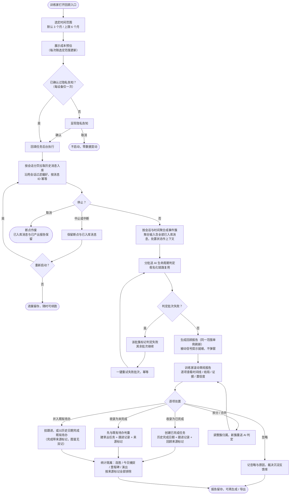
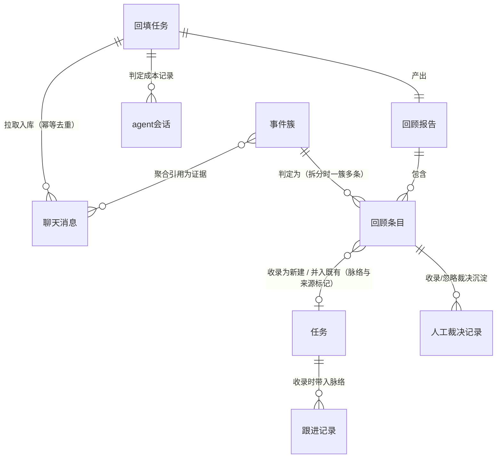
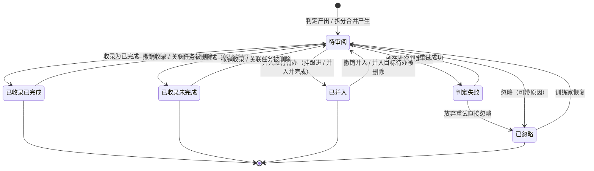
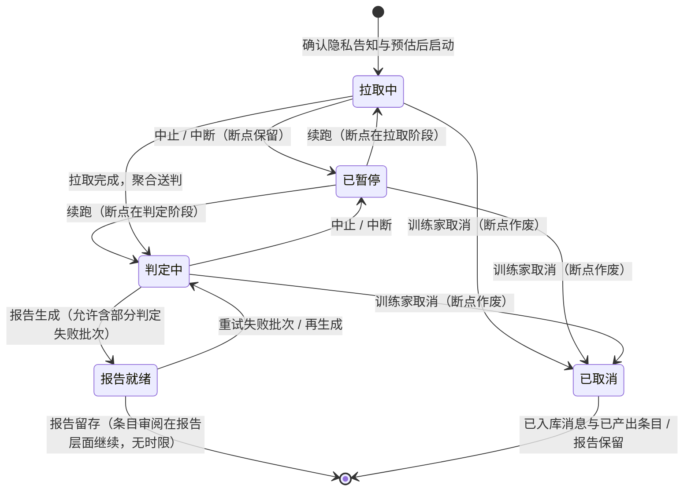

# 飞书历史回顾（feishu-history-review）软件设计规范 (SDD)

> 产出方式：经 `sdd-requirements-analyst` 技能产出；输入为 `specs/feishu-history-review/design.md` 已定方向（方案 B：回顾报告先行，收录可选）。
> 分级：**L 级**。本文只在已定方向上细化需求与验收，不重做方案选型；协议形态、聚合算法、断点存储机制、UI 框架与入口位置归 AD / UIUX 阶段。

## 1. 需求理解

在方案 B 方向上细化：训练家（用户）显式触发一次性的飞书历史回填，系统拉取选定时间范围内的消息、按会话与时间聚合成「事件簇」，交本地 AI agent 做生命周期判定（事项 / 时间线 / 结局 / 证据 / 置信度），产出一份回顾报告；训练家在报告上逐项处置——收录为「已完成的、带跟进记录的」待办、收录为未完成待办、或忽略。收录的任务带「回顾收录」来源标记，与游戏化统计（连胜 / 今日捕捉 / 里程碑 / 演出）完全隔离；报告本身即交付物，即使一项都不收录，「梳理过去做了什么」的价值也已达成。

**业务边界（非目标，本期明确不做）**：

- 增量场景的「这事已搞定 → 建议完成既有待办」出口：**不做**（就地决策——回填场景先验证聚合判定质量，增量侧另立需求，见 §8 演进备注）。
- 跨源回填（飞书云文档、妙记会议纪要）：不做，待办来源扩展在 Roadmap Later 中独立演进。
- 自动 / 定期回填：不做，回填是重操作，仅训练家显式触发。
- 不改变现有增量判定四动作（todo / update / followUp / none）的行为语义。
- 不做报告的云端同步或分享：本地优先，报告只存本机（Markdown 导出为本地文件）。

**与产品铁律的对应**（验收场景一律不得违反）：宁漏勿滥（结局误报直接污染图鉴，判定偏收窄、低置信审慎呈现）；AI 建议人确认（回填判定**没有任何**免确认直接落任务的路径）；只做正向激励（回填收录不制造虚假连胜 / 里程碑贺词 / 今日捕捉）；注意力友好（默认安静、被动信号、可随时中止、不轰炸）。

## 2. 待澄清问题

无阻塞性问题。design.md「待用户确认项」三条已就地按倾向落为默认需求（正文中以〔待确认〕标注），随批量关卡带回确认，不阻塞后续阶段：

- [ ] 〔待确认-1〕回顾时间范围：默认 3 个月、单次上限 6 个月（§5 故事 1、§7 性能）。
- [ ] 〔待确认-2〕报告载体：应用内页为主，Markdown 导出复用现有导出管线（§5 故事 9）。
- [ ] 〔待确认-3〕图鉴累计是否包含回顾收录条目并标注来源（倾向：包含并标注）。连胜、今日捕捉、里程碑贺词与捕捉演出的排除是「只做正向激励」铁律的直接推论，**不在确认范围内、不可翻转**（§5 故事 6、§8 统计面）。

## 3. 示意图

### 3.1 业务流程图（含异常分支）



### 3.2 概念 ER 图

> 只表达业务实体、关系基数与业务关系；物理 schema 与协议契约由 AD 定义。聊天消息、任务、跟进记录、人工裁决记录（反馈库）、agent 会话为既有实体，此处只标扩展关系。



| 业务实体 | 属性 | 属性的业务含义 |
|----------|------|----------------|
| 回填任务 | 时间范围 | 本次回填覆盖的历史区间（起 / 止）；单次上限 6 个月〔待确认-1〕 |
| | 运行状态 | 拉取中 / 已暂停 / 判定中 / 报告就绪 / 已取消；中止与中断不丢失，取消作废断点但保留已入库消息与已产出报告 |
| | 断点 | 续跑位置（已完成的拉取与判定不必重来） |
| | 进度 | 已处理会话数与消息数，供进度可视 |
| | 预估信息 | 触发前展示的消息量级、预计时长、成本数量级 |
| 事件簇 | 会话与时间跨度 | 簇内消息的来源会话集合与起止时间 |
| | 成员消息引用 | 聚进本簇的消息集合（一条消息可属多簇） |
| 回顾条目 | 事项标题 | 一句话概括这件事是什么（训练家可读） |
| | 时间线 | 提出 → 跟进节点 → 结局的脉络（带各自证据） |
| | 结局 | 已完成 / 未完成（仍开放）/ 结局不明 |
| | 建议完成日期 | 结局为已完成时判定的历史完成日期，收录时训练家可修正 |
| | 证据消息引用 | 支撑判定的原始消息（可展开回看） |
| | 置信度 | 高 / 中 / 低，低置信审慎呈现 |
| | 判定理由 | AI 一句话说明为何如此判定 |
| | 审阅状态 | 待审阅 / 已收录·已完成 / 已收录·未完成 / 已并入 / 已忽略 / 判定失败 |
| 回顾报告 | 汇总统计 | 条目总数、结局分布、已收录数；随报告留存，不依赖证据消息留存 |
| | 关联回填任务 | 报告由哪次回填产出，再生成沿用同一范围 |
| | 单例性 | 同一时间范围的报告单例刷新（再生成不产生新版本堆叠）；不同范围的报告并存，默认保留最近 10 份，超出自动淘汰最旧（其豁免消息回归常规清理）；训练家可手动删除任一报告 |
| 任务（扩展） | 回顾来源标记 | 标识「经回顾收录」，是统计隔离与图鉴标注的判据；不因后续编辑改变 |
| | 历史完成日期 | 复用完成时间语义，记判定出的历史日期而非收录当日 |
| 聊天消息（既有） | — | 回填按消息 ID 幂等入库；留存口径见 §5 故事 8 与 §8 |
| 人工裁决记录（既有反馈库扩展） | — | 回顾条目的收录 / 并入 / 忽略裁决与原因，延续判定迭代飞轮；同一条目历次裁决均留痕，以最新裁决为准 |

### 3.3 状态图

回顾条目（核心处置实体）：



回填任务（重操作生命周期）：



## 4. 用户故事

| 优先级 | 角色 | 行为 | 价值 |
|--------|------|------|------|
| P0 | 训练家 | 我希望在知情（隐私告知 + 成本预估）的前提下，选定时间范围（默认 3 个月、上限 6 个月〔待确认-1〕）显式触发历史回填 | 以便补齐安装前的任务历史，且不会在不知情时把数月消息送出去、花掉意外成本 |
| P0 | 训练家 | 我希望回填全程可随时中止、中断后可续跑、进度以被动信号可见 | 以便这个重操作始终在我掌控中，不怕中断重来 |
| P0 | 训练家 | 我希望读到一份回顾报告：每件事的时间线、跟到哪、结局如何，附证据消息与置信度 | 以便真正了解过去一段时间的任务完成情况——即使一项都不收录，梳理本身就有价值 |
| P0 | 训练家 | 我希望把报告条目逐项收录为「已完成的、带跟进记录的」待办 | 以便历史成就能进图鉴，且带着完整脉络而不是一个光秃秃的标题 |
| P0 | 训练家 | 我希望把仍开放的条目收录为未完成待办（默认进草丛，不带历史截止） | 以便漏网之鱼回到日常管理，且不会一进来就变成逾期羞耻墙 |
| P0 | 训练家 | 我希望收录判重命中既有未完成待办时，能把该待办以历史完成日期落为完成（并入并完成），或仅并入新的跟进脉络 | 以便「安装后经增量捕捉的待办在回填范围内完成」这一核心场景有出口，且图鉴不双记 |
| P0 | 训练家 | 我希望忽略无关条目并可选原因 | 以便裁决沉淀进反馈库，判定越用越准 |
| P1 | 训练家 | 我希望能撤销收录 / 并入，且关联任务被删除后条目自动回到待审阅 | 以便手滑与事后反悔有救，报告统计不漂移 |
| P0 | 训练家 | 我希望收录动作绝不触发连胜、今日捕捉、里程碑贺词、捕捉演出或任何系统通知 | 以便图鉴统计不被「今天一口气收录 50 条」的虚假成就污染 |
| P0 | 训练家 | 我希望判定结果只是建议：没有任何免确认路径直接把回填判定变成任务 | 以便「AI 建议、人确认」的铁律在回填场景同样成立 |
| P0 | 训练家 | 我希望低置信与「结局不明」的条目以可区分的方式审慎呈现，且证据可查 | 以便我把复核注意力集中在最需要人眼的地方（宁漏勿滥） |
| P0 | 训练家 | 我希望单批判定失败不阻塞其余批次，失败批次可一键重试且幂等 | 以便数月量级的重操作不会因一次 agent 失败全部作废 |
| P0 | 训练家 | 我希望回填进行中或失败时，增量轮询照常恢复、互不阻塞 | 以便日常收音机链路不被回填破坏 |
| P1 | 训练家 | 我希望对聚合错误的簇做拆分与合并 | 以便「两件事被并成一簇 / 一件事被拆成两簇」时能人工纠偏 |
| P1 | 训练家 | 我希望对同一时间范围再生成报告（单例刷新）时，已收录 / 已并入 / 已忽略的不翻转、人工拆分合并保留、消息不重拉 | 以便续跑后刷新报告或重试判定是安全的（幂等） |
| P1 | 训练家 | 我希望收录时系统与既有任务（含图鉴中已完成的）判重并提示冲突 | 以便同一事项不在图鉴里登记两次 |
| P2 | 训练家 | 我希望把回顾报告导出为 Markdown〔待确认-2〕 | 以便存档或并入知识库 |

## 5. 验收标准（Gherkin）

### 故事 1: 知情触发回填 (P0)

```gherkin
Scenario: 首次选定时间范围触发回填，先见告知与预估
  Given 收音机链路已连通（lark-cli 已授权且已配置 AI agent），本设备未确认过回填隐私告知
  When 训练家在回顾入口选定时间范围「近 3 个月」并点击开始
  Then 系统先展示成本预估（消息量级、预计时长、成本数量级，每次随选定范围更新），再呈现隐私告知（选定范围内全部消息将送至所配置的 AI agent，本地或远程，判定链路全程假名化）
  And 训练家确认后回填任务在后台启动，进度以被动信号可见，不弹窗不抢焦点

Scenario: 已确认过告知后再次触发只看预估
  Given 训练家此前已确认过回填隐私告知
  When 再次选定时间范围准备触发
  Then 直接展示该范围的成本预估，不再重复隐私告知
  And 完整告知文案可随时从入口或设置重新查看

Scenario: 未确认隐私告知则零数据变动
  Given 训练家首次在本设备触发回填
  When 隐私告知呈现后训练家选择取消
  Then 回填任务不启动
  And 没有任何历史消息被拉取或送判

Scenario: 单次时间范围上限
  When 训练家尝试选定超过 6 个月的时间范围〔待确认-1〕
  Then 系统不接受该范围并说明单次上限
  And 训练家可以缩小范围后正常启动

Scenario: 会话过滤偏好沿用
  Given 训练家已把「摸鱼闲聊群」设为「总是过滤」
  When 训练家触发覆盖该群消息时间的回填
  Then 「摸鱼闲聊群」的历史消息不被拉取、不进入任何事件簇
```

### 故事 2: 可中止可续跑的回填 (P0)

```gherkin
Scenario: 中止保留进展，续跑不重复
  Given 回填任务拉取进行中，已入库 2000 条消息
  When 训练家点击停止
  Then 新的网络与 agent 调用在 10 秒内停止，断点与已入库消息保留
  And 训练家重新启动同一时间范围的回填时，已入库消息不重复入库（按消息 ID 幂等）

Scenario: 应用中断后重启可续跑
  Given 回填任务进行中应用被关闭或断网
  When 训练家重启应用并再次启动同一回填
  Then 回填从断点继续，已完成的拉取与已成功的判定批次不重做

Scenario: 取消作废断点但保留数据资产
  Given 回填拉取进行中，已入库 2000 条消息
  When 训练家选择取消（区别于中止）
  Then 回填任务终止且断点作废，再次启动同一范围为全新回填（消息层仍按消息 ID 幂等不重复入库）
  And 已入库消息与已产出的条目、报告保留
```

### 故事 3: 聚合与生命周期判定 (P0)

```gherkin
Scenario: 同一事项多轮消息聚合为一簇（含跨会话）
  Given 历史消息中「季度报告」这件事被布置 1 次、催办 2 次、交付与确认各 1 次，分布在同一个群与一个私聊共 5 条消息
  When 回填聚合与判定完成
  Then 报告中「季度报告」为一个回顾条目
  And 该条目的时间线呈现提出、跟进、结局各节点及对应证据消息
  And 结局判定为「已完成」，附建议完成日期与置信度

Scenario: 单批判定失败不阻塞，重试幂等
  Given 拉取完成，聚合产出 40 个事件簇，分 4 批送判
  When 第 2 批判定失败（agent 调用出错）
  Then 第 2 批的 10 个簇标记为「判定失败」
  And 其余 3 批继续判定并正常产出结果
  And 报告就绪时包含已成功批次，失败批次标注可重试
  When 训练家点击重试且其中 7 个簇成功
  Then 再次重试时只处理仍处于判定失败的 3 个簇，已成功的 7 个不重判
```

### 故事 4: 审阅回顾报告 (P0)

```gherkin
Scenario: 报告就绪用被动信号提示
  Given 训练家已离开应用或在做别的事
  When 回顾报告生成完毕
  Then 不出现系统通知、弹窗或抢焦点
  And 回顾入口以被动信号（如角标 / 状态变化）提示有报告待阅，训练家主动打开才呈现

Scenario: 低置信与结局不明审慎呈现
  Given 报告中条目 A 置信度为高、条目 B 置信度为低、条目 C 结局为「结局不明」
  When 训练家查看报告
  Then 条目 B 与 C 在报告数据面携带可机读的置信度与结局字段，并在呈现上具有可识别的区分标识（具体形态归 UIUX；验收断言基于数据字段与可访问名称，不依赖视觉比对）
  And 三个条目都完整可查判定理由与证据消息
  When 训练家收录结局不明的条目 C
  Then 由训练家显式指定结局（已完成或未完成）后才落库

Scenario: 时间范围内无信号
  Given 选定范围内所有会话被过滤或均无消息
  When 回填完成
  Then 生成空报告并如实说明「该时间范围内没有可回顾的信号」，不报错
```

### 故事 5: 收录为已完成 (P0)

```gherkin
Scenario: 收录建已完成任务并带脉络
  Given 报告中某条目结局为「已完成」、置信度中、时间线含 3 个跟进节点
  When 训练家选择「收录为已完成」
  Then 系统创建一条状态为已完成的任务
  And 该任务的完成时间记为判定的历史完成日期（非收录当日），训练家收录时可修正
  And 时间线中的跟进脉络成为该任务的跟进记录
  And 该任务带「回顾收录」来源标记

Scenario: 判定未给出完成日期时的填写规则
  Given 某条目结局为「已完成」但判定未给出建议完成日期，时间线最后一条证据消息发送于两个月前
  When 训练家收录为已完成
  Then 完成日期默认预填该条目时间线中最后一条证据消息的时间，训练家可修正
  And 完成日期在任何路径下都不默认为收录当日；无判定值且无可参照证据时间时，须训练家显式填写后才完成收录

Scenario: 判定不自动落任务（无免确认路径）
  Given 回填判定产出 40 个高置信「已完成」条目
  When 判定完成、回顾报告生成
  Then 任务库中不新增任何任务
  And 全部 40 个条目处于「待审阅」状态，等待训练家逐项处置

Scenario: 收录幂等
  Given 训练家对同一回顾条目点击收录
  When 因重复点击或操作重放再次触发收录
  Then 任务库中只存在一个由该条目收录的任务

Scenario: 收录不产生任何游戏化反馈
  Given 当前连胜 2 天且今日已自然捕捉 1 只
  When 训练家当天收录 20 条完成日期散布在历史 60 天的回顾条目
  Then 连胜天数仍为 2，今日捕捉计数仍为 1
  And 不出现捕捉演出、系统通知或里程碑贺词
```

### 故事 6: 统计隔离口径 (P0)

```gherkin
Scenario: 里程碑按纯自然捕捉计数触发
  Given 图鉴累计捕捉 100（其中回顾收录 5 条，自然捕捉 95），下一里程碑阈值按自然捕捉计数口径为 100
  When 训练家再完成 5 次自然捕捉
  Then 第 5 次自然捕捉触发里程碑贺词（自然计数到达 100）
  And 此前的回顾收录（已使累计数字跨过 100）不触发任何贺词

Scenario: 图鉴累计包含回顾收录并标注来源〔待确认-3〕
  Given 图鉴累计捕捉 100
  When 训练家收录 5 条回顾条目
  Then 图鉴累计为 105，且这 5 个任务在图鉴中可识别为「回顾收录」来源
  And 收录动作本身不触发捕捉演出、系统通知或贺词

Scenario: 隔离按来源标记判定，与日期无关
  Given 训练家把某回顾收录任务的完成日期修正为今天
  When 系统计算连胜与今日捕捉
  Then 该任务因带回顾来源标记仍被排除，连胜与今日捕捉不因此变化
```

### 故事 7: 收录为未完成、并入既有待办与忽略（场景级优先级：收录未完成 / 判重 / 并入 = P0，忽略 = P1）

```gherkin
Scenario: 仍开放的条目收录进草丛
  Given 某条目结局为「未完成」（事项仍开放），历史消息里曾提到截止日期
  When 训练家选择「收录为待办」
  Then 创建一条草丛状态的任务，默认不带历史截止时间（避免一进来就逾期）
  And 训练家可随后自行规划路线
  And 时间线脉络成为该任务的跟进记录，任务带回顾来源标记

Scenario: 收录与既有未完成待办判重
  Given 任务库中已有未完成待办「整理季度报告材料」
  When 训练家试图收录一个本质相同的回顾条目
  Then 系统提示与既有待办疑似重复
  And 训练家可选择并入既有待办或仍然新建，不静默重复创建

Scenario: 判定已完成的条目命中既有未完成待办（并入并完成）
  Given 既有未完成待办「整理季度报告材料」，回填判定同一事项为「已完成」（历史完成日期 2 个月前）
  When 训练家在判重提示下选择「并入并完成」
  Then 既有待办以该历史完成日期落为完成，时间线脉络成为其跟进记录
  And 该次完成带回顾来源标记，统计隔离同样生效（不进连胜与今日捕捉）
  And 图鉴中不出现同一事项的双记

Scenario: 判定未完成但有增补信息的条目命中既有待办（仅并入跟进）
  Given 既有未完成待办「整理季度报告材料」，回填条目结局为「未完成」且带来新的进展证据
  When 训练家选择「并入（挂跟进）」
  Then 新进展成为该待办的跟进记录，待办保持未完成
  And 此路径不触碰任何统计面，不携带来源标记

Scenario: 已被增量处置的消息参与聚合的口径
  Given 回填范围内有消息 M1 已被增量捕捉为待办 T1、消息 M2 已被人工逃走、消息 M3 仅作上下文（skipped）
  When 回填聚合与判定执行
  Then M1、M2、M3 均可作为事件簇证据参与聚合，M1 与 M2 的增量处置结果作为判定上下文
  And M1 所在事项的条目收录时判重命中 T1，走并入出口（挂跟进或并入并完成），不新建双记

Scenario: 忽略并沉淀原因
  Given 某条目判定为「已完成」但训练家认为不是自己的事项
  When 训练家选择忽略并选原因「不是给我的任务」
  Then 条目状态记为已忽略，裁决与原因沉淀进反馈库
  And 该条目可随时恢复为待审阅

Scenario: 判定失败的条目可直接忽略
  Given 某条目处于「判定失败」状态
  When 训练家不想重试，选择忽略
  Then 条目记为已忽略（可带原因），不再出现在待重试列表
```

### 故事 8: 回填与增量链路共存 (P0)

```gherkin
Scenario: 回填范围与已处理消息重叠
  Given 近 3 个月内已有 50 条消息经增量轮询入库，其中 20 条已捕捉建任务
  When 训练家对同一时间范围触发回填
  Then 已入库的消息不重复入库（按消息 ID 幂等）
  And 既有消息的处置状态与已建任务的关联不被回填改动

Scenario: 回填失败不阻塞增量轮询
  Given 回填任务在第 3 个会话分页时因网络失败中止
  When 下一个增量轮询周期到达
  Then 增量轮询正常执行，游标不受回填失败影响，消息不丢

Scenario: 回填消息在报告存续期豁免清理
  Given 训练家回填拉取了 5 个月前的消息，回顾报告已生成
  When 增量轮询执行例行清理
  Then 构成该报告判定输入的消息集（含已入库未被簇引用的消息）不被删除
  And 报告删除后，其关联消息回归常规清理
  And 报告的条目结论、时间线与置信度不依赖消息留存（报告导出件不受清理影响）

Scenario: 报告留存超过 60 天后审阅仍可查证据
  Given 一份回顾报告生成后训练家 90 天未打开
  When 训练家现在打开该报告审阅
  Then 条目结论、时间线与证据消息仍完整可查（豁免期 = 报告存续期）
```

### 故事 9: 拆分、合并与再生成 (P1)

```gherkin
Scenario: 拆分一个聚合错误的簇
  Given 某回顾条目实际混着两件不同的事
  When 训练家把它拆分为两个条目并重新归属证据消息
  Then 拆分产生的新簇重送 AI 生命周期判定（结局、时间线与置信度以新簇证据为准），判定完成后进入待审阅
  And 新条目各自保留人工归属后的证据，原条目不再呈现

Scenario: 合并两个本属同一事项的条目
  Given 两个条目实为同一件事（证据互补）
  When 训练家合并它们
  Then 合并产生的新簇重送 AI 判定，判定完成后进入待审阅，人工归属的证据合并呈现

Scenario: 再生成幂等与单例刷新
  Given 一份报告已有 10 条已收录、2 条已并入、5 条已忽略、25 条待审阅与判定失败
  When 训练家对同一时间范围再生成报告
  Then 已收录条目不重复创建任务、已并入条目不重复并入、已忽略条目保持忽略
  And 待审阅与判定失败的条目按最新已入库消息重新判定，人工拆分与合并的簇结构保留、不被再生成推翻
  And 再生成复用已入库消息不重新拉取，同一时间范围的报告单例刷新（不产生新版本堆叠）
  And 报告生成后训练家变更会话过滤偏好，不追溯该报告已聚合的消息（需要新口径时删除报告后重新回填）
```

### 故事 10: 报告导出 (P2)

```gherkin
Scenario: 导出回顾报告为 Markdown〔待确认-2〕
  Given 一份已生成的回顾报告
  When 训练家选择导出
  Then 生成一份本地 Markdown 文件，包含时间范围、汇总统计与各条目的时间线、结局、置信度
  And 导出文件包含证据消息原文（真名保留——导出是训练家主动落盘的本机文件）
```

### 故事 11: 撤销收录与条目回退 (P1)

```gherkin
Scenario: 撤销收录回到待审阅
  Given 某条目已收录为已完成，收录产生的任务未被训练家编辑或开始过
  When 训练家在该条目上选择撤销收录
  Then 收录产生的任务与随附跟进记录被删除，条目回到待审阅
  And 报告的已收录统计随之修正（报告统计从任务与条目实况派生，不用缓存计数）

Scenario: 任务被后续使用后撤销入口禁用
  Given 某条目收录产生的任务已被训练家编辑或开始过（改属性、专注、派发）
  When 训练家查看该条目
  Then 撤销收录入口禁用并提示改用任务删除

Scenario: 撤销并入并完成
  Given 某条目已对既有待办「并入并完成」
  When 训练家选择撤销并入
  Then 该既有待办回退为未完成（清除该次完成日期与来源标记），该次并入的跟进记录移除，条目回到待审阅

Scenario: 关联任务被删除后条目回退
  Given 某条目已收录或已并入，训练家随后在任务库删除了关联任务
  When 训练家打开报告
  Then 该条目回到待审阅，报告统计同步修正
```

## 6. 领域名词与数据实体

| 名词 | 说明 | 主要属性（仅业务含义） |
|------|------|------------------------|
| 回填（backfill） | 一次性拉取指定时间范围历史消息的重操作，仅训练家显式触发 | 时间范围、状态、断点、进度、预估信息 |
| 事件簇 | 按会话与时间聚合、指向同一事项的消息集合；跨会话的同一事项归为一簇 | 会话集合、时间跨度、成员消息引用 |
| 生命周期判定 | 对事件簇产出「事项 + 时间线 + 结局 + 证据 + 置信度」的 AI 判定，是建议不是决定 | — |
| 结局 | 已完成 / 未完成（仍开放）/ 结局不明（证据不足）三种 | — |
| 回顾条目 | 生命周期判定的产物，报告的呈现与处置单位 | 事项标题、时间线、结局、建议完成日期、证据引用、置信度、判定理由、审阅状态 |
| 证据消息 | 支撑判定的原始消息引用，审阅时可展开回看 | — |
| 置信度 | 高 / 中 / 低；低置信与结局不明需审慎呈现 | — |
| 收录 | 把回顾条目落为**新建**任务的人工确认动作：已完成（带跟进记录与历史完成日期）或未完成（默认草丛） | — |
| 并入 | 判重命中既有待办时的人工确认动作：仅挂跟进（不触碰统计面），或并入并完成（以历史日期落完成并带来源标记，图鉴无双记） | — |
| 撤销收录 / 撤销并入 | 回退处置：删除收录产生的任务（未被后续使用时）、或回退并入的完成与跟进，条目回到待审阅 | — |
| 忽略 | 不收录的处置，可选原因，沉淀反馈库 | — |
| 拆分 / 合并 | 对聚合错误簇的人工纠偏，产生的新条目回到待审阅 | — |
| 回顾来源标记 | 任务上「经回顾收录」的记号；统计隔离与图鉴标注的唯一判据，不因后续编辑改变 | — |
| 统计隔离 | 连胜、今日捕捉、里程碑贺词、捕捉演出对带回顾来源标记任务的排除 | — |
| 断点 | 回填进度与续跑位置；中止、中断、失败后均保留 | — |
| 回顾报告 | 一次回填的判定汇总与审阅载体，本身即交付物；同一时间范围单例刷新 | 时间范围、生成时间、汇总统计 |

## 7. 非功能需求 (NFR)

**性能与成本护栏**（数月消息 ≈ 数千条送判、数百次 agent 无头调用的量级假设）：

- 场景：触发前预估；指标：预估展示时延；阈值：选定范围且会话列表可得时 ≤ 5 秒给出消息量级 / 预计时长 / 成本数量级，不可得时如实展示「无法预估」，禁止用假数字安抚。
- 场景：回填全程；指标：可中止性；阈值：发出停止后 ≤ 10 秒内不再发起网络与 agent 调用（进行中的单个请求可等待完成），进展落盘率 100%。
- 场景：回填中断重做代价；指标：重做粒度；阈值：≤ 1 个判定批次（断点粒度不粗于批次）。
- 场景：进度反馈；指标：进度可见延迟；阈值：≤ 5 秒（按会话 / 批次粒度推进）。
- 场景：报告浏览；指标：首屏加载；阈值：1000 条目内 P95 ≤ 2 秒（本地库读取）。单条目证据展开 P95 ≤ 500 毫秒。
- 场景：收录操作；指标：单条收录落库（含跟进记录）时延；阈值：P95 ≤ 500 毫秒。
- 场景：单次回填数据量；指标：时间范围；阈值：默认 3 个月、单次上限 6 个月〔待确认-1〕。
- 场景：判定成本；指标：成本记录完整率；阈值：回填的每次 agent 调用 100% 落既有 agent 会话成本记录（时长 / 成本 / token）。

**隐私**：

- 场景：任何送 AI 的回填 payload；指标：真名与真实群名出现次数；阈值：0（复用既有假名化同一套映射，同代号 = 同人）。
- 场景：首次触发；指标：隐私告知；阈值：确认前拉取消息数 = 0；告知文案必须写明消息将送至「所配置的 AI agent（本地或 SSH 远程）」且隐私边界取决于 agent 配置。

**可靠性**：

- 场景：中止 / 断网 / 应用重启后；指标：续跑正确性；阈值：重复入库消息数 = 0、重复判定批次数 = 0（幂等）。
- 场景：单批判定失败；指标：对其余批次的阻塞；阈值：0（其余批次照常完成并进入报告）。
- 场景：回填中止或失败后；指标：增量轮询恢复时间；阈值：≤ 1 个轮询周期（默认 120 秒），增量游标与消息完整性不受影响。
- 场景：回填与增量拉取并发；指标：同库并发写冲突错误；阈值：0（回填与增量轮询及设置页手动「立即拉取」互斥执行，具体机制归 AD）。
- 场景：单会话分页拉取失败；指标：失败归宿；阈值：本轮中止并保留断点（不产生半会话数据假象），续跑重试成功后继续——与增量「游标整轮成功才推进」同一失败哲学，重试机制归 AD。
- 场景：收录操作；指标：幂等；阈值：同一回顾条目重复收录产生的多余任务数 = 0。

**注意力友好**（README 七原则映射）：

- 场景：回填全程与报告就绪；指标：主动打断（弹窗 / 抢焦点 / 系统通知）；阈值：0；就绪提示只用被动信号（默认安静、被动信号优先）。
- 场景：报告审阅；指标：催促机制；阈值：0——报告不过期、不倒计时、不催决策（打断必须可拒的更强形态：根本不打断）。
- 场景：收录动作；指标：捕捉演出 / 系统通知 / 里程碑贺词 / 连胜变化 / 今日捕捉变化；阈值：全部为 0。
- 场景：确认工作量；指标：呈现单位；阈值：按事件条目呈现，回填产生的待审阅事项进入收音机逐条消息分诊队列的数量 = 0（不制造几百张卡的瘫痪态）。

**可测试性**：

- 场景：聚合、生命周期判定、收录、统计隔离四条核心路径；指标：离线可测性；阈值：100% 可用夹具消息集合在本机驱动（不依赖真实飞书 API 与真实 agent，agent 以假 CLI 替代）。
- 场景：假名化；指标：可断言性；阈值：送判 payload 可被测试捕获并断言无真名 / 真实群名。
- 场景：统计隔离；指标：可断言性；阈值：收录回填任务后连胜 / 今日捕捉 / 图鉴累计 / 里程碑断言可自动化（现有 streak 语义为对照基准）。

## 8. 变更影响简述

**数据面**：`tasks` 需要回顾来源标记（`source` 枚举扩展或独立标记，形态归 AD）与历史完成日期语义复用；回顾报告、回顾条目、事件簇、回填任务为新增业务实体（物理形态归 AD）；条目与任务的「收录 / 并入」关联及撤销回退语义（§5 故事 11）。

**统计面（本次直接依赖，允许动；不顺手重构无关链路）**：**完备性判据——凡按任务完成时间（completed_at）或完成状态聚合的统计面，必须逐个声明对「回顾来源标记」的处理（排除 / 包含并标注），不允许未声明的默认计入**。逐面清单：连胜（`streak_conn` 按 done 任务 completed_at 日期集合）、今日捕捉（today_count）、图鉴累计与里程碑贺词（贺词按纯自然捕捉计数触发，见 §5 故事 6）、捕捉演出触发（前端捕捉场景）、日报 Markdown 导出的已完成清单、桌宠搭话的任务快照统计（caught / escaped 汇总）；Roadmap Later 的 52 周热力图、年度图鉴报告等新统计面设计时同受此判据约束。隔离判据是来源标记而非日期推断（§5 故事 6）。

**判重面**：`pk context` 现只列未完成待办（`bin/pk/context.rs`），收录判重需覆盖「既有未完成待办 + 图鉴已完成任务」两层；判重命中既有待办的出口含「并入（挂跟进）/ 并入并完成 / 仍然新建」三选（§5 故事 7）；判重上下文纳入已完成任务后的 token 膨胀裁剪策略归 AD。

**清理面（已核对的现状缺口）**：`chat_messages.created_at` 现写入**消息发送时间**（`feishu.rs` 入库以 `sent_rfc3339` 填充），而 60 天清理按 `created_at` 删除——回填的历史消息会在下一轮轮询被**立即删除**，与 design.md ②「按入库时间计、不会被立即清掉」的表述不符。留存口径已在本 SDD 锁定为**「报告存续期豁免」**（§5 故事 8）：构成报告判定输入的消息集（含已入库未被簇引用者）在报告存续期豁免清理，报告删除或被淘汰后回归常规清理；豁免的实现机制（按入库时间另列、豁免标记或其他）归 AD。报告与条目结论独立留存，不依赖证据消息留存（报告删除后证据随常规清理，回看降级为不可展开）。

**复用面（不重复建设）**：lark-cli 分页拉取与会话过滤偏好三态决策、假名化 AnonRules 同一映射、tools 判定链路与 pk 校验语义、`agent_sessions` 成本记录、`chat_feedback` 反馈飞轮、拉取 in-flight 守卫先例（回填与增量的互斥可循同一先例）。

**UI 面**：新增回顾报告入口与审阅交互（入口位置、信息架构、向导形态可借 ReviewWizard 先例——归 UIUX 阶段）；对未触发回填的存量用户零感知，入口以被动方式存在，不做新功能轰炸。

**演进备注（本期非目标的去向）**：增量消息「这事已搞定 → 建议完成既有待办」出口，待回填场景验证聚合判定质量后另立需求（可记入 `docs/debt.md` / Roadmap）；跨源回填（云文档、妙记）跟随 Roadmap Later 的待办来源扩展线。
