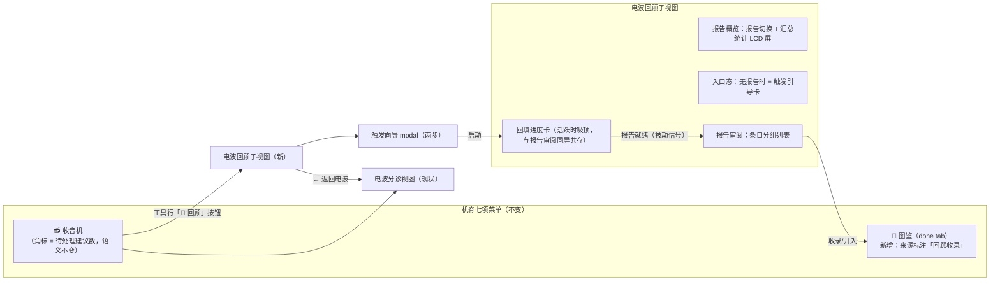
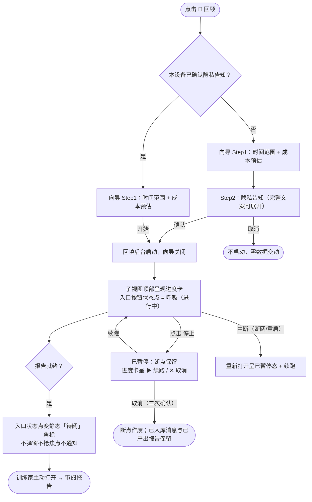
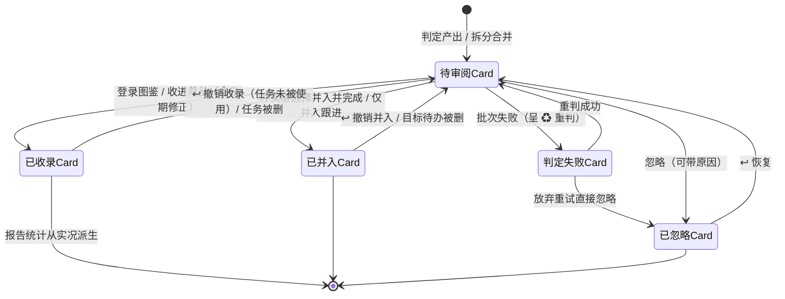

# 飞书历史回顾（feishu-history-review）UIUX 设计

> **产出方式声明**：经 `uiux-designer` 技能产出（技能已加载并按其框架执行）；输入为 `specs/feishu-history-review/requirements.md`（已过 1 轮隔离 SDD 评审）与 `design.md` 已定方向（方案 B：回顾报告先行，收录可选）。
> **外部技能降级声明**：本会话 `frontend-design` 与 `ui-ux-pro-max` 均不可用——§6.1 视觉方向按白名单六项自行声明（不写死 hex 为主、必要时引既有 token 名）、§6.2 实现级 token 以「映射既有 `src/dex.css` token」的方式给出建议（不新造色值）；§11 L 级视觉保真原型降级为**低保真 HTML 原型**（复用既有设计系统 token、不引外部依赖），见该章理由。
> **规模**：L 级。本文只做界面层规格：信息架构、交互状态、视觉方向、文案、验收与契约需求面；协议形态、聚合算法、断点机制归 AD（`architecture.md`）。
> **契约收敛修订（v2）**：已按主会话收敛结论增量修订——互斥启动改等待式（F9/S10/E5 + §4.2/§8）、忽略原因码五值定稿（E15/§8）、判重两类命中出口确认（§3.3）、F1 进度双通道定稿、收录表单只带日期修正（§3.2）、过滤/分组契约确认（D16）；漂移四条全部闭合（见「需求边界漂移」节）。
> **评审修复修订（v3）**：按隔离 uiux-reviewer 初审 2H+4M+5L 增量修复——H1 组合态定稿（活跃回填期间新回顾禁用、进度卡吸顶与报告审阅同屏、等待子态操作行）；H2 a11y 补规格（键盘模型/弹层焦点契约/状态点形状双通道/原型偏差声明）；M1 日期空值态载体；M2 日志 tab 与 i18n 三 key；M3 superseded 七态默认过滤等一致性；M4 原型五项承载性修正；L1-L5 顺手修；E19/E20 改异步刷新语义（newClusterIds + 事件）。
> **复评定稿修订（v4，最后一轮）**：复评无 High——M1 补 §10 三个既有统计面前端改动镜像（ReviewWizard/tasks store/PetApp）；M2 组合态三定格（首次回填×引导态 CTA 禁用、D2 生成中…、等待/拉取初期共用软化文案）；M3 弹层焦点契约通用化 + aria-expanded 入正文；L1 i18n key 按仓库结构修正；L2 文案统一三处；L3 原型五处。

---

## 1. UIUX 影响评估

| 维度 | 评估 | 结论 |
|---|---|---|
| **展示** | 回顾报告是全新交付物（汇总统计 + 逐条时间线/结局/置信度/证据展开），用户需要长时滚动审阅；收录产生的任务需在图鉴中以「回顾收录」来源可识别 | **有影响** |
| **触发** | 回填是重操作：时间范围选择、隐私告知（每设备一次）、成本预估（每次）、启动/中止/续跑/取消，全部需要显式入口 | **有影响** |
| **反馈** | 回填进行中以被动信号可视（进度 ≤5s 延迟）；报告就绪用被动信号（角标/状态变化）；收录/判重/失败重试均需就近反馈 | **有影响** |
| **异常** | 判定批次失败（可重试）、回填中断（可续跑）、空范围（空报告非错误）、撤销条件失效（任务已被使用）、范围超限、链路未配置 | **有影响** |
| **变更** | 收音机页新增回顾入口与子视图切换（CaptureBar 让位）；图鉴页新增「回顾收录」来源标注；不动机脊七项菜单 | **有影响** |

**结论：需要 UIUX 设计**（五维度全部命中）。本 feature 的 UI 面是方案 B 的核心工程量所在（design.md ③：「用 UI 工程量换判定质量与确认效率」），且受注意力友好七原则与「不制造羞耻」的强约束。

---

## 2. 信息架构

### 2.1 入口选址（三个候选的对比与推荐）

| 候选 | 形态 | 优点 | 缺点 |
|---|---|---|---|
| **A. 收音机内入口 + 报告子视图（推荐）** | 收音机工具行加「📜 回顾」按钮；报告审阅作为收音机 tab 内的全宽子视图 | ① 语义同源：回顾的输入就是历史电波，「收音机 = 从飞书电波里挑出待办」（`tabs.imDesc`），历史回看 =「重听旧电波」；② 前置条件同构：回顾与收音机同样要求 lark-cli 已授权 + AI agent 已配置，链路未通时的空态引导可直接复用；③ 零感知合规：不动机脊七项菜单，不用收音机的存量用户完全看不到；④ 被动信号挂点自然：入口按钮自身带状态点，不占用机脊「待处理建议」角标的语义 | 收音机页顶层多一个视图状态（分诊 ↔ 回顾），RadioTab 有一定改动量 |
| B. 图鉴/复盘侧 | 图鉴页（done tab）「🧢 复盘」按钮旁加入口 | 价值终点在图鉴（收录 = 登录图鉴）；复盘向导是重操作先例 | ① 语义错位：回顾的输入是消息电波（收音机域），图鉴是任务结果域，消息来源功能分裂两处；② 形态不匹配：ReviewWizard 是 480px modal 向导，报告审阅需要全宽长列表 + 证据展开；③ 图鉴页操作行过载（统计页头 + 筛选 stab + 复盘按钮 + 回顾入口）；④ 图鉴 tab 无角标机制，被动信号需新建打扰面 |
| C. 独立位置（机脊新菜单项） | 机脊第八项「回顾」 | 报告是独立交付物、多报告管理、审阅无时限，独立页面最干净 | **直接违背零感知铁律**：机脊菜单是世界观稳定导航（冒险/路线/草丛/图鉴/收音机/日志/背包），加一项 = 全体用户可见的新功能轰炸；低频功能不配常驻导航位；未触发回填的用户会看到一个空页面 |

**推荐 A**。触发向导（借 ReviewWizard 步骤条先例）与报告子视图都收在收音机 tab 内；图鉴侧只被动承接「回顾收录」来源标注，不加新入口。

### 2.2 导航与页面结构图



### 2.3 与既有导航的关系（零感知论证）

- **机脊不动**：七项菜单、`aria-current`、角标机制全部不变；「收音机」菜单项角标仍只表示待处理建议数。
- **入口的可见性条件**：回顾入口常驻收音机工具行（被动存在、不闪烁、不带红点）；链路未连通（lark-cli 未授权或未配置 AI agent）时点击进入子视图呈现引导态（复用收音机空态文案结构），入口本身不隐藏——SDD §8 UI 面「入口以被动方式存在，不做新功能轰炸」。
- **未触发回填的存量用户**：不打开收音机 tab → 全程零感知；打开收音机但不点回顾 → 多看到一个次级按钮（工具行第三项，与 ⏱/📡 视图切换同层级视觉重量）。

---

## 3. 页面与组件

### 3.1 组件树（ASCII）

```
RadioTab（改造：顶层 view 状态 'triage' | 'history'）
├── [triage] 电波分诊视图（现状不动）
│   └── 工具行新增：📜 回顾按钮（带状态点：进行中呼吸 / 就绪静态角标 / 无）
└── [history] 电波回顾子视图 HistoryView（新组件，src/components/history/）
    ├── HistoryToolbar（工具行：← 返回电波 · 报告切换 DexSelect · 再生成 · 导出 Markdown · 📜 新回顾【任意活跃回填期间禁用，title 见 §8】· 更多 ▾【删除报告 · 查看完整告知】）
    ├── BackfillStatusCard（回填进度卡：活跃时**吸顶**呈现于工具行下方，下方报告列表照常可审阅——同屏共存；等待/拉取/判定/已暂停四子态，操作行见 §4.2）
    │   ├── LCD 进度屏（px 数字：已拉取 x/y 会话 · 已入库 n 条消息 / 已判定 n/m 批）
    │   └── 操作行：⏸ 停止（保留断点）· ▶ 续跑 · ✕ 取消（作废断点，二次确认）——等待子态 = 可暂停（暂停后停在等待前位置）+ 可取消（同已暂停取消出口）
    ├── ReportSummaryLcd（报告汇总统计 LCD 屏：条目总数 · 结局分布 · 已收录数）
    ├── EntryFilterBar（过滤 chip：只看低置信 · 只看去向不明 · 分组折叠）
    ├── EntryGroupList（条目分组列表，借 ImListGroup 折叠先例）
    │   └── ReviewEntryCard × N（回顾条目卡 = 图鉴条目卡变体，见 3.2）
    │       ├── EntryHead（事项标题 + 结局徽章 + 置信度徽章 + 审阅状态）
    │       ├── TimelinePanel（时间线：提出 → 跟进节点 → 结局，各节点带证据引用）
    │       ├── VerdictReason（判定理由，一句话）
    │       ├── EvidenceList（证据消息，折叠展开回看原文）
    │       └── EntryActions（处置操作行，按结局/状态分型，见 3.2）
    ├── EmptyReport（空报告态：范围内无信号）
    ├── NoReportGuide（无报告引导态：从未回填）
    └── LinkNotReady（链路未配置引导态）
BackfillWizard（触发向导 modal，z-index 90，借 ReviewWizard 步骤条先例）
├── Step1：时间范围选择（预设档 + 自定义起止）+ 成本预估 LCD（随范围更新）
├── Step2：隐私告知（每设备一次；已确认过则跳过本步）+「查看完整告知」
└── 启动确认 → 关闭向导，回填后台执行
ConflictDialog（判重冲突弹层，卡片级 modal）
├── 冲突说明（命中既有待办 / 图鉴已有条目，列出 No. + 标题）
└── 出口：并入并完成（以历史日期）· 仅并入跟进 · 仍然新建 · 取消
CompleteDatePicker（完成日期修正小弹层，内嵌 DexDateTime，收录为已完成时）
SplitMergePanel（拆分/合并操作，P1：条目「更多 ▾」菜单入口，选中证据子集后确认；证据多选形态 **plan 阶段前补规格**——P1 有意降级，此处仅声明入口与返回契约（E19/E20））
```

### 3.2 回顾条目卡与处置操作行分型

条目卡是审阅的基本单位，形态 = 任务卡（图鉴条目卡）的事件回放变体：白卡 3px navy 描边 / 12px 圆角 / 4px 硬阴影，卡头一行（标题 16px/800 + 三个徽章），展开后呈时间线与证据。

**操作行按结局 × 审阅状态分型**（主操作唯一，次操作收进「更多 ▾」）：

| 结局/状态 | 主操作 | 次操作 |
|---|---|---|
| 已完成 · 待审阅 | 「◎ 登录图鉴」（点击弹完成日期修正弹层，预填建议日期） | 忽略 ▾（可带原因）· 拆分 ·（判重命中时弹冲突层） |
| 未完成 · 待审阅 | 「🌿 收进草丛」 | 忽略 ▾ · 拆分 ·（判重命中时弹冲突层） |
| 结局不明 · 待审阅 | 「✔ 按已收服收录」「🌿 按待办收录」并列（显式指定结局后才落库，SDD 故事 4；判重命中时同样弹冲突层） | 忽略 ▾ · 拆分 |
| 判定失败 | 「♻ 重判」（批量级另有整组重试） | 忽略 ▾（放弃重试） |
| 已收录·已完成 / 已收录·未完成 | 状态条：「✔ 已登录图鉴 No.x」+「↩ 撤销收录」（任务未被使用时可用） | 更多 ▾（撤销不可用时提示改用任务删除） |
| 已并入 | 状态条：「已并入 No.x 的跟进 / 并入并完成」+「↩ 撤销并入」 | — |
| 已忽略 | 状态条：✕ 已忽略（含原因）+「↩ 恢复」 | — |

**收录表单字段集（已收敛进 AD 契约）**：收录动作只带**完成日期修正**，不提供改标题/分类/标签的表单；判定输出可选给 `category`（AI 从启用分类中选，省略落默认分类）。任务建好后用既有任务编辑弹窗改属性——不在报告页复制编辑表单。

**完成日期空值态（SDD 故事 5「无判定值且无可参照证据时间须显式填写」的 UI 载体）**：CompleteDatePicker 在无建议日期、无证据时间可参照时，日期选择器呈空值态——**确认按钮禁用** + 引导文案「没有可参照的时间——凭记忆填一个，不默认今天」；填入任意日期后确认按钮解锁。「并入并完成」（冲突弹层）共享同一规格与弹层：无日期依据时同样先走此填写，再落并入并完成。

**时间线节点结构**：每节点 = 节点类型（提出/跟进/结局）+ 时间 + 一句话摘要 + 证据消息引用（可点击展开原文）。证据展开 <500ms（NFR），呈 LCD 屏内消息原文（会话名 / 发送者 / 时间 / 内容，本机展示真名——与收音机详情栏一致）。

### 3.3 判重冲突弹层

收录动作触发后端判重，命中时弹出卡片级 modal（不静默、不直接创建，SDD 故事 7）：

- 命中**未完成待办**：列出疑似重复的待办（No. + 标题），出口 = 「并入并完成（以历史日期）」（条目结局已完成时主推）/「仅并入跟进」（条目结局未完成时主推）/「仍然新建」（按结局分型措辞：已完成条目 =「仍然登录图鉴」、未完成条目 =「仍然收进草丛」）/ 取消。
- 命中**图鉴已完成任务**：提示「图鉴中已有相似条目 No.x」，出口 = 「忽略（已在图鉴）」/「仍然登录图鉴」/ 取消——其中「忽略」走忽略命令、原因码 `already_in_dex`（沉淀反馈库），不是静默丢弃。
- 多个命中时列出全部，单选后确认。
- 出口集合**已收敛（AD §3.6）**：命中未完成待办 = 并入并完成 / 仅并入跟进 / 仍然新建（分型措辞）/ 取消；命中图鉴已完成 = 忽略（reason=already_in_dex）/ 仍然新建（分型措辞）/ 取消。

### 3.4 报告管理

- **多报告组织**：工具行 `DexSelect` 报告切换（选项 = 时间范围 + 生成时间），默认最近一份；不同范围的报告并存，默认保留 10 份、超出自动淘汰最旧（被动淘汰，不提示——注意力友好）。
- **再生成**：同范围单例刷新（幂等：已收录/已忽略不翻转）；进行中时按钮态 = 「整理中…」（与 §8 文案统一）。
- **导出 Markdown**：工具行「导出」按钮 → 本地文件（复用既有导出管线与导出目录约定）→ toast + 打开导出目录入口。
- **删除报告**：报告切换器旁「更多 ▾」→ 删除（二次确认：提示「删除后证据消息回归常规清理，条目结论保留在导出件中」）。

---

## 4. 核心交互流程与状态设计

### 4.1 触发流（向导 → 后台执行 → 被动就绪）



范围选择细节：预设档「近 1 / 3（默认）/ 6 个月」+ 自定义起止（`DexDateTime`）；超 6 个月前端即拦（文案说明单次上限，不发起请求）；预估随范围变化刷新（刷新期间呈「预估中…」过渡态，≤5s；不可得时如实显示「无法预估」，禁止假数字——NFR）。

### 4.2 回填任务状态 → UI 呈现映射

**组合态定义（回填活跃 × 报告审阅同屏）**：回填活跃（等待/拉取/判定/已暂停）时，进度卡**吸顶**呈现于工具行下方，其下的报告列表照常可审阅——回填全程 20~40 分钟，期间审阅既有报告是合法且被鼓励的路径（与「报告不过期不催」同精神）。**首次回填进行中且无既有报告**时，吸顶进度卡下方呈无报告引导态，引导卡 CTA（「📜 开始第一次回顾」）随活跃回填禁用（同工具行禁用规则——防并发以 Invalid 错误形式暴露给用户）。**任意活跃回填期间，工具行「📜 新回顾」按钮禁用**（title：「一次只能跑一个回顾——当前的还没结束」；AD 契约：并发启动 = Invalid）；「再生成」同样仅在无活跃回填时可用。已暂停也属活跃态（断点仍在），按钮禁用规则一致。

**入口状态点的三态编码（形状 + 色相双通道，WCAG 1.4.1 不依赖单一色相）**：

| 状态 | 形状 | 色相 | 按钮 aria-label 追加 |
|---|---|---|---|
| 进行中（等待/拉取/判定） | 圆点，呼吸（reduced-motion 下转静态） | `--ok-bright` 绿 | 「回顾进行中」 |
| 报告待阅 | 圆点 + navy 内点（实心双环感） | `--poke-yellow` 黄 | 「有回顾报告待阅」 |
| 已暂停 | **方点**（静态） | `--warn` 琥珀 | 「回顾已暂停，可继续」 |

| 回填状态（SDD §3.3） | 入口按钮状态点 | 子视图呈现（吸顶进度卡 + 下方报告照常） |
|---|---|---|
| 启动等待（互斥让路，**已收敛：等待式**） | 呼吸点（同进行中） | 吸顶进度卡：LCD 共用软化文案「正在排队 / 准备翻旧电波…」（**主会话裁定**：等待与拉取初期在状态上不可区分——`state=fetching && chatsDone=0` 启发式会把首会话拉取误显为等待——故两情形共用对两者皆为真的文案，不动 AD 契约）；无错误弹层；操作行 = ⏸ 暂停（暂停后停在等待前位置，下次续跑仍先让路）+ ✕ 取消（同已暂停的取消出口，二次确认） |
| 拉取中 | 呼吸点（`--ok-bright`，LED 进行中语义） | 吸顶进度卡：LCD「已拉取 x/y 会话 · 已入库 n 条」+ 停止 |
| 判定中 | 呼吸点 | 吸顶进度卡：LCD「已判定 n/m 批」+ 停止 |
| 已暂停（中止/中断） | 静态琥珀**方点** | 吸顶进度卡：断点说明 + ▶ 续跑 + ✕ 取消 |
| 报告就绪 | 静态「待阅」圆点 + navy 内点（报告在但从未打开过时） | 进度卡消失，报告审阅全宽 |
| 已取消 | 无点 | 回到无报告引导态 / 既有报告列表 |

进度卡原则：只在「回顾子视图内」吸顶呈现，绝不浮层、绝不弹窗、不遮挡下方报告列表的操作；入口状态点是唯一全局可见的被动信号（呼吸 = 进行中——动效即信息）。

### 4.3 条目处置状态机（映射 SDD §3.3）



与收音机分诊同构的细节：处置后条目**即时翻转为状态条 + 撤销入口**（乐观 UI），5 秒 undo toast（借 `UndoToast` 先例）——撤销收录因涉及任务删除，不用 5 秒 toast 而用条目上常驻的「↩ 撤销收录」按钮（SDD 故事 11 的撤销是持久能力，不是 5 秒窗口）。

> **AD 第七态 superseded**：上图映射 SDD 六态；AD 契约为拆分/合并增加了第七态 superseded（被新簇取代的原条目）——查询默认过滤、**UI 不呈现任何 superseded 界面状态**（用户视角：拆分/合并后原条目直接消失、新条目经重判后出现在待审阅，见 SDD 故事 9「原条目不再呈现」）。

### 4.4 数据场景 6 类

| 场景 | 触发 | 呈现 |
|---|---|---|
| **空** | 从未回填（无报告） | 引导卡：「重听旧电波……」+ 📜 开始第一次回顾 |
| **空** | 空报告（范围内无信号/全被过滤） | 如实文案「这段时间的电波很安静——没有可回顾的信号」，非错误态 |
| **loading** | 打开报告 / 再生成 | 条目列表 skeleton（卡片级灰盒），汇总屏 LCD「检索中…」 |
| **成功** | 报告就绪 | 分组列表：待审阅（展开置顶）→ 判定失败 → 已收录 → 已并入 → 已忽略（后三组默认收起，借 `collapsed` 默认值先例） |
| **失败** | 条目查询出错 / 处置命令失败 | 图鉴机前缀错误条 + 就近重试按钮（错误文案两层结构） |
| **异常** | 回填中断 / 判定批次失败 | 见 4.2 进度卡；批次失败不阻塞其余（条目级失败态 + 整组重试按钮） |
| **权限/前置** | lark-cli 未授权或 AI agent 未配置 | 引导态：指向设置页对应分区（链路未通时不允许进入向导 Step1 的预估——预估无意义） |

### 4.5 组件交互状态

- **📜 回顾入口按钮**：default / hover（`--hover`）/ focus-visible（3px yellow outline）/ active（按压位移）/ 状态点（呼吸·进行中 / 静态·待阅）。
- **条目卡**：default / hover（`--hover` 淡黄）/ selected（键盘流聚焦态，3px yellow outline）/ 已处理（徽章态，无 hover 操作变化）。
- **处置按钮**：default / hover / active / disabled（busy 时「收录中…」；撤销收录在任务被使用时 disabled + title 说明）。
- **证据展开区**：collapsed（「证据 n 条 ▾」）/ expanding（无 skeleton——本地库 <500ms，直接展开）/ expanded（LCD 原文列表）。
- **进度 LCD**：数字变化用 `--t-act` 过渡；skeleton 不适用于 LCD（用「检索中…」文案态）。
- **向导步骤条**：current（黄底）/ past（`--ok-soft` + ✔）——借 ReviewWizard `.step-dot` 先例。

**键盘与焦点模型（history 视图）**——保守决策：**Tab-only 导航 + Enter/Space 激活 + Esc 收敛**，不引入收音机分诊的 ↑↓/J/K/C/X/F 单键流（那套键盘流绑定「逐条消息高速分诊」场景，回顾审阅是慢速阅读型交互，单键快捷键反而易误触收录）：

| 操作 | 键盘 |
|---|---|
| 条目卡聚焦 / 组间移动 / 工具行 / 过滤 chip | Tab / Shift+Tab（自然 DOM 序） |
| 展开收起条目、切换分组折叠、激活处置按钮 | Enter / Space |
| 收起已展开的条目 / 证据区 | Esc（焦点留在该条目卡头） |
| 关闭忽略原因弹层 | Esc（焦点回「忽略 ▾」触发钮） |

**弹层焦点契约（通用契约）**：**所有模态弹层一律适用**——含未来新增实例；当前已知实例：触发向导 / 完成日期 / 判重冲突 / 取消确认 / 删除报告确认 / P1 拆分合并确认。借 ReviewWizard 现行模式：打开时焦点移入卡片（首个可交互元素）；Tab 在卡片内圈闭（focus trap，末元素折回首元素）；Esc = 取消关闭；关闭后焦点回归触发按钮。忽略原因弹层为非模态 pop（同收音机 EscapeReasonPop：Esc/点外部收起，焦点回归触发钮）。

**展开控件的 aria 契约**：条目卡头、分组折叠头实施时用 button + `aria-expanded`（展开状态可机读）；证据引用展开同理。低保真原型以 div onclick 示意，属已声明偏差（见原型头部）。

**入口状态点可访问性**：状态点形状差异规格见 §4.2（呼吸圆点 / 圆点+navy 内点 / 方点）；入口按钮的可访问名（aria-label）随状态追加文字（「回顾进行中 / 有回顾报告待阅 / 回顾已暂停，可继续」），不依赖色相或形状单独承载状态。

### 4.6 Gherkin 场景 UI 可达性对照（SDD §5 逐故事核对）

| SDD 故事 | 场景 | UI 可达性 | 交互载体 |
|---|---|---|---|
| 1 知情触发 | 先见预估再告知 / 告知一次 / 零变动 / 上限 / 过滤沿用 | ✅ | 向导 Step1→Step2 顺序；告知状态查询；取消出口；前端范围拦截；（过滤沿用为后端行为，UI 无需呈现）⚠️ 见漂移节 |
| 2 可中止可续跑 | 停止 10s 生效 / 重启续跑 / 取消作废 | ✅ | 进度卡 停止/续跑/取消（二次确认）；中断重开呈已暂停态 |
| 3 聚合判定 | 批次失败不阻塞 / 重试幂等 | ✅ | 条目失败态 + 整组重试 + 单条重判（借收音机 retryFailed 先例） |
| 4 审阅报告 | 被动信号 / 低置信区分 / 空报告 | ✅ | 入口状态点；徽章编码 + `aria-label`（可访问名称断言）；空报告态文案 |
| 5 收录为已完成 | 日期修正 / 无免确认 / 幂等 / 零游戏化 | ✅ | CompleteDatePicker 预填建议日期（永不预填今天）；**空值态有载体**：无判定值且无证据时间时确认禁用 + 引导文案（见 §3.2），「并入并完成」共享；收录是唯一落库路径；收录后无任何演出/通知（无 UI 动作 = 合规） |
| 6 统计隔离 | 里程碑按自然计数 / 图鉴标注来源 | ✅（图鉴侧 + 三个既有统计面口径调整，见 §10） | 图鉴条目「回顾收录」标注（§10 变更影响）；收录动作零反馈演出；前端三处统计面隔离落地（ReviewWizard 周统计 / tasks store 今日捕捉 getter / PetApp 里程碑 caughtNatural 口径） |
| 7 未完成/并入/忽略 | 草丛收录 / 判重三选 / 并入并完成 / 仅并入 / 忽略原因 / 失败条目忽略 | ✅ | 操作行分型；ConflictDialog 三选；忽略原因弹层（借 EscapeReasonPop 形态，原因码另定——见文案节） |
| 8 与增量共存 | 消息幂等 / 增量不阻塞 / 豁免清理 | ✅（无专门 UI） | 后端行为；90 天后打开报告证据仍可查（证据展开常态可用即满足） |
| 9 拆分合并再生成 | 拆分 / 合并 / 再生成幂等 | ✅ | SplitMergePanel（P1）；再生成按钮 + 进行中态 |
| 10 导出 | Markdown 导出 | ✅ | 工具行导出按钮 + toast |
| 11 撤销 | 撤销收录 / 使用后禁用 / 撤销并入 / 任务删除回退 | ✅ | 条目常驻撤销按钮；禁用态 + title；回退由数据派生（状态条自动回待审阅） |

---

## 5. 组件级微交互

| 元素 | 反馈 | 动效意图 |
|---|---|---|
| 处置按钮（登录图鉴/收进草丛/并入/忽略） | 按压位移 = 阴影一半，`--t-tap` 80ms | 与全站按压语言一致 |
| 条目处置完成 | 卡片状态条以 `--t-pop` 150ms `--e-pop` 弹出，无声音无演出 | 反馈即信息，克制（收录 ≠ 捕捉演出——铁律） |
| 证据展开 | `--t-act` 300ms 高度过渡 | 展开是阅读行为，不用过冲 |
| 入口状态点（进行中） | `--ok-bright` 2s 呼吸（同大灯 LED 语义） | 动效即信息：唯一全局循环动画 |
| 入口状态点（待阅） | 静态角标，不闪烁 | 被动信号优先：看见即可，不催 |
| 进度 LCD 数字 | 值变化 `--t-act` 过渡 | 状态推进可感知但不跳动惊吓 |
| 向导步骤切换 | `--t-pop` 150ms | 同 ReviewWizard |
| 冲突弹层出现 | `--t-pop` 150ms `--e-pop` + 遮罩 `rgba(28,34,68,.42)` | 需要用户决策的模态，居中呈现 |
| **reduced-motion** | 上述全部动效即时完成（呼吸点转静态、弹出转直接呈现），语义不丢（状态点颜色/角标仍在） | 减动效双通道（系统偏好 + 应用内开关）全关 |

**收录动作的零动效纪律**：收录/并入成功**不播放**捕捉演出、不触发精灵跳跃、不出星星——条目卡状态条弹出（150ms）+ toast 是全部反馈。这是「统计隔离」在 UI 层的对应物。

---

## 6. 视觉风格

### 6.1 视觉方向（frontend-design 不可用，producer 降级声明）

- **风格定位**：延续图鉴复古——回顾报告不是新风格机会，而是「图鉴机的档案检索模式」：把数月电波翻出来整理成图鉴可登录的条目。所有新面必须能在 `dex-demo.html` 的组件语言里找到原型。
- **palette 方向**：不新造色相。结局三值与置信度全部映射既有语义 token（详见 6.2 映射表）；红仅保留给「取消回填（作废断点）」这一破坏性确认——**未完成不是红色警告**（不制造羞耻：仍开放的历史事项以中性色呈现，甚至带一点「宝可梦还在野外」的轻盈感）。
- **字体配对**：延续三级——报告标题/入口走 `.px-cn` 24px；LCD 数字与「No.xxx」走 `.px` 8px；时间线/证据/理由全部正文（Noto Sans CJK）。
- **signature 元素**：**「档案 LCD 屏」**——报告汇总统计与回填进度都呈现在 LCD 绿屏（`--lcd` + 扫描线）上，隐喻图鉴机检索历史电波的输出屏；条目卡 = 图鉴条目卡的「事件回放」变体（无精灵图——历史事项没有绑定单一分类，用结局徽章替代精灵位）。
- **反 AI 模板自检（降级）**：无法基于 frontend-design build 截图自检；改为基于低保真原型（§11）的检查声明——① 无大圆角软阴影渐变（全部硬阴影档位制）；② 无居中英雄区/营销式排版（工具型列表流）；③ 徽章/分组/折叠全部复用既有组件语言，无「新设计语言混入」；④ 空态文案是世界观文案不是「No data」。**此项自检未达 L 级标准（未经视觉保真原型截图验证），随批量关卡带回说明**。
- **文案/动效意图**：回顾的基调 =「档案管理」而非「收件箱清理」——不催决策（报告不过期）、不庆功（收录无演出）、审慎呈疑（低置信灰而不红）。

### 6.2 实现级 token 建议（ui-ux-pro-max 不可用，映射既有 dex.css token）

**结局三值视觉编码**（徽章小件级：2px 描边 / 2px 阴影 / 4px 圆角，浅底深字）：

| 结局 | token 映射 | 语义 |
|---|---|---|
| 已收服（已完成） | 底 `--ok-soft` 字 `--ok-ink` | 成就正面（绿 = 收服） |
| 仍在野外（未完成·仍开放） | 底 `#fff` 字 `--dex-navy` 描边 `--tag-pill`（蓝灰） | **中性**——不是警告；蓝灰 =「还在草丛里」的中性记录 |
| 去向不明（结局不明） | 底 `--conf-low-soft` 字 `--ink-soft` | 审慎灰：需要人眼，但不惊吓 |

**置信度**：复用收音机 `sug-conf` 三档（高 = `--ok-soft`/`--ok-ink`，中 = `--conf-mid-soft`/`--warn-ink`，低 = `--conf-low-soft`/`--ink-soft`）——同一产品内 AI 置信度的编码必须一致。

**其余关键 token**：

| 用途 | token |
|---|---|
| 判定失败徽章 / 重试按钮 | `--warn-soft` 底 / `--warn-ink` 字（技术态琥珀，非用户过错） |
| 进度/汇总 LCD | `--lcd` / `--lcd-text` / `--lcd-dark` + 扫描线 |
| 条目卡 | 卡片级 3px navy / 4px 硬阴影 / 12px 圆角；已处理态徽章化（不删除线——回顾条目不是任务） |
| 主操作按钮（登录图鉴/收进草丛） | `.btn` 默认黄底 navy 字，≥40px；次操作 `.btn.ghost`；忽略原因入口 `▾` 借 `.er-toggle` |
| 错误条 | 图鉴机前缀 + `--log-error`（LCD 内）/ `--danger`（白底行动） |
| 焦点 | 全局 `:focus-visible` 3px `--poke-yellow` |
| 间距 | 4px 基准网格；条目卡间距 12px（同任务卡） |

**对比度自查**：以上映射全部为既有已验收 token 组合（DESIGN_SYSTEM §1 声明的对比度档），无新造配色，不引入未验证对比度。

---

## 7. 响应式与断点

桌面应用（Tauri 主窗口），无移动端/横竖屏切换——**移动端 N/A，声明**。窗口宽度适配：

- **布局基准**：回顾子视图为全宽单列流（报告工具行 + 汇总屏 + 条目列表），不采用收音机 3:2 双栏——审阅是滚动阅读型交互，单列低密度与图鉴列表一致（每屏 3~4 张条目卡，展开后 1~2 张）。
- **断点（内容区宽）**：≥980px 汇总统计条横排 4 格；<980px 汇总 2×2 换行；<680px 工具行折两行（报告切换独占一行）。最小可用宽度 = 机脊 200px + 内容 480px ≈ 680px，低于此主窗口自身已不可用（现状约束，非本 feature 新增）。
- **向导/冲突弹层**：`max-width: calc(100vw - 32px)`（同 ReviewWizard）。

---

## 8. 文案规格（三视角，zh-Hans 草案；三语同步义务见 COPYWRITING）

> 视角判定：入口与操作 = **训练家**（行动号召）；进度/加载/错误 = **图鉴机**（设备拟人、克制）；本 feature 无桌宠气泡与系统通知（注意力友好），**宝可梦视角不出现**——这本身是设计决策。

| 场景 | 文案（草案） | 视角 |
|---|---|---|
| 回顾入口按钮 | `📜 回顾`（title：「重听旧电波，整理过去一段时间的任务图鉴」） | 训练家 |
| 子视图标题 | `历史电波回顾`（`.px-cn`）· 副题：「把旧电波里的事整理成报告——收不收录都算梳理」 | 训练家 |
| 向导 Step1 标题 | `选定要回看的时间范围` | 训练家 |
| 预估 LCD | `预计约 {n} 条电波 · 判定约 {t} · 成本量级 {c}`；刷新期间过渡态：`预估中…`；不可得时：`这段范围暂时无法预估（会话列表取不到）——可以继续，注意成本` | 图鉴机 |
| 范围超限 | `一次最多回看 6 个月——更早的电波可以再开一次回顾` | 图鉴机 |
| 隐私告知标题 | `回看前，训练家需要知道的事` | 训练家 |
| 隐私告知正文 | `所选时间范围内的全部飞书消息将送至你所配置的 AI agent（本地或 SSH 远程）做整理判定。发送前，真实姓名与群聊名会替换为稳定代号（成员_xxxx / 群_xxxx），同一人同一代号；隐私边界最终取决于你的 agent 配置。消息只整理成本机报告，不会上传到别处。` | 图鉴机 |
| 隐私确认按钮 | `知道了，开始回看` / `先不了` | 训练家 |
| 重看完整告知 | `查看完整告知`（向导内链接 + 子视图「更多 ▾」常驻入口） | — |
| 进度-拉取中 | `正在翻旧电波… 已收听 {x}/{y} 个会话 · 入库 {n} 条` | 图鉴机 |
| 进度-启动等待（互斥让路，已收敛；与拉取初期共用） | `正在排队 / 准备翻旧电波…`（两情形皆为真——等待与首会话拉取在状态上不可区分，共用软化文案） | 图鉴机 |
| 进度-判定中 | `图鉴机正在整理事件脉络… 已判定 {n}/{m} 批` | 图鉴机 |
| 已暂停 | `回看暂停了，进展都留着——随时继续`（反羞耻：不出现「中断/失败」字样） | 图鉴机 |
| 停止按钮 | `⏸ 暂停`（title：「暂停回看，保留进展」）；取消 = `✕ 放弃这次回看`（title：「作废断点；已入库消息与报告保留」） | 训练家 |
| 取消二次确认 | `放弃后这次回看的断点作废（已入库的电波和已生成的报告不受影响）。确定放弃？` | 图鉴机 |
| 报告就绪（被动） | 入口角标；打开后汇总屏：`{range} 的回顾 · 共 {n} 件事：已收服 {a} · 仍在野外 {b} · 去向不明 {c} · 已收录 {d}` | 图鉴机 |
| 空报告 | `这段时间的电波很安静——没有可回顾的信号。<br/>（如果本该有，检查会话过滤偏好是否把来源会话滤掉了）` | 图鉴机 |
| 无报告引导 | `还没回看过旧电波。<br/>把安装前几个月的任务脉络补进图鉴，从选定一段时间开始。` | 训练家 |
| 链路未配置 | `回看需要收音机链路：先在背包里接好飞书与 AI agent，再来重听旧电波。` | 图鉴机 |
| 结局徽章 | `已收服` / `仍在野外` / `去向不明` | 图鉴机 |
| 置信徽章 | 复用 `im.confidence`：`高置信` / `中置信` / `低置信`（低置信条目附 title：「判定把握不大，建议看看证据再决定」） | 图鉴机 |
| 主操作 | `◎ 登录图鉴`（收录已完成）· `🌿 收进草丛`（收录未完成）· `✔ 按已收服收录` · `🌿 按待办收录`（结局不明） | 训练家 |
| 完成日期弹层 | `这件事是什么时候收服的？`（预填建议日期，title：「判定建议 {date}；依据最后一条证据电波的时间」）| 训练家 |
| 完成日期-空值态（含并入并完成共享） | `没有可参照的时间——凭记忆填一个，不默认今天`（选择器空时确认按钮禁用，填入即解锁） | 图鉴机 |
| 并入操作 | `并入并完成（按 {date}）` · `仅并入跟进脉络` · `仍然登录图鉴`（已完成条目）/ `仍然收进草丛`（未完成条目） | 训练家 |
| 忽略原因（**已收敛进 AD 契约**：五值独立枚举，不复用收音机 escapeReasons——语义域不同） | `不是给我的任务`（not_my_task）· `图鉴里已经有了`（already_in_dex）· `不值得记`（not_worth）· `判定有误·不是一件事`（wrong_cluster）· `直接忽略`（空） | 训练家 |
| 忽略引导 | `为什么忽略？（帮 AI 越判越准）`（复用 `im.escapeWhy` 句式） | 训练家 |
| 撤销收录 | `↩ 撤销收录`（title：「删除这条收录的任务与跟进，条目回到待审阅」）；禁用时 title：「这只宝可梦已经被动过了——去图鉴里放生（删除）它」 | 训练家 |
| 收录 toast | `已登录图鉴 No.{id}（回顾收录，不计入连胜）` · `已收进草丛（回顾收录）` | 图鉴机 |
| 判定失败条目 | `这一批的判定没能完成 —— ♻ 重判`（批次级：`{n} 批判定失败 · 一键重判`） | 图鉴机 |
| 冲突弹层标题 | `图鉴机发现相似的事` / `草丛里已经有很像的待办` | 图鉴机 |
| 再生成 | `再生成`（进行中：`整理中…`；title：「同一时间范围只保留一份报告；已收录/忽略的不会变」） | 训练家 |
| 导出 | `📄 导出报告` → toast：`已导出到 {dir}（含电波原文）` | 图鉴机 |
| 证据-已清理降级 | `证据电波已被清理——结论不受影响，原文见导出件`（evidenceAvailable=false 时证据区降级呈现，可展开变不可用态） | 图鉴机 |
| 错误前缀 | 复用 `图鉴机遇到了点状况：{技术原文}` | 图鉴机 |

---

## 9. UIUX 验收（Gherkin，交互体验层；业务行为验收归 SDD 不重复）

```gherkin
Feature: 电波回顾的界面体验

  Scenario: 入口被动存在且零打扰
    Given 一位从未触发过回填的存量训练家
    When 他打开图鉴机主窗口
    Then 机脊菜单仍是七项，无新增导航项
    And 收音机工具行呈现「📜 回顾」按钮，无红点、无闪烁、无角标
    And 不出现任何关于回顾功能的弹窗、通知或引导浮层

  Scenario: 报告就绪只用被动信号
    Given 回填进行中，训练家停留在其他 tab
    When 回顾报告生成完毕
    Then 不出现系统通知、弹窗或焦点抢夺
    And 「📜 回顾」入口状态点从呼吸变为静态待阅角标
    And 训练家点击入口才呈现报告

  Scenario: 进度可见且可随时停止
    Given 回填拉取进行中，训练家打开回顾子视图
    Then 顶部进度卡以 LCD 屏呈现已处理会话数与消息数，5 秒内可感知推进
    When 训练家点击「⏸ 暂停」
    Then 进度卡转为已暂停态，呈现「▶ 继续」与「✕ 放弃这次回看」
    And 点击「✕」弹出二次确认，确认文案说明断点作废但数据资产保留

  Scenario: 低置信与结局不明可区分且可读
    Given 报告中存在高置信、低置信与去向不明三个条目
    When 训练家查看条目列表
    Then 低置信条目带灰色置信徽章，其可访问名称（aria-label）含「低置信」
    And 去向不明条目带灰色结局徽章，可访问名称含「去向不明」
    And 三个条目均可展开查看判定理由与证据消息原文

  Scenario: 收录动作零演出零通知
    When 训练家对某条目点击「◎ 登录图鉴」并在日期弹层确认
    Then 条目翻转为「✔ 已登录图鉴」状态条与撤销入口，动画不超过 300ms
    And 不出现捕捉演出、精灵跳跃、系统通知、连胜变化或今日捕捉变化

  Scenario: 未完成结局不以警告色呈现
    Given 报告中某条目结局为「仍在野外」
    When 训练家查看该条目卡
    Then 结局徽章为中性蓝灰系配色，不使用红色或 --danger
    And 不出现「逾期/落后/失败」字样

  Scenario: 判重冲突给出选择出口
    Given 训练家对某条目点击「◎ 登录图鉴」且判重命中既有未完成待办
    Then 弹出冲突弹层列出疑似重复待办的编号与标题
    And 呈现「并入并完成 / 仅并入跟进 / 仍然新建」三个出口与取消
    And 不存在静默创建重复任务的路径

  Scenario: 撤销入口的条件可见
    Given 某条目已收录，其任务未被编辑或开始过
    When 训练家查看该条目
    Then 「↩ 撤销收录」可用；点击后条目回到待审阅且报告已收录计数即时修正
    Given 该任务已被编辑过
    Then 撤销入口呈禁用态且 title 提示改用任务删除

  Scenario: 空报告如实呈现
    When 训练家打开一份范围内无可回顾信号的报告
    Then 呈现空报告文案而非错误态，且提示检查会话过滤偏好

  Scenario: 报告不过期不催决策
    Given 一份报告已生成 90 天未处理
    When 训练家打开应用与回顾子视图
    Then 报告仍完整可查（含证据展开），无倒计时、过期标记或催办提示
```

---

## 10. 变更影响（对现有界面/导航的改动点）

| 位置 | 改动 | 影响 |
|---|---|---|
| `RadioTab.vue` | 顶层新增 view 状态（triage ↔ history）；工具行新增「📜 回顾」按钮 + 状态点；history 视图下隐藏 CaptureBar（回顾时发报无意义，返回分诊恢复） | 现有分诊逻辑、键盘流（↑↓/J/K/C/X/F）不进入 history 视图（视图切换时键盘流作用域随之切换） |
| 新组件 `src/components/history/`（HistoryView 等） | 全新目录，收音机域内 | 无既有代码改写；`ImListGroup` / `SuggestCard` / `UndoToast` / `EscapeReasonPop` 的形态先例以「同构新建」复用（避免跨域 import 收音机组件造成的耦合，组件归属交实施判断） |
| 图鉴页（TaskTab done） | 已完成任务卡新增「回顾收录」来源标注（徽章位，`--tag-pill` 系） | 统计页头（`dexStats`）数字口径由后端派生，UI 不改结构 |
| 既有统计面（三处，AD §7.1 已列——UIUX 镜像） | ① `ReviewWizard.vue` 每周复盘「本周统计」（weekDone/weekFocusMin/byCategory）排除回顾来源任务；② `stores/tasks.ts` 今日捕捉进度条 `caught` getter 加 `!t.reviewCollectedAt` 过滤（今日捕捉计数隔离）；③ `PetApp.vue` 里程碑贺词触发改用 `caughtNatural`（纯自然捕捉）口径 | 三处均为口径过滤/换源，不改组件结构；统计隔离铁律的前端落地 |
| 日志 tab（SessionsTab） | 回填的判定会话（`kind=review_judge`）单次可达数百条——补 `sess.kind.review_judge` 标签呈现 + 过滤桶归属。就地决策：**独立过滤桶**（第 5 种来源过滤项），不并入现有桶——量级会淹没日常会话；默认视图（全部）照常包含 | 会话列表行与过滤控件各加一档；回填期间日志页可见大量 review_judge 行属预期（成本记录 NFR 的可视面） |
| 机脊（App.vue） | **不动** | — |
| i18n | 新增 `historyReview.*`（命名交实施）三语同步；置信度复用 `im.confidence*`；另补三项（key 建议值已按仓库既有结构修正，实施可微调但三语必须同步）：`sess.kind.review_judge`（日志 tab，snake_case 对齐既有 `sess.kind.*`：`回顾判定`）、`prompts.feature.review_judge`（设置页第 5 可编辑提示词名，归顶层 `prompts.feature.*` 域：`回顾判定提示词`）、图鉴「回顾收录」徽章文案归实际图鉴展示域（无独立 `dex.*` 域先例，现有来源字段在 `detail.source`——建议 `detail.sourceReview`：`回顾收录`） | 三文件 key 结构一致性测试兜底 |
| 设置页 | 不新增分区（隐私告知重看收在回顾入口内） | — |

---

## 11. 规格可视化 HTML（L 级原型 · 降级产出）

**降级声明**：L 级本应产出 `frontend-design` build 解封的视觉保真原型；本会话该技能不可用，**降级为低保真 HTML 原型**（`uiux-prototype.html`，与本文件同目录）。

**产出理由**：本 feature 的报告页信息密度高、结局/置信度视觉编码是全新决策面、判重冲突与日期修正弹层的出口结构复杂——静态原型对隔离 reviewer 的多模态评估有实质帮助，优于纯文字描述。

**原型约定**：
- 内嵌 `dex.css` 等价 token（`:root` 变量直接复制，不引外部文件、不引字体 CDN——`.px` 位退化标注为 monospace 系统栈，声明为低保真已知偏差）。
- mock 数据、不连 API、非业务实现（规格可视化，符合技能第 11 章约定）。
- 可切换状态：分诊视图（含入口按钮）↔ 回顾子视图（无报告引导 / 进度中 / 报告审阅 / 空报告）；报告页内可交互：条目展开、结局不明收录出口、判重冲突弹层、日期修正弹层、忽略原因弹层。
- 覆盖关键文案（§8 草案原文）与结局/置信度徽章编码（§6.2 映射）。

---

## 12. 契约需求面（UIUX → AD 单向需求传递）

> 只定义「界面需要什么」，不定义协议形态（端点路径/信道机制归 AD）。以下 endpointVerb 为期望动词语义。

### 12.1 触发入口表

| # | 入口名 | 用户操作 | 调用能力 | 期望端点动词 |
|---|---|---|---|---|
| E1 | 回顾入口-打开 | 点击「📜 回顾」 | 查询报告列表（含当前回填任务状态） | GET |
| E2 | 触发向导-预估 | 变更时间范围 | 查询该范围预估（消息量级/预计时长/成本量级/可估性） | GET |
| E3 | 触发向导-隐私状态 | 打开向导 | 查询本设备隐私告知确认状态（每设备一次） | GET |
| E4 | 触发向导-确认隐私 | 点击「知道了，开始回看」 | 记录隐私确认 | POST |
| E5 | 触发向导-启动 | 点击开始回看 | 创建回填任务（范围 ≤6 个月校验；增量拉取进行中时内部等待让路，**已收敛：等待式**） | POST |
| E6 | 进度卡-暂停 | 点击「⏸ 暂停」 | 中止回填（≤10s 停止网络与 agent 调用，断点保留） | POST |
| E7 | 进度卡-续跑 | 点击「▶ 继续」 | 从断点恢复 | POST |
| E8 | 进度卡-取消 | 二次确认后放弃 | 作废断点终止回填 | POST/DELETE |
| E9 | 报告-详情 | 打开/切换报告 | 查询报告详情 + 条目列表（支持按状态/置信度过滤分页） | GET |
| E10 | 条目-证据展开 | 展开证据区 | 查询证据消息原文（按引用批量） | GET |
| E11 | 条目-收录为已完成 | 「◎ 登录图鉴」+ 日期确认 | 创建已完成任务（历史完成日期 + 跟进记录 + 来源标记；触发判重） | POST |
| E12 | 条目-收录为未完成 | 「🌿 收进草丛」 | 创建草丛任务（跟进 + 来源标记；触发判重） | POST |
| E13 | 条目-并入并完成 | 冲突弹层选择 | 以历史完成日期完成既有待办 + 挂跟进 + 来源标记 | POST |
| E14 | 条目-仅并入跟进 | 冲突弹层选择 | 向既有待办挂跟进（不改状态、不带来源标记） | POST |
| E15 | 条目-忽略 | 点忽略（可带原因码） | 记忽略 + 原因沉淀反馈库 | POST |
| E16 | 条目-恢复 | 已忽略区「↩ 恢复」 | 回到待审阅 | POST |
| E17 | 条目-撤销收录 | 「↩ 撤销收录」 | 删除收录任务与跟进（校验任务未被使用），条目回待审阅 | POST/DELETE |
| E18 | 条目-撤销并入 | 「↩ 撤销并入」 | 回退完成状态/移除跟进，条目回待审阅 | POST |
| E19 | 条目-拆分 | 选证据子集确认拆分 | 生成新簇并重送判定——**异步刷新语义（已收敛 AD）**：返回 `newClusterIds`，条目经事件（F1 同通道）刷新呈现，非同步返回新条目 | POST |
| E20 | 条目-合并 | 勾选两条合并 | 合并簇重送判定——同 E19：返回 `newClusterIds` + 事件刷新 | POST |
| E21 | 报告-重试失败批次 | 「一键重判」/单条「♻ 重判」 | 重判失败簇（幂等，只处理仍失败者） | POST |
| E22 | 报告-再生成 | 点击「再生成」 | 同范围单例刷新（幂等规则见 SDD 故事 9） | POST |
| E23 | 报告-导出 | 点击导出 | 生成本地 Markdown（含证据原文） | POST/GET |
| E24 | 报告-删除 | 更多菜单删除（二次确认） | 删除报告（关联消息回归常规清理） | DELETE |

### 12.2 反馈通道表

| # | 场景 | 机制（期望） | UI 状态 |
|---|---|---|---|
| F1 | 回填进度（拉取/判定） | **已定（AD）**：事件推送 `review-backfill-progress`（≤5s 粒度）+ `review_get_backfill` 轮询双通道（应用重启后拉当前态） | 进度卡 LCD 数字推进 + 入口呼吸点 |
| F2 | 报告就绪 | 被动事件（前端本地信号，**不经过系统通知**） | 入口静态待阅角标 |
| F3 | 回填中断/失败中止 | 状态事件 | 进度卡转已暂停态 + 续跑出口 |
| F4 | 判定批次失败 | 随报告/进度事件 | 条目失败态 + 整组重试按钮（其余批次不受影响） |
| F5 | 收录/并入/忽略结果 | 同步响应 | 条目即时翻转状态条 + toast |
| F6 | 判重冲突 | 同步响应（收录命令返回冲突而非直接创建） | 冲突弹层三选 |
| F7 | 撤销结果 | 同步响应 | 条目回待审阅 + 统计即时修正（从实况派生） |
| F8 | 导出完成 | 同步/异步（归 AD） | toast + 导出目录入口 |
| F9 | 回填与增量互斥（**已收敛：等待式**） | 无错误码——启动命令受理后内部秒级退避等锁（会话粒度锁 + 500ms 让路，增量优先） | 进度卡等待子态共用软化文案「正在排队 / 准备翻旧电波…」（见 §4.2），无错误弹层；操作行 = 可暂停（停在等待前位置）+ 可取消（同已暂停取消出口） |

### 12.3 展示字段表

| # | 视图 | 字段名 | 来源实体.属性 | 格式约束 |
|---|---|---|---|---|
| D1 | 列表（报告切换） | 时间范围 | 回填任务.起止 | date 区间文案 |
| D2 | 列表（报告切换） | 生成时间 | 回顾报告.生成时间 | datetime；**null 时呈「生成中…」**（报告切换器中半成品报告——回填已产出部分条目但报告未定稿时的显示，M2b 定格） |
| D3 | 详情（汇总屏） | 条目总数/结局分布/已收录数 | 回顾报告.汇总统计 | 整数 + 三值分布 |
| D4 | 列表（条目） | 事项标题 | 回顾条目.标题 | text 一句话 |
| D5 | 列表（条目） | 结局 | 回顾条目.结局 | 枚举三值（机读字段，aria 同步） |
| D6 | 列表（条目） | 置信度 | 回顾条目.置信度 | 枚举高/中/低（机读字段） |
| D7 | 列表（条目） | 审阅状态 | 回顾条目.审阅状态 | 枚举七态（待审阅/已收录·已完成/已收录·未完成/已并入/已忽略/判定失败/**superseded**）——**已收敛（AD）**：superseded（拆分/合并后被取代的原条目）查询默认过滤、**UI 不呈现**，无对应界面状态 |
| D8 | 详情（条目） | 建议完成日期 | 回顾条目.建议完成日期 | date（结局已完成时） |
| D9 | 详情（条目） | 判定理由 | 回顾条目.判定理由 | text 一句话 |
| D10 | 详情（条目） | 时间线节点 | 回顾条目.时间线（类型/时间/摘要/证据引用） | 结构化列表 |
| D11 | 详情（条目） | 证据消息 | 事件簇.成员消息引用 → 聊天消息（会话/发送者/时间/原文） | text（本机真名） |
| D12 | 详情（条目） | 关联任务 | 回顾条目 ↔ 任务.收录/并入关联 | 任务 id + 标题 |
| D13 | 详情（条目） | 撤销可用性 | 关联任务.是否被后续使用（编辑/专注/派发） | 布尔（禁用撤销的判据） |
| D14 | 详情（进度卡） | 运行状态 | 回填任务.运行状态 | 枚举五态 |
| D15 | 详情（进度卡） | 进度 | 回填任务.进度（会话数/消息数/批次数） | 计数（px 数字） |
| D16 | 筛选（条目） | 状态/置信度/结局过滤（**已定（AD）**：`status` / `outcome` / `confidence` 后端过滤参数 + 分页保持；状态分组默认排序 = 待审阅→判定失败→已收录→已并入→已忽略，组内时间线正序） | 回顾条目.审阅状态/置信度/结局 | 枚举组合 |
| D17 | 详情（向导） | 预估信息 | 回填任务.预估信息（量级/时长/成本） | 概数文本（可标「无法预估」） |

### 12.4 交互状态表

| # | 状态 | 触发条件 | 期望错误码 |
|---|---|---|---|
| S1 | 空（无报告） | 从未回填 | 无（引导态） |
| S2 | 空（空报告） | 范围内无可回顾信号 | 无（如实文案） |
| S3 | loading | 打开报告/再生成/切报告 | 无 |
| S4 | 成功 | 报告就绪/处置完成 | 无 |
| S5 | 失败（查询） | 报告/条目/证据查询出错 | 通用错误码（图鉴机前缀呈现） |
| S6 | 失败（处置命令） | 收录/并入/忽略/撤销出错 | 逐命令错误码（含部分成功语义，交 AD） |
| S7 | 异常（回填中止） | 网络中断/agent 失败中止 | 回填中断错误码（转已暂停态呈现） |
| S8 | 异常（批次失败） | agent 批次判定失败 | 批次失败标记（非错误弹窗） |
| S9 | 权限/前置 | lark-cli 未授权或 AI agent 未配置 | 前置不满足错误码（引导设置） |
| S10 | loading（等待子态，**已收敛：等待式**） | 增量拉取进行中启动回填（内部等锁让路） | 无错误码（不呈现为失败；进度卡等待文案） |
| S11 | 失败（撤销禁用） | 关联任务已被后续使用 | TASK_IN_USE 类错误码（禁用判据 D13） |
| S12 | 失败（范围超限） | 选定 >6 个月 | 前端本地拦截（不发请求） |

### 12.5 contract.json（机读双轨，与上表一致，冲突以本 JSON 为准）

```json
{
  "feature": "feishu-history-review",
  "entryPoints": [
    {"name": "回顾入口-打开", "userAction": "点击「📜 回顾」", "capability": "查询报告列表与当前回填状态", "endpointVerb": "GET reports"},
    {"name": "触发向导-预估", "userAction": "变更时间范围", "capability": "查询范围预估（消息量级/时长/成本量级/可估性）", "endpointVerb": "GET estimate"},
    {"name": "触发向导-隐私状态", "userAction": "打开向导", "capability": "查询本设备隐私确认状态", "endpointVerb": "GET privacy-ack"},
    {"name": "触发向导-确认隐私", "userAction": "点击「知道了，开始回看」", "capability": "记录隐私确认（每设备一次）", "endpointVerb": "POST privacy-ack"},
    {"name": "触发向导-启动", "userAction": "点击开始回看", "capability": "创建回填任务（范围校验；增量拉取进行中时内部等待让路，等待式）", "endpointVerb": "POST backfill"},
    {"name": "进度卡-暂停", "userAction": "点击「⏸ 暂停」", "capability": "中止回填（断点保留）", "endpointVerb": "POST backfill/pause"},
    {"name": "进度卡-续跑", "userAction": "点击「▶ 继续」", "capability": "断点续跑", "endpointVerb": "POST backfill/resume"},
    {"name": "进度卡-取消", "userAction": "二次确认后放弃", "capability": "作废断点终止回填", "endpointVerb": "POST backfill/cancel"},
    {"name": "报告-详情", "userAction": "打开/切换报告", "capability": "查询报告详情与条目列表（过滤分页）", "endpointVerb": "GET report"},
    {"name": "条目-证据展开", "userAction": "展开证据区", "capability": "批量查询证据消息原文", "endpointVerb": "GET messages"},
    {"name": "条目-收录为已完成", "userAction": "「◎ 登录图鉴」+日期确认", "capability": "创建已完成任务（历史日期+跟进+来源标记+判重）", "endpointVerb": "POST entry/capture-done"},
    {"name": "条目-收录为未完成", "userAction": "「🌿 收进草丛」", "capability": "创建草丛任务（跟进+来源标记+判重）", "endpointVerb": "POST entry/capture-open"},
    {"name": "条目-并入并完成", "userAction": "冲突弹层选择", "capability": "以历史日期完成既有待办+挂跟进+来源标记", "endpointVerb": "POST entry/merge-complete"},
    {"name": "条目-仅并入跟进", "userAction": "冲突弹层选择", "capability": "向既有待办挂跟进（不带来源标记）", "endpointVerb": "POST entry/merge-followup"},
    {"name": "条目-忽略", "userAction": "点忽略（可带原因码）", "capability": "记忽略+原因沉淀反馈库（五值独立枚举：not_my_task / already_in_dex / not_worth / wrong_cluster / 空=直接忽略）", "endpointVerb": "POST entry/ignore"},
    {"name": "条目-恢复", "userAction": "已忽略区「↩ 恢复」", "capability": "回到待审阅", "endpointVerb": "POST entry/restore"},
    {"name": "条目-撤销收录", "userAction": "「↩ 撤销收录」", "capability": "删除收录任务与跟进（校验未被使用）", "endpointVerb": "POST entry/undo-capture"},
    {"name": "条目-撤销并入", "userAction": "「↩ 撤销并入」", "capability": "回退完成/移除跟进", "endpointVerb": "POST entry/undo-merge"},
    {"name": "条目-拆分", "userAction": "选证据子集确认", "capability": "新簇重送判定（异步刷新：返回 newClusterIds + 事件刷新，非同步 newItems——已收敛 AD）", "endpointVerb": "POST entry/split"},
    {"name": "条目-合并", "userAction": "勾选两条合并", "capability": "合并簇重送判定（同拆分：newClusterIds + 事件刷新——已收敛 AD）", "endpointVerb": "POST entry/merge-cluster"},
    {"name": "报告-重试失败批次", "userAction": "一键重判/单条重判", "capability": "重判失败簇（幂等）", "endpointVerb": "POST report/retry-failed"},
    {"name": "报告-再生成", "userAction": "点击「再生成」", "capability": "同范围单例刷新（幂等）", "endpointVerb": "POST report/regenerate"},
    {"name": "报告-导出", "userAction": "点击导出", "capability": "生成本地 Markdown（含证据原文）", "endpointVerb": "POST report/export"},
    {"name": "报告-删除", "userAction": "更多菜单删除（二次确认）", "capability": "删除报告（消息回归常规清理）", "endpointVerb": "DELETE report"}
  ],
  "feedbackChannels": [
    {"scenario": "回填进度（拉取/判定）", "mechanism": "异步", "uiState": "事件推送 review-backfill-progress（≤5s 粒度）+ review_get_backfill 轮询双通道（重启后拉当前态）；进度卡 LCD 数字推进 + 入口呼吸点"},
    {"scenario": "报告就绪", "mechanism": "异步", "uiState": "入口静态待阅角标（不弹窗不通知不抢焦点）"},
    {"scenario": "回填中断/失败中止", "mechanism": "异步", "uiState": "进度卡转已暂停态 + 续跑出口"},
    {"scenario": "判定批次失败", "mechanism": "异步", "uiState": "条目失败态 + 整组重试（其余批次不受影响）"},
    {"scenario": "收录/并入/忽略结果", "mechanism": "同步", "uiState": "条目翻转状态条 + toast（零演出零通知）"},
    {"scenario": "判重冲突", "mechanism": "同步", "uiState": "冲突弹层（并入并完成/仅并入跟进/仍然新建/取消）"},
    {"scenario": "撤销结果", "mechanism": "同步", "uiState": "条目回待审阅 + 统计从实况派生即时修正"},
    {"scenario": "导出完成", "mechanism": "同步", "uiState": "toast + 导出目录入口"},
    {"scenario": "回填与增量互斥", "mechanism": "异步", "uiState": "等待子态（已收敛）：启动受理后内部秒级退避等锁（会话粒度锁+500ms 让路，增量优先）；进度卡等待文案 + 操作行（可暂停·停在等待前位置 / 可取消·同已暂停取消出口），无错误弹层、无 MUTEX_CONFLICT 错误码"}
  ],
  "displayFields": [
    {"view": "列表", "fieldName": "时间范围", "source": "回填任务.起止", "format": "date-range"},
    {"view": "列表", "fieldName": "生成时间", "source": "回顾报告.生成时间", "format": "datetime；null 时呈「生成中…」（半成品报告）"},
    {"view": "详情", "fieldName": "汇总统计", "source": "回顾报告.汇总统计（总数/结局分布/已收录数）", "format": "int+enum"},
    {"view": "列表", "fieldName": "事项标题", "source": "回顾条目.标题", "format": "text"},
    {"view": "列表", "fieldName": "结局", "source": "回顾条目.结局", "format": "enum:done|open|unknown"},
    {"view": "列表", "fieldName": "置信度", "source": "回顾条目.置信度", "format": "enum:high|medium|low"},
    {"view": "列表", "fieldName": "审阅状态", "source": "回顾条目.审阅状态", "format": "enum:seven-states（superseded 查询默认过滤、UI 不呈现，已收敛 AD）"},
    {"view": "详情", "fieldName": "建议完成日期", "source": "回顾条目.建议完成日期", "format": "date"},
    {"view": "详情", "fieldName": "判定理由", "source": "回顾条目.判定理由", "format": "text"},
    {"view": "详情", "fieldName": "时间线节点", "source": "回顾条目.时间线", "format": "structured-list"},
    {"view": "详情", "fieldName": "证据消息", "source": "事件簇.成员消息引用→聊天消息", "format": "text；evidenceAvailable=false 时降级为「证据电波已被清理」文案（结论留存不受影响）"},
    {"view": "详情", "fieldName": "关联任务", "source": "回顾条目↔任务.收录并入关联", "format": "task-ref"},
    {"view": "详情", "fieldName": "撤销可用性", "source": "关联任务.是否被后续使用", "format": "boolean"},
    {"view": "详情", "fieldName": "运行状态", "source": "回填任务.运行状态", "format": "enum:five-states"},
    {"view": "详情", "fieldName": "进度", "source": "回填任务.进度（会话/消息/批次）", "format": "counts"},
    {"view": "筛选", "fieldName": "状态/置信度/结局过滤", "source": "回顾条目.审阅状态/置信度/结局", "format": "enum-combo:status|outcome|confidence（后端过滤参数已定，分页保持；状态分组默认排序待审阅→判定失败→已收录→已并入→已忽略，组内时间线正序）"},
    {"view": "详情", "fieldName": "预估信息", "source": "回填任务.预估信息", "format": "approx-text|null"}
  ],
  "interactionStates": [
    {"state": "空", "trigger": "从未回填（无报告）", "expectedErrorCode": null},
    {"state": "空", "trigger": "范围内无可回顾信号（空报告）", "expectedErrorCode": null},
    {"state": "loading", "trigger": "打开报告/再生成/切报告/展开证据", "expectedErrorCode": null},
    {"state": "成功", "trigger": "报告就绪/处置完成", "expectedErrorCode": null},
    {"state": "失败", "trigger": "报告/条目/证据查询出错", "expectedErrorCode": "GENERIC_QUERY_ERROR"},
    {"state": "失败", "trigger": "收录/并入/忽略/撤销命令出错", "expectedErrorCode": "PER_COMMAND_ERROR（含部分成功语义，交 AD）"},
    {"state": "异常", "trigger": "回填中断（网络/agent 失败中止）", "expectedErrorCode": "BACKFILL_INTERRUPTED"},
    {"state": "异常", "trigger": "agent 批次判定失败", "expectedErrorCode": "BATCH_FAILED（标记非弹窗）"},
    {"state": "权限", "trigger": "lark-cli 未授权或 AI agent 未配置", "expectedErrorCode": "PRECONDITION_NOT_MET"},
    {"state": "loading", "trigger": "增量拉取进行中启动回填（互斥让路，等待子态）", "expectedErrorCode": null},
    {"state": "失败", "trigger": "撤销时关联任务已被使用", "expectedErrorCode": "TASK_IN_USE"},
    {"state": "失败", "trigger": "时间范围 >6 个月", "expectedErrorCode": null}
  ]
}
```

> 注：feedbackChannels 的 mechanism 受 schema 枚举限制（同步/异步/轮询/SSE/WS），F1 双通道细节（事件推送 + 轮询兜底）与 F9 等待语义已写入 uiState 字段；interactionStates 中其余错误码仍为语义命名占位，正式错误码以 AD（architecture.md，契约权威）为准。

---

## 13. 注意力友好自查表（README 七原则逐条对照）

| 原则 | 设计响应 | 落点 |
|---|---|---|
| 1 默认安静 | 回填全程与报告就绪零通知零弹窗零声音；唯一全局信号 = 入口按钮状态点（呼吸=进行中，静态=待阅）；收录动作无任何系统反馈 | §4.2、§5、§9 |
| 2 打断必须可拒 | 本 feature 更强：**根本不打断**——报告不过期、无倒计时、无催决策；所有「需要训练家决策」的时刻（判重冲突、日期确认、取消确认）都是训练家自己动作的回应，就近提供取消出口 | §4.1、§4.3、§9 |
| 3 被动信号优先 | 报告就绪 = 入口角标；进度 = 子视图内 LCD 屏（打开才见）；无 badge 堆叠、不占机脊角标 | §2.3、§4.2 |
| 4 动效即信息 | 唯一循环动画 = 入口呼吸点（进行中语义，同大灯 LED 语言）；收录零演出；reduced-motion 全降级且语义不丢 | §5、§6.1 |
| 5 一次只强调一件事 | 待审阅组唯一展开置顶，已处理三组默认收起；「只看低置信/去向不明」过滤把复核注意力集中到最需要人眼处（宁漏勿滥的 UI 对应物）；同屏闪烁元素 = 0 | §3、§4.4 |
| 6 不制造羞耻 | 结局三值无红色：「仍在野外」中性蓝灰、「去向不明」审慎灰；空报告如实不指责；「已暂停」文案无「失败」字眼；收录未完成默认草丛不带历史截止（避免一进来就是逾期墙） | §6.2、§8 |
| 7 常驻而不霸占 | 入口是收音机工具行内的次级按钮（与视图切换同级视觉重量）；回顾子视图全宽但可随时「← 返回电波」；CaptureBar 让位不叠加 | §2.1、§7、§10 |

---

## ⚠️ 需求边界漂移（回流触发）——已全部收敛

主会话契约收敛已完成（AD 同步产出，`architecture.md` 为契约权威）。以下为 UI 设计过程中发现的边界项（均为**轻回流·契约层增量**，无重回流）及逐条收敛结果：

| # | 漂移 | 类型 | 位置 | 收敛结果 |
|---|---|---|---|---|
| 1 | **判重命中「图鉴已完成任务」的出口集合**：SDD §8 判重面要求覆盖已完成层，但 §5 故事 7 只定义了命中未完成待办的三选出口 | 契约层增量（冲突响应的分支） | §3.3、E11/E12 冲突响应 | **已收敛（AD §3.6）**：命中未完成待办 = 并入并完成 / 仅并入跟进 / 仍然新建 / 取消；命中图鉴已完成 = 忽略（走忽略命令 reason=already_in_dex）/ 仍然新建 / 取消 |
| 2 | **回填与增量互斥的启动冲突呈现**：SDD NFR 说互斥执行，但「增量拉取进行中时训练家点启动」是排队等待还是拒绝报错未定义 | 契约层增量（等待语义） | S10、F9 | **已收敛（等待式，与 UI 原建议相反）**：AD 定排队等待式——启动命令受理后内部秒级退避等锁（会话粒度锁 + 500ms 让路，增量优先），无 MUTEX_CONFLICT 错误码；UI 呈现为进度卡等待子态（文案见 §4.2 / §8，等待与拉取初期共用软化表述）（拒绝式让用户手动重试大概率自愈的操作，违背注意力友好——接受 AD 结论并撤回原建议） |
| 3 | **忽略原因码集合**：与收音机 `escapeReasons`（duplicate/not_task/…）部分同构，复用还是独立 | 契约层增量（枚举值） | E15、§8 | **已收敛（五值独立枚举，不复用 escapeReasons——语义域不同）**：not_my_task / already_in_dex / not_worth / wrong_cluster / 空=直接忽略 |
| 4 | **触发向导中呈现会话过滤偏好生效状态**（可选增强）：故事 1 只断言过滤行为，未要求 UI 展示 | 展示层可选项（非必需） | §4.1、空报告文案 | **维持一期不做**（YAGNI）：空报告文案已指向排查路径 |

以上 4 条均未触发「重回流」（无新用户故事/新功能/核心流程变更——出口与错误码是既有能力的呈现分支）。

## 待确认（就地决策标注，随批量关卡带回）

- 入口命名「📜 回顾」与子视图标题「历史电波回顾」：与每周「训练家复盘」（🧢）刻意区分为两个概念（复盘=任务库治理，回顾=电波历史回看）——命名是否成立待用户过目。
- 「登录图鉴 / 收进草丛」作为收录双出口的世界观措辞（替代直白的「收录为已完成/未完成」）——更贴词汇表，但比 SDD 原词多一层转译。同族：判重冲突的「仍然新建」已按结局分型改为「仍然登录图鉴 / 仍然收进草丛」（评审 L2），与双出口措辞闭环——一并待用户过目。
- 低保真原型（§11）的视觉自检不能替代 L 级视觉保真原型的反模板检查——若批量关卡后需要，可在实施前补一次 `frontend-design` 视觉层（交主会话决策）。
